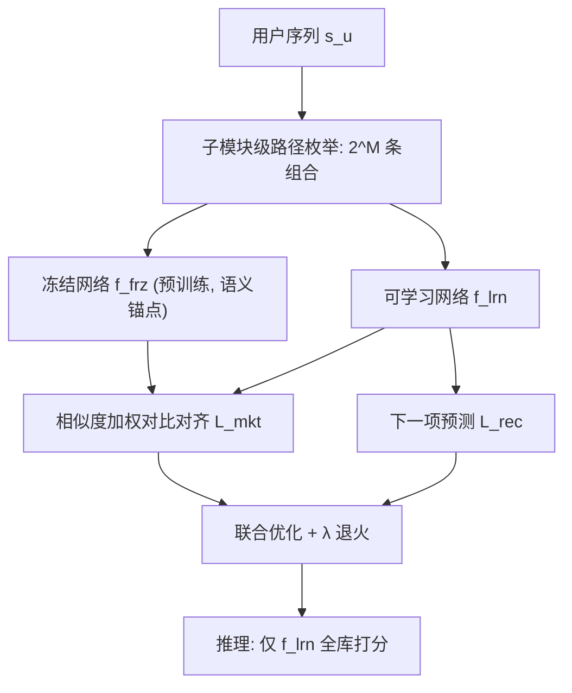

# FLAME: Condensing Ensemble Diversity into a Single Network for Efficient Sequential Recommendation (将集成多样性浓缩进单一网络的高效序列推荐)

- **会议/期刊**: SIGIR 2026 (Full Papers Track)
- **作者与机构**: WooJoo Kim, JunYoung Kim, JaeHyung Lim, SeongJin Choi, SeongKu Kang, HwanJo Yu (POSTECH / Korea University)
- **推荐链路定位**: 召回 (Next-Item 序列召回)
- **研究方向**: 序列与会话推荐 / 自监督对比学习
- **论文原文**: [https://arxiv.org/abs/2604.04038v3](https://arxiv.org/abs/2604.04038v3)
- **开源代码**: [https://github.com/woo-joo/FLAME_SIGIR26](https://github.com/woo-joo/FLAME_SIGIR26)

## TL;DR (1分钟核心速览)

序列推荐中单一网络难以覆盖用户多面行为，而传统集成需并行训练多个网络，带来数倍计算开销与早期互监督噪声导致的训练震荡（收敛慢至 2.94×）。FLAME 仅用两个网络（一个预训练冻结、一个从头学习），将每个网络拆成 $M$个子模块并交叉组合，用$2^M$ 条路径模拟指数级集成多样性；冻结网络作为语义锚点提供稳定引导。推理时只保留可学习网络，零额外开销。在 6 个数据集、Leave-One-Out + Full-Ranking 协议下，NDCG@20 最高相对提升 9.70%，收敛速度最高快 7.69×。

## Background & Motivation (背景与核心矛盾)

- **主流范式**: 序列推荐以 SASRec 类单塔 Transformer 为主；为捕捉多样行为，近期工作（EMKD、DHEN、FamouSRec）并行训练 $N$ 个网络并施加互知识迁移（对比学习 + 蒸馏）。
- **前人局限**: ① **计算低效**——推理需前向全部 $N$ 个网络并聚合，参数量与时延数倍于单网络；② **训练不稳**——随机初始化网络间的互监督在早期是纯噪声，实验中收敛比单网络慢至 2.94×，稀疏数据（Beauty）上尤甚。
- **核心洞察 (Key Insight)**: 作者用 SASRec 做三组对照（Single / Ensemble-Scratch / Ensemble-Guide），发现**预训练并冻结一个网络**后，可学习网络的收敛更快更稳且单模型性能反超 Single——即"冻结教师"能消除互监督噪声；同时，单网络内部不同子模块（Embedding 层 vs. 浅层 vs. 深层）天然编码不同粒度模式，子模块级组合即可制造多样性，无需真的堆网络。
- **本文切入点**: 把"多样性"从**网络级**下移到**子模块级**组合，把"可靠性"交给**冻结锚点**，从而用 2 个网络模拟 $2^M$ 路集成，并把全部能力蒸馏进单个可学习网络。

## Method (核心方法设计)

### 1. 整体框架 (Overall Architecture)

FLAME 构建两个同构 SASRec：预训练后冻结的 $f^{frz}$与从头训练的$f^{lrn}$，各自按$M$个子模块切分（默认$M=2$：Embedding 模块 + 序列编码模块）。训练时，对每条序列在每个子模块阶段独立选择来自冻结或可学习网络，枚举全部$2^M$条路径得到$\{\tilde{h}^p_u\}_{p\in\{frz,lrn\}^M}$；这些表示经**相似度加权对比对齐**拉入统一语义空间，同时可学习网络自身承担下一项预测损失。推理时丢弃冻结网络与所有组合路径，仅用$f^{lrn}$ 打分，开销与单 SASRec 完全一致。

<figure class="paper-figure" markdown="span">
  <figcaption>图4：所提 FLAME 的 (a) 训练和 (b) 推理过程示意图。在 (a) 中，可学习网络通过下一项预测任务进行优化。同时，2𝑀</figcaption>
</figure>

### 2. 关键设计拆解 (Key Designs)

1. **模块化集成 (Modular Ensemble)**：痛点是对比学习类方法在单网络内做增广，视图多样性受限于同一表征空间；异构集成（DHEN/FamouSRec）靠架构差异换多样性，但知识共享受阻、扩展性差。FLAME 定义路径 $p=(p_1,\dots,p_M)\in\{frz,lrn\}^M$，表示由
$$\tilde{h}^p_u=\big(f^{(M)}_{p_M}\circ f^{(M-1)}_{p_{M-1}}\circ\cdots\circ f^{(1)}_{p_1}\big)(s_u)$$
给出。$M=2$ 即得 4 种表示，等价于 4 网络集成的多样性，而参数只增一份冻结副本；t-SNE 显示传统 2 网络集成只形成 2 个簇，模块化集成形成 4 个簇并覆盖了前者完全漏掉的用户行为区域。

2. **引导式互学习 + 相似度加权对齐**：痛点是 $2^M$ 条路径中共享子模块越多的对越相似，若等权做 InfoNCE，损失会被这些"结构近亲"对主导，对齐效率低。FLAME 以同序列不同路径为正、同 batch 其他序列为负，并按批内平均相似度反比加权：
$$w_{p,q}=\frac{\exp(-\text{sim}_{p,q})}{\sum_{\{p',q'\}\subset\mathcal{P}}\exp(-\text{sim}_{p',q'})},\quad \mathcal{L}_{mkt}(u)=\sum_{\{p,q\}\subset\mathcal{P}} w_{p,q}\,\mathcal{L}_{nce}(\tilde{h}^p_u,\tilde{h}^q_u)$$
直觉是"越像越少推"，把梯度预算让给真正互补的路径对；冻结网络则保证被对齐的目标空间本身是可靠的。

3. **训练目标、负采样与推理效率**：总损失 $\mathcal{L}=\sum_u\big(\mathcal{L}_{rec}(u)+\lambda(r)\cdot\mathcal{L}_{mkt}(u)\big)$，其中$\lambda(r)=\lambda_0(\lambda_R/\lambda_0)^{r/R}$指数退火（$\lambda_R=1e{-5}$），早期靠对比引导、后期回归任务本身以防过拟合冻结空间。负样本为 **in-batch 负采样**（对比部分）+ **softmax 全库负样本**（$\mathcal{L}_{rec}$部分），无额外 hard negative 挖掘。推理仅前向$f^{lrn}$，参数量与单 SASRec 相同（Beauty 上 1.67M vs. FamouSRec 2.30M），时延 1.30s vs. 3.29s。

## Experimental Setup & Evaluation Protocol (实验设置与评估协议)

- **数据集与预处理**（全部按 `5-core` 过滤，隐式反馈）：

| 数据集 | #Users | #Items | #Interactions | Avg.SeqLen | 稀疏度 |
| :--- | :---: | :---: | :---: | :---: | :---: |
| Toys | 19,412 | 11,924 | 167,597 | 8.6 | 99.93% |
| Beauty | 22,363 | 12,101 | 198,502 | 8.9 | 99.93% |
| Games | 24,303 | 10,672 | 231,780 | 9.5 | 99.91% |
| Sports | 35,598 | 18,357 | 296,337 | 8.3 | 99.96% |
| Yelp | 29,915 | 21,572 | 345,186 | 11.5 | 99.95% |
| MovieLens 1M | 6,040 | 3,416 | 999,611 | 165.5 | 95.16% |

- **数据划分与防穿越**: `Leave-One-Out`——每用户最后一项作测试、倒数第二项作验证，严格按序列时序，无未来信息泄漏。
- **排名评测协议**: 无偏 `Full-Ranking`（全库未交互物品排序，不做负采样），报告 HR@{5,10,20} 与 NDCG@{5,10,20}。
- **对比基线与超参**: 三组基线——通用序列（GRU4Rec / Caser / SASRec / BERT4Rec / FMLPRec）、对比学习序列（CL4SRec / DuoRec / MCLRec / CT4Rec）、集成式（EMKD 四路 BERT4Rec、DHEN、FamouSRec 四异构架构）。FLAME 用 $L=2$层、2 头、$d=64$、$T=50$、dropout 0.5、$M=2$、Adam lr=1e-3、batch=256、200 epochs、验证 NDCG@20 早停（patience=30）。

## Key Experimental Results (实验关键数据)

### 1. 主实验对比 (Main Results)

受篇幅限制，取 6 个代表性基线 + 3 个核心指标（完整 36 列见原文 Table 2）：

| 数据集 | 指标 | SASRec | BERT4Rec | CL4SRec | DuoRec | EMKD | FamouSRec | **FLAME** | Improv. |
| :--- | :--- | :---: | :---: | :---: | :---: | :---: | :---: | :---: | :---: |
| Toys | HR@20 | 0.0989 | 0.0654 | 0.1268 | 0.1211 | 0.1256 | 0.1226 | **0.1382** | 9.01% |
| Toys | NDCG@20 | 0.0527 | 0.0364 | 0.0660 | 0.0648 | 0.0611 | 0.0647 | **0.0723** | 9.29% |
| Beauty | HR@20 | 0.0966 | 0.0929 | 0.1196 | 0.1180 | 0.1193 | 0.1204 | **0.1311** | 8.62% |
| Beauty | NDCG@20 | 0.0483 | 0.0428 | 0.0598 | 0.0595 | 0.0600 | 0.0605 | **0.0664** | 9.70% |
| Games | HR@20 | 0.1485 | 0.1637 | 0.1886 | 0.1827 | 0.1833 | 0.1894 | **0.2073** | 9.43% |
| Games | NDCG@20 | 0.0671 | 0.0708 | 0.0859 | 0.0845 | 0.0829 | 0.0868 | **0.0950** | 9.43% |
| Sports | HR@20 | 0.0560 | 0.0521 | 0.0721 | 0.0665 | 0.0703 | 0.0736 | **0.0796** | 8.12% |
| Sports | NDCG@20 | 0.0277 | 0.0221 | 0.0347 | 0.0333 | 0.0341 | 0.0359 | **0.0380** | 5.88% |
| Yelp | HR@20 | 0.0688 | 0.0865 | 0.0975 | 0.0924 | 0.0942 | 0.0925 | **0.1036** | 5.33% |
| Yelp | NDCG@20 | 0.0293 | 0.0359 | 0.0412 | 0.0392 | 0.0400 | 0.0400 | **0.0445** | 7.69% |
| ML-1M | HR@20 | 0.2773 | 0.3171 | 0.3307 | 0.3314 | 0.3261 | 0.3410 | **0.3705** | 8.67% |
| ML-1M | NDCG@20 | 0.1260 | 0.1409 | 0.1521 | 0.1534 | 0.1497 | 0.1577 | **0.1714** | 8.67% |

### 2. 消融实验 (Ablation Study)

| 变体 | Beauty HR@20 | Beauty NDCG@20 | ML-1M HR@20 | ML-1M NDCG@20 |
| :--- | :---: | :---: | :---: | :---: |
| (1) FLAME 完整 | **0.1311** | **0.0664** | **0.3705** | **0.1714** |
| (2) w/o modular（退化为传统集成） | 0.1265 | 0.0618 | 0.3549 | 0.1603 |
| (3) w/o guide（双网络均从头训练） | 0.1254 | 0.0618 | 0.3446 | 0.1576 |
| (4) w/o weighting（等权 $\mathcal{L}_{cl}$） | 0.1275 | 0.0645 | 0.3586 | 0.1650 |
| (5) w/o annealing（$\lambda$ 恒定） | 0.1294 | 0.0639 | 0.3575 | 0.1653 |

### 3. 关键实验发现 (Key Findings)

1. **"冻结"比"组合"更关键**：去掉引导（变体 3）在 ML-1M 上 NDCG@20 掉 8.05%（0.1714→0.1576），跌幅甚至略大于去掉模块化（变体 2，-6.48%），说明早期互监督噪声是集成失效的主因，而非多样性不足；这与图 1 中 Ensemble-Scratch 曲线剧烈震荡、Ensemble-Guide 平稳超越 Single 的现象互为印证。
2. **多样性必须"结构化"才有效**：图 5 显示，把对比学习基线的视图数强行加到与 FLAME 相同（4/8/16），性能反而下降；而 FLAME 在 $M$ 从 2 增至 4 时仍提升最多 4.74%，且**不增加任何模型容量**。异构集成 DHEN/FamouSRec 则随视图数线性增本却收益边际化。
3. **效率-精度双赢是真实的**：表 4 中 FLAME 参数量（Beauty 1.67M）与 SASRec-Ensemble 持平，但 NDCG@20 从 0.0513 升至 0.0660；推理时延 1.30s 与单 SASRec 完全相同，比 EMKD（5.52s）低 4.2×、比 FamouSRec（3.29s）低 2.5×；收敛速度比集成基线快 4.55–7.69×。此外 $M>4$后收益递减（图 6），$M=2$ 是性价比拐点。

## Highlights & Limitations (亮点、对比与审稿批判)

- **与代表作对比 (vs. Prior Work)**: 与 **EMKD** 的本质区别是后者需 4 个 BERT4Rec 全程并行且互蒸馏，FLAME 只保留 1 个可训练网络 + 1 个冻结锚点；与 **FamouSRec** 相比，后者靠异构架构（Attention/GRU/MLP/Mamba）制造多样性但知识难共享、扩展性差，FLAME 在同构网络内用子模块路径组合获得更高多样性密度；与 **CL4SRec/DuoRec** 等单网络对比方法相比，FLAME 的多样性来自结构路径而非数据增广，因而视图数增加时不会退化。
- **可迁移亮点**: ① "冻结锚点 + 相似度反比加权对比"可作为通用训练稳定器，迁移到任何需要多视图对齐的召回模型（如多兴趣、多场景共享底层）；② 子模块级路径枚举是一种**零推理成本**的容量扩展手段，适合时延敏感的在线召回。
- **审稿级局限批判**: ① 训练阶段仍需前向 $2^M$条路径（$M=2$时 4 条），训练成本高于单网络，论文只报告了收敛 epoch 数而非总 FLOPs；② 冻结网络需一次完整预训练，超参（$\lambda_0$、$\tau$）虽称鲁棒但仍需按数据集调，且$M$的收益在$M>4$ 后迅速饱和，说明"指数多样性"的实际可用上界有限；③ 全部实验为离线 Full-Ranking，缺少线上 A/B 或工业级时延验证。

## Rating (四维评分)

- **方法创新性 (Novelty)**: ⭐⭐⭐⭐ （核心机制与方法设计具备明确创新性，理论与实验动机支撑充分）
- **评估协议与实验扎实度 (Protocol & Experiments)**: ⭐⭐⭐⭐⭐ （主流公开数据集评测完整，包含多基线对比与消融实验验证）
- **写作与数学规范度 (Clarity & Rigor)**: ⭐⭐⭐⭐⭐ （问题形式化定义清晰，核心模块数学推导与架构阐述严谨易读）
- **工业落地与复现价值 (Industrial & Practical Value)**: ⭐⭐⭐⭐ （兼顾推荐效果增益与训练/推理效率，具备实际场景迁移参考价值）
