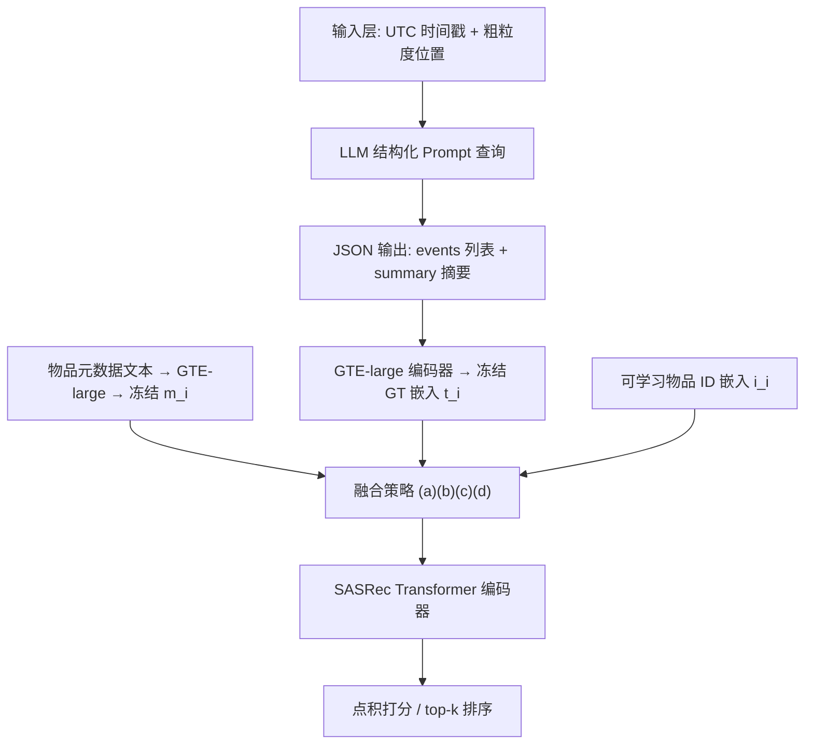
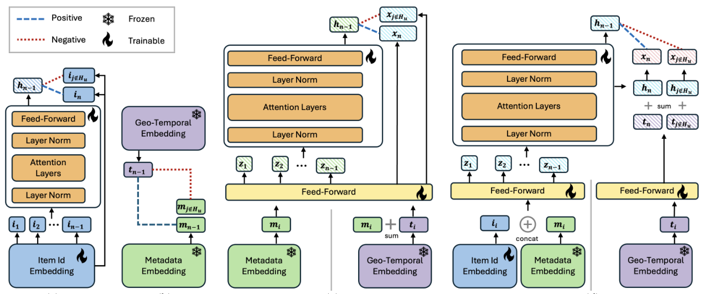
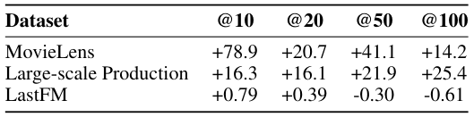

# From Time and Place to Preference: LLM-Driven Geo-Temporal Context in Recommendations (从时间与地点到偏好：LLM 驱动的地理-时间上下文推荐)

- **会议/期刊**: SIGIR 2026（arXiv 预印本 2510.24430v1，2025-10-28）
- **推荐链路定位**: 精排 (Ranking) — 将上下文特征注入 SASRec 式序列编码器用于 next-item 预测
- **研究方向**: 时空轨迹与 POI 本地生活推荐 / 大语言模型推荐 (LLM4Rec)
- **论文原文**: [https://arxiv.org/abs/2510.24430v1](https://arxiv.org/abs/2510.24430v1)
- **开源代码**: 暂未开源（原文声明发布 context-enriched MovieLens 1M 数据集，但正则预提取未发现代码仓库链接）

## TL;DR (核心速览)

针对推荐系统把时间戳仅当作数值/周期特征、忽略节假日与地域文化事件的问题，本文提出用 LLM 从"UTC 时间戳 + 粗粒度位置"生成地理-时间（GT）上下文嵌入，并设计一个轻量"信息量测试"（GT 嵌入与物品元数据做点积排序的 HR@k 是否优于随机）作为上线前诊断。GT 嵌入通过两种方式注入 SASRec：(1) 与元数据嵌入直接融合（M+GT / Id+M+GT），(2) 辅助对比损失对齐语义与 GT 表征。在 MovieLens 1M 与 Comcast 生产数据上，M+GT 在 general 用户上 NDCG@5 相对 SASRec 提升 +21.44%，Id+M+GT 在 explorer 用户上更优；LastFM 无显著增益，作者据此论证需自适应/混合策略。

## Background & Motivation (背景与动机)

- **领域背景与主流范式**: 上下文感知推荐将时间、地点、社交场景作为额外信号。时间编码主要有两条路线：(1) 显式特征建模（小时、星期、节假日 flag 等静态元数据）；(2) 隐式序列建模（用演化中的用户-物品序列捕捉时序动态，如 SASRec）。近年移动/普适计算工作进一步引入天气、用户移动性等动态上下文。
- **现有方法局限 (Limitations of Prior Work)**:
  1. **静态日历/人工规则不可扩展**：现有上下文推荐多依赖硬编码节假日表或领域特定事件清单（如电商换季、流媒体奥斯卡），难以响应实时变化，且跨域泛化差。
  2. **高层语义时间知识缺位**：圣诞节、世界杯、返校季等"一等公民"式语义事件很少被建模为上下文实体，传统推荐系统缺乏世界知识整合能力。
  3. **动态上下文建模工程成本高**：需大量工程投入与人工策划的外部数据，难以在工业级大规模系统中落地。
- **核心挑战 (Key Challenge)**: 为什么简单加时间特征不够？因为用户意图不仅由时间驱动，还受文化、季节、地域差异共同影响——"纽约的冬天"与"佛罗里达的冬天"对同一跨国平台用户意味着完全不同的偏好分布。仅靠用户长历史 + 手工时间特征无法在规模化系统中刻画这种地理-时间耦合语义。
- **核心洞察与切入点 (Key Insight)**: LLM 已编码海量世界知识，可直接从"时间戳 + 粗粒度位置"这类极低成本输入生成语义丰富、实时、领域无关的上下文信号，无需人工特征工程。作者据此提出 LLM 驱动的 GT 上下文富化框架（图 1），并先用一个**轻量诊断测试**验证 GT 嵌入是否含预测信号，再决定是否做完整模型集成——这是一种"先探针、后集成"的务实研究范式。

<figure class="paper-figure" markdown="span">
  <figcaption>图 1</figcaption>
</figure>

## Problem Formulation & Method (问题定义与方法架构)

### 1. 符号定义与输入表征 (Notations & Input Representations)

- 用户集 $\mathcal{U}$、物品集 $\mathcal{I}$；用户 $u$ 的历史序列 $H_u=\{i_1,i_2,\dots,i_{n-1}\}$，预测目标为下一物品 $i_n$。
- 物品 ID 嵌入 $i_i\in\mathbb{R}^{d_i}$（可学习查找表）；物品元数据嵌入 $m_i\in\mathbb{R}^{d}$（由 GTE-large 编码器对 genres/actors/topics 等文本编码，**冻结**）；GT 嵌入 $t_i\in\mathbb{R}^{d}$（由 LLM 生成 JSON 上下文后经 GTE-large 编码，**冻结**）。
- 输入：交互的 UTC 时间戳 + 粗粒度位置（城市/州/国家）；输出：候选物品相关性得分 $s_j$ 或 top-k 排序列表。

### 2. 整体流水线 (Overall Architecture)

数据流：原始交互日志（时间戳+位置）→ 结构化 Prompt 查询 LLM → JSON 输出（`events` 数组 + `summary` 摘要）→ GTE-large 编码为稠密 GT 嵌入 $t_i$ → 与元数据/ID 嵌入按四种方案之一融合 → SASRec Transformer 编码 → 点积打分/排序。

### 3. 核心模块设计与数学原理 (Key Designs & Formulations)

**(1) LLM 驱动的 GT 上下文抽取模块**。给定时间戳与位置构造结构化 Prompt，要求 LLM 返回：(a) 该时间点前短期内该地区发生的真实世界事件列表（节假日、文化庆典、政治事件、体育赛事、娱乐发布、时尚趋势、重要人物、重大社会事件）；(b) 2–3 句自然语言摘要，解释这些事件如何影响用户兴趣。强制 JSON 格式（`events` 数组 + `summary` 字段），解析为机器可读特征。该设计的关键在于**完全绕开静态日历**，把"世界知识"变成可查询的在线服务。

**(2) GT 嵌入信息量测试（轻量诊断）**。令 $t_i\in\mathbb{R}^d$ 为物品 $i$ 的 GT 嵌入，对每个用户从其历史 $H_u$ 中随机采一个物品 $i$，用 $t_i$ 作为用户 GT 表征；候选物品 $j$ 用元数据嵌入 $m_j$。打分：
$$\text{score}(u,j)=t_i^\top m_j$$
按得分降序排序，比较 $\text{HR@}k_{\text{geo-temporal}}>\text{HR@}k_{\text{random}}$。若成立（哪怕小幅），即判定 GT 嵌入含预测信息，可进入完整集成。这是一个**免训练、模型无关**的探针，物理直觉是：若 GT 嵌入真编码了"该时刻该地点的语义情境"，它应与用户当时消费物品的内容语义存在可测对齐。

**(3) 四种集成方案（图 2）**：
- **(a) 基线 SASRec**：$s^+=h_{n-1}^\top i_n$，$s^-=h_{n-1}^\top i_j\ (j\notin H_u)$，排序损失 $\mathcal{L}_{\text{rank}}=-\log\sigma(s^+)-\log\sigma(-s^-)$。
- **(b) 辅助损失对齐**：GT 嵌入 $t_{n-1}$ 与同物品元数据 $m_{n-1}$ 为正对，与用户未交互物品 $m_j$ 为负对：
$$\mathcal{L}_{\text{aux}}=\ell\big(\text{sim}(t_{n-1},m_{n-1}),1\big)+\ell\big(\text{sim}(t_{n-1},m_j),0\big)$$
负样本构造：取交互日期前一个 GT 时间窗内其他用户交互过的物品，过滤目标用户已见物品以避免假阴性，再随机采固定数量。由于 $t$ 与 $m$ 均预计算冻结，该目标**纯在嵌入层定义、模型无关**，可无缝搭配任意序列编码器。
- **(c) 元数据替代 ID**：去掉可学习 ID 表，$h_{n-1}=G(F([m_1,\dots,m_{n-1}]))$，$x_i=F(m_i+t_i)$，$s^+=h_{n-1}^\top x_n$。仅 Transformer 主干可训练，参数与计算极省。
- **(d) ID+元数据拼接 + GT 后置**：$z_i=F_1([i_i\Vert m_i])$，$h_{n-1}=G([z_1,\dots,z_{n-1}])$，$x_i=F_2(t_i)+h_i$。GT 仅在排序损失阶段作为**上下文偏置**加入，避免与 ID/元数据在输入端纠缠——当 GT 因素"调制但不覆盖"ID 嵌入独有的共现模式时更优。

<figure class="paper-figure" markdown="span">
  <figcaption>图 2</figcaption>
</figure>

### 4. 训练目标、负采样与推理复杂度 (Optimization, Negative Sampling & Complexity)

- **损失函数**: 主损失为排序对比损失 $\mathcal{L}_{\text{rank}}=-\log\sigma(s^+)-\log\sigma(-s^-)$；方案 (b) 额外叠加 $\mathcal{L}_{\text{aux}}$（BCE / Cosine / Pairwise Margin Ranking 三种实现，Pairwise 又分 `rand` 与 `sem` 两种负采样）。原文未报告显式温度系数 $\tau$ 与分项权重数值。
- **训练负采样策略**: 排序损失用"用户未交互物品"作负例；辅助损失用**时间窗内其他用户交互、且目标用户未见过的物品**作候选池，再随机采样（`Pairwiserand`），或从与 GT 特征最不相似的物品池中采样（`Pairwisesem`）。作者消融发现：直接取全空间最不相似物品作硬负例会过拟合，从"不相似池"中随机采样更稳定。
- **时间与空间复杂度**: 方案 (c) 去掉 ID 表与额外投影层，仅 Transformer 可训练，per-token 开销可忽略；方案 (d) 保留 ID 表，表达力更强但计算成本更高。GT 嵌入为**离线预计算**（生产环境提前一天生成次日 ground-truth GT 特征与嵌入），在线推理仅需查表 + 点积，无需 Beam Search 或 ANN 索引。原文未报告具体 ms/request 延迟与峰值显存。

## Experimental Setup & Evaluation Protocol (实验设置与评估协议)

- **数据集统计与预处理**: 选用 MovieLens 1M 与 LastFM 1K（二者同时含交互时间戳与位置信息，且时间跨度足够长以捕捉季节性），外加 Comcast 大规模生产数据集（真实用户交互日志）。原文未给出各数据集的 #Users/#Items/#Interactions 精确统计表，下表仅列可确认信息：

| 数据集 (Dataset) | 用户数 (#Users) | 物品数 (#Items) | 交互数 (#Interactions) | 稀疏度/密度 (Sparsity) | 模态/辅助特征说明 |
| :--- | :---: | :---: | :---: | :---: | :--- |
| MovieLens 1M | 原文未报告 | 原文未报告 | 原文未报告 | 原文未报告 | 评分时间戳（非真实观看时间）+ 位置；每用户每电影仅出现一次 |
| LastFM 1K | 原文未报告 | 原文未报告 | 原文未报告 | 原文未报告 | 含时间戳与位置；仅作诊断测试初步验证 |
| Production (Comcast) | 原文未报告 | 原文未报告 | 原文未报告 | 原文未报告 | 真实观看时间戳；可保留/去除重复剧集 |

- **数据划分方式 (Splitting Strategy)**: 构造两类测试集——**general user**（典型历史交互，含 binge watching 等行为）与 **explorer user**（用户仅与过去六个月完全未见过的新物品交互，属冷启动/新物品泛化设定）。生产数据中 general 设定按总观看时长保留重复剧集，explorer 设定训练时去除重复。**注意**：MovieLens 时间戳为评分事件而非真实观看时间，存在评分延迟噪声；且每用户每电影仅出现一次，故所有 MovieLens 用户实质都是 explorer 用户。原文未明确说明训练/验证/测试的具体比例或 LOO 切分细节。
- **排名评测协议 (Ranking Protocol)**: 原文未明确声明是 Full-Ranking 还是 Sampled Ranking；从方法描述看，排序损失使用正负样本对训练，诊断测试对全候选集按点积排序计算 HR@k。**存在评估协议透明度不足的问题**。
- **评价指标与显著性检验**: HR@k 与 NDCG@k（k=1/5/10），general 设定额外报告 item coverage。原文**未报告**多随机种子方差、配对显著性检验（t-test/Wilcoxon/Bootstrap）或 Embedding 维度 $d$ 的具体数值。

## Key Experimental Results (核心实验结果)

### 1. 主实验对比 (Main Results)

**诊断测试（表 1）**：GT 嵌入单独对元数据做点积排序，相对随机排序的 HR@k 提升百分比：

| 数据集 | @10 | @20 | @50 | @100 |
| :--- | :---: | :---: | :---: | :---: |
| MovieLens | +78.9% | +20.7% | +41.1% | +14.2% |
| Large-scale Production | +16.3% | +16.1% | +21.9% | +25.4% |
| LastFM | +0.79% | +0.39% | −0.30% | −0.61% |

MovieLens 与生产数据增益明显，LastFM 增益微小且不一致，说明该域几乎无 GT 信号；后续完整模型集成在 LastFM 上同样无有意义提升，故 LastFM 仅作诊断验证、排除出主结果。

<figure class="paper-figure" markdown="span">
  <figcaption>表 1</figcaption>
</figure>

**完整模型（表 2，general users，生产数据集，相对 SASRec 的百分比提升）**：

| 模型变体 | NDCG@5 | NDCG@10 | HR@1 | HR@5 | HR@10 | Coverage@1 | Coverage@5 | Coverage@10 |
| :--- | :---: | :---: | :---: | :---: | :---: | :---: | :---: | :---: |
| M | 18.02 | 14.52 | 29.31 | 10.46 | 2.83 | 16.12 | 72.15 | 109.02 |
| Id+M | −40.91 | −37.21 | −52.49 | −33.44 | −25.31 | −50.62 | −43.35 | −39.16 |
| Id+M+GT_train | −18.29 | −16.58 | −24.61 | −14.28 | −10.61 | −37.31 | −35.21 | −33.22 |
| Id+M+GT | −2.11 | −1.54 | −2.50 | −1.90 | −0.60 | 1.40 | 2.69 | 1.65 |
| M+GT_train | 19.31 | 15.81 | 28.48 | 13.00 | 5.26 | 19.33 | 67.96 | 112.54 |
| **M+GT** | **21.44** | **17.68** | **32.77** | **13.90** | **5.59** | 14.72 | 60.76 | 105.39 |
| Loss-[BCE] | 0.64 | 0.70 | 2.00 | −0.15 | 0.09 | −3.56 | −4.35 | −5.94 |
| Loss-[Cos] | −1.24 | −1.34 | −1.01 | −1.13 | −1.39 | −15.78 | −20.97 | −21.67 |
| Loss-[Pairwise_rand] | 1.06 | 0.94 | 2.80 | 0.40 | 0.22 | −16.65 | −20.02 | −21.34 |
| Loss-[Pairwise_sem] | 1.54 | 1.43 | 2.44 | 0.94 | 0.84 | −3.25 | −7.52 | −8.14 |

关键结论：general 用户上 **M+GT 最强**（NDCG@5 +21.44%、HR@1 +32.77%），因元数据与 GT 嵌入冻结融合，模型不依赖协同记忆，起到正则化作用、降低方差、缓解过拟合；纯 ID 方案（Id+M）反而大幅劣于 SASRec（−40.91% NDCG@5），说明在该生产场景下 ID 协同信号弱、内容+上下文信号主导。辅助损失方案（Loss-*）增益有限（≤+1.54%），且显著损害覆盖率。

**explorer users（表 3）**：原文正文指出 **Id+M+GT 类模型更优**——这类用户呈高熵、求新、长尾行为，细粒度 item-to-item 线索（如续集链）至关重要，保留 ID 嵌入的 Id+M+GT 表达力更强，尽管计算成本更高。原文未在正文给出表 3 的具体数值（表格在 PDF 中未完整呈现）。

### 2. 消融实验与控制变量分析 (Ablation Study)

- **融合位置消融**：输入端融合（M+GT）vs. 损失阶段融合（Id+M+GT）vs. 辅助损失（Loss-*）。结果显示输入端直接融合在 general 用户上贡献最大；辅助损失单独使用增益微弱。
- **GT 使用时机消融**：`+GT_train`（仅训练用 GT）vs. `+GT`（训练+推理均用 GT）。M+GT_train 已能取得次优结果（NDCG@5 +19.31%），说明即使推理时 GT 嵌入滞后一天（生产环境提前一天生成），仍保留大部分收益。
- **负采样策略消融**：`Pairwise_rand`（从不相似池随机采）优于直接取全空间最不相似物品作硬负例，后者因过拟合极端硬负例而性能下降。
- **控制变量说明**：原文未报告参数量对齐或图拓扑度数匹配的严格消融；方案 (c) 天然去掉了 ID 表，参数量与基线不可直接对齐，这是审稿视角下的一个控制变量缺口。

### 3. 稀疏度/冷启动分桶与超参敏感度 (Sparsity Buckets & Hyperparameters)

- **冷启动/新物品分桶**：general vs. explorer 两类用户设定构成核心分桶分析。general 用户偏好内容+上下文主导的 M+GT；explorer 用户（仅交互全新物品）偏好保留 ID 的 Id+M+GT。这直接支撑了作者"需自适应/混合策略"的核心论点。
- **关键超参数敏感度**：原文未系统报告温度系数、损失权重、编码器层数或嵌入维度的敏感度曲线。
- **线上 A/B 测试结果**：原文仅包含离线实验与生产数据集离线评估，**未报告线上 A/B 测试**（CTR/CVR/GMV/留存等指标均未提及）。

## Highlights, Limitations & Critiques (亮点、局限与审稿级批判)

- **核心亮点与可迁移性**:
  1. **"先诊断、后集成"的研究范式**极具迁移价值：GT 嵌入信息量测试免训练、模型无关，可在任何新域上线前低成本判断上下文信号是否存在（LastFM 的负结果正是该探针价值的反证）。
  2. **LLM 作为在线世界知识服务**：仅需时间戳+粗粒度位置即可生成语义上下文，绕开静态日历与人工特征工程，天然跨域、可实时更新。
  3. **辅助损失模型无关**：由于 $t$ 与 $m$ 均冻结，$\mathcal{L}_{\text{aux}}$ 可无缝挂到任意序列编码器上。
  4. **发布 context-enriched MovieLens 1M 数据集**，对后续时间/事件感知个性化研究有社区价值。
- **局限性与审稿视角批判 (Critical Limitations)**:
  1. **评估协议透明度不足**：未明确 Full-Ranking vs. Sampled Ranking、未给数据集统计量、未报告嵌入维度 $d$、未做显著性检验与多随机种子方差——这在 SIGIR 主会标准下是明显短板。
  2. **MovieLens 时间戳语义错位**：评分时间 ≠ 观看时间，引入评分延迟噪声，且每用户每电影仅一次导致"所有用户实质都是 explorer"，削弱了 general/explorer 对比在 Movie
