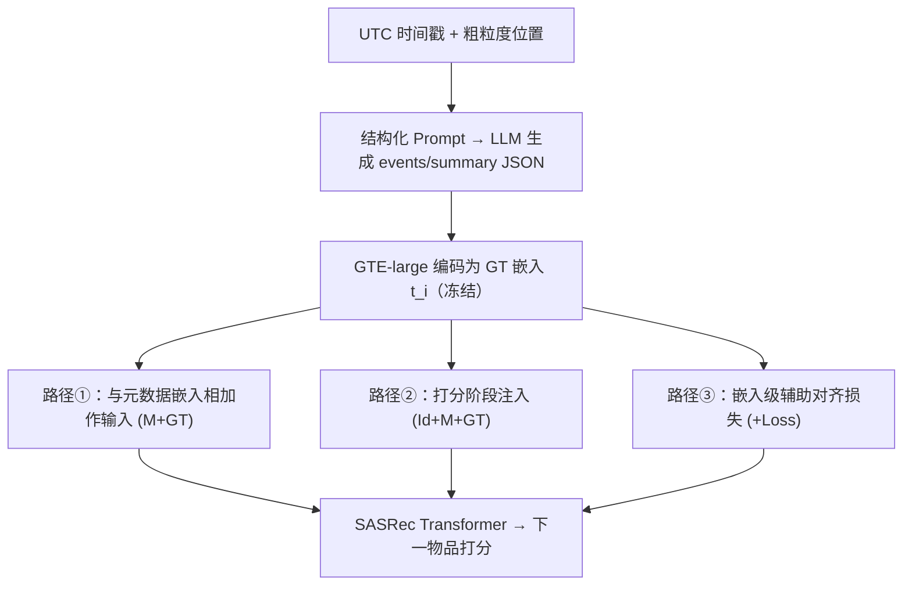
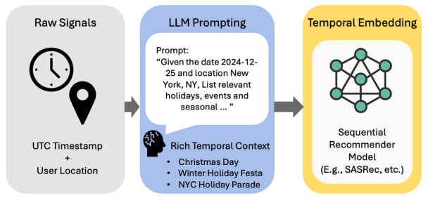

# From Time and Place to Preference: LLM-Driven Geo-Temporal Context in Recommendations (从时间与地点到偏好：LLM 驱动的地理-时间上下文推荐)

- **会议/期刊**: SIGIR 2026
- **作者与机构**: Yejin Kim, Shaghayegh Agah, Neeraj Sharma, Mayur Nankani, Feifei Peng, Maria Peifer, Sardar Hamidian, H. Howie Huang（Comcast Technology AI / George Washington University GraphLab）
- **推荐链路定位**: 精排（序列下一物品预测）
- **研究方向**: 序列与会话推荐 / 大语言模型推荐
- **论文原文**: [https://arxiv.org/abs/2510.24430v1](https://arxiv.org/abs/2510.24430v1)
- **开源代码**: 暂未开源（论文释放了 context-enriched MovieLens 1M 数据集）

## TL;DR (1分钟核心速览)

现有序列推荐把时间戳当作数值/周期特征，丢失了节假日、季节、地域事件等真实世界语义。本文用 LLM 仅凭 UTC 时间戳与粗粒度位置生成结构化地理-时间（GT）上下文，经 GTE-large 编码为稠密嵌入，并以「输入特征融合」或「嵌入级辅助对齐损失」两种方式注入 SASRec。作者还提出一个免训练的信息量诊断测试（GT 嵌入与物品元数据的点积排序 HR@k 是否优于随机），在 MovieLens、LastFM 与 Comcast 生产数据上验证其与全模型集成结论一致。生产数据 general 用户上 M+GT 相对 SASRec 提升 NDCG@5 +21.44%、HR@10 +5.59%，并显著提升覆盖率。

## Background & Motivation (背景与核心矛盾)

- **主流范式**: 上下文感知推荐把时间编码为小时/星期/节假日 flag 等静态元数据，或依赖领域定制的日历与事件列表（电商季节促销、流媒体奥斯卡/格莱美）。
- **前人局限**: ① 手工特征与静态日历难以覆盖跨文化、跨地域的语义事件（如"新英格兰湖畔的家庭剧"这类主题关联），且需大量工程维护；② 动态上下文方法依赖外部策展数据，缺乏跨域通用性，对实时事件响应滞后。
- **核心洞察 (Key Insight)**: LLM 内嵌的世界知识可直接把「时间戳 + 城市/州/国家」翻译成节假日、季节趋势、本地/全球事件的语义描述，无需任何人工特征工程即可规模化生成。
- **本文切入点**: 把 GT 上下文当作一等公民嵌入，并先用一个极轻量的诊断测试判断该数据域是否存在可用的 GT 信号，再决定是否值得做全模型集成。

## Method (核心方法设计)

### 1. 整体框架 (Overall Architecture)

输入为交互的 UTC 时间戳与粗粒度位置，构造结构化 prompt 要求 LLM 返回 JSON（`events` 事件数组 + `summary` 2–3 句自然语言解释），再用冻结的 GTE-large 编码为稠密 GT 嵌入 $t_i$。该嵌入以三种路径进入 SASRec 式 Transformer：与元数据嵌入相加作为输入（M+GT）、与 Id 嵌入拼接后仅在打分阶段注入（Id+M+GT）、或作为嵌入级辅助对比损失与物品元数据对齐（+Loss-*）。训练用标准下一物品对比损失，推理按候选打分排序。

<figure class="paper-figure" markdown="span">
  <figcaption>图1：从时间戳和位置到LLM生成的地理-时间上下文，用于序列推荐。</figcaption>
</figure>

### 2. 关键设计拆解 (Key Designs)

1. **LLM 地理-时间上下文抽取与信息量诊断测试**：痛点在于无法预知某数据域是否含 GT 信号。作者先用免训练的端到端探针：取用户历史中随机一物品的 GT 嵌入 $t_i$作为用户表示，与全库物品元数据嵌入$m_j$做点积排序，若$\mathrm{HR@}k_{\text{geo-temporal}} > \mathrm{HR@}k_{\text{random}}$ 则判定存在预测信号。该测试与后续全模型集成结论高度一致（LastFM 两者均无增益），可作为低成本的"是否值得上模型"前置筛选。

2. **嵌入级辅助对齐损失（模型无关）**：GT 嵌入与元数据嵌入均为预计算冻结向量，故对齐目标纯在嵌入层定义，可无缝挂到任意序列编码器上。正样本为同一物品的 $(t_{n-1}, m_{n-1})$，负样本从「交互日期前一段 GT 窗口内其他用户交互过、且目标用户未见过」的物品池中随机采样（避免假阴性）：
$$\mathcal{L}_{\text{aux}}=\ell\big(\mathrm{sim}(t_{n-1},m_{n-1}),1\big)+\ell\big(\mathrm{sim}(t_{n-1},m_j),0\big),\ j\notin H_u$$
直觉是让 GT 嵌入既语义一致又具判别性；实验发现从"最不相似池"中随机采样比取全局最难负样本更稳，后者易过拟合。

3. **训练目标、负采样与推理效率**：主损失为 SASRec 的对比排序损失 $\mathcal{L}_{\text{rank}}=-\log\sigma(s^+)-\log\sigma(-s^-)$，总损失为$\mathcal{L}_{\text{rank}}+\lambda\mathcal{L}_{\text{aux}}$。M+GT 变体因去掉可训练 Id 表、仅保留 Transformer 主干，参数量与计算开销最小；Id+M+GT 保留 Id 嵌入以捕捉细粒度 item-to-item 转移（续集链），代价更高。生产环境采用离线作业提前一天生成次日 GT 嵌入，即便非实时仍取得次优增益。

## Experimental Setup & Evaluation Protocol (实验设置与评估协议)

- **数据集与预处理**: MovieLens 1M、LastFM 1K（均含时间戳与位置）、Comcast 大规模生产日志。MovieLens 时间戳为评分事件而非观看时间，存在延迟噪声；每部电影每用户仅出现一次，故所有用户实质为 explorer。

| 数据集 | #Users | #Items | #Interactions | 稀疏度/密度 | 特征/场景说明 |
| :--- | :---: | :---: | :---: | :---: | :--- |
| MovieLens 1M | ~6.0K | ~3.7K | ~1.0M | 密度 ~4.5% | 评分时间戳+位置，含类型/演员元数据 |
| LastFM 1K | ~1.0K | — | — | — | 音乐收听，仅作诊断验证 |
| Production | 大规模 | 大规模 | 大规模 | 极稀疏 | 真实观看日志，含剧集重复 |

- **数据划分与防穿越 (Splitting Strategy)**: 构造两类测试集——`general`（常规历史交互，含 binge watching）与 `explorer`（用户仅与过去六个月完全未出现的新物品交互），属冷启动/新物品划分；生产集 general 保留重复剧集、explorer 训练时去重。
- **排名评测协议 (Ranking Protocol)**: 采用 `Sampled Ranking`（正样本 + 未交互负样本打分），指标为 HR@k 与 NDCG@k，general 额外报告 item coverage。
- **对比基线与超参设置**: 基线为 SASRec（Id 嵌入 Transformer），变体 M / Id+M / M+GT / Id+M+GT / +Loss-[BCE/Cos/Pairwise{rand|sem}]；GT 与元数据嵌入均由 GTE-large 冻结编码，仅 Transformer 主干可训练。

## Key Experimental Results (实验关键数据)

### 1. 主实验对比 (Main Results)

生产数据 general 用户（相对 SASRec 的提升 %）：

| 模型变体 | NDCG@5 | NDCG@10 | HR@1 | HR@5 | HR@10 | Coverage@10 |
| :--- | :---: | :---: | :---: | :---: | :---: | :---: |
| M（仅元数据） | 18.02 | 14.52 | 29.31 | 10.46 | 2.83 | 109.02 |
| Id+M | -40.91 | -37.21 | -52.49 | -33.44 | -25.31 | -39.16 |
| Id+M+GT | -2.11 | -1.54 | -2.50 | -1.90 | -0.60 | 1.65 |
| M+GT_train | 19.31 | 15.81 | 28.48 | 13.00 | 5.26 | 112.54 |
| **M+GT** | **21.44** | **17.68** | **32.77** | **13.90** | **5.59** | **105.39** |
| Loss-[Pairwise_sem] | 1.54 | 1.43 | 2.44 | 0.94 | 0.84 | -8.14 |

MovieLens explorer 用户（相对 SASRec 提升 %，绝对基线 NDCG@5=0.0395、HR@10=0.1598）：

| 模型变体 | NDCG@5 | NDCG@10 | HR@1 | HR@5 | HR@10 |
| :--- | :---: | :---: | :---: | :---: | :---: |
| M | 24.30 | 11.27 | 1250.00 | 9.75 | 0.75 |
| Id+M | 12.91 | 7.10 | 375.00 | 8.40 | 3.32 |
| **Id+M+GT_train** | **47.09** | **29.94** | **2337.50** | **21.60** | **12.64** |
| Id+M+GT | 43.29 | 24.07 | 2337.50 | 17.28 | 6.13 |
| M+GT | 31.65 | 17.13 | 1575.00 | 13.70 | 4.13 |
| Loss-[Pairwise_sem] | -2.78 | -6.79 | 50.00 | -5.80 | -9.64 |

诊断测试（HR@k 相对随机提升 %）：MovieLens +78.9/+20.7/+41.1/+14.2（@10/20/50/100），生产集 +16.3/+16.1/+21.9/+25.4，LastFM 仅 +0.79/+0.39/-0.30/-0.61。

### 2. 消融实验 (Ablation Study)

| 消融项 | 关键结论（生产 general / MovieLens explorer） |
| :--- | :--- |
| 去掉 GT（M vs M+GT） | NDCG@5 从 18.02→21.44，GT 是主要增益来源 |
| 去掉 Id 嵌入（Id+M vs M） | 生产集 Id+M 暴跌 -40.91%，Id 表在稀疏生产域严重过拟合 |
| GT 仅训练期注入（GT_train vs GT） | 生产集 GT_train 略逊（19.31 vs 21.44），MovieLens 反而更优（47.09 vs 43.29） |
| 辅助损失类型 | Cos 损失最稳；BCE/Pairwise 在生产集有效但 MovieLens 上监督错位 |

### 3. 关键实验发现 (Key Findings)

1. **数据域决定最优注入路径**：生产 general 用户 M+GT 最优（NDCG@5 +21.44%），而 explorer 用户 Id+M+GT_train 最优（NDCG@5 +47.09%），说明内容+GT 信号主导时冻结融合更抗过拟合，细粒度 item-to-item 需求强时须保留 Id 嵌入。
2. **GT 嵌入在推理期可能是噪声**：MovieLens 因时间戳为评分事件、GT 分布异质，训练期注入而推理期丢弃（Id+M+GT_train）反而优于全程使用（43.29→47.09），与生产集结论相反，证明需按数据时间对齐性自适应选择。
3. **诊断测试可低成本预判收益**：LastFM 诊断仅 +0.79%（@10）且全模型集成同样无增益，MovieLens/生产集诊断显著为正且集成有效，二者结论一致，可作为上线前的免训练筛选器。

## Highlights & Limitations (亮点、对比与审稿批判)

- **与代表作对比 (vs. Prior Work)**: 相比依赖静态日历/策展事件列表的上下文推荐（Mateos & Bellogn 2024）与知识图谱增强（Wang et al. 2018），本文用 LLM 零工程生成跨域语义上下文；相比 LLM4Rec 的指令微调/意图重写（Xu et al. 2025），本文不改造推荐器本身，仅把 LLM 当离线上下文编码器，落地成本低。
- **可迁移亮点**: ① 「嵌入级辅助对齐损失」因两侧向量冻结而模型无关，可直接挂到任意序列/图推荐器；② 「信息量诊断测试」是极低成本的域适配前置探针，可推广到任何新特征（天气、社交）上线前的价值评估。
- **审稿级局限批判**: ① 主实验仅以 SASRec 为骨干，未验证 GRU4Rec/BERT4Rec 等更强序列模型，增益是否可叠加存疑；② 生产集仅离线评估、无 A/B，且 GT 嵌入提前一天生成，实时事件（突发新闻、直播）响应能力未验证；③ 依赖 LLM 生成质量，幻觉与知识过时风险仅定性讨论，缺乏对 prompt 变体与 LLM 选型的敏感性分析。

## Rating (四维评分)

- **方法创新性 (Novelty)**: ⭐⭐⭐ （把 LLM 当免训练地理-时间语义编码器思路实用，但整体是特征工程+辅助损失的组合式创新，理论深度有限）
- **评估协议与实验扎实度 (Protocol & Experiments)**: ⭐⭐⭐ （覆盖 MovieLens/LastFM/生产三域并区分 general/explorer，但仅 Sampled Ranking、单骨干、无显著性检验与线上 A/B）
- **写作与数学规范度 (Clarity & Rigor)**: ⭐⭐⭐⭐ （prompt 模板、四种集成架构与公式定义清晰，诊断测试逻辑自洽，附录给出绝对指标）
- **工业落地与复现价值 (Industrial & Practical Value)**: ⭐⭐⭐⭐ （离线预生成嵌入、模型无关辅助损失、参数高效 M+GT 变体均利于工程部署，且释放增强版 MovieLens 数据集）

