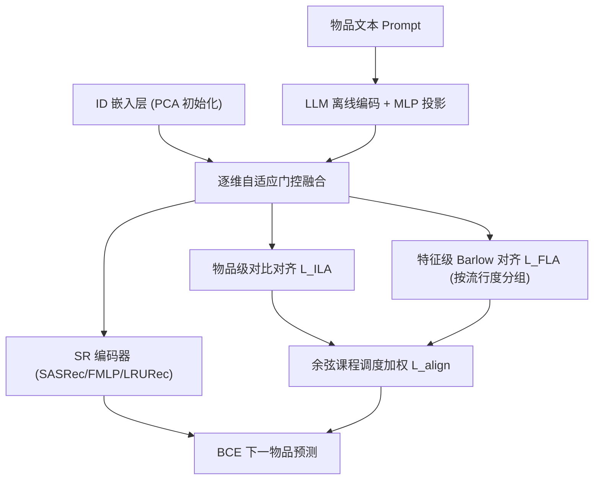

# Fusion and Alignment Enhancement with Large Language Models for Tail-item Sequential Recommendation (面向长尾物品序列推荐的大模型融合与对齐增强)

- **会议/期刊**: SIGIR 2026
- **作者与机构**: Zhifu Wei, Yizhou Dang, Guibing Guo (东北大学), Chuang Zhao (天津大学), Zhu Sun (SUTD)
- **推荐链路定位**: 召回（序列下一物品预测）
- **研究方向**: 序列与会话推荐 / 冷启动与长尾推荐
- **论文原文**: [https://arxiv.org/abs/2604.03688v1](https://arxiv.org/abs/2604.03688v1)
- **开源代码**: [https://github.com/ZhifuWei/FAERec](https://github.com/ZhifuWei/FAERec)

## TL;DR (1分钟核心速览)

序列推荐中大量长尾物品交互稀疏，纯 ID 嵌入无法学到有效转移模式。现有 LLM 增强方法只把语义嵌入当"辅助信号"（初始化或对比迁移），推理时丢弃语义，且忽视 ID 空间（协同结构）与 LLM 空间（语义结构）的维度组织不一致，引入冲突信号。FAERec 提出**逐维自适应门控融合**保留双源信息，并用**物品级对比对齐 + 特征级 Barlow-Twins 对齐**（课程学习调度）消除结构冲突。在 Beauty/Grocery/Yelp 三数据集、6 种骨干上，Leave-One-Out + Full-Ranking 协议下尾物品 H@10 相对最优基线最高提升 427.35%（LRURec 骨干）。

## Background & Motivation (背景与核心矛盾)

- **主流范式**: 序列推荐以 SASRec/FMLP-Rec/LRURec 等 ID 嵌入模型为主，靠交互数据学协同转移模式；长尾侧则用头部物品知识迁移（CITIES/MELT/LOAM）或 LLM 语义增强（LLMInit 初始化、RLMRec 跨视图互信息、LLM-ESR 双视图蒸馏）。
- **前人局限**: ① **语义利用不足**——LLMInit/RLMRec 仅把 LLM 嵌入当训练期辅助信号，最终物品表示中不保留语义，长尾物品仍缺信息；② **空间结构不一致**——ID 空间按协同模式组织维度、LLM 空间按文本语义组织维度，两空间近邻关系错位，强行融合产生冲突梯度。
- **核心洞察 (Key Insight)**: 作者在 Beauty 上统计发现多数物品交互 <5 次且 SASRec 对其 H@10 极低；t-SNE 可视化（图 5）显示 LLM-ESR 的 ID/LLM 嵌入分布严重错位，而 RLMRec-Con 仅靠对比学习只能做到"分布相似"，无法保证维度级结构一致。
- **本文切入点**: 融合要"保留双源"（门控插值而非单向迁移），对齐要"由点到面"（物品级对应 → 特征级相关结构），并用课程学习避免复杂目标过早介入。

## Method (核心方法设计)

### 1. 整体框架 (Overall Architecture)

物品文本经 LLM API（text-embedding-ada-002）离线编码并缓存，经两层 MLP 投影到 $d$维；同时用 PCA 降维后的 LLM 嵌入初始化 ID 嵌入层以缓解优化不平衡。训练时每个物品的 ID 与 LLM 嵌入拼接后过门控网络，输出逐维权重做插值得到融合嵌入$\mathbf{f}_i$，送入任意 SR 编码器（SASRec/FMLP-Rec/LRURec 等）做下一物品预测。辅助分支上，物品级对比对齐与特征级 Barlow-Twins 对齐由余弦课程调度器加权，与 BCE 主损失联合优化。推理时因两空间已对齐，直接等权平均 ID 与 LLM 嵌入，省去门控开销。

### 2. 关键设计拆解 (Key Designs)

1. **逐维自适应门控融合 (AGF)**：痛点是不加区分地拼接/相加会让头部物品的强协同信号淹没长尾语义信号。做法是把 $[\mathbf{e}^{ID}_i \oplus \mathbf{e}^{LLM}_i]$送入两层 MLP 得门控向量$\mathbf{g}_i=\sigma(\mathbf{W}_2(\mathbf{W}_1[\mathbf{e}^{ID}_i\oplus\mathbf{e}^{LLM}_i]+\mathbf{b}_1)+\mathbf{b}_2)\in[0,1]^d$，再逐维插值$\mathbf{f}_i=\mathbf{g}_i\odot\mathbf{e}^{ID}_i+(1-\mathbf{g}_i)\odot\mathbf{e}^{LLM}_i$。直觉：每个维度独立决定"信协同还是信语义"，长尾物品的门控自然向语义侧偏移，头部物品保留协同主导。

2. **双层对齐 (ILA + FLA)**：物品级用 InfoNCE 建立点对点对应，$\mathcal{L}_{ILA}=-\frac{1}{K}\sum_i\log\frac{\exp(\mathrm{sim}(\mathbf{e}^{ID}_i,\mathbf{e}^{LLM}_i)/\tau)}{\sum_j\exp(\mathrm{sim}(\mathbf{e}^{ID}_i,\mathbf{e}^{LLM}_j)/\tau)}$；特征级借鉴 Barlow Twins，先按批内**流行度中位数**把物品切成高/低流行两组（防止头部主导统计量），组内沿 batch 维标准化后算交叉相关矩阵$\mathbf{C}$，损失为$\mathcal{L}_{FLA}=\sum_i(1-\mathbf{C}_{ii})^2+\lambda\sum_{i}\sum_{j\neq i}\mathbf{C}_{ij}^2$——对角项拉齐对应维度、非对角项解耦冗余维度。直觉：ILA 保证"同一物品两视图靠近"，FLA 保证"两空间用相同维度编码相同信息"，后者才是结构一致性的真正来源。

3. **课程学习调度与训练目标**：FLA 是空间结构级复杂目标，早期直接施加会污染 ILA 刚建立的对应关系。权重 $w_i(t)=(w_{\max}-w_{\min})\cdot\frac{1+\cos(2\pi t/T)}{2}+w_{\min}$余弦振荡，总损失$\mathcal{L}=\mathcal{L}_{rec}+\alpha\cdot[w_i(t)\mathcal{L}_{ILA}+(1-w_i(t))\mathcal{L}_{FLA}]$。负采样沿用 SR 常规 BCE 单负样本；LLM 嵌入全离线缓存，在线仅多一次门控 MLP 前向（推理时更可省去），开销可忽略。

## Experimental Setup & Evaluation Protocol (实验设置与评估协议)

- **数据集与预处理**: 过滤交互数 <3 的用户（冷启动用户不在研究范围），最大序列长度 50：

| 数据集 | #Users | #Items | 稀疏度 | 平均序列长 | 场景说明 |
| :--- | :---: | :---: | :---: | :---: | :--- |
| Beauty | 52,204 | 57,289 | 99.99% | 7.56 | Amazon 美妆 |
| Grocery | 32,126 | 39,264 | 99.98% | 8.57 | Amazon 食品杂货 |
| Yelp | 15,720 | 11,383 | 99.89% | 12.23 | 本地商户签到 |

- **数据划分与防穿越**: `Leave-One-Out`（最后一项测试、倒数第二项验证），序列按时间顺序，无未来信息泄漏。
- **排名评测协议**: 无偏 `Full-Ranking`（全物品库排序，非采样），指标 H@K / N@K，$K\in\{5,10,20\}$；长尾按帕累托原则取流行度后 80% 物品为$\mathcal{V}_{tail}$。
- **对比基线与超参**: 传统长尾方法 CITIES/MELT/LOAM + LLM 方法 RLMRec-Con/RLMRec-Gen/LLMInit/LLM-ESR；骨干 SASRec、FMLP-Rec、LRURec（另加 NARM/LightSANs/gMLP 验证泛化）。嵌入维度 $d=128$，batch 256，Adam lr=0.001；$\lambda\in\{0.001,\dots,0.1\}$、$\alpha\in\{0.1,\dots,0.5\}$ 网格调参。

## Key Experimental Results (实验关键数据)

### 1. 主实验对比 (Main Results)

Beauty 数据集（SASRec / LRURec 骨干，Full-Ranking）：

| 方法 | SASRec H@10 | SASRec N@10 | SASRec Tail H@10 | LRURec H@10 | LRURec Tail H@10 |
| :--- | :---: | :---: | :---: | :---: | :---: |
| Base (骨干) | 0.0331 | 0.0180 | 0.0113 | 0.0349 | 0.0108 |
| CITIES | 0.0305 | 0.0159 | 0.0106 | 0.0330 | 0.0101 |
| LOAM | 0.0300 | 0.0158 | 0.0115 | 0.0302 | 0.0110 |
| MELT | 0.0178 | 0.0088 | 0.0001 | 0.0242 | 0.0018 |
| RLMRec-Con | 0.0521 | 0.0287 | 0.0239 | 0.0372 | 0.0117 |
| RLMRec-Gen | 0.0439 | 0.0242 | 0.0122 | 0.0418 | 0.0098 |
| LLMInit | 0.0377 | 0.0200 | 0.0103 | 0.0383 | 0.0096 |
| LLM-ESR | 0.0269 | 0.0140 | 0.0049 | 0.0277 | 0.0045 |
| **FAERec** | **0.0642** | **0.0372** | **0.0633** | **0.0644** | **0.0617** |
| Improv. | +23.22% | +29.62% | +164.85% | +54.07% | +427.35% |

Grocery 上 SASRec 骨干 FAERec 达 H@10 0.0776 / Tail H@10 0.0718（+27.84% / +71.77%）；Yelp 上 LRURec 骨干 Tail H@10 提升 +50.88%。唯一失手处为 FMLP-Rec 骨干的 Yelp 整体指标（-5.19%）。

### 2. 消融实验 (Ablation Study)

Beauty 数据集，H@10 / Tail H@10：

| 变体 | SASRec | FMLP-Rec | LRURec |
| :--- | :---: | :---: | :---: |
| FAERec 完整 | **0.0642 / 0.0633** | **0.0622 / 0.0645** | **0.0644 / 0.0617** |
| w/o AGF | 0.0534 / 0.0359 | 0.0624 / 0.0516 | 0.0561 / 0.0369 |
| w/o ILA | 0.0568 / 0.0473 | 0.0585 / 0.0567 | 0.0519 / 0.0353 |
| w/o FLA | 0.0626 / 0.0603 | 0.0597 / 0.0630 | 0.0632 / 0.0595 |
| w/o CLS | 0.0554 / 0.0436 | 0.0576 / 0.0538 | 0.0529 / 0.0401 |
| w/o PG | 0.0636 / 0.0601 | 0.0618 / 0.0642 | 0.0636 / 0.0583 |
| Base | 0.0331 / 0.0113 | 0.0277 / 0.0066 | 0.0349 / 0.0108 |

### 3. 关键实验发现 (Key Findings)

1. **AGF 是长尾收益的最大来源**：去掉 AGF 后 SASRec 尾物品 H@10 从 0.0633 崩到 0.0359（-43%），说明"推理时保留语义嵌入"而非仅训练期迁移，才是长尾补偿的关键；这也解释了 LLMInit（推理丢弃语义）为何整体垫底。
2. **课程学习不可省，且 FLA 需后置**：w/o CLS 的尾物品 H@10（0.0436）甚至低于 w/o FLA（0.0603），证明过早施加特征级结构约束会破坏 ILA 建立的物品对应关系，验证了"由简到繁"调度的必要性。
3. **长尾与多样性双赢，但头部略有代价**：分组分析（图 4）显示 FAERec 在 1-4、5-9 交互组显著领先 RLMRec-Con，但在 50+ 头部组略逊；同时 Beauty 上 Cov@10 从 0.6972（Base）升至 0.8538、TCov@10 从 0.6266 升至 0.8249，说明语义融合缓解了长尾物品的曝光劣势。

## Highlights & Limitations (亮点、对比与审稿批判)

- **与代表作对比 (vs. Prior Work)**: 相比 LLMInit（语义仅作初始化、训练后丢弃）与 RLMRec（互信息迁移、推理不留语义），FAERec 在推理阶段保留双源信息；相比 LLM-ESR（双视图融合但无空间一致性约束），FAERec 用特征级 Barlow 对齐显式约束维度相关结构，t-SNE 上呈现更一致的两空间分布。
- **可迁移亮点**: ① 流行度中位数分组 + 组内 Barlow 对齐，可推广到任何"头部主导统计量"的跨视图对齐场景；② 推理时等权融合替代门控，是"训练复杂、推理轻量"的实用折衷，适合工业召回部署。
- **审稿级局限批判**: ① 依赖 OpenAI text-embedding-ada-002 闭源 API，语义质量与成本不可控，且未与开源 LLaMA 编码做公平对比；② 特征级对齐需批内流行度统计与分组，对 batch 组成敏感，小 batch 或极端长尾分布下方差可能偏大；③ 头部物品性能略降（Yelp/FMLP-Rec 骨干整体指标为负），长尾-头部权衡未给出显式帕累托控制手段。

## Rating (四维评分)

- **方法创新性 (Novelty)**: ⭐⭐⭐⭐ （门控融合与双层对齐组合扎实，特征级 Barlow 对齐迁移到 ID-LLM 空间一致性属首次，但各组件均为已有技术的巧妙重组）
- **评估协议与实验扎实度 (Protocol & Experiments)**: ⭐⭐⭐⭐⭐ （3 数据集 × 6 骨干 × Full-Ranking 无偏协议，消融覆盖全部模块，另有分组分析、多样性、超参敏感度与 t-SNE 验证）
- **写作与数学规范度 (Clarity & Rigor)**: ⭐⭐⭐⭐ （公式与符号定义清晰、动机图直观，但课程调度的周期 $T$与$w_{\max}/w_{\min}$ 取值未在正文给出）
- **工业落地与复现价值 (Industrial & Practical Value)**: ⭐⭐⭐⭐ （代码开源、LLM 嵌入离线缓存、推理零额外开销，但闭源 API 依赖与门控训练成本需工程评估）

