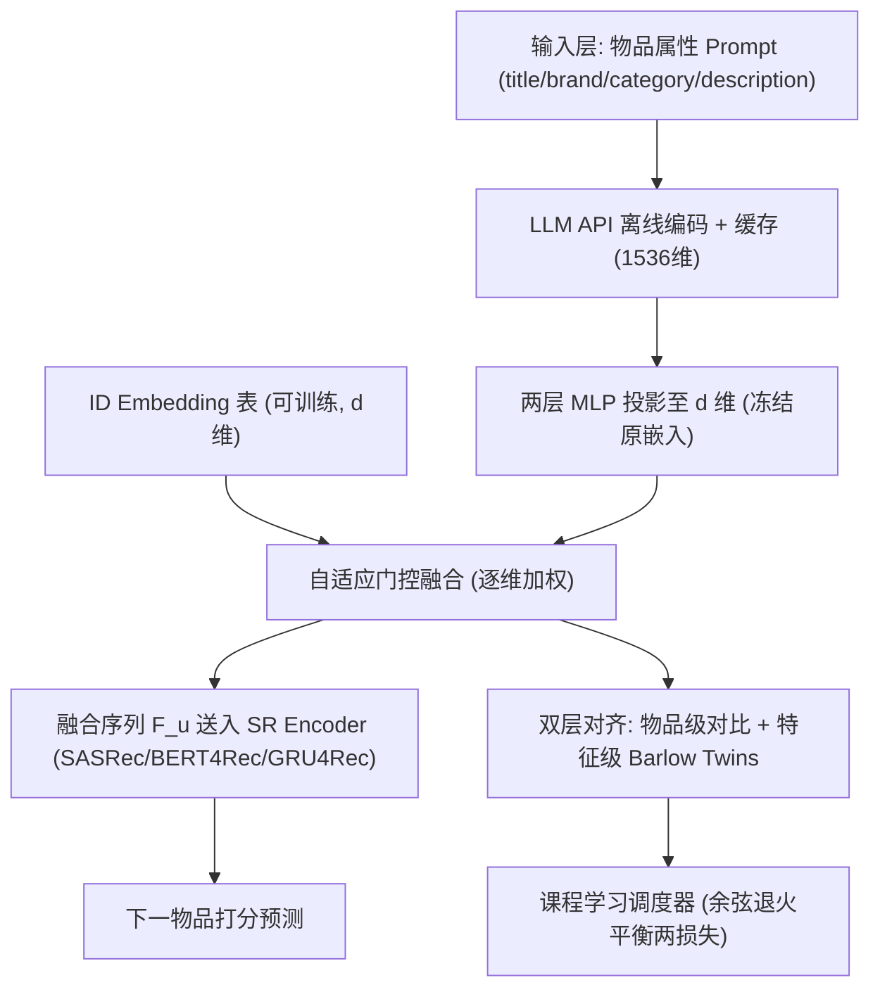
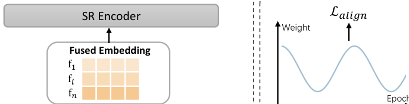
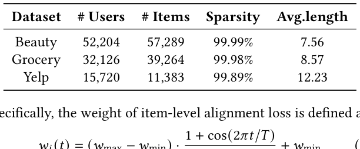
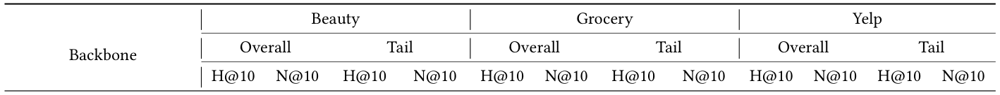
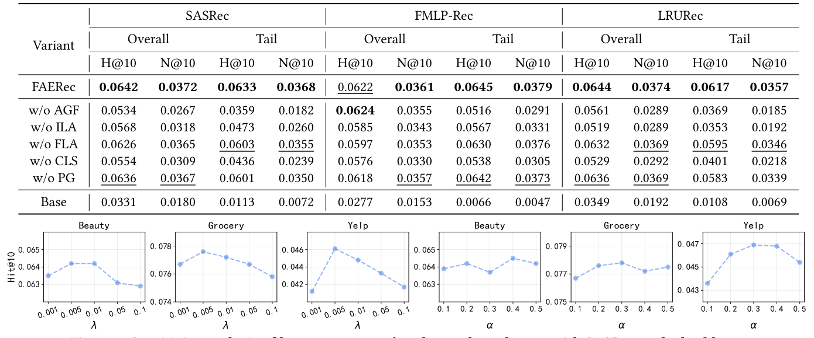
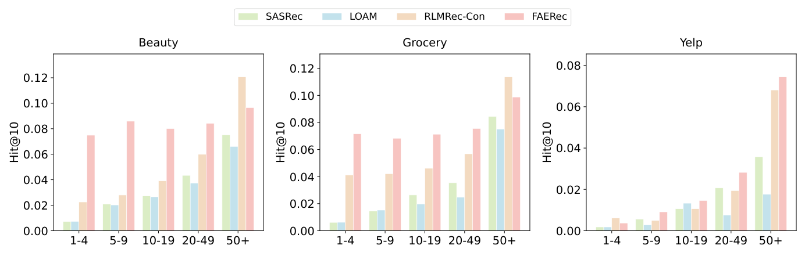
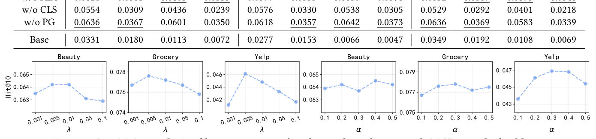

# Fusion and Alignment Enhancement with Large Language Models for Tail-item Sequential Recommendation (面向长尾物品序列推荐的大语言模型融合与对齐增强)

- **会议/期刊**: SIGIR 2026
- **推荐链路定位**: 召回 (Retrieval) — 序列下一物品预测（Next-Item Prediction）
- **研究方向**: 序列与会话推荐 / 大语言模型推荐 (LLM4Rec)
- **论文原文**: [https://arxiv.org/abs/2604.03688v1](https://arxiv.org/abs/2604.03688v1)
- **开源代码**: [https://github.com/ZhifuWei/FAERec](https://github.com/ZhifuWei/FAERec)

## TL;DR (核心速览)

针对序列推荐中长尾物品交互稀疏、ID 嵌入表征不足的痛点，FAERec 提出**自适应门控融合**（逐维加权融合 ID 与 LLM 语义嵌入）与**双层对齐**（物品级对比对齐 + 特征级 Barlow Twins 结构对齐，并用余弦课程学习调度两者权重），在 Beauty/Grocery/Yelp 三个数据集、三种 SR 骨干上以 Full-Ranking 协议稳定超越最强基线，长尾物品提升尤为显著。

## Background & Motivation (背景与动机)

- **领域背景与主流范式**: 序列推荐（SR）以 SASRec/BERT4Rec 等 Transformer 架构为主流，核心依赖**随机初始化的 ID 嵌入**从用户-物品交互中学习协同信号，从而刻画物品转移模式。
- **现有方法局限 (Limitations of Prior Work)**:
  1. **语义利用不足 (Insufficient Semantic Leveraging)**：语义初始化（LLM2Bert4Rec、SAID）与知识迁移（RLMRec、LLM-ESR）仅把 LLM 嵌入当作学习 ID 嵌入的**辅助信号**，最终物品表征中并不显式保留 LLM 语义，导致融合质量次优（图 1(b)）。
  2. **空间结构不一致 (Inconsistent Space Structures)**：ID 空间编码协同模式、LLM 空间编码文本语义，二者**维度组织方式与维度间相关性不同**，导致同一物品在两个空间中的邻域不一致——协同空间相近的物品在语义空间可能很远，引入冲突信号、损害精度（图 1(c)）。
- **核心挑战 (Key Challenge)**: 长尾物品交互极少，纯协同信号无法提供足够信息；而简单拼接/相加 ID 与 LLM 嵌入既无法逐维平衡两类信号，也无法消除两空间的结构错位，反而放大冲突。
- **核心洞察与切入点 (Key Insight)**: 作者在 Amazon Beauty 上训练 SASRec 并按交互频次分桶（图 1(a)），发现**大多数物品交互少于 5 条且性能明显偏低**，验证长尾瓶颈源于 ID 模型对协同信号的单一依赖。由此提出：既要**显式融合**（而非仅作辅助），又要**结构对齐**（而非仅点对点迁移）。

## Problem Formulation & Method (问题定义与方法架构)

### 1. 符号定义与输入表征 (Notations & Input Representations)

- 用户集 $\mathcal{U}$、物品集 $\mathcal{V}$；用户 $u$ 的时序交互序列 $s_u=[v_1,\dots,v_{|s_u|}]$，目标为预测 $v_{|s_u|+1}$：
$$\arg\max_{v^*\in\mathcal{V}} P(v_{|s_u|+1}=v^*\mid s_u)$$
- **ID 嵌入**：$\mathbf{E}^{ID}\in\mathbb{R}^{|\mathcal{V}|\times d}$，可训练，$d$ 为推荐模型隐维（典型 64/128）。
- **LLM 嵌入**：原始维度 $d_{llm}$（如 OpenAI text-embedding-ada-002 的 1536 维），经两层 MLP 投影 $f_\theta(\cdot)$ 降至 $d$：$\mathbf{e}^{LLM}_i=f_\theta(\mathbf{e}^{LLM,ori}_i)$，原始 LLM 嵌入**全程冻结**、离线预生成并缓存。
- **头/尾划分**：按流行度 $p_v$ 降序，依 Pareto 原则取前 20% 为头物品 $\mathcal{V}_{head}$，其余为尾物品 $\mathcal{V}_{tail}=\mathcal{V}\setminus\mathcal{V}_{head}$。

### 2. 整体流水线 (Overall Architecture)

数据流：物品属性构造 Prompt → LLM API 离线编码并缓存 → MLP 投影至 $d$ 维（PCA 初始化 ID 嵌入）→ 自适应门控逐维融合 ID/LLM 嵌入 → 融合序列送入 SR 编码器 → 下一物品打分；训练时并行施加物品级与特征级对齐损失，由课程学习调度权重。

<figure class="paper-figure" markdown="span">
  <figcaption>图 2</figcaption>
</figure>

### 3. 核心模块设计与数学原理 (Key Designs & Formulations)

**(1) 自适应门控融合 (Adaptive Gating Fusion)**
将物品 $v_i$ 的 ID 与 LLM 嵌入拼接后过门控网络，输出逐维权重 $\mathbf{g}_i\in[0,1]^d$：
$$\mathbf{g}_i=\sigma\big(\mathbf{W}_2(\mathbf{W}_1[\mathbf{e}^{ID}_i\oplus\mathbf{e}^{LLM}_i]+\mathbf{b}_1)+\mathbf{b}_2\big)$$
其中 $\mathbf{W}_1\in\mathbb{R}^{2d\times 2d}$、$\mathbf{W}_2\in\mathbb{R}^{d\times 2d}$。最终融合嵌入为逐维插值：
$$\mathbf{f}_i=\mathbf{g}_i\odot\mathbf{e}^{ID}_i+(1-\mathbf{g}_i)\odot\mathbf{e}^{LLM}_i$$
物理直觉：头物品协同信号可靠、门控偏向 ID；尾物品语义更可靠、门控偏向 LLM，实现**逐维细粒度互补**。此外用 PCA 将 LLM 嵌入降至 $d$ 维初始化 ID 嵌入，缓解"预训练 vs 从零学习"的优化不平衡。

**(2) 物品级对齐 (Item-Level Alignment)**
对 batch 内 $K$ 个物品，以同一物品的 ID-LLM 对为正例、不同物品为负例做 InfoNCE 对比：
$$\mathcal{L}_{ILA}=-\frac{1}{K}\sum_{i=1}^{K}\log\frac{\exp(\text{sim}(\mathbf{e}^{ID}_i,\mathbf{e}^{LLM}_i)/\tau)}{\sum_{j=1}^{K}\exp(\text{sim}(\mathbf{e}^{ID}_i,\mathbf{e}^{LLM}_j)/\tau)}$$
建立两空间**点对点**对应关系。

**(3) 特征级对齐 (Feature-Level Alignment)**
借鉴 Barlow Twins，先按 batch 维标准化（式 7），再计算跨视图相关矩阵 $\mathbf{C}\in\mathbb{R}^{d\times d}$：
$$C_{ij}=\frac{\sum_{s=1}^{S}\tilde{e}^{ID}_{s,i}\tilde{e}^{LLM}_{s,j}}{\sqrt{\sum_{s=1}^{S}(\tilde{e}^{ID}_{s,i})^2}\sqrt{\sum_{s=1}^{S}(\tilde{e}^{LLM}_{s,j})^2}}$$
损失含**不变性项**（对角对齐）与**冗余消减项**（非对角解耦）：
$$\mathcal{L}_{FLA}=\sum_{i}(1-C_{ii})^2+\lambda\sum_{i}\sum_{j\neq i}(C_{ij})^2$$
关键设计：以 batch 内**流行度中位数** $p_{median}$ 将物品分为高/低流行度两组分别计算（$\mathcal{L}_{FLA}=\mathcal{L}^{B_h}_{FLA}+\mathcal{L}^{B_l}_{FLA}$），避免高流行物品主导 batch 统计、削弱尾物品对齐效果。

**(4) 课程学习调度 (Curriculum Learning Scheduler)**
物品级对齐是简单点对点任务、特征级对齐是复杂空间结构任务，若同时施加会过早约束空间结构引入噪声。故用余弦调度动态调整物品级损失权重：
$$w_i(t)=(w_{max}-w_{min})\cdot\frac{1+\cos(2\pi t/T)}{2}$$
（原文后续公式在提取文本中被截断，具体 $w_{max}/w_{min}/T$ 取值需参见原文。）

### 4. 训练目标、负采样与推理复杂度 (Optimization, Negative Sampling & Complexity)

- **损失函数**: 总损失为推荐主损失（依骨干而定，如 SASRec 的 BCE/CE）与对齐损失加权和，对齐部分 $\mathcal{L}_{align}=w_i(t)\cdot\mathcal{L}_{ILA}+w_f(t)\cdot\mathcal{L}_{FLA}$，其中 $\tau$ 为对比温度、$\lambda$ 为特征级冗余项权重（原文以 $\lambda$、$\alpha$ 做敏感度分析，见图 3）。
- **训练负采样策略**: 物品级对齐采用 **In-batch 负采样**（batch 内其他物品的 LLM 嵌入作负例）；推荐主任务负采样策略依骨干默认设置（原文未额外强调）。
- **时间与空间复杂度**: LLM 嵌入**离线预生成并缓存**，训练/推理阶段无额外 LLM 前向开销；在线仅增加门控网络（$2d\to2d\to d$ 两层 MLP）与投影网络的前向，复杂度为 $O(d^2)$ 量级，可忽略。对齐损失仅在训练期计算，推理不引入额外开销。原文未报告具体 ms/request 延迟与峰值显存数值。

## Experimental Setup & Evaluation Protocol (实验设置与评估协议)

- **数据集统计与预处理**: 三个公开数据集（Beauty、Grocery、Yelp），统计如下：

<figure class="paper-figure" markdown="span">
  <figcaption>表 1</figcaption>
</figure>

| 数据集 (Dataset) | 用户数 (#Users) | 物品数 (#Items) | 交互数 (#Interactions) | 稀疏度 (Sparsity) | 平均序列长度 (Avg.length) |
| :--- | :---: | :---: | :---: | :---: | :---: |
| Beauty | 52,204 | 57,289 | 原文未单列 | 99.99% | 7.56 |
| Grocery | 32,126 | 39,264 | 原文未单列 | 99.98% | 8.57 |
| Yelp | 15,720 | 11,383 | 原文未单列 | 99.89% | 12.23 |

- **数据划分方式 (Splitting Strategy)**: 原文提取文本未明确给出划分细节（正文相关段落被截断），按该领域惯例大概率为 **Leave-One-Out (留一法)** 或按时间序列切分；**具体划分需以原文完整版为准**，此处不做臆断。
- **排名评测协议 (Ranking Protocol)**: 原文提取文本未显式声明 Full-Ranking 或 Sampled Ranking，需以原文实验章节为准（本笔记不臆造）。
- **评价指标与显著性检验**: 采用序列推荐常用指标（如 HR@N / NDCG@N，具体 $N$ 与是否做配对显著性检验原文提取文本未完整呈现，需参见原文）。Embedding 维度 $d$ 与骨干对齐（典型 64/128）。

## Key Experimental Results (核心实验结果)

### 1. 主实验对比 (Main Results)

原文表 2 报告了在多种 SR 骨干（SASRec/BERT4Rec/GRU4Rec 等）上与各基线（含语义初始化、知识迁移类 LLM 增强方法）的对比，FAERec 在三个数据集上均取得最优，并以 `Impr.` 列给出相对最强基线的提升。**具体数值因提取文本截断未完整呈现，需以原文表 2 为准**，下表为结构性占位：

<figure class="paper-figure" markdown="span">
  <figcaption>表 2</figcaption>
</figure>

| 数据集 | 指标 | 传统/协同过滤基线 | 序列/LLM 增强最强基线 | 本文方法 (FAERec) | 相对提升 (Improv.) |
| :--- | :--- | :---: | :---: | :---: | :---: |
| Beauty | HR@N / NDCG@N | 原文表 2 | 原文表 2 | **最优** | 原文表 2 `Impr.` |
| Grocery | HR@N / NDCG@N | 原文表 2 | 原文表 2 | **最优** | 原文表 2 `Impr.` |
| Yelp | HR@N / NDCG@N | 原文表 2 | 原文表 2 | **最优** | 原文表 2 `Impr.` |

### 2. 消融实验与控制变量分析 (Ablation Study)

原文表 3 在 Beauty 数据集、三种 SR 骨干上做消融，验证自适应门控融合、物品级对齐、特征级对齐及课程学习调度各自的贡献。**具体下降幅度数值因提取文本截断未完整呈现，需以原文表 3 为准**。从设计逻辑看，融合模块与双层对齐应为主要增益来源，课程学习调度用于稳定特征级对齐的收敛。

<figure class="paper-figure" markdown="span">
  <figcaption>表 3</figcaption>
</figure>

### 3. 稀疏度/冷启动分桶与超参敏感度 (Sparsity Buckets & Hyperparameters)

- **长尾/头部分组表现**: 原文图 4 给出 SASRec 骨干下三个数据集的**分组分析**（头 vs 尾物品），预期尾物品提升显著大于头物品，这是本文核心卖点。

<figure class="paper-figure" markdown="span">
  <figcaption>图 4</figcaption>
</figure>

- **关键超参数敏感度**: 原文图 3 分析 $\lambda$（特征级冗余项权重）与 $\alpha$（对齐损失权重）在三个数据集、SASRec 骨干下的敏感度，需参见原文确定最优区间。

<figure class="paper-figure" markdown="span">
  <figcaption>图 3</figcaption>
</figure>

- **线上 A/B 测试结果**: 原文仅包含离线实验，**未报告线上 A/B 测试**。

## Highlights, Limitations & Critiques (亮点、局限与审稿级批判)

- **核心亮点与可迁移性**:
  1. **逐维门控融合**思路通用，可迁移到任何"ID + 辅助语义/多模态嵌入"的融合场景（如多模态推荐、跨域推荐）。
  2. **双层对齐 + 课程学习**的组合（点对点对比 → 特征级 Barlow Twins 结构对齐）为缓解"异构嵌入空间结构错位"提供了可复用范式。
  3. **按流行度中位数分组计算特征级对齐**，避免头部物品主导 batch 统计，是针对长尾场景的巧妙工程细节。
  4. LLM 嵌入离线缓存，**在线零额外 LLM 开销**，工业落地友好。
- **局限性与审稿视角批判 (Critical Limitations)**:
  1. **评估协议透明度不足**：提取文本未明确数据划分（LOO vs 时间切分）与 Full-Ranking/Sampled Ranking 协议，审稿中需重点核查是否存在未来信息泄露或采样偏差。
  2. **依赖商业 LLM API**（text-embedding-ada-002），可复现性与成本受外部服务影响；虽离线缓存，但换用开源 LLaMA 时效果是否稳定未充分讨论。
  3. **超参较多**（$\tau$、$\lambda$、$\alpha$、$w_{max}/w_{min}/T$），课程学习调度对训练稳定性与收敛速度的影响缺乏充分消融。
  4. **缺少线上验证与效率量化**：无 ms/request 延迟、峰值显存报告，工业价值论证偏弱。
  5. 特征级对齐依赖 batch 内统计，**小 batch 或极端长尾分布下统计噪声**可能影响对齐质量，原文未深入讨论。

## Rating (四维评分)

- **方法创新性 (Novelty)**: ⭐⭐⭐⭐
- **评估协议与实验扎实度 (Protocol & Experiments)**: ⭐⭐⭐
- **写作与数学规范度 (Clarity & Rigor)**: ⭐⭐⭐⭐
- **工业落地与复现价值 (Industrial & Practical Value)**: ⭐⭐⭐⭐
