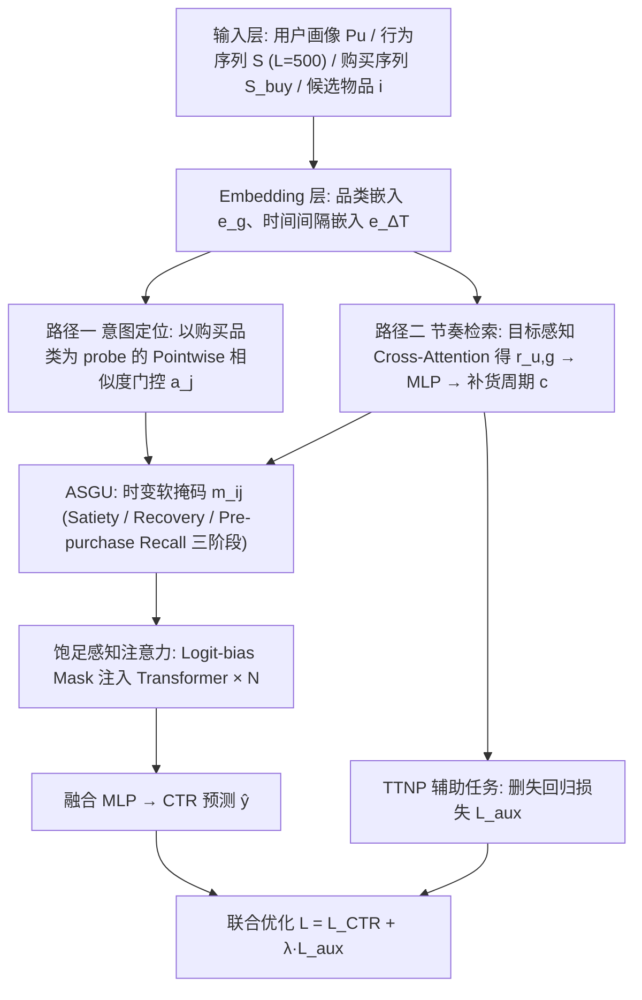
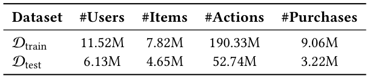
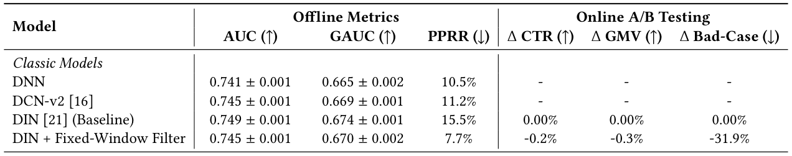
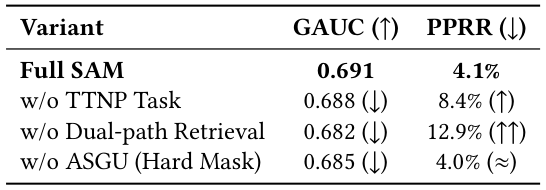

# Learning to Forget: Satiation-Aware Long-Sequence Transducers for Mitigating Post-Purchase Redundancy (学会遗忘：面向购买后冗余缓解的饱足感知长序列转换器)

- **会议/期刊**: SIGIR 2026 (第49届国际ACM SIGIR会议，Melbourne, Australia)
- **推荐链路定位**: 精排 (CTR Prediction / Fine-ranking Stage)
- **研究方向**: 序列与会话推荐 / CTR预估与特征交叉
- **论文原文**: [https://arxiv.org/abs/2607.12714v1](https://arxiv.org/abs/2607.12714v1)
- **开源代码**: [https://github.com/alibaba/TorchEasyRec](https://github.com/alibaba/TorchEasyRec) （注：该仓库为阿里 PAI 团队通用推荐训练框架 TorchEasyRec，论文致谢中说明其支撑了本文的工程实现与大规模训练，并非本文专用代码库）

## TL;DR (核心速览)

本文针对电商精排中"购买即意图终止"却被现有序列模型当作正向偏好累积所导致的**购买后冗余 (post-purchase redundancy)** 问题，提出**饱足感知机制 SAM**：用双路交叉注意力回溯抑制已满足意图簇的历史点击、从长期购买序列检索个性化补货节奏，再由自适应饱足门控 (ASGU) 生成时变软掩码，并以自监督 TTNP 任务学习商品生命周期。在 Tmall 工业日志上 GAUC 达 0.691、PPRR 降至 4.1%（较最强基线降超 60%），线上 A/B 取得 +1.1% CTR、+0.9% GMV、Bad-Case 降 74.5%。

## Background & Motivation (背景与动机)

- **领域背景与主流范式**: 现代推荐/广告系统依赖长行为序列推断用户演化意图，Transformer 式自注意力（SASRec、BERT4Rec）与工业 CTR 模型（DIN、DIEN）成为主流，其共同假设是**所有交互均为正向偏好信号并持续累积**。
- **现有方法局限 (Limitations of Prior Work)**:
  1. **动作-意图不对称 (Action-Intent Asymmetry)**：一次购买往往意味着一个更宽泛意图（表现为购买前的一簇点击）的满足与关闭，但标准自注意力仅把购买当作又一个正向信号聚合，导致已满足意图滞留于用户表征中。
  2. **购买后冗余 (Post-purchase Redundancy)**：转化后系统立即重复推荐同类商品，浪费优质推荐位并损害用户信任。
  3. **饱足动态复杂 (Satiation Dynamics)**：退出并非二值事件——耐用品（冰箱）意味着长期/永久退出，快消品（纸巾）意味着带周期性复活的临时退出；且用户消费风格从"连续囤货"到"一次满足"差异巨大。
  4. **现有后处理方案不足**：MMR、DPP 等重排规则或重复/探索模式的启发式概率在表征学习过程之外运作，缺乏物品级饱足衰减粒度与"提前唤醒 (lead-in)"能力。
- **核心挑战 (Key Challenge)**: 简单的固定窗口过滤会无差别过度抑制（论文中 DIN + Fixed-Window Filter 使 GAUC 降至 0.670、线上 GMV 反降 0.3%），因为不同品类生命周期差异极大；而增加注意力深度只会更强地聚合购买信号，反而加剧冗余。
- **核心洞察与切入点 (Key Insight)**: 作者将购买重新定义为**意图终止 (Interest Exit)** 信号，把"何时遗忘"与"记住什么"置于同等地位；并借鉴连续时间事件建模思想，用**自监督的"距下次购买时间 (TTNP)"** 从原始日志中挖掘补货周期，无需人工标注耐用品/快消品。

## Problem Formulation & Method (问题定义与方法架构)

### 1. 符号定义与输入表征 (Notations & Input Representations)

给定用户 $u$，精排阶段估计候选物品 $i$ 的点击率，输入包括：

- **用户画像** $P_u$：人口统计与长期偏好等静态特征；
- **用户行为序列** $S=\{x_1,\dots,x_L\}$：按时间排序的点击与购买交互，每个 $x_j$ 含物品特征与品类 $g_j$，序列截断长度 $L=500$；
- **用户购买序列** $S_{buy}=\{x^{(p)}_1,\dots,x^{(p)}_H\}$：仅保留购买事件的长周期历史，用于捕捉消费节奏；
- **候选物品** $i$ 及其品类 $g_i$。

目标是学习打分函数 $f(P_u, S, S_{buy}, i)\to \hat{y}$，$\hat{y}\in[0,1]$ 为交互概率；核心诉求是在候选 $i$ 属于用户近期已满足品类时正确识别 $S$ 中的"Interest Exit"事件并抑制 $\hat{y}$。

### 2. 整体流水线 (Overall Architecture)

SAM 采用多塔融合架构：输入层分别编码用户画像、行为序列、购买序列与候选物品；双路兴趣建模模块（意图定位 + 节奏检索）共享投影矩阵 $W_Q, W_K$；ASGU 生成饱足掩码注入 Transformer 注意力层；最终经融合 MLP 输出 CTR 预测，并与 TTNP 辅助任务联合优化。

<figure class="paper-figure" markdown="span">
  <figcaption>图 1</figcaption>
</figure>

### 3. 核心模块设计与数学原理 (Key Designs & Formulations)

**（1）意图定位与回溯抑制 (Retroactive Suppression)**：以购买品类嵌入 $e_{g_{buy}}$ 为 probe query，对历史节点品类嵌入 $e_{g_j}$ 计算逐点相似度门控：

$$a_j = \sigma\!\left(\frac{(W_Q e_{g_{buy}})^\top (W_K e_{g_j})}{\sqrt{d}}\right)$$

关键设计在于用 **Sigmoid 逐点门控而非 Softmax**：Softmax 在 $L=500$ 的长序列上会稀释权重，而逐点形式使同一意图簇内所有节点（含购买前的浏览点击）都能维持接近 1.0 的抑制强度，与序列长度无关——这正是解决"购买代表一簇点击"的动作-意图不对称的关键。

**（2）个性化节奏检索 (Personalized Rhythm Retrieval)**：在长期购买序列 $S_{buy}=\{(e_{g_k}, e_{\Delta T_k})\}_{k=1}^H$ 上做目标感知交叉注意力：

$$r_{u,g}=\sum_{k=1}^{H}\beta_k\cdot(W_V e_{\Delta T_k}),\quad \beta_k=\text{Softmax}_k\!\left(\frac{(W_Q e_{g_{buy}})^\top(W_K e_{g_k})}{\sqrt{d}}\right)$$

$r_{u,g}$ 为历史消费节奏的加权和，经 MLP 解码为正值标量 $c=\text{Softplus}(\text{MLP}(r_{u,g}))$，即预测的补货周期（天）。两路共享 $W_Q, W_K$ 以保证统一语义空间与参数效率。

**（3）自适应饱足门控单元 ASGU**：生成调制历史节点的掩码 $m_{ij}$，设计为购买后立即最深、随接近预测周期 $c$ 逐渐释放：

$$m_{ij}=1-a_j\cdot\sigma\!\left(k\cdot\left(\alpha-\frac{\Delta t_{ij}}{c}\right)\right)$$

其中 $\Delta t_{ij}$ 为距购买经过的时间，$k$ 为可学习陡峭因子，$\alpha\in(0,1]$ 为 **Lead-in Offset**（如 0.8）。三阶段物理直觉：
- **Satiety Phase**（$\Delta t_{ij}\to 0$）：$\phi\approx\alpha$ 保持高位，同品类（$a_j\approx1$）节点被有效掩蔽（$m_{ij}\to0$）；
- **Recovery Phase**（$\Delta t_{ij}\to\alpha c$）：$\phi\to0.5$，掩码渐隐；
- **Pre-purchase Recall**（$\Delta t_{ij}>\alpha c$）：$\phi\to0$，$m_{ij}\to1$，在预测周期结束前提前重新激活历史兴趣，捕捉补货前的早期浏览。

**（4）饱足感知注意力 (Satiation-aware Attention)**：为数值稳定，以 Logit-bias 形式注入门控信号：

$$\ell_{ij}=\frac{q_i^\top k_j}{\sqrt{d}}+\log\big(\text{clip}(m_{ij},\epsilon,1)\big)$$

保证 $m_{ij}\to0$ 时对应注意力权重 $\alpha_{ij}\to0$。

### 4. 训练目标、负采样与推理复杂度 (Optimization, Negative Sampling & Complexity)

- **损失函数**: 联合优化 $\mathcal{L}=\mathcal{L}_{CTR}+\lambda\mathcal{L}_{aux}$。其中 $\mathcal{L}_{CTR}$ 为交叉熵（CTR Loss，见架构图）；TTNP 辅助任务采用**删失回归损失**：

$$\mathcal{L}_{aux}=\sum\left|\log(c+1)-\log(\Delta t+1)\right|^2$$

其中 $\Delta t=t_{k+1}-t_k$ 为同品类相邻两次购买的时间间隔。对右删失情形（观测窗口内仅购买一次），用平台该品类全局平均复购周期 $\bar{c}_g$ 插补：$\Delta t=\max(T_{end}-t_k,\ \bar{c}_g)$，使模型对稀疏长周期耐用品也能学到稳健下界。
- **训练负采样策略**: 原文未报告显式负采样方案（精排 CTR 场景通常以曝光未点击为负样本，论文未明确说明），**原文未报告**。
- **时间与空间复杂度**: 原文未报告离线预处理耗时、单 Epoch 训练耗时、在线推理延迟 (ms/request) 与峰值显存。定性而言，双路共享 $W_Q,W_K$ 降低参数开销；ASGU 为逐点门控，避免 Softmax 长序列计算瓶颈；在线推理无需 Beam Search 或 ANN 检索，仅增加一次节奏检索与掩码生成的前向开销。具体数值**原文未报告**。

## Experimental Setup & Evaluation Protocol (实验设置与评估协议)

- **数据集统计与预处理**: 采集 Tmall 电商平台 2025/06/07–2025/11/07 的线上服务日志构建数据集 $\mathcal{D}$，过滤交互数 $\ge 20$ 的活跃用户，序列截断长度 $L=500$。

<figure class="paper-figure" markdown="span">
  <figcaption>表 2</figcaption>
</figure>

| 数据集 (Dataset) | 用户数 (#Users) | 物品数 (#Items) | 交互数 (#Actions) | 购买数 (#Purchases) | 模态/辅助特征说明 |
| :--- | :---: | :---: | :---: | :---: | :--- |
| $\mathcal{D}_{train}$ | 11.52M | 7.82M | 190.33M | 9.06M | 用户画像、品类 ID、时间间隔 |
| $\mathcal{D}_{test}$ | 6.13M | 4.65M | 52.74M | 3.22M | 同上 |

- **数据划分方式 (Splitting Strategy)**: **全局时间戳切分 (Global Temporal Split)**——前 5 个月为训练集 $\mathcal{D}_{train}$，最后 1 个月为测试集 $\mathcal{D}_{test}$，明确用于防止数据穿越 (data leakage)。
- **排名评测协议 (Ranking Protocol)**: 精排 CTR 场景，采用 **AUC / GAUC** 评估排序能力（GAUC 为工业界更贴近线上表现的指标），未采用全库排序或采样负例排序的召回式协议；冗余控制采用 **PPRR**（推荐物品与用户最近购买物品同叶子品类的曝光占比，在基于既有复购周期查找表的品类特定时间窗内计算）与线上 **Bad-Case Ratio**（用户显式负反馈中"已购买"原因占比）。
- **评价指标与显著性检验**: AUC、GAUC、PPRR、线上 ΔCTR、ΔGMV、ΔBad-Case。离线实验在 $\mathcal{D}_{test}$ 上重复 **5 次**，报告 Mean ± Std，并以 $*$ 标注 $p<0.05$ 的显著性；线上 A/B 遵循标准协议，模型服务 **1% 真实流量**。Embedding 维度 $d$ 原文未明确报告具体数值。

## Key Experimental Results (核心实验结果)

### 1. 主实验对比 (Main Results)

<figure class="paper-figure" markdown="span">
  <figcaption>表 1</figcaption>
</figure>

| 数据集 | 指标 | DIN (Baseline) | 最强序列/生成式基线 (OneTrans) | 本文方法 SAM | 相对提升 (Improv.) |
| :--- | :--- | :---: | :---: | :---: | :---: |
| $\mathcal{D}_{test}$ | AUC | 0.749±0.001 | 0.762±0.001 | **0.763\*±0.001** | +0.13% |
| $\mathcal{D}_{test}$ | GAUC | 0.674±0.001 | 0.689±0.001 | **0.691\*±0.001** | +0.29% |
| $\mathcal{D}_{test}$ | PPRR (↓) | 15.5% | 15.8% | **4.1%** | 相对最强基线降约 74%（较 DIN 降超 60%） |
| 线上 A/B | ΔCTR (↑) | 0.00% | +1.1% | **+1.1%** | 与 OneTrans 持平 |
| 线上 A/B | ΔGMV (↑) | 0.00% | +0.6% | **+0.9%** | 优于 OneTrans |
| 线上 A/B | ΔBad-Case (↓) | 0.00% | +10.2%（恶化） | **-74.5%** | 大幅改善 |

补充观察：传统 DNN/DCN-v2 GAUC 有限（0.665/0.669）；DIN 因显式关注已购物品在候选相似时反而加剧冗余（PPRR 15.5%）；MTGR、OneTrans 等 SOTA 序列模型 GAUC 最高但 PPRR 同样高（16.1%/15.8%），印证其将购买后信号当作"强正向反馈"。SAM 在 AUC/GAUC 上与 OneTrans 持平或略优，同时 PPRR 大幅下降。此外，SAM 学到的周期具有物理可解释性：耐用品（冰箱）平均饱足周期超 300 天，快消品（纸巾）约 15–30 天。

### 2. 消融实验与控制变量分析 (Ablation Study)

<figure class="paper-figure" markdown="span">
  <figcaption>表 3</figcaption>
</figure>

| 变体 | GAUC (↑) | PPRR (↓) |
| :--- | :---: | :---: |
| Full SAM | **0.691** | **4.1%** |
| w/o TTNP Task | 0.688 (↓) | 8.4% (↑) |
| w/o Dual-path Retrieval | 0.682 (↓) | 12.9% (↑↑) |
| w/o ASGU (Hard Mask) | 0.685 (↓) | 4.0% (≈) |

贡献排序为 **Dual-path Retrieval > TTNP > ASGU Gating**：移除节奏检索使 GAUC 略降但 PPRR 急剧上升（4.1%→12.9%），说明历史购买节奏是判断"何时停止"的首要信号；去掉 TTNP 后模型无法区分冰箱与纸巾的差异化饱足周期，GAUC 次优；将 ASGU 换成硬掩码虽维持低冗余（4.0%），但误抑制了补货前浏览等"lead-in"兴趣，GAUC 下降。原文未报告参数量对齐或图拓扑度数匹配等控制变量消融。

### 3. 稀疏度/冷启动分桶与超参敏感度 (Sparsity Buckets & Hyperparameters)

- **用户/物品交互频次分桶表现**: 原文未报告长尾物品或冷启动用户的分桶实验。
- **关键超参数敏感度**: 原文未报告 $\lambda$、$\alpha$（Lead-in Offset）、$k$（陡峭因子）或序列长度 $L$ 的敏感度分析；仅给出 $\alpha$ 的示例取值 0.8。
- **线上 A/B 测试结果**: 在 Tmall 线上 1% 流量部署，相对已部署基线 DIN：**ΔCTR +1.1%、ΔGMV +0.9%、ΔBad-Case -74.5%**；对照的 DIN + Fixed-Window Filter 因无差别过度抑制导致 ΔCTR -0.2%、ΔGMV -0.3%（Bad-Case 虽降 31.9% 但业务受损），凸显自适应门控的必要性。

## Highlights, Limitations & Critiques (亮点、局限与审稿级批判)

- **核心亮点与可迁移性**:
  1. **"购买即意图终止"的范式转换**具有强普适性，可迁移至订阅续费、内容消费（看完一部剧后抑制同类推荐）、广告转化后抑制等场景。
  2. **Pointwise Sigmoid 门控替代 Softmax** 解决长序列权重稀释，是长序列注意力建模的通用技巧。
  3. **TTNP 自监督删失回归**无需人工标注商品生命周期，且用全局平均周期插补右删失样本，思路可迁移至任何"事件间隔预测"辅助任务。
  4. **ASGU 的 Lead-in 机制**在抑制冗余与召回补货需求间取得平衡，避免硬过滤的业务损伤，工程价值高。
- **局限性与审稿视角批判 (Critical Limitations)**:
  1. **评估协议局限**：仅使用单一工业数据集（Tmall 内部日志），无公开基准（如 Amazon、Taobao 公开集）对比，外部可复现性存疑；且为 5 页短文，实验规模受限。
  2. **基线公平性**：SAM 与 OneTrans 在 AUC/GAUC 上"统计持平"，主要收益集中在 PPRR 与业务指标，方法创新性更多体现为业务洞察而非架构突破。
  3. **超参与实现细节缺失**：$d$、$\lambda$、$\alpha$、$k$ 的取值与敏感度、负采样策略、训练/推理耗时与显存均未报告，削弱可复现性。
  4. **TTNP 删失插补的偏差风险**：用平台全局平均周期 $\bar{c}_g$ 插补单次购买样本，可能对长周期耐用品引入系统性偏差，原文未做敏感性分析。
  5. **线上实验周期与流量**：仅 1% 流量、未报告实验持续时长与置信区间，长期留存/LTV 影响未知。
  6. **代码可用性**：提供的 TorchEasyRec 为通用框架而非本文专用实现，SAM 模块的复现需自行实现。

## Rating (四维评分)

- **方法创新性 (Novelty)**: ⭐⭐⭐⭐ （"学习遗忘"视角与 TTNP 自监督周期学习有洞察力，但组件多为已有技术的组合）
- **评估协议与实验扎实度 (Protocol & Experiments)**: ⭐⭐⭐ （时间切分防泄露、5 次重复+显著性、线上 A/B 完整，但仅单数据集、缺公开基准与超参分析）
- **写作与数学规范度 (Clarity & Rigor)**: ⭐⭐⭐⭐ （三阶段门控的物理直觉阐述清晰，公式完整；部分符号与实现细节略简）
- **工业落地与复现价值 (Industrial & Practical Value)**: ⭐⭐⭐⭐⭐ （阿里 Tmall 线上验证，CTR/GMV/Bad-Case 全面收益，端到端可插拔于现有精排链路）
