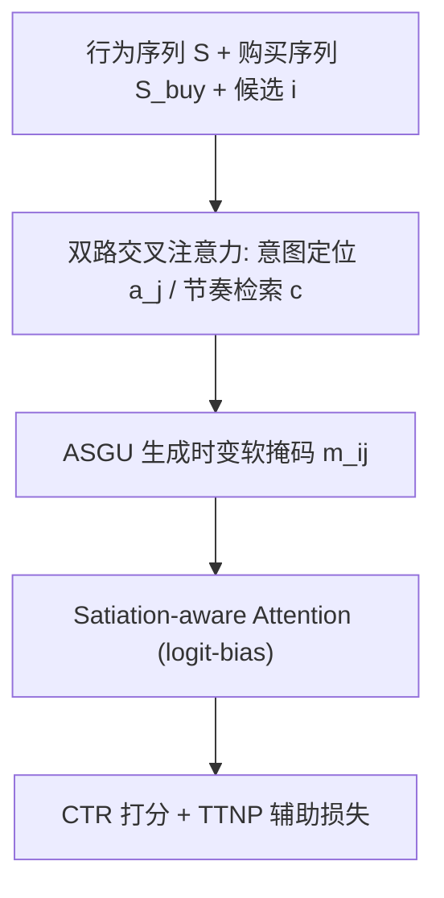
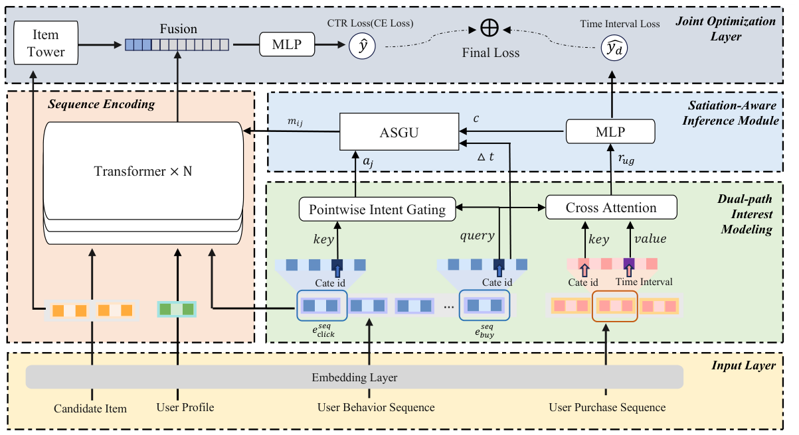

# Learning to Forget: Satiation-Aware Long-Sequence Transducers for Mitigating Post-Purchase Redundancy (学会遗忘：缓解购后冗余的饱食感知长序列转换器)

- **会议/期刊**: SIGIR 2026 (Industry Track)
- **作者与机构**: Yipin Dai, Ruocong Tang, Xing Fang, Yang Huang, Jing Wang, Zhentao Song, He Guo（阿里巴巴集团）
- **推荐链路定位**: 精排 (CTR 预估)
- **研究方向**: 序列与会话推荐 / CTR 预估与特征交叉
- **论文原文**: [https://arxiv.org/abs/2607.12714v1](https://arxiv.org/abs/2607.12714v1)
- **开源代码**: [https://github.com/alibaba/TorchEasyRec](https://github.com/alibaba/TorchEasyRec)（基于 TorchEasyRec 工程实现）

## TL;DR (1分钟核心速览)

电商序列推荐把每次点击/购买都当作正向偏好累积，但购买实际是某簇意图的**终止**（Interest Exit），导致购后反复推荐同类商品（购后冗余）。本文提出 SAM：用购买品类作探针**回溯抑制**同簇历史点击，从长期购买序列检索个性化复购节奏，经自适应饱食门控（ASGU）生成时变软掩码注入注意力 logit，并以 TTNP 自监督任务学习商品生命周期。在天猫工业日志（时间切分、AUC/GAUC/PPRR 评估）上 PPRR 从 15.5% 降至 4.1%（降幅超 60%），线上 A/B 的 CTR +1.1%、GMV +0.9%、Bad-Case 降 74.5%。

## Background & Motivation (背景与核心矛盾)

- **主流范式**: SASRec/BERT4Rec 式自注意力与 DIN/DIEN 式候选感知注意力，统一将历史交互视为正向偏好信号进行聚合强化。
- **前人局限**: ① 购买被当作"又一个正样本"，已满足意图持续滞留于用户表征，购后立即重复曝光同类商品；② 现有缓解手段（MMR/DPP 后置重排、重复-探索启发式概率、固定窗口过滤）在表征学习之外运作，无法建模**物品级饱食衰减**与复购前的"提前唤醒"效应。
- **核心洞察 (Key Insight)**: 单次购买动作对应一簇前置点击构成的完整意图（Action-Intent Asymmetry）；且"退出"非二值事件——耐用品（冰箱）近乎永久退出，快消品（纸巾）为周期性临时退出，退出强度应由**个性化复购周期**连续调制。
- **本文切入点**: 把"何时遗忘"作为可学习表征的一部分，用购买事件反向定位并抑制意图簇，用预测周期控制抑制的释放节奏。

## Method (核心方法设计)

### 1. 整体框架 (Overall Architecture)

输入为用户画像 $P_u$、行为序列$S$（长 500，含点击与购买）、纯购买序列$S_{buy}$与候选物品$i$。双路交叉注意力共享$W_Q,W_K$：一路以购买品类嵌入为 query 做逐点意图定位，一路从$S_{buy}$检索复购节奏并解码出周期$c$；ASGU 依据$c$与购买后经过时间生成软掩码，以 logit-bias 形式注入 Transformer 注意力，抑制已满足意图并在周期临近时逐步唤醒；TTNP 辅助任务用真实复购间隔监督$c$，与 CTR 交叉熵联合优化。

<figure class="paper-figure" markdown="span">
  <figcaption>图1：饱食感知机制（SAM）的整体架构。</figcaption>
</figure>

### 2. 关键设计拆解 (Key Designs)

1. **逐点意图定位（Retroactive Suppression）**：Softmax 在 $L=500$长序列上会稀释抑制权重，故改用 Sigmoid 逐点相似度门$a_j=\sigma\big((W_Q e_{g_{buy}})^\top (W_K e_{g_j})/\sqrt{d}\big)$，以购买品类嵌入为探针，使同簇历史节点无论序列多长都保持接近 1.0 的抑制强度——物理直觉是"购买是对整簇浏览的结算凭证"。
2. **节奏检索与 ASGU 时变掩码**：对 $S_{buy}$中历史间隔嵌入做 target-aware 注意力得$r_{u,g}$，经 Softplus MLP 解码为正周期$c$；掩码$m_{ij}=1-a_j\cdot\sigma\big(k\cdot(\alpha-\Delta t_{ij}/c)\big)$，其中$\alpha$为 lead-in 偏移（如 0.8）、$k$为可学陡度。购后$\Delta t\to 0$时$m\to 1-a_j$（同类近乎全掩），$\Delta t\to\alpha c$时掩码消退，$\Delta t>\alpha c$时$m\to 1$ 恢复——实现"抑制—提前唤醒—复购召回"三段式节奏。
3. **TTNP 自监督与训练目标**：以同品类相邻购买间隔 $\Delta t$监督周期，损失$\mathcal{L}_{aux}=\sum|\log(c+1)-\log(\Delta t+1)|^2$；对右删失样本（窗口内仅一次购买）用平台品类全局均值$\bar{c}_g$插补$\Delta t=\max(T_{end}-t_k,\bar{c}_g)$，保证耐用品学到稳健下界。总损失$\mathcal{L}=\mathcal{L}_{CTR}+\lambda\mathcal{L}_{aux}$；掩码以$\log(\mathrm{clip}(m_{ij},\epsilon,1))$ 加到注意力 logit 上保证数值稳定，无需额外负采样，推理仅增一次轻量交叉注意力与 MLP。

## Experimental Setup & Evaluation Protocol (实验设置与评估协议)

- **数据集与预处理**: 天猫 2025/06/07–2025/11/07 线上日志采样，过滤交互 ≥20 的活跃用户，序列截断至 $L=500$：

| 数据集 | #Users | #Items | #Actions | #Purchases | 特征/场景说明 |
| :--- | :---: | :---: | :---: | :---: | :--- |
| $\mathcal{D}_{train}$ | 11.52M | 7.82M | 190.33M | 9.06M | 前 5 个月，电商点击+购买 |
| $\mathcal{D}_{test}$ | 6.13M | 4.65M | 52.74M | 3.22M | 后 1 个月，防穿越 |

- **数据划分与防穿越**: 全局时间戳切分（前 5 月训练 / 后 1 月测试），严格防泄漏。
- **排名评测协议**: 精排 CTR 场景，离线用 AUC 与 GAUC（用户内分组排序，更贴近线上）；冗余控制用 PPRR（推荐物品与最近购买同叶子品类、且在品类复购窗口内的曝光占比）与线上 Bad-Case Ratio（"已购买"负反馈占比）。线上 A/B 部署 1% 流量。
- **对比基线与超参设置**: 经典组 DNN/DCN-v2/DIN；高效序列组 HiFormer/RankMixer；大规模长序列 SOTA 组 HSTU/HHFT/MTGR/OneTrans；离线重复 5 次取均值±标准差，$p<0.05$ 显著性检验。

## Key Experimental Results (实验关键数据)

### 1. 主实验对比 (Main Results)

| 模型 | AUC ↑ | GAUC ↑ | PPRR ↓ | ΔCTR ↑ | ΔGMV ↑ | ΔBad-Case ↓ |
| :--- | :---: | :---: | :---: | :---: | :---: | :---: |
| DIN (Baseline) | 0.749 | 0.674 | 15.5% | 0.00% | 0.00% | 0.00% |
| DIN + Fixed-Window Filter | 0.745 | 0.670 | 7.7% | -0.2% | -0.3% | -31.9% |
| HiFormer | 0.753 | 0.679 | 14.5% | - | - | - |
| HSTU | 0.758 | 0.684 | 15.2% | +0.8% | +0.4% | +11.0% |
| HHFT | 0.759 | 0.685 | 14.9% | - | - | - |
| MTGR | 0.761 | 0.687 | 16.1% | - | - | - |
| OneTrans | 0.762 | 0.689 | 15.8% | +1.1% | +0.6% | +10.2% |
| **SAM (Ours)** | **0.763\*** | **0.691\*** | **4.1%** | **+1.1%** | **+0.9%** | **-74.5%** |

### 2. 消融实验 (Ablation Study)

| 变体 | GAUC ↑ | PPRR ↓ |
| :--- | :---: | :---: |
| Full SAM | **0.691** | **4.1%** |
| w/o TTNP Task | 0.688 | 8.4% |
| w/o Dual-path Retrieval | 0.682 | 12.9% |
| w/o ASGU (Hard Mask) | 0.685 | 4.0% |

### 3. 关键实验发现 (Key Findings)

1. **冗余与精度可解耦**：SAM 在 GAUC 追平/略超 OneTrans（0.691 vs 0.689）的同时把 PPRR 从 15.5% 压到 4.1%（降幅 >60%）；而固定窗口过滤虽把 PPRR 降到 7.7%，却使 GAUC 掉至 0.670、线上 GMV -0.3%，证明"一刀切遗忘"会误伤合法复购。
2. **节奏检索是"何时停止"的主信号**：移除双路检索后 PPRR 从 4.1% 反弹至 12.9%（消融中最大退化），GAUC 降 0.009；移除 TTNP 后 PPRR 升至 8.4%，说明无自监督时模型无法区分冰箱（>300 天）与纸巾（15–30 天）的异质周期。
3. **硬掩码保冗余但伤精度**：将 ASGU 换成硬掩码 PPRR 几乎不变（4.0%），GAUC 却降至 0.685，印证 lead-in 软释放对复购前浏览意图的召回价值；线上 Bad-Case 降 74.5% 与 CTR +1.1% 共同说明冗余曝光让出的坑位被新品类有效填充。

## Highlights & Limitations (亮点、对比与审稿批判)

- **与代表作对比 (vs. Prior Work)**: 与 DIN 的本质差异在于把购买从"正样本"改写为"意图终止探针"并反向抑制其前置点击簇；与 HSTU/OneTrans 等长序列架构正交——它们只提升长程依赖建模，PPRR 反而更高（15–16%），SAM 可作为注意力层的即插即用门控；与 MMR/DPP 等后置重排相比，SAM 在表征学习内部完成物品级、时变的饱食衰减。
- **可迁移亮点**: ① 用"事件品类嵌入作探针 + Sigmoid 逐点门"替代 Softmax 做长序列意图簇定位，避免权重稀释；② 右删失样本用平台品类均值插补的 TTNP 自监督范式，可迁移到任何"周期未知、标注缺失"的生命周期建模（如会员续费、内容消费疲劳）。
- **审稿级局限批判**: ① 仅在天猫单平台验证，PPRR 依赖预置的品类复购周期查找表定义窗口，跨域泛化与指标口径敏感性未讨论；② 周期 $c$为单点标量预测，未建模方差/不确定性，且$\alpha$、$k$、$\lambda$ 等超参的敏感度分析与推理延迟开销均未给出。

## Rating (四维评分)

- **方法创新性 (Novelty)**: ⭐⭐⭐⭐ （"购买即意图终止"的问题重构新颖，逐点门控与 lead-in 软掩码设计有清晰物理直觉，但组件本身均为成熟算子的巧妙组合）
- **评估协议与实验扎实度 (Protocol & Experiments)**: ⭐⭐⭐⭐ （工业级数据+时间切分+线上 A/B+冗余专指标 PPRR 设计到位，消融完整；缺超参敏感度与多平台验证）
- **写作与数学规范度 (Clarity & Rigor)**: ⭐⭐⭐⭐ （公式紧凑、掩码三段式行为解释清晰；周期预测的不确定性与复杂度分析略欠）
- **工业落地与复现价值 (Industrial & Practical Value)**: ⭐⭐⭐⭐⭐ （阿里 TorchEasyRec 工程实现、线上 1% 流量验证 CTR/GMV 双涨且 Bad-Case 降 74.5%，落地价值极高）

