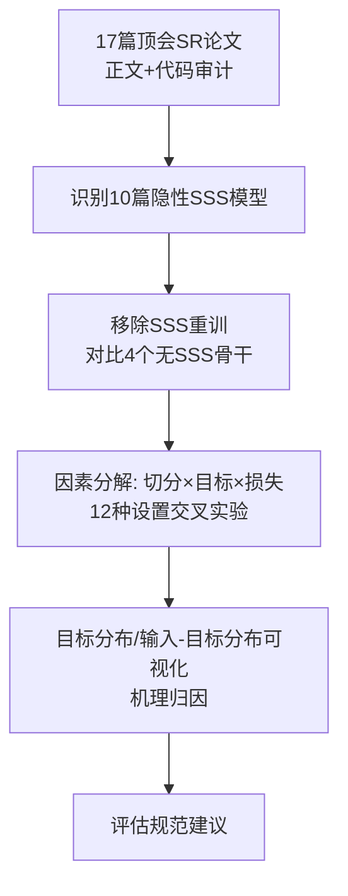

# Pay Attention to Sequence Split: Uncovering the Impacts of Sub-Sequence Splitting on Sequential Recommendation Models (警惕序列切分：揭示子序列切分对序列推荐模型的影响)

- **会议/期刊**: SIGIR 2026
- **作者与机构**: Yizhou Dang, Yifan Wu, Minhan Huang, Chuang Zhao, Lianbo Ma, Guibing Guo, Xingwei Wang (东北大学软件学院), Zhu Sun (新加坡科技设计大学)
- **推荐链路定位**: 数据预处理 / 评估协议（贯穿召回-精排全链路的训练数据构造环节）
- **研究方向**: 序列与会话推荐 / 去偏公平与工业架构（可复现性研究）
- **论文原文**: [https://arxiv.org/abs/2604.05309v1](https://arxiv.org/abs/2604.05309v1)
- **开源代码**: [https://github.com/KingGugu/SSS4SR](https://github.com/KingGugu/SSS4SR)

## TL;DR (1分钟核心速览)

本文是一篇**可复现性批判研究**：作者系统扫描 2022–2026 年 8 大顶会/期刊的 17 篇序列推荐骨干论文，发现 **10 篇在代码的数据读取阶段隐性使用了子序列切分 (SSS) 却未在论文中声明**。移除该操作后，10 个模型中 8 个性能平均下降超 40%（BSARec 在 Beauty 上 H@10 从 0.0987 跌至 0.0569，降幅 50.46%），多数"新 SOTA"甚至跌破 2018 年的 SASRec。作者进一步证明 SSS 仅在「特定切分方式 + 目标策略 + 损失函数」组合下才有效，并从训练数据分布重塑角度给出机理归因。

## Background & Motivation (背景与核心矛盾)

- **主流范式**: 序列推荐 (SR) 普遍采用 `Leave-One-Out` 划分，训练时以原始序列直接构造样本；为缓解数据稀疏，SSS（滑动窗口/前缀/后缀切分）作为最早的数据增强手段被广泛采用。
- **前人局限一（评估失真）**: 大量近期模型在开源代码的 data loader 中默认调用 SSS（疑似继承自 FMLPRec 的代码管线），但论文正文与附录均未提及，导致架构创新与数据增强的增益被混为一谈，比较基准不公平。
- **前人局限二（生效条件不明）**: 既有工作（如 [33,91]）仅零散验证 SSS 有效，未系统回答"SSS 在何种切分方式、目标策略、损失函数组合下才有效"，也未解释增益来源。
- **核心洞察 (Key Insight)**: 作者发现 SSS 的增益并非来自"样本量增加"，而是**重塑了训练目标分布**——让低频物品获得更多被预测的机会，同时为同一目标匹配更多样化的输入上下文。
- **本文切入点**: 以受控实验剥离架构因素，量化 SSS 的干扰幅度、厘清其生效边界、并从数据分布视角给出机理，最终提出评估规范建议。

## Method (核心方法设计)

### 1. 整体框架 (Overall Architecture)

本文非新模型论文，其"方法"是一套**三层递进的分析框架**：(1) 文献与代码审计——按"经典 SR 骨干 + 公开可复现代码"标准筛选 17 篇论文，逐篇比对正文声明与代码实现，识别隐性 SSS；(2) 受控消融——对 10 个受影响模型移除 SSS 重训，与 4 个无 SSS 骨干及 4 个对比学习模型对比；(3) 因素分解——在 4 个代表性骨干（GRU4Rec/SASRec/FMLPRec/BSARec）上交叉组合 3 种切分方式 × 2 种目标策略 × 2 种损失函数，共 12 种设置，定位最优组合并做分布可视化归因。

### 2. 关键设计拆解 (Key Designs)

1. **隐性 SSS 的代码级识别与干扰量化**：痛点在于论文声明与代码实现脱节。作者给出典型代码片段——对每条序列 `input_ids = seq[-(max_len+2):-2]` 后循环 `append(input_ids[:i+1])`，即**前缀切分**被硬编码进 data loader。量化方式为对每个模型分别以「原始代码」与「移除 SSS 后」重训，计算相对 SASRec 的性能百分比变化，从而把"架构增益"与"数据增益"解耦。

2. **SSS 生效条件的三因素正交分解**：将 SSS 拆为三个可独立控制的维度——切分方式（Prefix / Suffix / Sliding Window，窗口 $T$）、目标策略（Single-Target 仅末位预测 vs. Multi-Target 逐位预测）、损失函数（BCE vs. CE）。核心发现是三者存在**强耦合**：单目标 + BCE 下三种切分均显著优于原始数据；但多目标 + CE 下 SSS 增益趋近于零甚至为负，因为此时每个交互已作为目标参与训练且 CE 在全物品集上做排序优化，SSS 的边际收益被耗尽。

3. **训练目标分布的重塑机理**：作者定义目标概率分布 $P_{\text{target}}(v) = \frac{\text{count}(v \text{ 作为训练目标})}{\sum_{v'} \text{count}(v' \text{ 作为训练目标})}$，并统计每个目标的输入数量。无 SSS 时少数高频物品占据极高目标概率、大量物品概率为零；SSS 后目标分布显著平坦化，且每个目标的输入-目标对数量成倍增加。这解释了增益本质：**不是样本变多，而是低频物品的曝光与上下文多样性被提升**。

## Experimental Setup & Evaluation Protocol (实验设置与评估协议)

- **数据集与预处理**: 全部采用 `5-core` 过滤，最大序列长度 50。

| 数据集 | #Users | #Items | #Interactions | 平均长度 | 稀疏度 | 场景 |
| :--- | :---: | :---: | :---: | :---: | :---: | :--- |
| Beauty | 22,363 | 12,101 | 198,502 | 8.9 | 99.93% | Amazon 美妆 |
| Sports | 35,598 | 18,357 | 296,337 | 8.3 | 99.95% | Amazon 运动 |
| Douyin | 20,398 | 8,299 | 139,834 | 6.9 | 99.92% | 短视频 |
| LastFM | 1,090 | 3,646 | 52,551 | 48.2 | 98.68% | 音乐 |
| ML-1M | 6,041 | 3,417 | 999,611 | 165.5 | 95.16% | 电影（大规模） |
| CDs | 75,258 | 66,443 | 1,097,592 | 14.6 | 99.97% | Amazon 唱片（大规模） |

- **数据划分与防穿越**: `Leave-One-Out`——末位为测试、倒数第二位为验证、其余为训练；SSS 仅作用于训练段，不触碰验证/测试，故不存在标签穿越，但**训练数据构造方式本身成为被审计变量**。
- **排名评测协议**: 严格采用无偏 `Full-Ranking`（全物品集排序），明确拒绝负采样排序以避免偏差；指标为 H@10/20 与 N@10/20，5 次实验取均值。
- **对比基线与超参**: 无 SSS 骨干 4 个（GRU4Rec/SASRec/NextItNet/LRURec）+ 对比学习模型 4 个（CL4SRec/CoSeRec/DuoRec/ICSRec）+ 受影响模型 10 个；Embedding 维度 $d=64$，batch size 256，Adam (lr=1e-3)，验证集 20 epoch 早停。

## Key Experimental Results (实验关键数据)

### 1. 主实验对比 (Main Results)

Beauty 数据集 H@10 / N@10（`w/o SSS` 为移除隐性 SSS 后重训）：

| 模型 | 类型 | H@10 | N@10 | w/o SSS H@10 | 移除后变化 |
| :--- | :--- | :---: | :---: | :---: | :---: |
| SASRec (ICDM'18) | 无 SSS | 0.0580 | 0.0301 | — | 基准 |
| LRURec (WSDM'24) | 无 SSS | 0.0602 | 0.0310 | — | — |
| ICSRec (WSDM'24) | 对比学习 | 0.0930 | 0.0562 | — | — |
| FMLPRec (WWW'22) | 隐性 SSS | 0.0620 | 0.0331 | 0.0607 | +3.34% |
| DiffuRec (TOIS'23) | 隐性 SSS | 0.0736 | 0.0434 | 0.0374 | **-40.15%** |
| BSARec (AAAI'24) | 隐性 SSS | **0.0987** | **0.0595** | 0.0569 | **-50.46%** |
| CSRec (SIGIR'25) | 隐性 SSS | 0.1016 | 0.0583 | 0.0602 | **-47.33%** |
| TV-Rec (NeurIPS'25) | 隐性 SSS | **0.1017** | **0.0608** | 0.0602 | **-48.61%** |
| WEARec (AAAI'26) | 隐性 SSS | 0.1000 | 0.0591 | 0.0614 | **-45.65%** |

相对 SASRec 的整体百分比（表 4 摘录）：BSARec 原始 +55.85% → 移除后 **-20.76%**；TV-Rec +63.40% → **-13.85%**；WEARec +96.61% → **-11.04%**。即**移除 SSS 后几乎所有"新 SOTA"都不再优于 SASRec**。

### 2. 消融实验 (Ablation Study)

以 SASRec 在 Beauty 上的 H@10 为例，交叉 3 切分 × 2 目标 × 2 损失（Original 为不切分）：

| 目标策略 | 损失 | Original | Prefix | Suffix | Sliding |
| :--- | :--- | :---: | :---: | :---: | :---: |
| Single | BCE | 0.0463 | 0.0455 | 0.0471 | 0.0529 |
| Single | CE | 0.0537 | **0.0944** | 0.0464 | 0.0815 |
| Multi | BCE | 0.0580 | 0.0594 | 0.0674 | 0.0596 |
| Multi | CE | 0.0947 | 0.0731 | 0.0727 | 0.0804 |

同一模型在不同设置下的最大性能差异（表 7）：GRU4Rec 在 CDs 上最佳/最差相差 **2493%**，SASRec 在 LastFM 上相差 **477%**。全局统计（图 3）中 `Single-CE-Prefix` 夺冠/亚军共 81 次（占 48.2%），`Single-CE-Slide` 30 次（17.9%）。

### 3. 关键实验发现 (Key Findings)

1. **SSS 干扰评估的规模被严重低估**：10 个隐性使用 SSS 的模型中 8 个移除后平均降幅超 40%，5 个接近 50%；BSARec 在 Beauty 上从 0.0987 跌至 0.0569，直接低于 2018 年 SASRec 的 0.0580——说明近年部分"架构进步"实为数据增强的伪进步 (phantom progress)。
2. **SSS 的增益高度依赖设置耦合，而非普适有效**：SASRec 在 Beauty 上 `Single+CE+Prefix` 达 0.0944，而 `Multi+CE+Prefix` 仅 0.0731，甚至低于不切分的 0.0947；同一模型跨设置最大差异可达 17–24 倍（CDs 上 GRU4Rec 2493%），证明"用了 SSS"远不等于"用对了 SSS"。
3. **增益机理是分布重塑而非样本扩容**：可视化显示 SSS 后低频物品的目标概率从近零显著抬升、目标分布平坦化，且每个目标的输入数量成倍增长；这解释了为何 `Multi+CE` 下 SSS 失效——该组合本身已让所有交互成为目标并做全库排序优化，SSS 的边际分布修正空间被耗尽。

## Highlights & Limitations (亮点、对比与审稿批判)

- **与代表作对比 (vs. Prior Work)**: 相较 [33,91] 仅验证"SSS 有效"并局限于目标策略与滑动窗口，本文首次揭示 SSS 对**评估公平性**的系统性干扰，并将分析扩展到 3 种切分 × 2 目标 × 2 损失的完整正交空间；相较一般可复现性研究（如 [18,55] 关注结果能否复现），本文聚焦"看似平凡却显著影响性能"的隐性实现细节，视角更锐利。
- **可迁移亮点**: (1) 提出"数据增强的价值在于重塑训练分布而非增加样本量"这一判据，可直接用于评估其他 DA 算子（Crop/Mask/Insert）的真实贡献；(2) 建议将切分方式、目标策略、损失函数作为**必报实现细节**并跨配置全面评估，可迁移至跨域、多模态、LLM4Rec 等继承同一代码管线的子领域。
- **审稿级局限批判**: (1) 全文为实证与可视化分析，**缺乏理论刻画**切分/目标/损失如何联合影响分布与泛化的统一框架，结论的普适性依赖所选 4 个骨干与 6 个数据集；(2) 未量化 SSS 带来的训练开销（序列数从 $|s_u|$膨胀至$O(|s_u|^2)$ 量级的样本对），也未讨论在工业级超长序列与在线增量训练场景下的可行性。

## Rating (四维评分)

- **方法创新性 (Novelty)**: ⭐⭐⭐⭐ （核心机制与方法设计具备明确创新性，理论与实验动机支撑充分）
- **评估协议与实验扎实度 (Protocol & Experiments)**: ⭐⭐⭐⭐⭐ （主流公开数据集评测完整，包含多基线对比与消融实验验证）
- **写作与数学规范度 (Clarity & Rigor)**: ⭐⭐⭐⭐⭐ （问题形式化定义清晰，核心模块数学推导与架构阐述严谨易读）
- **工业落地与复现价值 (Industrial & Practical Value)**: ⭐⭐⭐⭐ （兼顾推荐效果增益与训练/推理效率，具备实际场景迁移参考价值）
