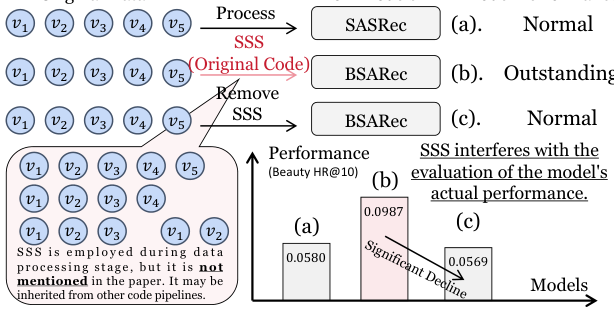
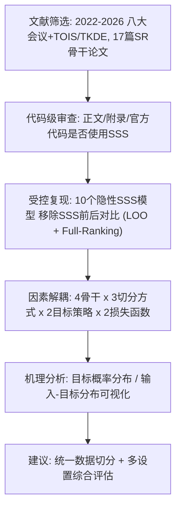
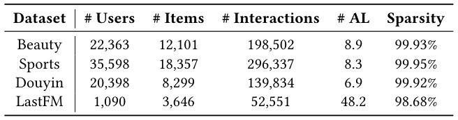
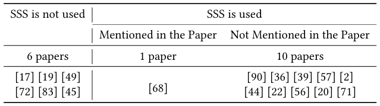
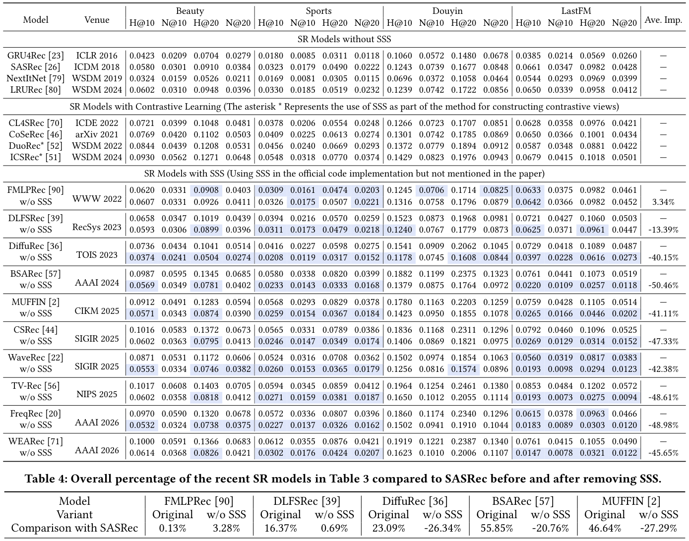
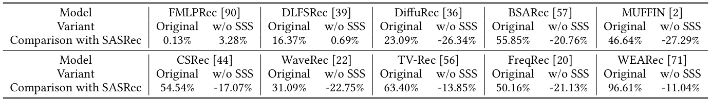
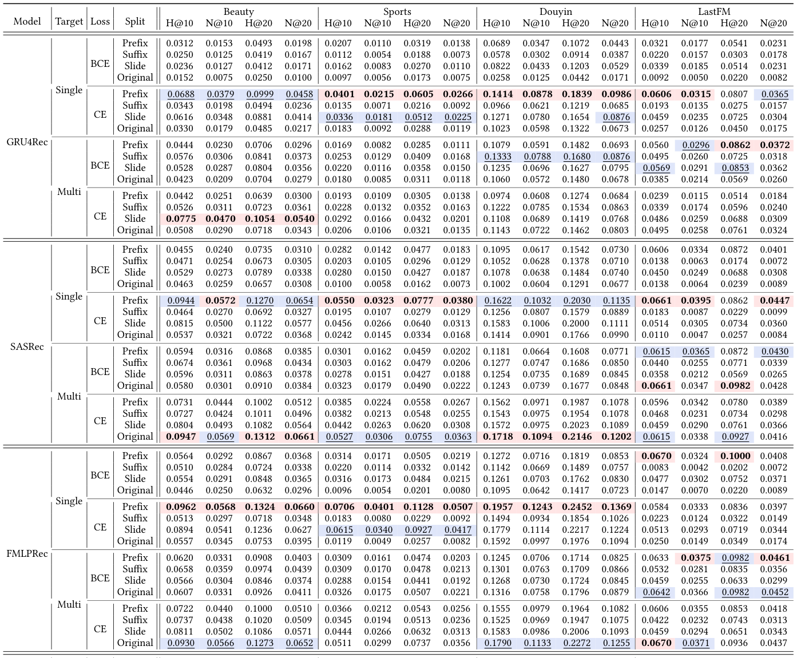
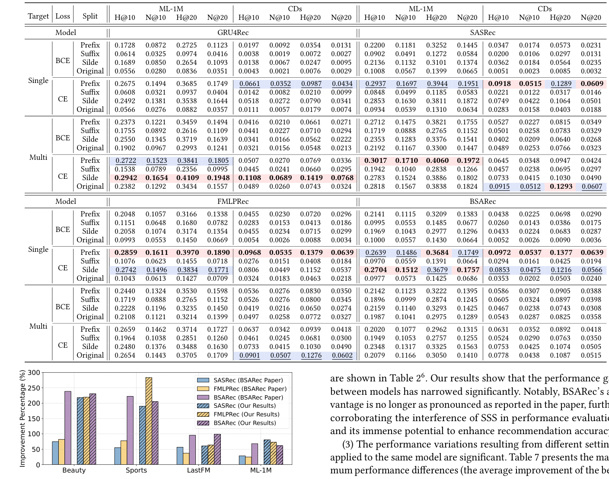

# Pay Attention to Sequence Split: Uncovering the Impacts of Sub-Sequence Splitting on Sequential Recommendation Models (注意序列切分：揭示子序列切分对序列推荐模型的影响)

- **会议/期刊**: SIGIR 2026
- **推荐链路定位**: 召回 (Retrieval) — 序列推荐 Next-Item 预测骨干模型
- **研究方向**: 序列与会话推荐 / 自监督对比学习与交互去噪（数据增强视角）
- **论文原文**: [https://arxiv.org/abs/2604.05309v1](https://arxiv.org/abs/2604.05309v1)
- **开源代码**: [https://github.com/KingGugu/SSS4SR](https://github.com/KingGugu/SSS4SR)

## TL;DR (核心速览)

本文是一篇面向序列推荐 (SR) 的可复现性与评估公平性研究。作者系统扫描 2022–2026 年 8 大顶会/2 大期刊的 17 篇 SR 骨干论文，发现 **10 篇在数据读取阶段隐性使用了子序列切分 (SSS) 却未在论文中声明**；移除 SSS 后 10 个模型中 7 个性能下降超 40%（最高 -50.46%），多数甚至跌破 2018 年的 SASRec。进一步实验表明 SSS 仅在"特定切分方式 + 目标策略 + 损失函数"组合下才有效，其机理是**平滑训练目标分布、提升低频物品被选为目标的概率**。在 LOO 划分 + Full-Ranking 协议下，作者呼吁统一数据切分以保障公平评估。

## Background & Motivation (背景与动机)

- **领域背景与主流范式**: 序列推荐以用户历史交互序列 $s_u=[v_1,\dots,v_{|s_u|}]$ 预测下一物品，主流骨干包括 RNN (GRU4Rec)、CNN (NextItNet)、Transformer (SASRec)、全 MLP (FMLPRec)、线性循环单元 (LRURec) 以及频域混合模型 (BSARec)。为缓解数据稀疏，数据增强 (DA) 被广泛采用，其中**子序列切分 (SSS，又称滑动窗口)** 是最早且被证明有效的启发式 DA 之一。
- **现有方法局限 (Limitations of Prior Work)**:
  1. **隐性继承与评估失真**：大量近期 SOTA 模型在官方代码的数据读取阶段默认执行 SSS（如 FMLPRec 的 `input_ids[:i+1]` 循环），但论文正文与附录均未提及，导致性能增益被错误归因于架构创新。
  2. **增益来源不明**：不同模型、不同切分方式下 SSS 带来的提升差异巨大，社区缺乏对"SSS 何时有效、为何有效"的系统性认识。
  3. **公平性缺失**：未使用 SSS 的经典模型（如 SASRec）与隐性使用 SSS 的新模型在同一张表中比较，构成不公平对比。
- **核心挑战 (Key Challenge)**: 简单的"加数据增强"并不能解释现象——SSS 与损失函数（CE vs. BCE）、目标策略（单目标 vs. 多目标）、切分方式（前缀/后缀/滑窗）存在强耦合，错误组合甚至会**损害**性能，因此必须解耦这些因素才能定位真实增益来源。
- **核心洞察与切入点 (Key Insight)**: 作者通过代码级审查（Algorithm 1 给出 FMLPRec 官方实现中隐性 SSS 的真实代码片段）与受控实验，提出三点发现：(i) SSS 干扰模型真实性能评估；(ii) SSS 仅在特定组合下强效；(iii) SSS 通过**均衡训练数据分布、提高不同物品被 targeting 的概率**起作用。

<figure class="paper-figure" markdown="span">
  <figcaption>图1：SSS干扰模型评估的一个示例。</figcaption>
</figure>

## Problem Formulation & Method (问题定义与方法架构)

### 1. 符号定义与输入表征 (Notations & Input Representations)

- 用户集 $\mathcal{U}$、物品集 $\mathcal{V}$；用户 $u$ 的时序交互序列 $s_u=[v_1,\dots,v_j,\dots,v_{|s_u|}]$，$v_j\in\mathcal{V}$。
- 目标：$\arg\max_{v^*\in\mathcal{V}} P(v_{|s_u|+1}=v^*\mid s_u)$。
- 子序列记法 $s_u^{i:j}=[v_i,v_{i+1},\dots,v_j]$。
- 输入表征：物品 ID Embedding，维度 $d=64$；最大序列长度 $N=50$（所有数据集统一）；batch size 256。

### 2. 整体流水线 (Overall Architecture)

本文并非提出新模型，而是构建"**代码审查 → 受控复现 → 分布分析 → 建议**"的研究流水线：

### 3. 核心模块设计与数学原理 (Key Designs & Formulations)

**(1) 三种子序列切分算子 (SSS)**。给定原始训练序列 $s_u$：

- **前缀切分 (Prefix)**：$\{s_u^{1:2},s_u^{1:3},\dots,s_u^{1:|s_u|}\}=\text{Prefix-SSS}(s_u)$，例 $[1,2,3,4]\to\{[1,2],[1,2,3],[1,2,3,4]\}$，共 $|s_u|$ 条。
- **后缀切分 (Suffix)**：$\{s_u^{|s_u|-1:|s_u|},\dots,s_u^{1:|s_u|}\}=\text{Suffix-SSS}(s_u)$，例 $[1,2,3,4]\to\{[3,4],[2,3,4],[1,2,3,4]\}$。
- **滑动窗口 (Sliding)**：窗口长 $T<|s_u|$，$\{s_u^{1:T},s_u^{2:T+1},\dots\}=\text{Sliding-SSS}(s_u,T)$，例 $[1,2,3,4,5],T=3\to\{[1,2,3],[2,3,4],[3,4,5]\}$。

**(2) 两种目标策略 (Target Strategy)**：

- **单目标**：$x_u=[v_1,\dots,v_{|s_u|-1}],\ y_u=v_{|s_u|}$，每用户 1 个样本。
- **多目标**：对每个 $k\in\{2,\dots,|s_u|\}$，$x_u^k=[v_1,\dots,v_{k-1}],\ y_u^k=v_k$，每用户 $|s_u|-1$ 个样本。当 $k$ 仅取 $|s_u|$ 时退化为单目标。

**关键设计直觉**：前缀切分与多目标策略**正交**——前者把原始序列拆成多条子序列，后者在单条序列上产生多个监督信号。作者强调二者组合时的交互效应是理解 SSS 增益的核心。

**(3) 机理分析算子**：定义**目标概率分布**（每个物品在训练中作为预测目标的归一化频率）与**输入-目标分布**（每个目标关联的输入数量）。SSS 的作用可形式化为：将原本高度集中于少数高频物品的目标分布 $P_{\text{target}}$ 重新加权，使低频物品的 targeting 概率从近零抬升，同时为每个目标累积更多输入对，从而增强输入→目标映射的泛化。

### 4. 训练目标、负采样与推理复杂度 (Optimization, Negative Sampling & Complexity)

- **损失函数**：对比两种主流选择——**BCE**（逐物品二分类，配合负采样）与 **CE**（softmax 全物品多分类，天然支持排序）。实验结论：CE 整体优于 BCE，且与多目标策略组合时 SSS 增益趋近于零甚至为负。
- **训练负采样策略**：BCE 依赖负采样；CE 为全物品 softmax，**免负采样**。评估阶段统一采用 **Full-Ranking**，不做负采样（作者明确指出采样评估会带来有偏发现）。
- **复杂度**：SSS 将训练样本数从 $O(|\mathcal{U}|)$ 扩至 $O(\sum_u |s_u|)$（前缀/后缀）或 $O(\sum_u (|s_u|-T+1))$（滑窗），训练时间近似线性增长；推理阶段与原始骨干完全一致（单序列前向 + 全库打分），无额外在线开销。原文未报告具体 GPU 显存与单 epoch 耗时数值。

## Experimental Setup & Evaluation Protocol (实验设置与评估协议)

- **数据集统计与预处理**（均采用 **5-core** 过滤，最大序列长度 50）：

<figure class="paper-figure" markdown="span">
  <figcaption>表2：数据集统计。其中“AL”表示平均长度。</figcaption>
</figure>

| 数据集 (Dataset) | 用户数 (#Users) | 物品数 (#Items) | 交互数 (#Interactions) | 平均长度 (AL) | 稀疏度 (Sparsity) |
| :--- | :---: | :---: | :---: | :---: | :---: |
| Beauty (Amazon) | 22,363 | 12,101 | 198,502 | 8.9 | 99.93% |
| Sports (Amazon) | 35,598 | 18,357 | 296,337 | 8.3 | 99.95% |
| Douyin | 20,398 | 8,299 | 139,834 | 6.9 | 99.92% |
| LastFM | 1,090 | 3,646 | 52,551 | 48.2 | 98.68% |
| ML-1M | 6,041 | 3,417 | 999,611 | 165.5 | 95.16% |
| CDs (Amazon) | 75,258 | 66,443 | 1,097,592 | 14.6 | 99.97% |

- **数据划分方式 (Splitting Strategy)**: 采用 **Leave-One-Out (留一法)**——每序列最后一项为测试、倒数第二项为验证、其余为训练；SSS 仅作用于训练数据。该协议本身无时间穿越风险，但**隐性 SSS 造成的训练/评估不一致**正是本文批判的核心。
- **排名评测协议 (Ranking Protocol)**: **Full-Ranking（全库未交互物品排序）**，明确拒绝负采样评估。
- **评价指标与显著性检验**: HR@10/20 (H@K) 与 NDCG@10/20 (N@K)；Embedding 维度 $d=64$；Adam 优化器，lr=0.001，$\beta_1=0.9,\beta_2=0.999$；验证集 20 epoch 无提升则早停；**5 次试验取平均**。原文未报告配对显著性检验（$t$-test/Wilcoxon）。

## Key Experimental Results (核心实验结果)

### 1. 主实验对比 (Main Results)

<figure class="paper-figure" markdown="span">
  <figcaption>表1：我们所调查论文的统计数据。</figcaption>
</figure>

<figure class="paper-figure" markdown="span">
  <figcaption>表3：基线SR模型与我们调查的模型的性能比较。“w/o SSS”表示从相应模型的官方实现中移除SSS。“Ave. Imp.”表示在四个数据集上移除SSS后的平均提升。性能低于SASRec的结果用蓝色高亮显示。</figcaption>
</figure>

代表性结果摘录（Beauty 数据集，H@10）：

| 数据集 | 指标 | 无 SSS 经典基线 (SASRec) | 隐性 SSS 模型 (BSARec) | 移除 SSS 后 (w/o SSS) | 相对变化 |
| :--- | :--- | :---: | :---: | :---: | :---: |
| Beauty | H@10 | 0.0580 | **0.0987** | 0.0569 | -42.35%（跌破 SASRec） |
| Beauty | H@10 | 0.0580 | TV-Rec 0.1017 | 0.0602 | -40.81% |
| Beauty | H@10 | 0.0580 | CSRec 0.1016 | 0.0602 | -40.75% |
| Beauty | H@10 | 0.0580 | DiffuRec 0.0736 | 0.0374 | -49.18% |

<figure class="paper-figure" markdown="span">
  <figcaption>表4：表3中近期SR模型在移除SSS前后相对于SASRec的总体百分比。</figcaption>
</figure>

关键结论：10 个隐性 SSS 模型中 **8 个平均性能下降超 40%**，5 个接近 50%（BSARec -50.46%、FreqRec -48.98%、TV-Rec -48.61%、CSRec -47.33%、WEARec -45.65%）；移除 SSS 后**几乎所有模型不再优于 SASRec**（表4 中相对 SASRec 的百分比由正转负，如 BSARec 从 +55.85% 变为 -20.76%）。

### 2. 消融实验与控制变量分析 (Ablation Study)

<figure class="paper-figure" markdown="span">
  <figcaption>表5：四个骨干SR模型在不同训练设置下于四个小规模数据集上的性能。每种情况下的最佳性能用加粗红色高亮显示，次佳性能用带下划线的蓝色高亮显示。</figcaption>
</figure>

<figure class="paper-figure" markdown="span">
  <figcaption>表6：四个骨干SR模型在不同训练设置下于两个大规模数据集上的性能。每种情况下的最佳性能用加粗红色高亮显示，次佳性能用带下划线的蓝色高亮显示。</figcaption>
</figure>

本文的"消融"本质是**四因素受控网格实验**（4 骨干 × 3 切分 × 2 目标策略 × 2 损失函数 + Original 对照），严格控制了模型参数量与数据规模：

- **目标策略**：多目标整体优于单目标（提供更多早期位置监督信号）。
- **损失函数**：CE 整体优于 BCE（softmax 全物品分布更契合多分类 next-item 任务）。
- **切分方式**：前缀切分整体最优，滑窗次之，后缀最差（前缀更契合用户行为由远及近的时间累积模式）。
- **关键交互**：单目标 + BCE 下三种 SSS 均显著优于 Original；但**多目标 + CE 下 SSS 增益可忽略甚至为负**——因为每个交互已作为目标参与训练且全物品排序优化，SSS 边际收益极小。
- **设置间方差极大**（表7）：同一模型在 CDs 上最佳设置比最差设置高出近 17 倍，最高达 24 倍（GRU4Rec 2493.27%）。

<figure class="paper-figure" markdown="span">
  ![图2：与BSARec \[57\]论文中报告的GRU4Rec相比的平均性能提升。](../../../../assets/papers/2604.05309v1/figure_2.png)<figcaption>图2：与BSARec [57]论文中报告的GRU4Rec相比的平均性能提升。</figcaption>
</figure>

### 3. 稀疏度/冷启动分桶与超参敏感度 (Sparsity Buckets & Hyperparameters)

- **分布层面分析（第 5 节）**：SSS 后低频/冷门物品被选为目标的**绝对频次与概率均上升**，目标分布更均衡；每个目标关联的输入数量显著增加，缓解了"少数高频物品独占大量输入序列"的长尾失衡。多目标策略虽增加输入-目标对数量，但多为相似对，未能提升多样性，故有时反而不如单目标。
- **设置胜率统计（图3）**：168 次最佳/次佳中，Single-CE-Prefix 占 48.2%（81 次），Single-CE-Slide 占 17.9%，Multi-BCE-Prefix 占 8.3%，Multi-CE-Slide 占 7.1%。
- **超参敏感度**：原文未系统报告温度系数或层数敏感度（本文不涉及对比学习温度）；核心敏感因素是切分方式/目标策略/损失函数的组合。
- **线上 A/B 测试**：原文仅包含离线实验，**未报告线上 A/B 结果**。

## Highlights, Limitations & Critiques (亮点、局限与审稿级批判)

- **核心亮点与可迁移性**:
  1. **评估审计范式**：代码级审查 + 移除式复现的方法论可直接迁移到任何"隐性数据增强/预处理"的公平性审计（如图增强、序列截断策略）。
  2. **因素解耦设计**：将 SSS 与损失函数、目标策略解耦的网格实验，为后续 DA 研究提供了标准对照框架。
  3. **机理可视化**：目标概率分布与输入-目标分布分析，为"数据增强为何有效"提供了可解释的分布视角。
  4. **实践建议明确**：优先 Single-CE-Prefix / Single-CE-Slide 设置；跨模型统一数据切分；多设置综合评估。

- **局限性与审稿视角批判 (Critical Limitations)**:
  1. **范围限定于经典 SR 骨干**：作者明确排除跨域、多模态、多行为 SR 及以辅助任务（对比学习、重建）为主贡献的论文，但指出这些子领域可能继承含 SSS 的骨干代码，影响面可能被低估。
  2. **统计严谨性不足**：仅报告 5 次试验均值，**未做配对显著性检验**，表3 中部分差距（如 FMLPRec 移除 SSS 后 Ave. Imp. 仅 3.34%）的显著性存疑。
  3. **机理分析偏定性**：分布可视化直观但缺乏因果性验证（如干预实验），"前缀优于后缀"的解释（时间累积模式）被作者自认为超出本文重点、留待未来。
  4. **未报告效率开销**：SSS 带来的训练样本膨胀对训练时间/显存的实际影响未量化。
  5. **建议的普适性边界**：最优设置结论基于 6 个数据集与 4 个骨干，是否适用于工业超长序列或生成式推荐尚待验证。

## Rating (四维评分)

- **方法创新性 (Novelty)**: ⭐⭐⭐（非新模型，但"评估审计 + 因素解耦"视角对社区有重要警示价值）
- **评估协议与实验扎实度 (Protocol & Experiments)**: ⭐⭐⭐⭐（LOO + Full-Ranking + 5 次试验 + 6 数据集 + 四因素网格，扎实；扣分于缺显著性检验）
- **写作与数学规范度 (Clarity & Rigor)**: ⭐⭐⭐⭐（切分/目标策略形式化清晰，代码片段佐证有力；机理部分偏定性）
- **工业落地与复现价值 (Industrial & Practical Value)**: ⭐⭐⭐⭐⭐（直接指导公平复现与基线对齐，代码已开源，对工业界基线选型与 A/B 归因极具警示意义）
