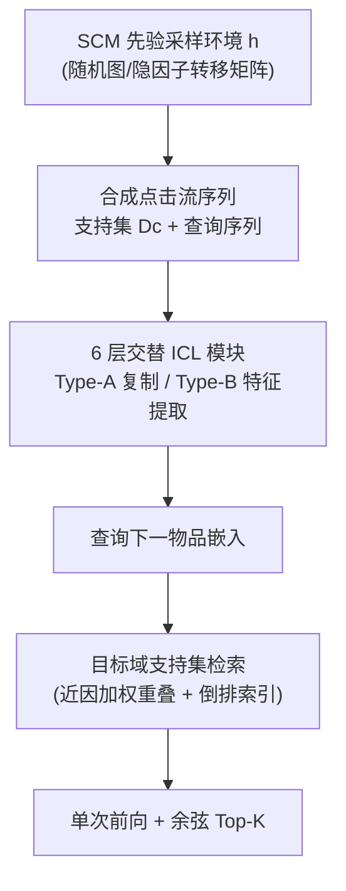
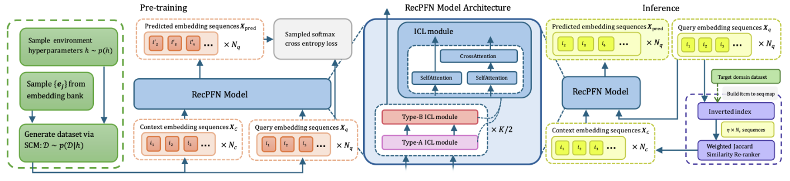

# RecPFN: Prior-Fitted Networks for In-Context-Based Recommendations (面向上下文学习的先验拟合网络推荐)

- **会议/期刊**: SIGIR 2026 (pp. 1731–1742)
- **作者与机构**: En Zhi Tan, Jia Xiang Lim, Bryan Lijie Chew, Tze Minh Ng, Benjamin Yan Han Yap (SAP SE, Singapore)
- **推荐链路定位**: 端到端生成式（单次前向 Next-Item 预测）
- **研究方向**: 序列与会话推荐 / 冷启动与长尾推荐
- **论文原文**: [https://arxiv.org/abs/2608.19735v1](https://arxiv.org/abs/2608.19735v1)
- **开源代码**: [https://github.com/SAP-samples/tabular-ai-recpfn](https://github.com/SAP-samples/tabular-ai-recpfn)

## TL;DR (1分钟核心速览)

序列推荐的主流范式（SASRec/BERT4Rec/UniSRec）依赖大规模目标域交互与逐域重训，而"混合真实域预训练"的通用推荐器在真正零样本迁移时常常打不过一个无参数的 EmbKNN。本文提出 RecPFN：完全在**结构因果模型 (SCM) 合成的点击流环境**上预训练一个轻量 decoder-only Transformer，把贝叶斯后验推断摊销进权重，推理时仅凭少量检索到的支持序列做单次前向即可预测下一物品、**零权重更新**。在 8 个公开基准的 Full-Ranking 协议下，零样本 HR@10/MRR@10 全面超越 RecFormer/RecGPT/UniSRec/VQ-Rec，Dianping 上 HR@10 相对提升达 +160.9%。

## Background & Motivation (背景与核心矛盾)

- **主流范式**: 强序列模型靠目标域大数据 + 充分训练；通用推荐器则走两条路——LLM 文本提示（RecGPT）或在多域真实交互上预训练专用架构（UniSRec/VQ-Rec/RecFormer）。
- **前人局限**: ① 偏好与交互逻辑高度依赖具体环境，混合域预训练学到的是"域无关平均"，难以刻画新环境的细粒度行为逻辑；② LLM 提示法延迟高且难以捕捉隐式协同信号，且仍需逐域适配。
- **核心洞察 (Key Insight)**: 论文实测发现 **EmbKNN（最近物品嵌入余弦检索，零学习）经常追平甚至超过预训练基线**——这直接质疑了"域无关真实数据预训练"的有效性，说明真正缺的是**推理时的即时条件化能力**，而非更多真实数据。
- **本文切入点**: 借用 PFN 思想，用**合成先验**训练模型去"学会做贝叶斯推断"而非"记住某个域"，把适配完全下放到推理期的支持集条件化。

## Method (核心方法设计)

### 1. 整体框架 (Overall Architecture)

RecPFN 把序列推荐写成后验预测分布 $p(j\mid S_{1:t},\mathcal{D})=\int p(j\mid S_{1:t},h)p(h\mid\mathcal{D})\mathrm{d}h$，其中环境$h$由 SCM 超参实例化。预训练阶段从宽先验$p(h)$采样环境、再按该环境动力学采样支持/查询序列，最小化期望交叉熵$\mathcal{L}(\theta)=\mathbb{E}_{(h,\mathcal{D}_c)}\mathbb{E}_{(S_{1:t},y)}[-\log\pi_\theta(y\mid S_{1:t},\mathcal{D}_c)]$，从而让网络直接逼近后验预测。推理时对新域仅做"检索支持集 → 单次前向 → 余弦检索 Top-K"，全程不更新任何权重。

<figure class="paper-figure" markdown="span">
  <figcaption>图1：RecPFN 的整体框架：（从左到右）基于合成数据的下一项预测任务预训练；由交替的 Type-A 和 Type-B ICL 模块组成的 RecPFN 模型架构；基于通过近因加权重叠检索到的支持集进行即时适应的推理</figcaption>
</figure>

### 2. 关键设计拆解 (Key Designs)

1. **SCM 合成先验（双转移矩阵族 + 两阶段课程）**：真实域预训练会记忆域特性，故改用可无限采样的合成环境。下一物品采样为转移与流行的混合：$P(s_t=j\mid s_{<t})\propto(1-\alpha_{pop})p_{trans,j}+\alpha_{pop}P_{pop,j}$，其中$p'_{trans}=\sum_{k=\max(1,t-d)}^{t-1}w_{t-1-k}\mathbf{T}_{s_k,:}$刻画近因加权的短期转移。转移矩阵$\mathbf{T}$由两支先验生成：**随机图先验**（每物品$k_{rel}$个后继，稀疏拓扑型）与**隐因子先验**（$\mathbf{E}=\mathbf{F}\mathbf{L}_{embed}$、$\mathbf{T}'=\mathbf{F}\mathbf{T}_{latent}\mathbf{F}^\top$，因子驱动型，矩阵分解为其特例）。直觉：前者教"复制/拓扑"，后者教"属性共现"，且$\mathbf{L}_{embed}$与$\mathbf{T}_{latent}$ 独立采样**刻意解耦了嵌入相似度与序列转移**，避免模型走"最近邻捷径"。训练采用先随机图、后混合的两阶段课程，因纯隐因子先验难以收敛。

2. **交替 Type-A / Type-B 注意力 + Hard-Alibi 掩码**：单一注意力难以兼顾"复制上下文"与"抽取非线性特征"。Type-A 令每个头的 $W_{V_i}\in\mathbb{R}^{D\times D}$初始化为单位阵、各头输出**直接求和**且去掉 FFN：$\mathrm{Attn}_A(Z)=\mathrm{LN}(Z+\sum_{i=1}^{N_h}\text{head}_i)$，专司跨序列信息搬运；Type-B 为标准多头 + FFN，负责特征学习。掩码上，前一半头施加 hard-alibi（第$i$头仅可见自身与前$i$ 个 token），后一半用标准因果掩码，把算力聚焦到近期上下文——与合成数据的近因加权动力学同构。

3. **训练目标、负采样与推理效率**：预训练用**采样 Softmax**（sampled softmax）对下一物品嵌入做自回归预测，无需显式负采样构造；推理用余弦相似度在目标域全库检索。上下文选择器是结构性瓶颈：$\mathrm{Sim}(S_q,S_j)=\sum_{i\in S_q\cap S_j}\lambda^{L_q-t}$，经倒排索引取$\eta N_c$候选（$\eta=10$）后重排取 Top-$N_c$（默认 8）。总成本为一次性 36 小时单卡 A100 预训练，换取所有未来域的**零重训**。

## Experimental Setup & Evaluation Protocol (实验设置与评估协议)

- **数据集与预处理**: 8 个评测基准，覆盖 Amazon 六类、Yelp、Dianping（中文 O2O，跨语言跨文化）：

| 数据集 | #Users | #Items | #Interactions | 平均长度 | 场景说明 |
| :--- | :---: | :---: | :---: | :---: | :--- |
| Appliances | 703 | 30,252 | 6,875 | 9.78 | 极稀疏小样本 |
| Arts | 1,579,230 | 302,809 | 2,875,917 | 1.82 | 超短序列 |
| Dianping | 208,596 | 243,247 | 4,422,473 | 21.20 | 中文 O2O |
| Games | 100,955 | 71,982 | 733,447 | 7.27 | 电商 |
| Movies | 450,757 | 182,032 | 4,169,631 | 9.25 | 电商 |
| Pantry | 247,659 | 10,814 | 471,614 | 1.90 | 小目录 |
| Scientific | 28,096 | 165,764 | 199,798 | 7.11 | 稀疏 |
| Yelp | 371,243 | 150,346 | 4,728,381 | 12.74 | 本地生活 |

  预训练消融另用 Fashion/Grocery/Sports/Movies 四个 Amazon 类目（Movies 不参与评测，避免泄漏）。
- **数据划分与防穿越 (Splitting Strategy)**: **比例划分 70/10/20**（train/val/test），验证与测试各截断至 10,000 样本，其余归训练；所有方法共享同一划分。
- **排名评测协议 (Ranking Protocol)**: **Full-Ranking 全库未交互排序**（候选集为完整物品目录），指标 HR@10 与 MRR@10，无采样负例。
- **对比基线与超参设置**: 监督组 GRU4Rec/SASRec/BERT4Rec/FDSA 及其语义嵌入变体（$\wedge$）、微调后的 UniSRec/VQ-Rec；零样本组 RecFormer/RecGPT/UniSRec/VQ-Rec 零样本版与无参数 EmbKNN。物品嵌入统一用 gte-Qwen2-1.5B-instruct；$K=6$层 ICL、$N_h=8$、dropout 0.2、AdamW lr$1\times10^{-4}$；监督基线 4 个随机种子平均，$\ast$表示$p<0.05$ 显著。

## Key Experimental Results (实验关键数据)

### 1. 主实验对比 (Main Results)

零样本设定（Table 2，HR@10 / MRR@10，Full-Ranking）：

| 数据集 | RecPFN | RecFormer | RecGPT | UniSRec | VQ-Rec | EmbKNN | Improv.(HR) |
| :--- | :---: | :---: | :---: | :---: | :---: | :---: | :---: |
| Appliances | **.1915 / .1471** | .1250/.0808 | .1064/.0993 | .0709/.0340 | — | .1206/.0844 | +53.2% |
| Arts | **.2077 / .1485** | — | .1851/.1393 | .0390/.0372 | .1469/.1124 | .1918/.1301 | +8.3% |
| Games | **.0673 / .0417** | .0585/.0283 | .0355/.0330 | .0239/.0116 | .0346/.0302 | .0471/.0161 | +15.0% |
| Movies | **.1253 / .0708** | .0875/.0431 | .0416/— | .0354/.0212 | .0428/.0366 | .0774/.0268 | +43.2% |
| Pantry | **.2491 / .2031** | .1534/.1004 | .0599/.0579 | — | .1975/— | .2377/.1913 | +4.8% |
| Scientific | **.1007 / .0730** | .0827/— | .0655/.0595 | .0431/.0226 | .0735/.0482 | .0826/.0480 | +21.7% |
| Dianping | **.0574 / .0269** | — | .0088/.0007 | .0016/.0005 | .0003/.0002 | .0220/— | +160.9% |
| Yelp | .0245/— | .0163/.0092 | .0179/.0171 | .0073/.0044 | — | **.0293/.0152** | -16.4% |

部署效率（Table 3，监督基线仅训 3 epoch）：RecPFN 在 8 个数据集中 7 个 HR@10 排名第 1，Appliances 上 HR +52.1%、Dianping 上 HR +273.3%/MRR +448.0%，仅 Yelp 落后（HR -31.5%，排名第 5）。低数据（Table 4，10% 训练集 + 50 epoch）下 RecPFN 在 Appliances/Dianping 仍居首，Arts/Pantry/Scientific 位列第 2–3。

### 2. 消融实验 (Ablation Study)

Table 5 相对 base 的百分比变化（节选）：

| 变体 | Appliances MRR | Arts MRR | Dianping MRR | Yelp MRR |
| :--- | :---: | :---: | :---: | :---: |
| RecPFN-base | .1471 | .1485 | .0269 | .0165 |
| RecPFN-small (4 层) | -26.6 | +0.7 | -29.2 | -10.0 |
| 仅 Type-A 注意力 | -19.7 | +0.8 | -12.3 | -3.7 |
| 仅 Type-B 注意力 | -22.4 | -5.7 | -83.0 | +18.4 |
| 换真实 Amazon 数据预训练 | -37.5 | -3.0 | -59.3 | -25.7 |
| 仅随机图先验 | -11.3 | +1.5 | -32.2 | -10.7 |
| 无上下文 (no context) | -86.3 | -71.5 | -87.9 | -89.8 |
| 随机上下文 | -70.8 | -72.7 | -89.8 | -94.5 |
| 上下文池缩至 10% | -30.9 | -4.1 | -72.3 | -35.1 |
| 去近因加权 ($\lambda=1$) | -7.8 | -0.3 | -52.1 | -11.4 |

### 3. 关键实验发现 (Key Findings)

1. **上下文是绝对瓶颈而非正则项**：去掉上下文 MRR 暴跌 71.5%–89.8%，随机上下文同样崩塌，而上下文从 8 缩到 2/4 几乎无损、扩到 16/32 反而下降（Dianping -25.0%/-57.7%）——说明模型"榨干"支持集信号但无法补偿其缺失，且大上下文稀释注意力预算。
2. **合成先验优于真实数据预训练**：把 SCM 先验换成四个 Amazon 真实类目后，Appliances MRR -37.5%、Dianping -59.3%，直接验证"训练摊销推断"比"记忆域特性"更具迁移性；同时仅用随机图先验在 Dianping 掉 32.2%，证明隐因子先验不可省。
3. **交替注意力与近因加权缺一不可**：仅 Type-B 在 Dianping 上 MRR -83.0%，仅 Type-A 在 Appliances -19.7%，交替设计兼顾复制与特征抽取；去近因加权在 Dianping 掉 52.1%，与 hard-alibi 掩码的近期聚焦形成呼应。

## Highlights & Limitations (亮点、对比与审稿批判)

- **与代表作对比 (vs. Prior Work)**: 相比 UniSRec/VQ-Rec 的"多域真实交互预训练 + 目标域微调"，RecPFN 完全不用真实交互、不做任何权重更新；相比 RecGPT 的 LLM 文本提示，它以嵌入序列为输入、单次前向完成预测，推理 6.58 ms/用户 vs. RecGPT 40.81 ms（Yelp），快约 6 倍；相比 EmbKNN 的纯最近邻，它通过支持集条件化获得了真正的序列动力学建模能力。
- **可迁移亮点**: ① "解耦嵌入相似度与转移结构"的 SCM 合成思路可直接迁移到冷启动/跨域数据增广；② Type-A 单位阵 $W_V$ + 头求和的无 FFN 复制块，是低成本 ICL 上下文搬运的通用组件。
- **审稿级局限批判**: ① 推理 6.58 ms/用户显著高于 VQ-Rec 的 0.44 ms，且上下文选择需建倒排索引，大规模目录下的延迟与内存开销未充分讨论；② 性能对嵌入编码器敏感（换 multilingual-mpnet 在 Yelp MRR -52.3%），且 Yelp 上被 EmbKNN 反超，说明对强流行度/本地生活场景的适配仍不足；③ 全部为离线 Full-Ranking 评测，缺少线上 A/B 与目录漂移下的校准分析。

## Rating (四维评分)

- **方法创新性 (Novelty)**: ⭐⭐⭐⭐ （首次将 PFN 式摊销贝叶斯推断引入序列推荐，SCM 双先验 + 交替注意力设计有清晰的理论动机）
- **评估协议与实验扎实度 (Protocol & Experiments)**: ⭐⭐⭐⭐ （8 数据集 Full-Ranking、零样本/低算力/低数据三档对比 + 四轴消融完整，但缺线上验证与方差报告）
- **写作与数学规范度 (Clarity & Rigor)**: ⭐⭐⭐⭐ （贝叶斯框架与 SCM 生成过程推导清晰，算法伪代码完整；部分符号在正文与附录间略有重复）
- **工业落地与复现价值 (Industrial & Practical Value)**: ⭐⭐⭐⭐ （代码开源、单卡 36 小时预训练换零重训，多域部署摊销优势明显；但单用户推理延迟与编码器依赖需工程优化）

