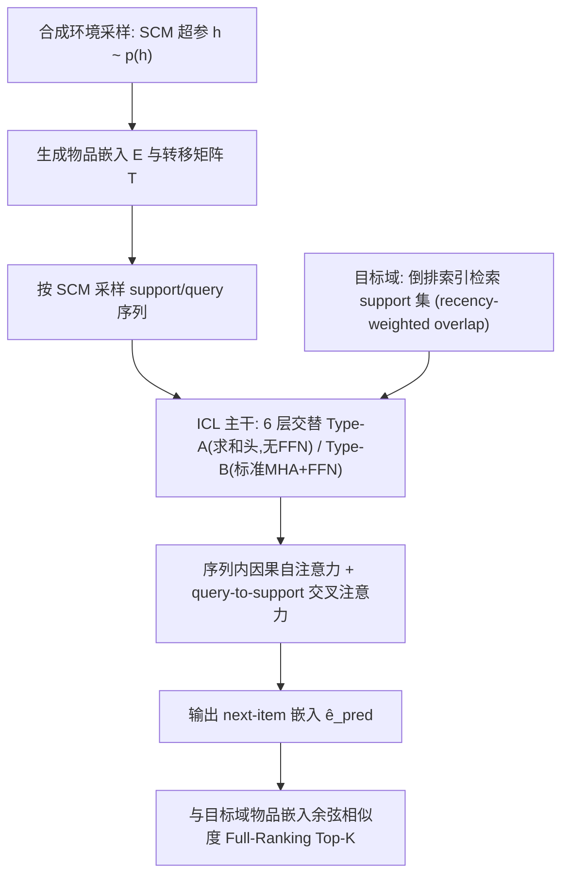
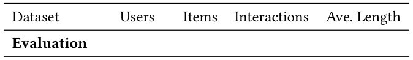
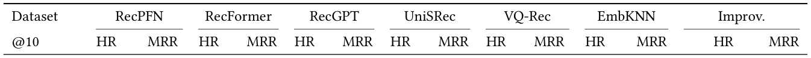
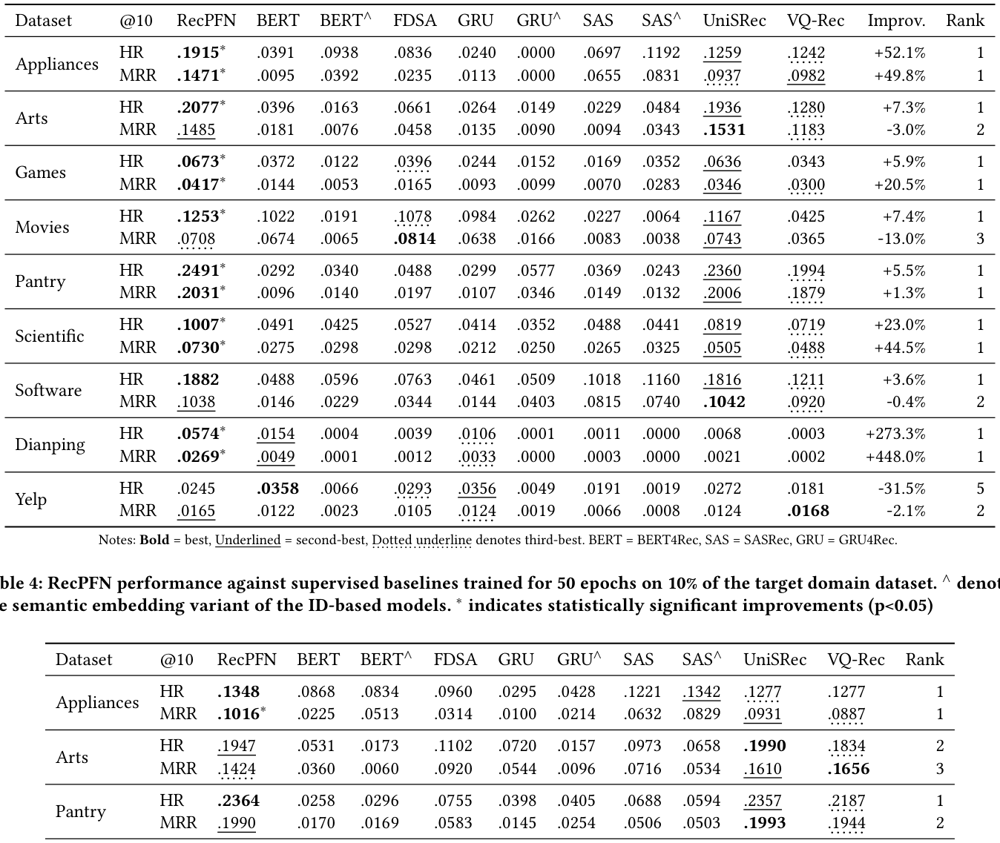
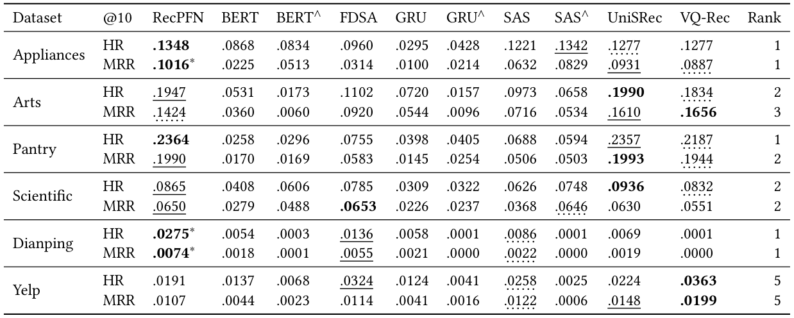
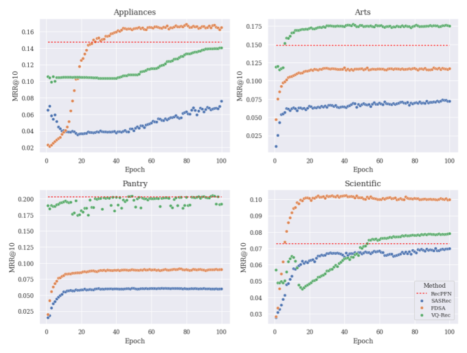

# RecPFN: Prior-Fitted Networks for In-Context-Based Recommendations (基于先验拟合网络的上下文学习式推荐)

- **会议/期刊**: SIGIR 2026 (49th International ACM SIGIR Conference)
- **推荐链路定位**: 召回 (Retrieval) — 以 next-item 预测形式做全库 Top-K 检索
- **研究方向**: 序列与会话推荐 / 大语言模型推荐 (ICL 范式)
- **论文原文**: [https://arxiv.org/abs/2608.19735v1](https://arxiv.org/abs/2608.19735v1)
- **开源代码**: [https://github.com/SAP-samples/tabular-ai-recpfn](https://github.com/SAP-samples/tabular-ai-recpfn)

## TL;DR (核心速览)

针对序列推荐"每个新域都要重训、跨域预训练难以真正零样本迁移"的痛点，RecPFN 提出首个**基于嵌入的 PFN 式上下文学习 (ICL) 序列推荐器**：完全在**合成点击流环境**（结构因果模型 SCM 先验采样）上预训练，推理时仅凭少量目标域 support 序列做单次前向即可预测 next-item，无需任何权重更新。在 8 个公开基准的 **Full-Ranking** 协议下，零样本 HR@10/MRR@10 全面超越 RecFormer/RecGPT/UniSRec/VQ-Rec/EmbKNN（如 Appliances +53.2%/+48.1%），并在低算力、低数据监督对比中保持强竞争力。

## Background & Motivation (背景与动机)

- **领域背景与主流范式**: 序列推荐已从 RNN/CNN 演进到 Transformer（SASRec/BERT4Rec），近年两条"通用推荐器"路线兴起：(i) LLM prompting 把历史与候选格式化为文本做排序；(ii) 在大量真实交互语料上预训练推荐专用架构（UniSRec/VQ-Rec/RecGPT/RecFormer）做跨域迁移。
- **现有方法局限 (Limitations of Prior Work)**:
  1. **强序列模型依赖大域内数据与大量在线训练算力**，新域冷启动部署成本高；
  2. **LLM prompting 路线延迟高**，且难以捕捉隐式协同信号；
  3. **混合域真实数据预训练难以实现真正零样本迁移**——用户偏好与交互模式高度依赖具体环境（setting-dependent），域无关的跨域嵌入对齐在新环境中常常失效。文中一个极具说服力的观察是：**无学习的 EmbKNN（最近物品嵌入余弦检索）经常追平甚至击败预训练基线**，直接质疑了域无关预训练的有效性。
- **核心挑战 (Key Challenge)**: 推荐的行为逻辑是"环境特异"的，那么能否不依赖任何真实交互语料、不更新权重，就让模型在推理时"读懂"新域的行为动力学？
- **核心洞察与切入点 (Key Insight)**: 借用 PFN（Prior-Fitted Networks）思想——在**多样合成分布**上训练以**摊销贝叶斯推断**，使模型学会"从少量 support 样本推断后验预测分布"的通用算法。作者用**结构因果模型 (SCM) 先验**生成海量合成点击流环境，把"域适应"转化为"上下文条件化"，从而绕开真实数据依赖与权重更新。

## Problem Formulation & Method (问题定义与方法架构)

### 1. 符号定义与输入表征 (Notations & Input Representations)

- 物品库 $\mathcal{I}=\{1,\dots,N\}$，用户历史 $S_{1:t}=(s_1,\dots,s_t)$，$s_\tau\in\mathcal{I}$；任务为预测 $s_{t+1}$。
- 环境（假设）$h\in\mathcal{H}$ 定义序列演化律 $p(j\mid S_{1:t},h)$，先验 $p(h)$ 编码对合理环境的信念；RecPFN 中 $h$ 由 SCM 及其超参实例化。
- 输入 prompt：$N_c$ 条 support 序列 + $N_q$ 条 query 序列，均 padding 到长度 $L$、嵌入维度 $D$，即 $X=(X_c,X_q)$，$X_c\in\mathbb{R}^{N_c\times L\times D}$，$X_q\in\mathbb{R}^{N_q\times L\times D}$。
- 物品嵌入由 **gte-Qwen2-1.5B-instruct** 生成（非 ID 查表），这是"embedding-based PFN"的关键前提。

### 2. 整体流水线 (Overall Architecture)

数据流：SCM 先验采样合成环境 $\to$ 生成 support/query 序列与物品嵌入 $\to$ 6 层交替 Type-A/Type-B ICL 模块（序列内因果自注意力 + query-to-support 交叉注意力）$\to$ 输出 next-item 嵌入 $\hat{e}_{pred}$ $\to$ 与目标域物品嵌入做余弦相似度全库检索 Top-K。推理时 support 集由**倒排索引 + recency-weighted overlap** 在线检索得到。

<figure class="paper-figure" markdown="span">
  <figcaption>图 1</figcaption>
</figure>

### 3. 核心模块设计与数学原理 (Key Designs & Formulations)

**(1) 贝叶斯目标：摊销后验预测分布 (PPD)**

给定观测数据 $\mathcal{D}$ 与 query 前缀 $S_{1:t}$，金标准预测为

$$p(j\mid S_{1:t},\mathcal{D})=\int_{\mathcal{H}} p(j\mid S_{1:t},h)\,p(h\mid\mathcal{D})\,dh,\qquad p(h\mid\mathcal{D})=\frac{p(\mathcal{D}\mid h)p(h)}{\int_{\mathcal{H}}p(\mathcal{D}\mid h')p(h')\,dh'}$$

PFN $f_\theta$ 直接以 $(S_{1:t},\mathcal{D}_c)$ 为输入输出 $\pi_\theta(\cdot\mid S_{1:t},\mathcal{D}_c)$，通过最小化联合先验下的期望交叉熵来**摊销**该积分：

$$\mathcal{L}(\theta)=\mathbb{E}_{(h,\mathcal{D}_c)\sim p(h)p(\mathcal{D}\mid h)}\ \mathbb{E}_{(S_{1:t},y)\sim p(S_{1:t},y\mid h)}\big[-\log \pi_\theta(y\mid S_{1:t},\mathcal{D}_c)\big]$$

物理直觉：模型不是学"某个域的物品共现"，而是学"如何从上下文样本中推断环境的转移结构"这一元算法。

**(2) SCM 合成点击流生成（先验的载体）**

每个环境定义 $N$ 个物品、嵌入 $e_j\in\mathbb{R}^{D_{item}}$、转移分数矩阵 $T\in\mathbb{R}^{N\times N}$ 与流行度 $P_{pop}$。序列生成：

$$p'_{trans}=\sum_{k=\max(1,t-d)}^{t-1} w_{t-1-k}\,T_{s_k,:},\qquad P(s_t=j\mid s_{<t})\propto(1-\alpha_{pop})\,p_{trans,j}+\alpha_{pop}P_{pop,j}$$

即**近期加权转移（短期序列模式）+ 全局流行度（长期静态吸引力）**的混合，并排除已见物品。转移矩阵由两类互补先验构造：

- **随机图先验**：每物品采样 $k_{rel}$ 个后继邻居置 $T_{jk}=1$，自环概率 $p_{self}$，其余为 0 —— 建模"固定后继集合"（剧集、捆绑包）的稀疏拓扑型转移；
- **潜因子先验**：采样 $L_{embed}\in\mathbb{R}^{D_{latent}\times D_{item}}$、$T_{latent}$ 与稀疏物品-因子映射 $F\in\mathbb{R}^{N\times D_{latent}}$（每行约 $k_{fac}$ 个 $\pm1$ 非零），令

$$E=F L_{embed},\qquad T'=F\,T_{latent}\,F^{\top}$$

由于 $L_{embed}$ 与 $T_{latent}$ 独立采样，**特征相似度与序列转移被解耦**（矩阵分解是 $T_{latent}=I$ 的特例）。这一设计直接对应真实推荐中"嵌入相近 ≠ 会被连续点击"的现象。物品嵌入从 BEIR（Quora/FIQA/FEVER/MS MARCO）80 万句向量库中采样，保证与下游 gte-Qwen2 嵌入空间对齐。

**(3) 交替注意力 ICL 主干**

每层先做序列内因果自注意力，再做 query 对 support 的交叉注意力：

$$\text{SelfAttention}(X)=\big(\text{Attn}(X_c,X_c,X_c),\ \text{Attn}(X_q,X_q,X_q)\big),\quad \text{CrossAttention}(X)=\big(X_c,\ \text{Attn}(X_q,\text{flatten}(X_c),\text{flatten}(X_c))\big)$$

- **Type-A（求和头，无 FFN）**：各头 value 投影到完整维度 $D$（$W_{V_i}\in\mathbb{R}^{D\times D}$ 且初始化为单位阵），头输出**直接求和**而非拼接，去掉 MLP：$\text{Attn}_A(Z)=\text{LayerNorm}\big(Z+\sum_{i=1}^{N_h}\text{head}_i\big)$。灵感来自 attention-only transformer 的"序列复制/信息搬运"能力。
- **Type-B（标准 MHA + FFN）**：$d_k=D/N_h$，拼接后过 $W_O$ 与 FFN，负责学习非线性潜特征。
- **Hard-Alibi Masking**：前一半头（$i<N_h/2$）只允许 token 关注自身与前 $i$ 个 token（强局部归纳偏置），后一半头用标准因果掩码。

设计直觉：Type-A 负责"从 support 中复制/搬运匹配模式"，Type-B 负责"抽取抽象特征"，二者交替兼顾 copying 与 feature extraction。

**(4) 推理期 support 检索（上下文选择器）**

$$\text{Sim}(S_q,S_j)=\sum_{i\in S_q\cap S_j} w(i,S_q),\qquad w(i,S_q)=\lambda^{L_q-t}$$

从 query 最近物品出发，经物品-序列倒排索引检索至 $\eta\times N_c$ 规模（$\eta=10$），再按 Sim 重排取 Top-$N_c$。贝叶斯视角：更相关的 support 集更接近"从环境后验中抽样"，直接提升推断精度。

### 4. 训练目标、负采样与推理复杂度 (Optimization, Negative Sampling & Complexity)

- **损失函数**: 合成数据上的自回归 next-item 预测，采用 **sampled softmax loss**（对 next item 嵌入做采样 softmax），无 BPR/InfoNCE 温度项；总损失即上文 $\mathcal{L}(\theta)$ 的蒙特卡洛估计。
- **训练负采样策略**: 通过 **sampled softmax** 的采样负类实现（原文未给出采样数量与分布细节，属"原文未报告"项）；推理阶段为**免负采样**的全库余弦检索。
- **时间与空间复杂度**:
  - 预训练：单张 A100 **36 小时**，两阶段（先随机图先验，再随机图+潜因子等量混合），每阶段至多 120 epoch，每 epoch 500 训练步 + 200 验证步；每步采样 1 个环境，batch 为 $N_c=128$ support + $N_q=16$ query；AdamW，lr $1\times10^{-4}$，梯度累积 2，warm-up 6 epoch，early stopping patience 20（监控合成验证流上 $\text{MRR}_{RecPFN}/\text{MRR}_{EmbKNN}$ 比值以归一化环境难度）。
  - 推理：**单次前向、零梯度更新**，batch size 1、context size 8；support 检索靠倒排索引，复杂度近似 $O(\eta N_c)$ 候选 + 重排；最终 Top-K 为对目标域全库嵌入的余弦相似度（可用 ANN 加速，原文未报告具体延迟 ms/request 与峰值显存）。
  - 对比基线：监督模型需在目标域训练（3 epoch 或 50 epoch），RecPFN 目标域训练成本为 **0**。

## Experimental Setup & Evaluation Protocol (实验设置与评估协议)

- **数据集统计与预处理**: 8 个公开基准，覆盖 Amazon 电商（Appliances、Arts、Games、Movies、Pantry、Scientific、Software）、Yelp 本地生活、Dianping 中文 O2O。原文表 1 给出统计量（**原文未明确说明 5-core/10-core 过滤规则**，仅报告平均序列长度，最短 Arts 1.82、最长 Dianping 21.20，暗示过滤强度较弱）：

<figure class="paper-figure" markdown="span">
  <figcaption>表 1</figcaption>
</figure>

| 数据集 (Dataset) | 用户数 (#Users) | 物品数 (#Items) | 交互数 (#Interactions) | 平均序列长度 (Ave. Length) | 模态/辅助特征说明 |
| :--- | :---: | :---: | :---: | :---: | :--- |
| Appliances | 703 | 30,252 | 6,875 | 9.78 | 文本语义嵌入 (gte-Qwen2-1.5B) |
| Arts | 1,579,230 | 302,809 | 2,875,917 | 1.82 | 同上 |
| Dianping | 208,596 | 243,247 | 4,422,473 | 21.20 | 中文 O2O，语义嵌入 |
| Games | 100,955 | 71,982 | 733,447 | 7.27 | 语义嵌入 |
| Movies | 450,757 | 182,032 | 4,169,631 | 9.25 | 语义嵌入 |
| Pantry | 247,659 | 10,814 | 471,614 | 1.90 | 语义嵌入 |
| Scientific | 28,096 | 165,764 | 199,798 | 7.11 | 语义嵌入 |
| Yelp | 371,243 | 150,346 | 4,728,381 | 12.74 | 本地生活，语义嵌入 |
| *预训练消融用* Fashion | 8,886 | 186,189 | 44,769 | 5.04 | 仅用于真实数据预训练消融 |
| *预训练消融用* Grocery | 248,194 | 283,507 | 1,841,452 | 7.42 | 同上 |
| *预训练消融用* Movies | 450,757 | 182,032 | 4,169,631 | 9.25 | 同上（与评估集不重叠） |
| *预训练消融用* Sports | 6,703,391 | 957,764 | 12,980,837 | 1.94 | 同上 |

- **数据划分方式 (Splitting Strategy)**: **Ratio Split 70/10/20**（train/val/test），且 **validation 与 test 各截断至 10,000 样本**，其余全部归入训练集。所有方法使用完全相同的划分。注意：这是**按样本随机比例划分而非全局时间戳切分**，存在一定未来信息泄露风险（序列内部仍按时间顺序，但样本级随机划分可能让同一用户不同时段序列跨集合）；原文未讨论该风险。
- **排名评测协议 (Ranking Protocol)**: **Full-Ranking（全物品库作为候选集）**，无负采样，属无偏评估，值得肯定。
- **评价指标与显著性检验**: HR@10、MRR@10；监督基线在目标域上跑 **4 个随机种子**取平均；表 3/表 4 中标注 $*$ 表示相对最强基线的提升在 **$p<0.05$** 下统计显著（原文未说明具体检验方法，如配对 $t$-test 或 Wilcoxon，属"原文未报告"）。RecPFN 嵌入维度 $D$ 由 gte-Qwen2-1.5B-instruct 决定（原文未显式给出 $D$ 数值）。

## Key Experimental Results (核心实验结果)

### 1. 主实验对比 (Main Results)

**零样本对比（表 2）**：RecPFN 在 8 个数据集中 7 个取得最佳，唯一失手是 Yelp（HR@10 0.0245 vs EmbKNN 0.0293）。值得注意的是 EmbKNN 在 Arts/Pantry/Yelp 上极具竞争力，印证了作者对"域无关预训练"的质疑。

<figure class="paper-figure" markdown="span">
  <figcaption>表 2</figcaption>
</figure>

| 数据集 | 指标 | EmbKNN（最强零样本基线之一） | RecFormer / UniSRec / VQ-Rec 最优 | 本文方法 (Ours) | 相对提升 (Improv.) |
| :--- | :--- | :---: | :---: | :---: | :---: |
| Appliances | HR@10 / MRR@10 | .1206 / .0844 | .1250 / .0993 (RecFormer) | **.1915 / .1471** | +53.2% / +48.1% |
| Arts | HR@10 / MRR@10 | .1918 / .1301 | .1851 / .1393 (RecGPT) | **.2077 / .1485** | +8.3% / +6.6% |
| Games | HR@10 / MRR@10 | .0471 / .0161 | .0585 / .0330 (RecFormer) | **.0673 / .0417** | +15.0% / +26.6% |
| Movies | HR@10 / MRR@10 | .0774 / .0268 | .0875 / .0431 (RecFormer) | **.1253 / .0708** | +43.2% / +64.2% |
| Pantry | HR@10 / MRR@10 | .2377 / .1913 | .2069 / .1780 (UniSRec) | **.2491 / .2031** | +4.8% / +6.2% |
| Scientific | HR@10 / MRR@10 | .0826 / .0480 | .0827 / .0655 (RecGPT) | **.1007 / .0730** | +21.7% / +22.6% |
| Software | HR@10 / MRR@10 | .1448 / .0419 | .1418 / .1096 (RecGPT) | **.1882 / .1038** | +30.0% / +11.6% |
| Dianping | HR@10 / MRR@10 | .0220 / .0040 | .0103 / .0088 (RecGPT) | **.0574 / .0269** | +160.9% / +204.7% |
| Yelp | HR@10 / MRR@10 | **.0293 / .0152** | .0186 / .0172 (UniSRec) | .0245 / — | **-16.4% / -4.2%** |

**低算力监督对比（表 3，全量数据仅训 3 epoch）**：RecPFN 在 7/8 数据集 HR@10 排名第 1，多数指标显著（$p<0.05$）；Arts 的 MRR 与 Movies 的 MRR 分别落后 UniSRec（-3.0%）与 FDSA（-13.0%），排名第 2/3。

<figure class="paper-figure" markdown="span">
  <figcaption>表 3</figcaption>
</figure>

| 数据集 | 指标 | 最强监督基线（3 epoch 全量） | 本文方法 (Ours) | 相对提升 (Improv.) | 排名 |
| :--- | :--- | :---: | :---: | :---: | :---: |
| Appliances | HR@10 / MRR@10 | .1259 / .0982 (UniSRec / VQ-Rec) | **.1915\* / .1471\*** | +52.1% / +49.8% | 1 / 1 |
| Arts | HR@10 / MRR@10 | .1936 / .1531 (UniSRec) | **.2077\*** / .1485 | +7.3% / -3.0% | 1 / 2 |
| Games | HR@10 / MRR@10 | .0636 / .0346 (UniSRec) | **.0673\* / .0417\*** | +5.9% / +20.5% | 1 / 1 |
|

## 论文图表

<figure class="paper-figure" markdown="span">
  <figcaption>表 4</figcaption>
</figure>

<figure class="paper-figure" markdown="span">
  <figcaption>图 2</figcaption>
</figure>

