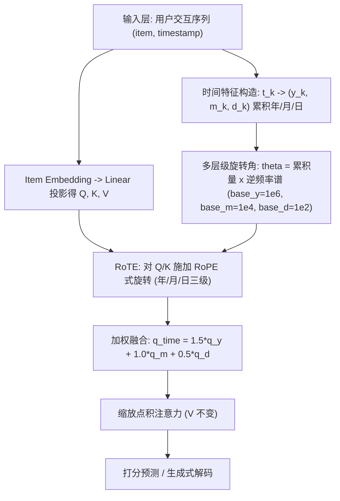
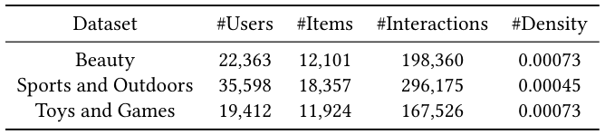
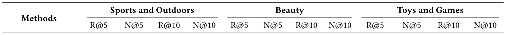
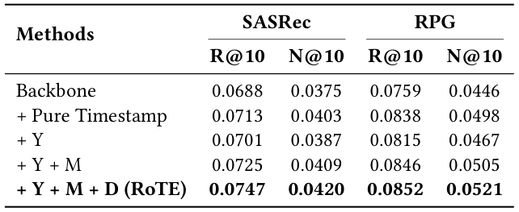
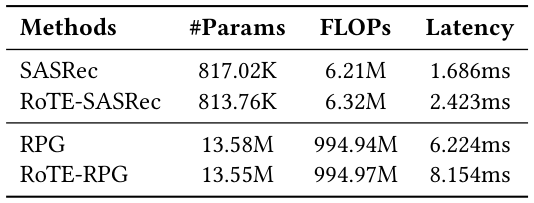

# RoTE: Coarse-to-Fine Multi-Level Rotary Time Embedding for Sequential Recommendation (面向序列推荐的由粗到细多层级旋转时间嵌入)

- **会议/期刊**: SIGIR 2026 (49th International ACM SIGIR Conference, Melbourne, VIC, Australia)
- **推荐链路定位**: 召回 (Retrieval) — 序列建模阶段的 Next-Item 表征增强模块，可同时服务于判别式打分与生成式解码
- **研究方向**: 序列与会话推荐 / 生成式推荐与离散语义 ID
- **论文原文**: [https://arxiv.org/abs/2604.13389v1](https://arxiv.org/abs/2604.13389v1)
- **开源代码**: [https://github.com/XiaoLongtaoo/RoTE](https://github.com/XiaoLongtaoo/RoTE)

## TL;DR (核心速览)

针对序列推荐仅用位置编码保留交互顺序、忽略真实时间跨度的痛点，RoTE 将 Unix 时间戳分解为年/月/日三级累积量，用固定逆频率谱生成旋转角，对自注意力中的 Query/Key 施加 RoPE 式旋转并按权重融合，作为即插即用模块替换位置编码。在 Amazon 三个 5-core 数据集、留一法 + 全库排序协议下，RoTE 一致提升 SASRec 与 RPG，Toys and Games 上 NDCG@5 相对 RPG 提升 20.11%，FLOPs 与延迟开销可忽略。

## Background & Motivation (背景与动机)

- **领域背景与主流范式**: 序列推荐分为判别式（GRU4Rec、Caser、BERT4Rec、SASRec 等，将推荐视为候选匹配/打分）与生成式（VQ-Rec、TIGER、HSTU、RPG 等，将推荐视为自回归序列生成）两大范式。二者构造序列的方式一致：按时间戳排序物品，再用**位置编码**表征顺序。
- **现有方法局限 (Limitations of Prior Work)**:
  1. **时间被"均匀化"**：位置编码本质是最简化的时间建模，只保留相对次序，把交互视为等间隔，丢弃了交互之间真实且不规则的时间跨度（如 1 天 vs 3 个月）。
  2. **多尺度信号被纠缠或丢弃**：长期兴趣跨年演化、中期受季节/月度影响、短期由日级行为驱动，这些异构时间尺度在单一连续时间戳中被压缩，模型难以区分"多尺度偏好漂移"。
  3. **原始时间戳与人类时间感知错位**：Unix 时间戳是连续数值，而用户以层级化、语义化方式理解时间（年→月→日），直接回归绝对数值存在表征偏差。
- **核心挑战 (Key Challenge)**: 简单地把时间戳作为辅助特征拼接进 item embedding，会让时间信号与序列建模"两张皮"，且无法在注意力层面感知交互间的**相对时间距离**；单纯加深网络或加对比学习也不能恢复被位置编码抹掉的时间跨度信息。
- **核心洞察与切入点 (Key Insight)**: 作者观察到 RoPE（旋转位置编码）通过旋转 Q/K 使注意力分数天然依赖**相对位移**，且保持向量范数。若把"位移"从离散位置序号换成"年/月/日累积计数"，则注意力即可感知多粒度相对时间差——这引出由粗到细（coarse-to-fine）的多层级旋转时间嵌入设计。

## Problem Formulation & Method (问题定义与方法架构)

### 1. 符号定义与输入表征 (Notations & Input Representations)

- 用户集 $\mathcal{U}$、物品集 $\mathcal{I}$；用户 $u$ 的交互序列 $\mathcal{S}_u=\{(i_0,t_0),(i_1,t_1),\dots,(i_{L_u-1},t_{L_u-1})\}$，满足 $t_0<t_1<\cdots<t_{L_u-1}$，$i_k\in\mathcal{I}$。
- 目标：学习条件分布 $p(i_{L_u}\mid \mathcal{S}_u)$，可实例化为排序打分函数或生成式 next-token 解码。
- 输入：item embedding 序列（维度 $d$，原文未显式给出具体 $d$ 值，沿用各 backbone 默认配置）；时间戳经分解得到三元组 $(y_k,m_k,d_k)$。
- 输出：下一物品的排序分数或生成 token。

### 2. 整体流水线 (Overall Architecture)

数据流：原始 Unix 时间戳 → 时间特征构造（年/月/日累积三元组）→ 对每个时间层级独立计算逆频率谱与旋转角 → 在多头自注意力内对 Q/K 施加旋转 → 三级旋转结果加权融合 → 标准缩放点积注意力 → 下游打分/解码。RoTE 仅替换原位置编码模块，不改动 value、注意力公式与训练目标。

<figure class="paper-figure" markdown="span">
  <figcaption>图 1</figcaption>
</figure>

### 3. 核心模块设计与数学原理 (Key Designs & Formulations)

**(1) 时间特征构造（Temporal Feature Construction）**：将时间戳 $t_k$ 分解为自 1970-01-01 起的累积年、月、日三元组
$$t_k \rightarrow (y_k, m_k, d_k),$$
例如 1970-01-01 对应 $(0,0,0)$，1971-01-01 对应 $(1,12,365)$。采用**累积计数**而非"当年第几月/第几日"，是为了保持时间序的单调性，使旋转角随真实时间跨度单调增长，从而让注意力感知到跨度的绝对大小。

**(2) 多层级旋转角计算**：对每个时间层级 $l\in\{y,m,d\}$，在头维度 $d$ 上定义固定逆频率向量
$$\omega_i^{(l)}=\big(\text{base}^{(l)}\big)^{-\frac{2i}{d}},\quad i=0,\dots,\tfrac{d}{2}-1,$$
其中 $\text{base}^{(y)}=10^6,\ \text{base}^{(m)}=10^4,\ \text{base}^{(d)}=10^2$。旋转角为
$$\theta_k^{(y)}=y_k\cdot\omega^{(y)},\quad \theta_k^{(m)}=m_k\cdot\omega^{(m)},\quad \theta_k^{(d)}=d_k\cdot\omega^{(d)}.$$
物理直觉：base 越大频率越低、波长越长，适配"年"这种大跨度粗粒度信号；base 越小频率越高，适配"日"这种细粒度信号。这与 RoPE 中"低频管长程、高频管短程"的频谱分工一致。

**(3) RoPE 式旋转注入 Q/K**：对偶数-奇数维度对 $(2i,2i+1)$ 施加二维旋转
$$\begin{pmatrix}q_{k,2i}^{(l)}\\ q_{k,2i+1}^{(l)}\end{pmatrix}=\begin{pmatrix}\cos\theta_{k,i}^{(l)} & -\sin\theta_{k,i}^{(l)}\\ \sin\theta_{k,i}^{(l)} & \cos\theta_{k,i}^{(l)}\end{pmatrix}\begin{pmatrix}q_{k,2i}\\ q_{k,2i+1}\end{pmatrix},$$
K 同理。向量化形式为
$$q_k^{(l)}=q_k\odot\cos\theta_k^{(l)}+\text{rotate}(q_k)\odot\sin\theta_k^{(l)},$$
其中 $\text{rotate}(x)=(-x_1,x_0,-x_3,x_2,\dots,-x_{d-1},x_{d-2})$ 为固定偶奇交换置换。该操作保范数，使注意力分数只依赖 Q/K 间的**相对时间差**（旋转角之差），这正是"感知异构时间距离"的数学根源。

**(4) 多层级加权融合**：三级旋转结果按标量权重聚合
$$q_k^{\text{time}}=\alpha_y q_k^{(y)}+\alpha_m q_k^{(m)}+\alpha_d q_k^{(d)},\quad k_k^{\text{time}}=\alpha_y k_k^{(y)}+\alpha_m k_k^{(m)}+\alpha_d k_k^{(d)},$$
取 $\alpha_y=1.5,\ \alpha_m=1.0,\ \alpha_d=0.5$——粗粒度权重更大以强调长期偏好演化，细粒度权重较小以刻画短期动态。融合后的 Q/K 进入标准缩放点积注意力，V 与注意力公式均不变。

### 4. 训练目标、负采样与推理复杂度 (Optimization, Negative Sampling & Complexity)

- **损失函数**: 原文未显式写出损失公式，明确声明"RoTE 不修改训练目标"，即沿用各 backbone 原生损失（SASRec 的 next-item 交叉熵/BCE 类目标、RPG 的生成式自回归损失）。无额外正则项、无温度系数 $\tau$ 引入。
- **训练负采样策略**: 原文未报告 RoTE 引入任何新的负采样；负采样完全继承 backbone 设定（原文未展开说明 SASRec/RPG 的具体负采样细节）。
- **时间与空间复杂度**:
  - 参数量：SASRec 817.02K → RoTE-SASRec **813.76K**（略降）；RPG 13.58M → RoTE-RPG **13.55M**（略降）。原因是计算式时间编码替换了原位置编码的大 embedding 查表。
  - FLOPs：SASRec 6.21M → 6.32M；RPG 994.94M → 994.97M，几乎不变。
  - 推理延迟：SASRec 1.686ms → 2.423ms；RPG 6.224ms → 8.154ms，仍为毫秒级实时。原文未报告峰值显存与训练单 epoch 耗时。

## Experimental Setup & Evaluation Protocol (实验设置与评估协议)

- **数据集统计与预处理**: 采用 Amazon Reviews 的 **5-core** 版本（用户与物品均至少 5 次交互），按时间戳排序，训练与评估序列统一截断/填充至最大长度 **50**。

<figure class="paper-figure" markdown="span">
  <figcaption>表 1</figcaption>
</figure>

| 数据集 (Dataset) | 用户数 (#Users) | 物品数 (#Items) | 交互数 (#Interactions) | 稀疏度/密度 (Density) | 模态/辅助特征说明 |
| :--- | :---: | :---: | :---: | :---: | :--- |
| Beauty | 22,363 | 12,101 | 198,360 | 0.00073 | 仅 ID + 时间戳，无多模态 |
| Sports and Outdoors | 35,598 | 18,357 | 296,175 | 0.00045 | 仅 ID + 时间戳，无多模态 |
| Toys and Games | 19,412 | 11,924 | 167,526 | 0.00073 | 仅 ID + 时间戳，无多模态 |

- **数据划分方式 (Splitting Strategy)**: **Leave-One-Out (留一法)**——每个用户最后一次交互为测试、倒数第二次为验证、其余全部训练。注意：这是按用户序列尾部切分，而非全局时间戳切分，因此**存在跨用户时间穿越的潜在风险**（训练集中可能包含晚于其他用户测试时刻的交互），这是该协议长期被诟病的固有局限，原文未做额外防护。
- **排名评测协议 (Ranking Protocol)**: 原文仅写"standard leave-one-out evaluation strategy"，**未明确说明是 Full-Ranking 还是 Sampled Ranking**（未给出负例采样比例）。按该领域惯例与 SASRec/RPG 官方实现，通常为全库排序，但原文未显式声明，此处标注为"原文未明确报告"。
- **评价指标与显著性检验**: Recall@5/10、NDCG@5/10；结果在 **5 个随机种子**上平均；表 2 注明 RoTE 相对对应 backbone 的提升经 **paired $t$-test，$p<0.05$** 统计显著。Embedding 维度 $d$ 原文未报告，沿用各 backbone 默认。

## Key Experimental Results (核心实验结果)

### 1. 主实验对比 (Main Results)

<figure class="paper-figure" markdown="span">
  <figcaption>表 2</figcaption>
</figure>

| 数据集 | 指标 | 传统/生成式最强基线 | 本文增强 (Ours) | 相对提升 (Improv.) |
| :--- | :--- | :---: | :---: | :---: |
| Sports and Outdoors | R@5 / N@5 | SASRec 0.0228 / 0.0146；RPG 0.0294 / 0.0201 | RoTE-SASRec 0.0233 / 0.0158；**RoTE-RPG 0.0317 / 0.0222** | SASRec +2.19% / +8.22%；RPG +7.82% / +10.45% |
| Sports and Outdoors | R@10 / N@10 | SASRec 0.0347 / 0.0189；RPG 0.0419 / 0.0241 | RoTE-SASRec 0.0372 / 0.0202；**RoTE-RPG 0.0456 / 0.0266** | SASRec +7.20% / +6.88%；RPG +8.83% / +10.37% |
| Beauty | R@5 / N@5 | SASRec 0.0375 / 0.0238；RPG 0.0504 / 0.0349 | RoTE-SASRec 0.0400 / 0.0260；**RoTE-RPG 0.0521 / 0.0370** | SASRec +6.67% / +9.24%；RPG +3.37% / +6.02% |
| Beauty | R@10 / N@10 | SASRec 0.0604 / 0.0311；RPG 0.0730 / 0.0422 | RoTE-SASRec 0.0638 / 0.0336；**RoTE-RPG 0.0742 / 0.0438** | SASRec +5.63% / +8.04%；RPG +1.64% / +3.79% |
| Toys and Games | R@5 / N@5 | SASRec 0.0466 / 0.0310；RPG 0.0531 / 0.0373 | RoTE-SASRec 0.0512 / 0.0345；**RoTE-RPG 0.0624 / 0.0448** | SASRec +9.87% / +11.29%；RPG **+17.51% / +20.11%** |
| Toys and Games | R@10 / N@10 | SASRec 0.0688 / 0.0375；RPG 0.0759 / 0.0446 | RoTE-SASRec 0.0747 / 0.0420；**RoTE-RPG 0.0852 / 0.0521** | SASRec +8.58% / +12.00%；RPG +12.26% / +16.82% |

关键观察：RoTE 在全部 3 数据集 × 4 指标 × 2 backbone 上**无一例外**提升；生成式 backbone RPG 的绝对增益普遍大于判别式 SASRec，Toys and Games 上增益最大（N@5 +20.11%），Beauty 上增益最小（R@10 仅 +1.64%），说明增益幅度与数据集的时间分布特性相关。

### 2. 消融实验与控制变量分析 (Ablation Study)

<figure class="paper-figure" markdown="span">
  <figcaption>表 3</figcaption>
</figure>

在 Toys and Games 上逐级引入时间信号（R@10 / N@10）：

| 配置 | SASRec | RPG |
| :--- | :---: | :---: |
| Backbone（仅位置编码） | 0.0688 / 0.0375 | 0.0759 / 0.0446 |
| + Pure Timestamp（绝对 Unix 时间戳旋转） | 0.0713 / 0.0403 | 0.0838 / 0.0498 |
| + Y（仅年） | 0.0701 / 0.0387 | 0.0815 / 0.0467 |
| + Y + M | 0.0725 / 0.0409 | 0.0846 / 0.0505 |
| + Y + M + D (RoTE) | **0.0747 / 0.0420** | **0.0852 / 0.0521** |

结论：(a) 任何时间信号都优于纯位置编码；(b) 单用"年"反而不如"纯时间戳"，说明粗粒度单独使用信息不足；(c) 由粗到细逐级叠加单调提升，Y+M+D 最优，验证多层级设计的必要性；(d) 消融**未做参数量对齐或图度数匹配**等控制变量（本方法本身参数几乎不变，该风险较低）。

### 3. 稀疏度/冷启动分桶与超参敏感度 (Sparsity Buckets & Hyperparameters)

- **用户/物品交互频次分桶表现**: **原文未报告**长尾/冷启动分桶实验。
- **关键超参数敏感度**: **原文未报告**对 $\alpha_y,\alpha_m,\alpha_d$ 与 base 取值的敏感性分析；仅给出固定取值 $\alpha=(1.5,1.0,0.5)$、$\text{base}=(10^6,10^4,10^2)$，缺乏调参依据的实证支撑。
- **效率分析**: 见表 4，RoTE 参数量略降、FLOPs 近乎不变、延迟增加约 0.7–1.9ms。

<figure class="paper-figure" markdown="span">
  <figcaption>表 4</figcaption>
</figure>

- **线上 A/B 测试结果**: **原文仅包含离线实验**，未报告任何线上 A/B 指标。

## Highlights, Limitations & Critiques (亮点、局限与审稿级批判)

- **核心亮点与可迁移性**:
  1. **思想简洁且正交**：把 RoPE 的"相对位移感知"从位置序号迁移到真实时间累积量，几乎零参数、零架构改动，可直接插入任意 Transformer 序列模型（含生成式），工程迁移成本极低。
  2. **多粒度频谱分工有物理直觉**：用不同 base 控制年/月/日的波长，与 RoPE 低频/高频的既有认知自洽，且消融证明逐级叠加有效。
  3. **保范数旋转保证训练稳定**，且替换位置编码后参数量反降，是"免费午餐"式的改进。
- **局限性与审稿视角批判 (Critical Limitations)**:
  1. **评估协议披露不足**：未明确 Full-Ranking 还是 Sampled Ranking，未给出负例比例；留一法本身存在跨用户时间穿越风险，削弱结论可信度。
  2. **超参缺乏依据**：$\alpha$ 与 base 的取值无敏感性分析、无调参协议，读者难以判断增益是否对超参敏感。
  3. **时间粒度上限为"日"**：未建模小时/分钟级短期意图，也未建模"交互间隔时长"（time gap）这一更直接的时间跨度信号，与摘要中"time span"的表述存在一定落差——实际建模的是"绝对日历位置"而非"相邻交互间隔"。
  4. **数据集单一**：仅 3 个 Amazon 域，缺乏 Yelp/Gowalla 等强时空周期性数据，也未做长尾/冷启动分桶，泛化性证据偏薄。
  5. **效率数据口径不清**：延迟从 1.686ms 增至 2.423ms（+43.7%），虽绝对值小，但相对增幅并不"negligible"，且未报告 batch size、硬件与显存。
  6. **理论分析缺失**：未从注意力分数分解角度证明旋转后注意力确实编码了相对时间差，仅靠实验佐证。

## Rating (四维评分)

- **方法创新性 (Novelty)**: ⭐⭐⭐⭐（RoPE→多粒度日历时间的迁移自然且有效，但属组合式创新）
- **评估协议与实验扎实度 (Protocol & Experiments)**: ⭐⭐⭐（5 种子 + 配对 t 检验是加分项，但排序协议未披露、数据集单一、缺超参与分桶分析）
- **写作与数学规范度 (Clarity & Rigor)**: ⭐⭐⭐⭐（公式与维度清晰，旋转算子定义完整；损失与实现细节略简）
- **工业落地与复现价值 (Industrial & Practical Value)**: ⭐⭐⭐⭐⭐
