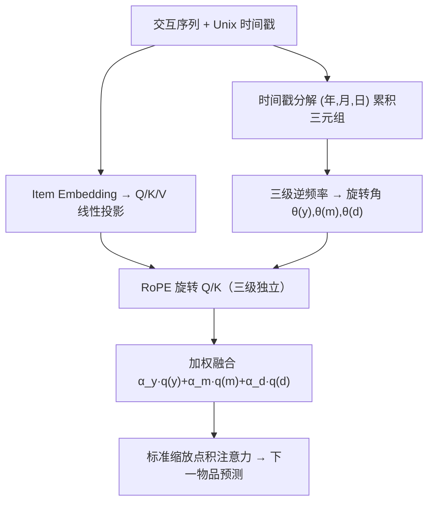
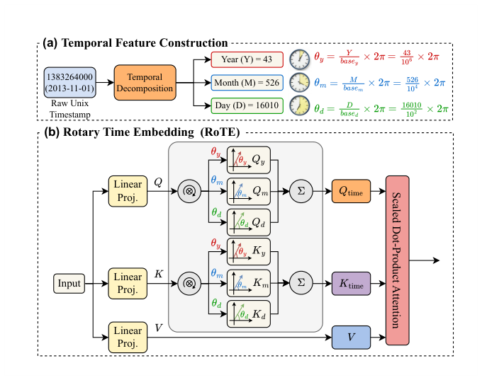

# RoTE: Coarse-to-Fine Multi-Level Rotary Time Embedding for Sequential Recommendation (由粗到细的多级旋转时间嵌入序列推荐)

- **会议/期刊**: SIGIR 2026
- **作者与机构**: Haolin Zhang、Xiu Li（清华深圳国际研究生院）；Longtao Xiao、Ruixuan Li（华中科技大学）；Guohao Cai（华为诺亚方舟实验室）
- **推荐链路定位**: 召回（序列编码器内部表征增强，端到端可插拔）
- **研究方向**: 序列与会话推荐 / 生成式推荐
- **论文原文**: [https://arxiv.org/abs/2604.13389v1](https://arxiv.org/abs/2604.13389v1)
- **开源代码**: [https://github.com/XiaoLongtaoo/RoTE](https://github.com/XiaoLongtaoo/RoTE)

## TL;DR (1分钟核心速览)

现有序列推荐把交互按时间戳排序后仅用位置编码建模，等价于"把时间当等距序号"，丢弃了真实时间跨度与多尺度语义。RoTE 将 Unix 时间戳分解为年/月/日三级累积量，用三组不同基频的旋转角分别对 Query/Key 做 RoPE 式旋转并加权融合，使注意力分数天然感知相对时间差。作为即插即用模块替换位置编码，在三个 Amazon 5-core 数据集、Leave-One-Out + Full-Ranking 协议下，SASRec 与 RPG 全线提升，Toys 上 NDCG@5 相对 RPG 提升 20.11%。

## Background & Motivation (背景与核心矛盾)

- **主流范式**: 传统判别式（SASRec/BERT4Rec）与生成式（TIGER/RPG/HSTU）序列推荐均按时间戳排序构序列，再依赖可学习或正弦位置编码注入时序信息。
- **前人局限**: 其一，位置编码只保留相对次序、假设交互等距，真实场景中"隔 3 天"与"隔 3 月"被压成同一偏移；其二，绝对时间戳是单一连续标量，与用户"年尺度长期兴趣漂移、月尺度季节偏好、日尺度即时意图"的分层时间感知不匹配，多尺度信号被纠缠或丢弃。
- **核心洞察 (Key Insight)**: 时间对用户是**层级语义量**而非数值量；而 RoPE 的旋转角恰好是"相对差可加分解"的天然载体——两向量内积只依赖角度差，正好编码时间间隔。
- **本文切入点**: 把时间戳拆成 (年, 月, 日) 累积三元组，各用独立基频生成旋转角，在注意力内部直接旋转 Q/K，实现"时间差感知"而非"位置序号感知"。

## Method (核心方法设计)

### 1. 整体框架 (Overall Architecture)

输入为用户交互序列的 item embedding，经标准线性投影得到 $Q,K,V$；同时将每条交互的 Unix 时间戳$t_k$分解为累积三元组$(y_k,m_k,d_k)$（自 1970-01-01 起累计的年/月/日数，如 1971-01-01 记为$(1,12,365)$）。对每个粒度$l\in\{y,m,d\}$计算逆频率向量与旋转角，分别对$Q,K$施加 RoPE 旋转得到三组时间感知表征，按标量权重$\alpha_y,\alpha_m,\alpha_d$加权融合后送入标准缩放点积注意力；$V$ 与注意力公式、训练目标均不改动，故可直接替换原位置编码模块。

<figure class="paper-figure" markdown="span">
  <figcaption>图1：所提出的RoTE模块示意图。</figcaption>
</figure>

### 2. 关键设计拆解 (Key Designs)

1. **多粒度时间特征构造（把标量时间变成层级序数）**：直接对绝对时间戳做旋转会让"年"与"日"共享同一频率谱，粗粒度漂移被细粒度抖动淹没。RoTE 定义 $t_k\to(y_k,m_k,d_k)$，累积计数保证单调有序且跨粒度可比，为后续分级频率提供语义基础。

2. **分级旋转时间嵌入（让注意力感知相对时间差）**：对每个粒度 $l$取逆频率$\omega_i^{(l)}=(\text{base}^{(l)})^{-2i/d}$，旋转角$\theta_k^{(l)}=v_k^{(l)}\cdot\boldsymbol{\omega}^{(l)}$，其中$v_k^{(l)}\in\{y_k,m_k,d_k\}$；再以偶奇维配对做二维旋转的向量化形式：
$$\mathbf{q}_k^{(l)}=\mathbf{q}_k\odot\cos\boldsymbol{\theta}_k^{(l)}+\text{rotate}(\mathbf{q}_k)\odot\sin\boldsymbol{\theta}_k^{(l)}$$
$\mathbf{k}_k^{(l)}$同理，$\text{rotate}(\cdot)$为偶奇交换并取负的固定置换。由于旋转保范且内积只依赖角度差$\theta_k-\theta_j$，注意力分数自动编码两交互的时间间隔；三级独立旋转再融合$\mathbf{q}_k^{\text{time}}=\sum_l\alpha_l\mathbf{q}_k^{(l)}$，粗粒度大权重（$\alpha_y=1.5>\alpha_m=1.0>\alpha_d=0.5$）对应长期兴趣、细粒度小权重对应短期意图。基频设为$\text{base}^{(y)}=10^6,\text{base}^{(m)}=10^4,\text{base}^{(d)}=10^2$，使不同粒度覆盖不同周期带宽，避免频率混叠。

3. **训练目标、负采样与推理效率**：损失完全沿用骨干（SASRec 用 CE/BPR 式下一物品分类，RPG 用自回归生成似然），RoTE 不引入额外监督或负采样策略；参数量反而略降（位置嵌入表被免查表的计算式编码替代，SASRec 817.02K→813.76K），FLOPs 仅 +1.8%（6.21M→6.32M），推理延迟 1.686ms→2.423ms，仍为毫秒级。

## Experimental Setup & Evaluation Protocol (实验设置与评估协议)

- **数据集与预处理**: 三个 Amazon Reviews 公开基准，均取 `5-core` 版本（用户与物品至少 5 次交互），按时间戳排序，序列截断/填充至最大长度 50。

| 数据集 | #Users | #Items | #Interactions | 密度 | 场景说明 |
| :--- | :---: | :---: | :---: | :---: | :--- |
| Sports and Outdoors | 35,598 | 18,357 | 296,175 | 0.00045 | 户外运动，最稀疏 |
| Beauty | 22,363 | 12,101 | 198,360 | 0.00073 | 美妆 |
| Toys and Games | 19,412 | 11,924 | 167,526 | 0.00073 | 玩具游戏 |

- **数据划分与防穿越**: 标准 `Leave-One-Out`——每用户最后一条交互为测试、倒数第二条为验证、其余训练；结果取 5 个随机种子平均。
- **排名评测协议**: 采用 `Full-Ranking`（对全库未交互物品排序），指标 Recall@{5,10} 与 NDCG@{5,10}；显著性用配对 t 检验，$p<0.05$。
- **对比基线与超参设置**: 传统类 GRU4Rec、Caser、BERT4Rec、SASRec；生成式类 VQ-Rec、TIGER、HSTU、RPG。RoTE 仅替换 SASRec 与 RPG 的位置编码，其余架构与超参沿用原实现；融合权重 $\alpha_y=1.5,\alpha_m=1.0,\alpha_d=0.5$。

## Key Experimental Results (实验关键数据)

### 1. 主实验对比 (Main Results)

| 方法 | Sports R@10 | Sports N@10 | Beauty R@10 | Beauty N@10 | Toys R@10 | Toys N@10 |
| :--- | :---: | :---: | :---: | :---: | :---: | :---: |
| SASRec | 0.0347 | 0.0189 | 0.0604 | 0.0311 | 0.0688 | 0.0375 |
| BERT4Rec | 0.0191 | 0.0099 | 0.0347 | 0.0170 | 0.0203 | 0.0099 |
| TIGER | 0.0400 | 0.0225 | 0.0648 | 0.0384 | 0.0712 | 0.0432 |
| HSTU | 0.0414 | 0.0215 | 0.0704 | 0.0389 | 0.0669 | 0.0357 |
| RPG | 0.0419 | 0.0241 | 0.0730 | 0.0422 | 0.0759 | 0.0446 |
| **RoTE-SASRec** | **0.0372** | **0.0202** | **0.0638** | **0.0336** | **0.0747** | **0.0420** |
| Improv. (vs SASRec) | +7.20% | +6.88% | +5.63% | +8.04% | +8.58% | +12.00% |
| **RoTE-RPG** | **0.0456** | **0.0266** | **0.0742** | **0.0438** | **0.0852** | **0.0521** |
| Improv. (vs RPG) | +8.83% | +10.37% | +1.64% | +3.79% | +12.26% | +16.82% |

（Toys 上 RoTE-RPG 的 R@5/N@5 相对 RPG 分别提升 17.51%/20.11%，为全文最大增益。）

### 2. 消融实验 (Ablation Study)

Toys and Games 数据集上逐级引入时间粒度：

| 配置 | SASRec R@10 | SASRec N@10 | RPG R@10 | RPG N@10 |
| :--- | :---: | :---: | :---: | :---: |
| Backbone（位置编码） | 0.0688 | 0.0375 | 0.0759 | 0.0446 |
| + Pure Timestamp | 0.0713 | 0.0403 | 0.0838 | 0.0498 |
| + Y | 0.0701 | 0.0387 | 0.0815 | 0.0467 |
| + Y + M | 0.0725 | 0.0409 | 0.0846 | 0.0505 |
| + Y + M + D (RoTE) | **0.0747** | **0.0420** | **0.0852** | **0.0521** |

### 3. 关键实验发现 (Key Findings)

1. **"有真实时间"比"有时间结构"更关键**：仅用绝对时间戳旋转（Pure Timestamp）已把 RPG 的 N@10 从 0.0446 拉到 0.0498（+11.7%），说明时间跨度信号本身是主要增益来源；而 Y+M+D 再进一步到 0.0521，证明层级分解带来额外约 4.6% 的增量。
2. **粒度增益单调但非均匀**：Y→Y+M 在 SASRec 上 N@10 提升 0.0387→0.0409，而 Y+M→Y+M+D 仅 0.0409→0.0420，说明月粒度承载了主要的季节性中周期信息，日粒度贡献边际递减，提示可针对数据周期特性裁剪粒度以省算力。
3. **生成式骨干受益更大**：RoTE 对 RPG 的增益（Toys N@5 +20.11%）显著高于对 SASRec（+11.29%），推测自回归解码对时间上下文更敏感、且 RPG 原位置编码更弱；同时 Beauty 上增益最小（N@10 仅 +3.79%），暗示该数据集时间间隔分布较均匀、时间信号冗余度高。

## Highlights & Limitations (亮点、对比与审稿批判)

- **与代表作对比 (vs. Prior Work)**: 相比 TIGER/RPG 仅靠语义 ID 与位置编码隐式吸收时序，RoTE 显式注入真实时间差；相比 TiSASRec 类时间间隔矩阵建模，RoTE 不引入额外注意力偏置参数、不改注意力公式，且天然支持多粒度；相比纯 RoPE（如 RoPE 在 LLM 中的位置用法），本文把"位置序号"替换为"日历累积量"，是语义化改造。
- **可迁移亮点**: ① 用"多基频旋转 + 加权融合"编码任意多尺度连续变量（如价格档位、地理距离），可迁移至 POI 与跨域场景；② 免查表计算式编码替代大嵌入表，对 embedding table 膨胀的工业召回模型有直接压缩价值。
- **审稿级局限批判**: ① 仅在 3 个 Amazon 域、序列长度 50 上验证，未覆盖长序列（>200）与强周期场景（新闻/音乐），粒度选择（年/月/日）对分钟级高频场景不适用；② 延迟虽为毫秒级但相对 SASRec 增加约 44%（1.686→2.423ms），且融合权重 $\alpha$ 与基频 base 为手工设定，缺少敏感性分析与自动学习方案；③ 未与 TiSASRec、时间感知图模型等显式时间基线直接对比，说服力略打折。

## Rating (四维评分)

- **方法创新性 (Novelty)**: ⭐⭐⭐⭐ （把 RoPE 的"相对差可加"性质巧妙嫁接到日历层级时间上，思路简洁但理论深度有限，属优雅的工程化创新）
- **评估协议与实验扎实度 (Protocol & Experiments)**: ⭐⭐⭐⭐ （三数据集 + Full-Ranking + 5 种子 + 配对 t 检验规范，消融逐级清晰；但缺时间感知专项基线与超参敏感性分析）
- **写作与数学规范度 (Clarity & Rigor)**: ⭐⭐⭐⭐ （旋转公式与向量化 rotate 算子定义干净、符号统一，复杂度分析到位；融合权重设定缺乏推导依据）
- **工业落地与复现价值 (Industrial & Practical Value)**: ⭐⭐⭐⭐⭐ （即插即用、代码开源、参数不增反降、毫秒级延迟，可直接替换现有序列召回模型的位置编码，落地成本极低）

