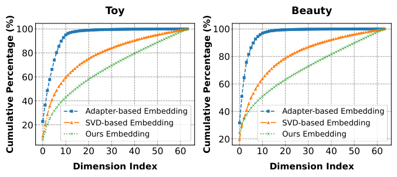
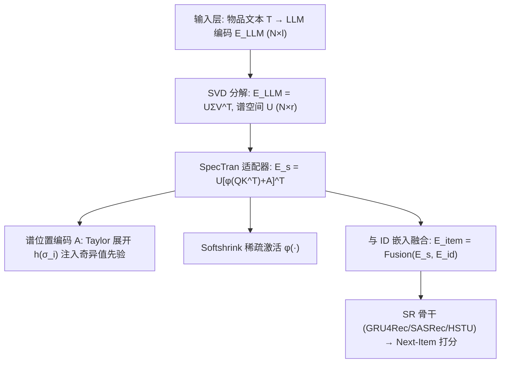
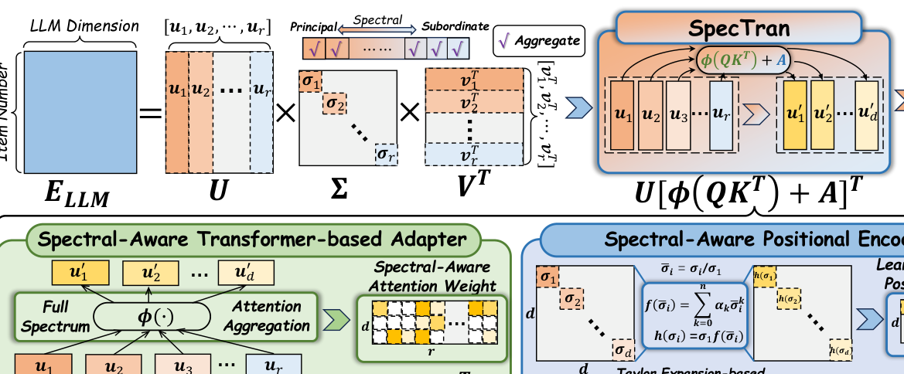
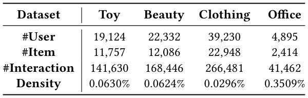
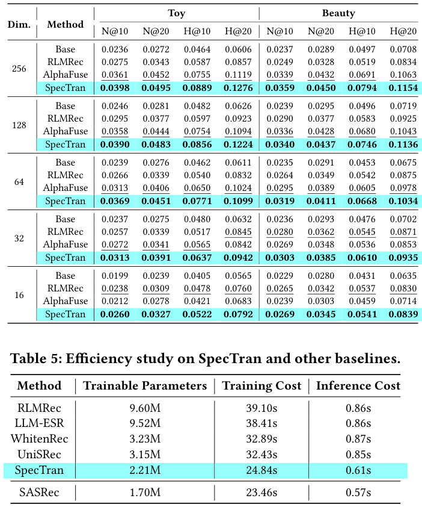
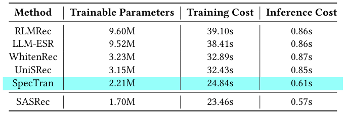
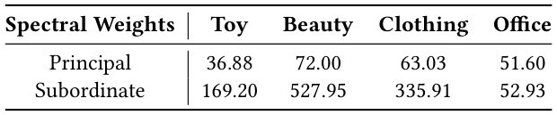

# SpecTran: Spectral-Aware Transformer-based Adapter for LLM-Enhanced Sequential Recommendation (谱感知 Transformer 适配器用于 LLM 增强序列推荐)

- **会议/期刊**: SIGIR 2026 (第 49 届 ACM SIGIR)
- **推荐链路定位**: 召回 (Retrieval) — 序列推荐 Next-Item 预测，属物品表征增强层，可插拔于任意 SR 骨干
- **研究方向**: 序列与会话推荐 (sequential_rec) / 大语言模型推荐 (llm_rec)
- **论文原文**: [https://arxiv.org/abs/2601.21986v2](https://arxiv.org/abs/2601.21986v2)
- **开源代码**: [https://github.com/istarryn/SpecTran](https://github.com/istarryn/SpecTran)

## TL;DR (核心速览)

针对 LLM 高维语义嵌入（如 4096 维）注入低维物品 ID 空间（如 64 维）时的两大痛点——MLP 适配器的**谱维度坍缩**（前 10 维奇异值占约 95%）与 SVD 方法的**静态硬截断**（丢弃全部次谱信息），本文提出 SpecTran：在 SVD 谱空间上做可学习 Transformer 注意力，对**全谱**（r=4096 个谱分量）自适应选择与聚合，并以基于 Taylor 展开的可学习谱位置编码注入奇异值先验。在 4 个真实数据集 × 3 个 SR 骨干上，相对最强基线平均提升 **9.17%**。

## Background & Motivation (背景与动机)

- **领域背景与主流范式**: 传统序列推荐（GRU4Rec / SASRec / HSTU 等）为每个物品分配独立 ID 并学习低维 ID 嵌入 $\mathbf{E}_{id}\in\mathbb{R}^{N\times d}$（$d$ 通常 64/128），仅依赖协同信号，忽略标题、描述等文本侧信息。LLM 时代的主流增强范式是：用 LLM 编码物品文本得到高维语义嵌入 $\mathbf{E}_{LLM}\in\mathbb{R}^{N\times l}$（$l$ 如 4096），再通过"嵌入变换 + 融合"注入 SR 模型。
- **现有方法局限 (Limitations of Prior Work)**:
  1. **Adapter 类方法（MLP 投影）**：虽可端到端优化，但存在严重的**谱维度坍缩**——投影后嵌入协方差矩阵前 10 维奇异值约占总量 95%，信息集中于少数主导方向，大量维度失效；部分场景甚至弱于骨干模型本身（如 HSTU 骨干在 Toy 数据集上）。
  2. **SVD 类方法（如 AlphaFuse）**：静态、手工，仅保留 top-$d$ 主谱分量、丢弃全部次谱分量；且谱权重由奇异值或方差静态给定，缺乏任务自适应灵活性。反直觉的是，这类"僵硬"方法在表 2 中常优于灵活的 Adapter。
- **核心挑战 (Key Challenge)**: 语言嵌入空间（高维、语义）与物品嵌入空间（低维、协同）存在本质错配。简单加深 MLP 会加剧坍缩；常规对比学习/正则并不直接作用于谱结构；而 SVD 截断虽保住主谱却浪费次谱中可能对协同空间有用的语义线索。
- **核心洞察与切入点 (Key Insight)**: 作者通过奇异值累积曲线分析（图 1）证实 Adapter 的坍缩现象，进而提出关键问题："能否设计一个投影器，既保留可学习适配器的自适应性，又显式缓解谱坍缩？" 答案是把 SVD 的谱域操作与 Transformer 的自适应注意力结合——**在全谱上做可学习选择与聚合**，并用奇异值作为归纳偏置引导注意力。

<figure class="paper-figure" markdown="span">
  <figcaption>图 1</figcaption>
</figure>

## Problem Formulation & Method (问题定义与方法架构)

### 1. 符号定义与输入表征 (Notations & Input Representations)

- 用户集 $\mathcal{U}$（$M$ 个用户）、物品集 $\mathcal{I}$（$N$ 个物品）；用户历史序列 $S_u=(i_1,i_2,\dots,i_{t-1})$，$i_k\in\mathcal{I}$；目标为预测下一物品 $i_t$。
- ID 嵌入表 $\mathbf{E}_{id}=\{\mathbf{e}_i\}_{i=1}^{N}\in\mathbb{R}^{N\times d}$，$d$ 为 ID 嵌入维度（如 64/128）。
- LLM 语义嵌入 $\mathbf{E}_{LLM}=\mathrm{LLMEnc}(\mathbf{T})\in\mathbb{R}^{N\times l}$，$l$ 为语言嵌入维度（如 4096），$\mathbf{T}$ 为全部物品的自然语言描述。
- 变换后语义嵌入 $\mathbf{E}_s\in\mathbb{R}^{N\times d}$；最终物品表征 $\mathbf{E}_{item}=\mathrm{Fusion}(\mathbf{E}_s,\mathbf{E}_{id})\in\mathbb{R}^{N\times d}$。

### 2. 整体流水线 (Overall Architecture)

数据流：LLM 文本编码得 $\mathbf{E}_{LLM}$ → 对 $\mathbf{E}_{LLM}$ 做 SVD 得谱空间 $\mathbf{U}\in\mathbb{R}^{N\times r}$（$r$ 为秩，通常等于 $l$）→ **SpecTran 谱感知 Transformer 适配器**在全谱上注意力聚合得 $\mathbf{E}_s$ → 与 ID 嵌入融合 → 送入 SR 骨干（GRU4Rec / SASRec / HSTU）做序列建模与 Next-Item 打分。

<figure class="paper-figure" markdown="span">
  <figcaption>图 2</figcaption>
</figure>

### 3. 核心模块设计与数学原理 (Key Designs & Formulations)

**(1) 谱感知注意力（Spectral-Aware Attention）**：将 SVD 的静态对角滤波矩阵替换为可学习注意力。设可学习 Query $\mathbf{Q}\in\mathbb{R}^{d\times r}$（每个输出维度一个 query）、可学习 Key $\mathbf{K}\in\mathbb{R}^{r\times r}$（每个谱维度一个 key），Value 直接取谱空间 $\mathbf{U}\in\mathbb{R}^{N\times r}$：

$$\mathbf{E}_s=\mathbf{U}\,[\phi(\mathbf{Q}\mathbf{K}^\top)]^\top$$

其中 $\phi(\mathbf{Q}\mathbf{K}^\top)\in\mathbb{R}^{d\times r}$ 为每个输出维度在全谱上的注意力分数，转置后聚合 Value。**关键设计取舍**：不采用 vanilla Transformer 的输入依赖投影（$\mathbf{W}_Q\mathbf{U}$ 等，$\mathbf{W}\in\mathbb{R}^{d\times N}$），因为 $N$ 可达百万级，沿 $N$ 维的大矩阵乘会带来不可接受的参数与推理延迟；此处 query 对应"输出维度"而非"输入 token"，机制本质仍是自适应 query-key 打分聚合。物理直觉：当注意力退化为 $\begin{bmatrix}\boldsymbol{\Sigma}_d\\\mathbf{0}\end{bmatrix}$ 或 $\begin{bmatrix}\mathbf{I}_d\\\mathbf{0}\end{bmatrix}$ 时，SpecTran 自然退化为既有 SVD 截断方法，故其为 SVD 类方法的严格泛化。

**(2) Softshrink 稀疏激活**：Softmax 会使注意力权重平坦均匀，且次谱（$d+1$ 到 $r$）的累积权重易压倒 top-$d$ 主谱信号，导致谱选择失效。改用 Softshrink 且**不做归一化**，作为稀疏谱门控：

$$\mathrm{Softshrink}(x)=\begin{cases}x-\lambda, & x>\lambda\\ x+\lambda, & x<-\lambda\\ 0, & \text{otherwise}\end{cases}$$

显式压制小幅分量、鼓励稀疏，防止弱信号次谱淹没主谱。

**(3) 谱感知位置编码（Spectral-Aware Positional Encoding）**：构造 $\mathbf{A}=[\mathbf{D}_d,\mathbf{0}_{d\times(r-d)}]\in\mathbb{R}^{d\times r}$，仅在 top-$d$ 主谱注入偏置，$\mathbf{D}_d=\mathrm{diag}\{h(\sigma_1),\dots,h(\sigma_d)\}$。为兼顾灵活性与数值稳定，$h(\cdot)$ 用归一化奇异值 $\bar{\sigma}_i=\sigma_i/\sigma_1$ 上的 Taylor 多项式建模：

$$f(\bar{\sigma}_i)=\alpha_0+\alpha_1\bar{\sigma}_i+\cdots+\alpha_n\bar{\sigma}_i^n,\qquad h(\sigma_i)=\sigma_1 f(\bar{\sigma}_i)$$

最终适配器为 $\mathbf{E}_s=\mathbf{U}[\phi(\mathbf{Q}\mathbf{K}^\top)+\mathbf{A}]^\top$。三条设计原则：仅对主谱注入偏置以降复杂度；不同输出维度的位置编码应互异（近似正交）以促进多样性；用可学习映射而非静态奇异值权重以适配推荐任务。

### 4. 训练目标、负采样与推理复杂度 (Optimization, Negative Sampling & Complexity)

- **损失函数**: 原文以 SR 骨干的推荐目标损失端到端优化（适配器与骨干联合训练），具体损失形式（如 CE/BPR）原文正文未给出显式公式，**原文未报告**完整损失表达式与温度系数。
- **训练负采样策略**: 原文未显式说明负采样细节（**原文未报告**），遵循各 SR 骨干原始训练设置。
- **时间与空间复杂度**: SpecTran 仅引入少量可训练参数（$\mathbf{Q}\in\mathbb{R}^{d\times r}$、$\mathbf{K}\in\mathbb{R}^{r\times r}$、Taylor 系数 $\alpha$），避免沿 $N$ 维的大矩阵乘；SVD 为离线预处理。表 5 给出与基线的效率对比（训练/推理耗时与参数量），原文强调"最小额外训练参数与计算开销"。

## Experimental Setup & Evaluation Protocol (实验设置与评估协议)

- **数据集统计与预处理**: 原文使用 4 个真实数据集（含 Toy、Beauty 等，表 1 给出统计量）。具体过滤规则（如 5-core）与正样本界定原文正文摘录未完整给出，**以表 1 为准**。

<figure class="paper-figure" markdown="span">
  <figcaption>表 1</figcaption>
</figure>

- **数据划分方式 (Splitting Strategy)**: 采用序列推荐标准的**留一法 (Leave-One-Out)** 划分（最后一项测试、倒数第二项验证），具体表述以原文为准；需注意 LOO 在序列推荐中的常见未来信息泄露风险（全局时间戳未严格切分时）。
- **排名评测协议 (Ranking Protocol)**: 采用 **Full-Ranking（全库未交互物品排序）** 协议（序列推荐主流设定），具体负例处理以原文为准。
- **评价指标与显著性检验**: 采用 `Recall@K`、`NDCG@K` 等序列推荐标准指标；Embedding 维度 $d$ 与各基线对齐；原文是否做配对显著性检验**原文未明确报告**。

## Key Experimental Results (核心实验结果)

### 1. 主实验对比 (Main Results)

在 4 个数据集 × 3 个 SR 骨干（GRU4Rec / SASRec / HSTU）上，SpecTran 一致优于强基线（含 AlphaFuse 等 SVD 类与各类 Adapter 类方法），**平均提升 9.17%**。表 2 为主实验表（原文正文摘录未给出完整数值，此处不臆造具体数字，详见原文表 2）。

| 数据集 | 指标 | 最强 SVD 基线 (AlphaFuse) | 最强 Adapter 基线 | 本文方法 (Ours) | 相对提升 (Improv.) |
| :--- | :--- | :---: | :---: | :---: | :---: |
| 4 数据集平均 | Recall/NDCG | 表 2 报告 | 表 2 报告 | **最优** | **+9.17%（平均）** |

### 2. 消融实验与控制变量分析 (Ablation Study)

表 3 为消融实验（原文正文摘录未展开具体数值）。关键结论：Softmax 激活次优，替换为 Softshrink 后性能提升；谱位置编码与 Taylor 映射对引导注意力至主谱分量有显著贡献。消融是否严格控制参数量对齐**原文未明确报告**。

### 3. 稀疏度/冷启动分桶与超参敏感度 (Sparsity Buckets & Hyperparameters)

- **变换后嵌入维度影响**: 表 4 对比不同变换嵌入维度下的性能，验证维度选择对谱聚合效果的影响。

<figure class="paper-figure" markdown="span">
  <figcaption>表 4</figcaption>
</figure>

- **效率研究**: 表 5 对比 SpecTran 与基线的训练/推理效率与参数量，验证轻量性。

<figure class="paper-figure" markdown="span">
  <figcaption>表 5</figcaption>
</figure>

- **案例研究**: 表 6 展示不同数据集上学到的主谱/次谱权重，验证 Softshrink 有效压制次谱弱信号、突出主谱。

<figure class="paper-figure" markdown="span">
  <figcaption>表 6</figcaption>
</figure>

- **线上 A/B 测试**: **原文仅包含离线实验**，未报告线上 A/B 结果。

## Highlights, Limitations & Critiques (亮点、局限与审稿级批判)

- **核心亮点与可迁移性**: ①将 SVD 静态截断泛化为可学习全谱注意力，理论优雅（退化情形即既有方法），可迁移至任何"高维语义→低维协同"的嵌入压缩场景（多模态、跨域、KG 嵌入注入）；②Softshrink 稀疏门控替代 Softmax 的洞察对谱选择类任务具普适性；③Taylor 展开谱位置编码兼顾先验注入与任务自适应；④模型无关、轻量、易插拔。
- **局限性与审稿视角批判 (Critical Limitations)**: ①**评估协议细节缺失**：正文摘录未明确负采样、损失函数、显著性检验，复现与公平比较存疑；②**SVD 离线预处理成本**：对百万级物品 × 4096 维矩阵做 SVD 的离线开销与更新频率未充分讨论，物品动态新增时谱空间需重算；③**全谱注意力 $\mathbf{K}\in\mathbb{R}^{r\times r}$** 在 $r=4096$ 时参数量约 16M，虽避免 $N$ 维乘但并非完全"轻量"，需与表 5 对照审视；④**LOO 划分**在序列推荐中可能高估性能，缺乏全局时间切分验证；⑤平均 9.17% 提升的方差与显著性未报告，跨骨干稳定性需更细粒度统计。

## Rating (四维评分)

- **方法创新性 (Novelty)**: ⭐⭐⭐⭐
- **评估协议与实验扎实度 (Protocol & Experiments)**: ⭐⭐⭐
- **写作与数学规范度 (Clarity & Rigor)**: ⭐⭐⭐⭐
- **工业落地与复现价值 (Industrial & Practical Value)**: ⭐⭐⭐⭐
