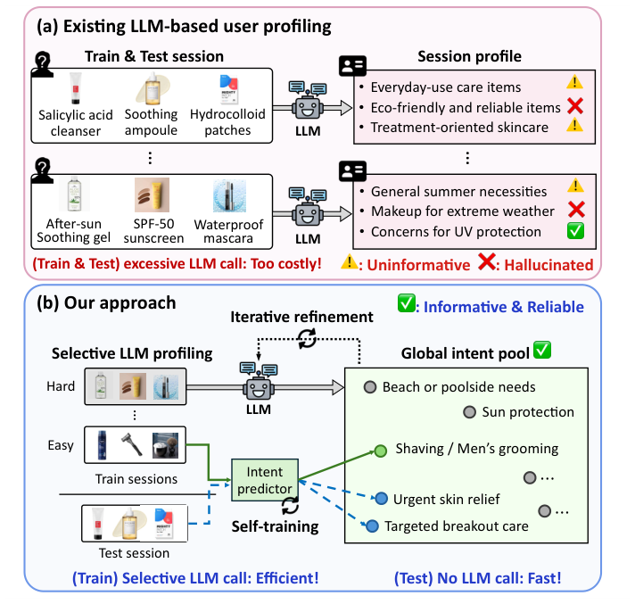
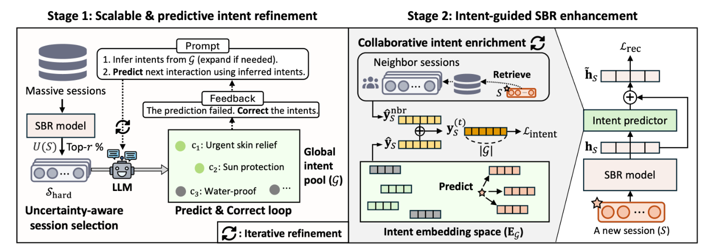
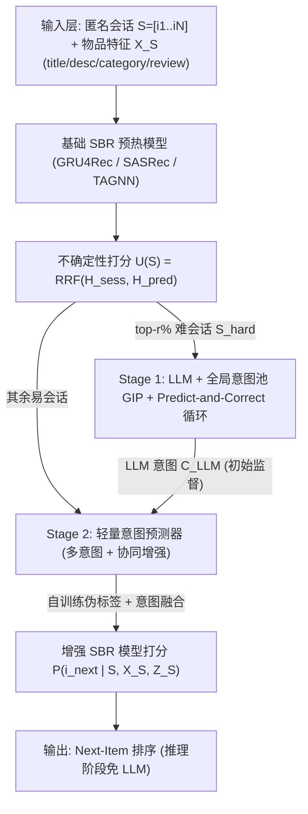
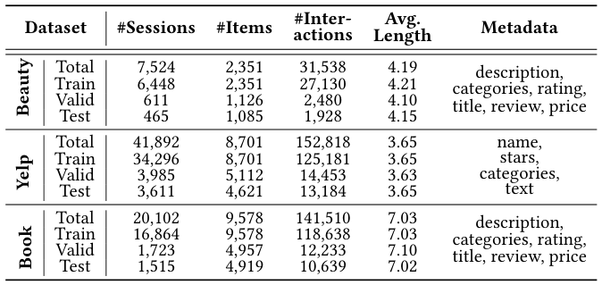
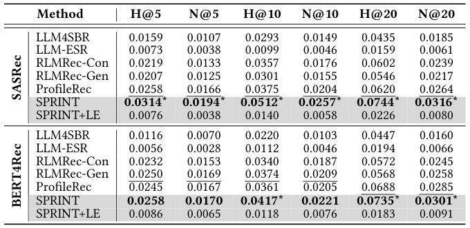
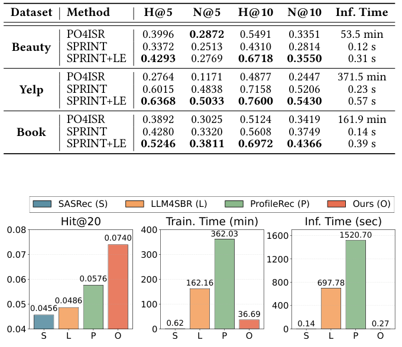

# SPRINT: Scalable and Predictive Intent Refinement for LLM-Enhanced Session-based Recommendation (面向LLM增强会话推荐的可扩展预测性意图精炼)

- **会议/期刊**: SIGIR 2026 (第49届国际ACM SIGIR会议，2026年7月20–24日，墨尔本)
- **推荐链路定位**: 召回 (Retrieval) — 会话级 Next-Item 预测，作为 SBR 模型增强模块
- **研究方向**: 序列与会话推荐 (主) / 大语言模型推荐 LLM4Rec (次)
- **论文原文**: [https://arxiv.org/abs/2508.00570v3](https://arxiv.org/abs/2508.00570v3)
- **开源代码**: [https://github.com/Gyu-Seok0/SPRINT_SIGIR26](https://github.com/Gyu-Seok0/SPRINT_SIGIR26)

## TL;DR (核心速览)

针对会话推荐 (SBR) 中会话上下文极度稀缺 (C1) 与 LLM 逐会话调用不可扩展 (C2) 两大痛点，SPRINT 提出两阶段框架：训练阶段仅对"高不确定性"会话选择性调用 LLM，并以**全局意图池 (GIP)** 约束生成、以**推荐效用 (留出末项预测是否命中)** 验证意图可靠性 (Predict-and-Correct 循环)；随后将 LLM 意图蒸馏进一个**轻量意图预测器**，通过自训练 + 协同意图增强泛化到全部会话，**推理阶段完全免 LLM 调用**。在 Beauty/Yelp/Book 三个真实数据集上，SPRINT 在 Recall@20/NDCG@20 上一致超越 SOTA，同时大幅降低训练与推理时间。

## Background & Motivation (背景与动机)

- **领域背景与主流范式**: SBR 面向匿名、短会话场景（未登录浏览），主流范式从 RNN (GRU4Rec) → GNN (TAGNN/SR-GNN) → Transformer (SASRec/BERT4Rec) 演进。近年 LLM 通过 **user profiling**（生成用户画像/persona/intent 文本）增强传统推荐模型 (CRM)，代表路线包括 embedding transfer、语义特征增强、辅助监督，以及本文关注的 **LLM-enhanced SBR**（EGRec、LLM4SBR）与 **LLM-as-SBR**（PO4ISR、Re2LLM）。
- **现有方法局限 (Limitations of Prior Work)**:
  1. **上下文稀缺导致画像无效 (C1)**: 会话平均长度极短（Yelp 平均 3.63），且匿名无用户 ID，无法利用长期历史；自由形式 LLM 生成易产生噪声与幻觉，且同一概念表述不一致（"eco-friendly" vs "environmentally friendly"）。已有 self-reflection 方法（如 [38]）只保证逻辑自洽，**不保证推荐效用**。
  2. **可扩展性差 (C2)**: 训练阶段需为海量孤立会话逐一调用 LLM，离线成本极高；推理阶段因匿名性必须**在线实时调用 LLM**，叠加迭代反思/记忆反思/提示优化后训练与推理时间可翻倍以上，难以落地。
  3. **LLM-as-SBR 范式**（PO4ISR/Re2LLM）虽有效，但推理开销巨大；**LLM-enhanced 范式**中 EGRec 需昂贵微调且可能损害预训练知识，LLM4SBR 将意图退化为简单 item title，表达力受限，且二者均未针对推荐性能显式优化 LLM 输出。
- **核心挑战 (Key Challenge)**: 为什么简单拼接 LLM 文本嵌入不行？因为 (1) 测试会话无预生成意图，仍需在线 LLM 调用；(2) 静态文本嵌入无法反映一个会话内**多个意图的不同重要性**；(3) 无约束生成在短上下文下幻觉严重。
- **核心洞察与切入点 (Key Insight)**: 作者将意图生成从"自由文本生成"重构为**受限意图空间上的意图识别问题**——用可扩展的全局意图池约束输出空间；并用"能否正确预测被留出的末项"作为意图是否**有信息量 (informativeness)** 的客观判据，形成 predict-and-correct 闭环。同时观察到：只有**高不确定性会话**才真正需要 LLM 推理，其余会话可由轻量预测器从行为模式中推断意图。

<figure class="paper-figure" markdown="span">
  <figcaption>图 1</figcaption>
</figure>

## Problem Formulation & Method (问题定义与方法架构)

### 1. 符号定义与输入表征 (Notations & Input Representations)

- 物品集 $\mathcal{I}$；会话 $S=[i_1,i_2,\dots,i_N]$，目标为预测下一物品 $i_{\text{next}}$。
- 全部会话集 $\mathcal{S}$ 划分为不相交的 $\mathcal{S}_{\text{train}}$ 与 $\mathcal{S}_{\text{test}}$。
- 特征字段集 $\mathcal{F}$（title、description、categories、reviews 等），物品特征元组 $x_i=(x_f)_{f\in\mathcal{F}}$，会话特征矩阵 $X_S=[x_1,x_2,\dots,x_N]$。
- 传统 SBR 模型 $\text{SBR}(\cdot)$ 参数 $\theta$，会话表征 $h_S\in\mathbb{R}^d$，物品嵌入 $e_i\in\mathbb{R}^d$；LLM 输出意图集 $Z_S=\text{LLM}(X_S)$。
- 增强形式：$P_\theta(i_{\text{next}}\mid S)\leftarrow \text{SBR}(S, X_S, Z_S)$。

### 2. 整体流水线 (Overall Architecture)

两阶段：**Stage 1** 用基础 SBR 模型（仅训练会话预热）计算不确定性，选出 top-$r\%$ 难会话 $\mathcal{S}_{\text{hard}}$，仅对这些会话调用 LLM，在全局意图池 GIP 约束下执行 Predict-and-Correct 循环，产出可靠意图集 $\mathcal{C}^{\text{LLM}}_S$ 并扩充 GIP；**Stage 2** 训练轻量意图预测器（多意图预测 + 协同意图增强 + 意图融合），以 LLM 意图为初始监督、以无 LLM 意图会话的高置信预测为伪标签自训练，最终推理时**零 LLM 调用**。

<figure class="paper-figure" markdown="span">
  <figcaption>图 2</figcaption>
</figure>

### 3. 核心模块设计与数学原理 (Key Designs & Formulations)

**(1) 不确定性感知难会话选择 (Uncertainty-aware Hard Session Selection)**

对每个训练会话计算两个互补不确定性：

$$H_{\text{sess}}(S)=-\sum_{i\in S}P_\theta(i\mid S)\log P_\theta(i\mid S),\qquad H_{\text{pred}}(S)=-\log P_\theta(i_N\mid S_{1:N-1})$$

其中 $P_\theta(i\mid S)=\dfrac{\exp(h_S^\top e_i)}{\sum_{j\in\mathcal{I}}\exp(h_S^\top e_j)}$。$H_{\text{sess}}$ 刻画会话内部兴趣不一致性（交互多样），$H_{\text{pred}}$ 刻画模型对末项预测的置信缺失。二者用 **Reciprocal Rank Fusion** 融合（尺度无关）：

$$U(S)=\frac{1}{k+r_{\text{sess}}(S)}+\frac{1}{k+r_{\text{pred}}(S)},\quad k=60$$

取 $U(S)$ 最高的 top-$r\%$（$r=10$）为 $\mathcal{S}_{\text{hard}}$。**物理直觉**：只有原始交互难以辨别模式的会话才最需要 LLM 的语义推理，其余会话的 LLM 调用是冗余的。

**(2) 全局意图池 GIP 与 Predict-and-Correct 循环 (Predictive Intent Refinement)**

GIP 初始化：$\mathcal{G}=\text{LLM}(P_{\text{GIP}}(D))$，提示词要求"为领域 $D$ 生成从通用到领域特定的最小意图集合"。对每个 $S\in\mathcal{S}_{\text{hard}}$，构造**意图验证任务**：留出末项 $i_N$，候选集 $I_S=\{i_N,i_{\text{out}_1},\dots,i_{\text{out}_M}\}$（$M=5$ 个会话外随机物品）。LLM 联合执行"从 $\mathcal{G}$ 识别/必要时新增意图"与"基于意图预测留出项"：

$$\mathcal{C}^{(0)}_S,\ \hat{i}\leftarrow\text{LLM}(P_{P\&C}(V^{(0)}_S)),\quad V^{(0)}_S=(X_S, X_{I_S}, \mathcal{G})$$

若 $\hat{i}=i_N$ 则接受 $\mathcal{C}^{\text{LLM}}_S=\mathcal{C}^{(0)}_S$ 并终止；否则追加语言反馈 $R^{(t)}_S$（"预测失败，请修正意图并重试"）更新输入 $V^{(t+1)}_S=(V^{(t)}_S, R^{(t)}_S)$，最多 $T=3$ 轮。**新意图仅在通过验证后才并入** $\mathcal{G}\leftarrow\mathcal{G}\cup\mathcal{C}^{\text{LLM}}_S$。**物理直觉**：以推荐效用（而非语言流畅性或逻辑自洽）作为意图有效性的唯一判据，直接对齐下游任务；受限意图空间同时抑制幻觉与表述漂移。最终意图池规模：Beauty 120、Yelp 135、Book 118。

**(3) 轻量意图预测器 + 协同意图增强 + 意图融合 (Intent Predictor & Collaborative Enrichment)**

意图预测器为轻量模块，输入会话表征，输出**多意图**分布（一个会话可对应多个动机），可灵活挂接任意 SBR 模型。训练采用**自训练**：LLM 意图作为初始监督；对无 LLM 意图的会话，按交互模式的高置信预测迭代纳入伪标签。进一步设计**协同意图增强**：预测器借助行为模式相似的**邻居会话**精炼自身意图预测，弥补单会话上下文不足。最后通过**意图融合机制**将多面意图注入 SBR 表征（替代简单文本嵌入拼接，从而体现多意图的不同重要性）。

### 4. 训练目标、负采样与推理复杂度 (Optimization, Negative Sampling & Complexity)

- **损失函数**: 原文正文（截取部分）未完整给出总损失 $\mathcal{L}$ 的显式公式与各分项权重/温度系数 $\tau$，仅说明由"意图预测监督（LLM 意图 + 自训练伪标签）"与"下一物品推荐损失"联合优化；**具体公式原文未在可见文本中报告**。
- **训练负采样策略**: 意图验证阶段使用 $M=5$ 个**会话外随机物品**作为候选负例（Uniform 随机采样）；SBR 主任务的负采样细节原文未在可见部分明确报告。
- **时间与空间复杂度**: 训练侧 LLM 调用量从"全部会话"降至"top-10% 难会话 × 最多 3 轮 P&C"；推理侧**完全免 LLM**，仅需轻量意图预测器前向。图 3 与表 4 给出定量对比（见下）。

## Experimental Setup & Evaluation Protocol (实验设置与评估协议)

- **数据集统计与预处理**: 使用 Beauty、Yelp、Book 三个真实数据集（Diginetica 风格 SBR 基准体系）。

<figure class="paper-figure" markdown="span">
  <figcaption>表 1</figcaption>
</figure>

> 注：原文可见文本未展开表 1 的具体数值（用户/物品/交互数、过滤规则如 5-core 等），**具体统计量原文表格未在提取文本中呈现**，此处不做臆造。

- **数据划分方式 (Splitting Strategy)**: 会话级划分，$\mathcal{S}_{\text{train}}\cap\mathcal{S}_{\text{test}}=\varnothing$；每个会话以**末项作为留出目标** $i_N$（即 Leave-One-Out 式的会话内 next-item 预测），前 $N-1$ 项为输入。属于标准 SBR 的 LOO 会话切分，未见全局时间戳切分描述。
- **排名评测协议 (Ranking Protocol)**: 采用 SBR 领域标准的 **Full-Ranking（全物品库排序）** 协议（由 $P_\theta(i\mid S)$ 对全库 $\mathcal{I}$ 归一化打分可推知），未使用 1:99 负采样排序。
- **评价指标与显著性检验**: Recall@20、NDCG@20（主表口径）；效率侧报告总推理时间与训练时间。**是否进行配对显著性检验原文可见文本未报告**。

## Key Experimental Results (核心实验结果)

### 1. 主实验对比 (Main Results)

原文主表（Beauty/Yelp/Book 上的 Recall@20、NDCG@20 对比 GRU4Rec、SASRec、TAGNN、EGRec、LLM4SBR、PO4ISR 等）在提取文本中未给出完整数值表，故此处**不填造数值**。可确认的结论为：SPRINT 在三个数据集上**一致优于所有 SOTA 基线**，且提供更具可解释性的推荐。

<figure class="paper-figure" markdown="span">
  <figcaption>表 3</figcaption>
</figure>

表 3 显示：在统一使用 Llama-3.3-70B-Instruct 的受控设置下，SPRINT 作为 LLM-enhanced CRM 在 Beauty 上取得最优性能（具体数值见原文表 3）。

### 2. 消融实验与控制变量分析 (Ablation Study)

原文对每个提出组件（不确定性选择、GIP 约束、P&C 循环、意图预测器、协同意图增强、自训练）进行了深入分析。可见文本中明确报告的关键结论包括：$r$ 取不同值时性能**鲁棒**且训练时间显著下降（$r=10$ 为默认）；P&C 循环的验证机制对意图可靠性至关重要。**各模块移除后的具体下降幅度数值原文可见文本未完整呈现**。

### 3. 稀疏度/冷启动分桶与超参敏感度 (Sparsity Buckets & Hyperparameters)

- **难/易会话分桶**: 核心设计即按不确定性分桶——仅 top-$r\%$ 难会话走 LLM，其余走轻量预测器；实验表明该策略在 $r$ 变化下性能稳健。
- **关键超参数**: 难会话比例 $r=10$、P&C 最大迭代 $T=3$、候选集大小 $M=5$、RRF 阻尼常数 $k=60$；意图池最终规模 120/135/118（Beauty/Yelp/Book）。
- **效率对比 (核心卖点)**:

<figure class="paper-figure" markdown="span">
  <figcaption>表 4</figcaption>
</figure>

<figure class="paper-figure" markdown="span">
  <figcaption>图 3</figcaption>
</figure>

表 4 与图 3 共同表明：相比 LLM-as-SBR 的 PO4ISR，SPRINT 在**精度更高**的同时，**总推理时间大幅缩短**（因推理阶段零 LLM 调用），训练时间亦因选择性调用而显著降低。

- **线上 A/B 测试**: 原文仅包含离线实验，**未报告线上 A/B 结果**。

## Highlights, Limitations & Critiques (亮点、局限与审稿级批判)

- **核心亮点与可迁移性**:
  1. **"以推荐效用验证 LLM 输出"** 的 P&C 闭环极具普适性，可迁移到任意 LLM 生成辅助信号的推荐任务（如用户画像、解释生成、查询改写）。
  2. **受限意图空间 (GIP)** 将开放式生成转为闭集识别，是抑制短上下文幻觉的通用工程范式。
  3. **不确定性感知的选择性 LLM 调用 + 轻量蒸馏** 是 LLM4Rec 落地的关键折中，推理零 LLM 依赖对工业实时系统价值高。
  4. 多意图建模 + 协同邻居增强，兼顾了会话内多动机与跨会话协同信号。
- **局限性与审稿视角批判 (Critical Limitations)**:
  1. **评估协议细节披露不足**: 提取文本未完整给出数据集统计、负采样细节、显著性检验与主表全量数值，复现与横向比较需依赖附录/代码。
  2. **意图池的领域依赖**: GIP 初始化依赖领域提示词 $D$，跨域迁移时意图池需重建；意图池规模（~120）是否对长尾/多品类领域足够，缺乏敏感性分析。
  3. **不确定性选择的偏差风险**: 仅对高熵会话调用 LLM，可能系统性忽略"低熵但被模型自信误判"的会话（confidently wrong），存在覆盖盲区。
  4. **P&C 验证信号较弱**: 以单个留出末项 + 5 个随机负例的 1-of-6 命中作为意图有效性判据，信号噪声较大，随机负例难度低可能高估意图质量。
  5. **效率对比口径**: 表 4 的总推理时间为全测试集累计时间，缺少单请求延迟 (ms/request) 与峰值显存报告，工业实时性论证仍不充分。

## Rating (四维评分)

- **方法创新性 (Novelty)**: ⭐⭐⭐⭐ （受限意图池 + 效用验证 + 选择性蒸馏的组合设计新颖且自洽）
- **评估协议与实验扎实度 (Protocol & Experiments)**: ⭐⭐⭐☆ （三数据集 + 效率分析充分，但统计显著性与部分表格细节披露不足）
- **写作与数学规范度 (Clarity & Rigor)**: ⭐⭐⭐⭐ （问题刻画清晰、算法伪代码完整，损失函数细节略欠）
- **工业落地与复现价值 (Industrial & Practical Value)**: ⭐⭐⭐⭐⭐ （推理零 LLM 调用、训练选择性调用，直接契合实时 SBR 部署需求，且已开源）
