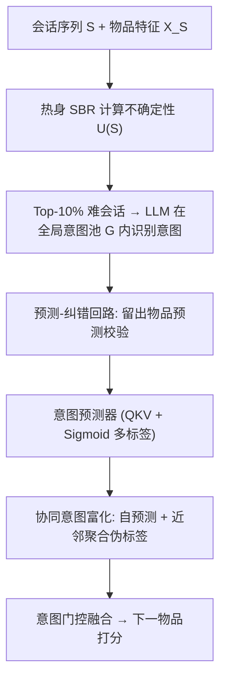

# SPRINT: Scalable and Predictive Intent Refinement for LLM-Enhanced Session-based Recommendation (面向 LLM 增强会话推荐的可扩展预测式意图精炼)

- **会议/期刊**: SIGIR 2026
- **作者与机构**: Gyuseok Lee, Wonbin Kweon, Zhenrui Yue, Yaokun Liu, Yifan Liu, Susik Yoon, Dong Wang, SeongKu Kang（UIUC / Korea University）
- **推荐链路定位**: 召回（会话级 Next-Item 预测）
- **研究方向**: 序列与会话推荐 / 大语言模型推荐
- **论文原文**: [https://arxiv.org/abs/2508.00570v3](https://arxiv.org/abs/2508.00570v3)
- **开源代码**: [https://github.com/Gyu-Seok0/SPRINT_SIGIR26](https://github.com/Gyu-Seok0/SPRINT_SIGIR26)

## TL;DR (1分钟核心速览)

会话推荐（SBR）的会话短且匿名，直接把 LLM 用户画像搬过来会撞上两堵墙：上下文稀缺导致画像空洞/幻觉（C1），以及海量孤立会话使训练与推理的 LLM 调用成本爆炸（C2）。SPRINT 把意图生成改写成「在可扩展全局意图池上做意图识别」，用「预测-纠错」回路以推荐效用为唯一验收标准；训练时只对不确定性最高的 10% 会话调用 LLM，再自训练出轻量意图预测器覆盖全量会话，推理阶段完全不调 LLM。在 Beauty/Yelp/Book 三个数据集、SASRec 与 BERT4Rec 双骨干、全库排序协议下，Beauty 上 H@20 相对最强基线提升约 18.6%，而推理延迟从分钟级降到 0.12 秒。

## Background & Motivation (背景与核心矛盾)

- **主流范式**: LLM 增强推荐的主流做法是「LLM 生成画像/意图 → 注入传统推荐模型」，如 LLM4SBR 从标题抽长短意图、RLMRec 做语义-协同双视图对齐、ProfileRec 用自反思生成双画像。
- **前人局限**: 其一，SBR 会话平均长度仅 3.6–7.0，且无用户 ID，LLM 在贫信息输入下产出宽泛（"summer necessities"）甚至幻觉的画像；其二，ProfileRec 类方法的自反思/记忆反思会让训练与推理时间翻倍以上，而匿名性又迫使推理时逐会话实时调用 LLM，工业上不可行。
- **核心洞察 (Key Insight)**: 画像「看起来合理」不等于「对推荐有用」——现有方法的校验目标是逻辑自洽（self-reflection），而非推荐效用；同时，真正需要 LLM 推理的只是那些从原始交互中看不出模式的「难会话」。
- **本文切入点**: 把意图生成约束进共享意图池 + 以留出物品预测正确与否作为意图验收信号，并把 LLM 的推理能力蒸馏进一个无 LLM 依赖的轻量预测器。

## Method (核心方法设计)

### 1. 整体框架 (Overall Architecture)

SPRINT 分两阶段。Stage 1：先用热身好的 SBR 模型给全部训练会话打不确定性分，取 top-10% 难会话调用 LLM；LLM 在全局意图池 $\mathcal{G}$ 内做「识别而非自由生成」，并通过「预测-纠错」回路反复校验意图是否真能预测留出物品，通过者入池。Stage 2：以 LLM 意图为初始标签训练轻量意图预测器（QKV 结构 + sigmoid 多标签），再用自预测与近邻聚合做标签富化，最后按相关性阈值把意图 value 向量融进会话表示，端到端训练 SBR。推理时只跑预测器与 SBR，零 LLM 调用。

### 2. 关键设计拆解 (Key Designs)

1. **不确定性感知的难会话选择**：若对所有会话调 LLM 则成本不可承受，而随机采样又会把算力浪费在简单会话上。本文用会话熵与预测难度两个互补信号，经倒数排名融合（RRF）合成统一分数：
$U(S)=\frac{1}{k+r_{\text{sess}}(S)}+\frac{1}{k+r_{\text{pred}}(S)},\quad k=60$其中$H_{\text{sess}}$刻画会话内部兴趣发散度，$H_{\text{pred}}=-\log P_\theta(i_N|S_{1:N-1})$ 刻画模型对末位物品的置信缺失。RRF 的好处是尺度无关，避免两个熵量纲不一致时的权重调参。

2. **全局意图池 + 预测-纠错回路**：自由生成的两个病根是幻觉与同义异形（"eco-friendly" vs "environmentally friendly"）。GIP 先由领域提示初始化一个紧凑意图集（最终 Beauty/Yelp/Book 分别仅 120/135/118 个意图），LLM 优先从池中识别，仅在无匹配时才新建概念。验收标准被定义为推荐效用：构造候选集 $I_S=\{i_N,i^{\text{out}}_1,\dots,i^{\text{out}}_M\}$（$M=5$），令 LLM 依据意图预测留出物品，
$\mathcal{C}^{(0)}_S,\hat{i}\leftarrow\text{LLM}(P_{P\&C}(V^{(0)}_S))$若$\hat{i}=i_N$则接受意图并入库，否则回灌语言反馈$V^{(t+1)}_S=(V^{(t)}_S,R^{(t)}_S)$重试，最多$T=3$ 轮。直觉是：只有能真正区分「本会话末位物品 vs 域内外物品」的意图才被保留，从源头掐断宽泛无效概念。

3. **意图预测器、协同富化与训练目标**：为摆脱推理期 LLM 依赖，用 QKV 匹配会话与意图，$\hat{y}_{Sc}=\sigma(\mathbf{q}_S^\top\mathbf{k}_c)$，此处刻意用 sigmoid 而非 softmax——一个会话可同时对应多个非互斥意图。标签从 LLM 硬标签出发，按 epoch 用$\mathbf{y}^{(t)}_S=\frac{1}{2}(\hat{\mathbf{y}}_S+\hat{\mathbf{y}}^{\text{nbr}}_S)$富化，其中近邻项由 mini-batch 内 top-$K$余弦相似会话加权聚合，既补全无 LLM 标签的会话，又把二值标签软化为重要性概率。融合侧用阈值$\tau=0.5$门控：$\tilde{\mathbf{h}}_S=\mathbf{h}_S+\text{Dropout}(\text{LN}(\mathbf{h}_S+\sum_c\phi(\hat{y}_{Sc})\mathbf{v}_c))$。总损失为
$\mathcal{L}=\mathcal{L}_{\text{Rec}}+\lambda_{\text{intent}}\mathcal{L}_{\text{intent}}+\lambda_{\text{ortho}}\mathcal{L}_{\text{ortho}}$
负采样采用「1 随机 + 1 来自 P&C 回路误判物品的硬负例」，意图正交损失拉开意图嵌入的语义区分度。

## Experimental Setup & Evaluation Protocol (实验设置与评估协议)

- **数据集与预处理**: 三个真实数据集，均做 `5-core` 过滤：

| 数据集 | #Sessions | #Items | #Interactions | 平均长度 | 特征/场景说明 |
| :--- | :---: | :---: | :---: | :---: | :--- |
| Beauty | 7,524 | 2,351 | 31,538 | 4.19 | 标题/类目/评论/价格，美妆电商 |
| Yelp | 41,892 | 8,701 | 152,818 | 3.65 | 商户名/星级/类目/文本，本地生活 |
| Book | 20,102 | 9,578 | 141,510 | 7.03 | 同 Beauty 字段，图书电商 |

- **数据划分与防穿越 (Splitting Strategy)**: 按每个会话末位事件的时间戳排序，取第 80/90 百分位为切点，做 8:1:1 的**全局时间戳切分**，训练/验证/测试会话互斥。
- **排名评测协议 (Ranking Protocol)**: 主实验为**全库排序（Full-Ranking）**，指标 Hit@$\{5,10,20\}$与 NDCG@$\{5,10,20\}$，五次随机种子取均值；与 LLM-as-SBR 的对比（表 4）则采用 20 候选（1 正 + 19 个 SASRec 预训练负例）的采样排序协议。
- **对比基线与超参设置**: 基线覆盖隐式意图（ELCRec、MiaSRec）、显式意图（FAPAT、CaFe）、LLM 增强（LLM4SBR、LLM-ESR、RLMRec-Con/Gen、ProfileRec）三类；骨干为 SASRec 与 BERT4Rec，2 层 2 头、$d=64$；LLM 默认 GPT-3.5-turbo，另用 Llama-3.3-70B-Instruct 复验；显著性用配对 t 检验（$p<0.05$）。

## Key Experimental Results (实验关键数据)

### 1. 主实验对比 (Main Results)

Beauty 与 Book（SASRec 骨干，Full-Ranking，节选）：

| 数据集 | 方法 | H@5 | N@5 | H@10 | N@10 | H@20 | N@20 |
| :--- | :--- | :---: | :---: | :---: | :---: | :---: | :---: |
| Beauty | SASRec (骨干) | 0.0198 | 0.0132 | 0.0297 | 0.0164 | 0.0456 | 0.0203 |
| Beauty | ELCRec | 0.0267 | 0.0170 | 0.0357 | 0.0199 | 0.0590 | 0.0258 |
| Beauty | FAPAT | 0.0250 | 0.0159 | 0.0383 | 0.0201 | 0.0594 | 0.0254 |
| Beauty | LLM-ESR | 0.0168 | 0.0104 | 0.0323 | 0.0154 | 0.0503 | 0.0199 |
| Beauty | RLMRec-Con | 0.0215 | 0.0139 | 0.0349 | 0.0180 | 0.0624 | 0.0249 |
| Beauty | ProfileRec | 0.0224 | 0.0146 | 0.0357 | 0.0188 | 0.0598 | 0.0250 |
| Beauty | **SPRINT** | **0.0331** | **0.0201** | **0.0503** | **0.0256** | **0.0740** | **0.0316** |
| Beauty | Improv.% vs 最优基线 | +23.9% | +18.2% | +31.7% | +28.6% | +18.6% | +26.4% |
| Book | ProfileRec | 0.0293 | 0.0183 | 0.0503 | 0.0250 | 0.0763 | 0.0315 |
| Book | **SPRINT** | **0.0341** | **0.0224** | **0.0548** | **0.0290** | **0.0796** | **0.0352** |
| Book | Improv.% vs 最优基线 | +16.4% | +22.4% | +8.9% | +16.0% | +4.3% | +11.7% |

Yelp 上 SPRINT 同样全面领先（H@5 0.0495 vs ProfileRec 0.0451，+9.8%）；BERT4Rec 骨干下 Beauty 的 H@20 由 0.0538 升至 0.0680（+26.4%）。

### 2. 消融实验 (Ablation Study)

Beauty 数据集（SASRec 骨干）：

| 配置 | H@5 | N@5 | H@20 | N@20 |
| :--- | :---: | :---: | :---: | :---: |
| 全关（纯骨干） | 0.0198 | 0.0132 | 0.0456 | 0.0203 |
| + (A) LLM 意图 | 0.0271 | 0.0164 | 0.0585 | 0.0257 |
| + (B) P&C 回路与 GIP | 0.0310 | 0.0192 | 0.0619 | 0.0280 |
| + (C) 自预测富化 | 0.0323 | 0.0195 | 0.0632 | 0.0282 |
| + (D) 近邻富化 | 0.0327 | 0.0197 | 0.0675 | 0.0295 |
| 全部组件 | **0.0331** | **0.0201** | **0.0740** | **0.0316** |

### 3. 关键实验发现 (Key Findings)

1. **P&C 回路是最大单点增益来源**：仅加 LLM 意图（A）把 H@20 从 0.0456 提到 0.0585，而叠加 GIP+P&C（B）再涨到 0.0619，说明「以推荐效用验收意图」比「有意图」本身更关键；近邻富化（D）单独贡献 H@20 +0.0043，验证协同信号对稀疏会话的补全价值。
2. **效率与精度可同时占优**：Beauty 上 SPRINT 训练耗时 36.69 分钟、推理 0.27 秒，而 ProfileRec 为 362.03 分钟 / 1520.70 秒，LLM4SBR 为 162.16 分钟 / 697.78 秒；相对 LLM-as-SBR 的 PO4ISR，Yelp 推理从 371.5 分钟压到 0.23 秒，H@5 反而从 0.2764 升到 0.6015。
3. **意图监督比例极具鲁棒性**：仅用 10% 会话的 LLM 意图即可逼近 100% 监督的效果，且显著优于 0% 设置；近邻数 $K=0$时性能骤降、$K=5$ 达峰，说明小规模行为近邻已足够，无需大邻域开销。

## Highlights & Limitations (亮点、对比与审稿批判)

- **与代表作对比 (vs. Prior Work)**: 相比 LLM4SBR 把意图退化为物品标题、EGRec 需微调 LLM 且有损预训练知识，SPRINT 用意图池 + 效用验收保证意图质量；相比 ProfileRec 的自反思画像，SPRINT 把反思目标从「逻辑自洽」换成「能否预测留出物品」，并把 LLM 能力蒸馏到推理期零调用，这是效率差距（0.27s vs 1520s）的根源。
- **可迁移亮点**: ①「以留出物品预测正确性作为 LLM 生成信号的验收器」可平移到跨域标签生成、查询改写等任意无监督信号场景；②「不确定性采样 + 自训练伪标签 + 近邻聚合」的三段式蒸馏范式，适合任何需要 LLM 但受延迟约束的在线系统。
- **审稿级局限批判**: ① P&C 回路的候选集仅 1 正 + 5 随机负例，验收信号偏弱，且随机负例可能让「宽泛意图」侥幸通过，缺少对难负例的鲁棒性分析；② 意图池规模（120/135/118）与领域提示强绑定，跨域迁移时需重新初始化，且论文未报告池规模膨胀对预测器 softmax-free 多标签头的长尾影响；③ SPRINT+LE 在 Llama 嵌入下性能崩塌（Beauty H@5 仅 0.0076），暴露高维语义嵌入与 64 维会话空间的维度失配问题，作者仅归因于「需更好的对齐」，未给出解法。

## Rating (四维评分)

- **方法创新性 (Novelty)**: ⭐⭐⭐⭐ （把意图生成重构为受限池上的识别问题，并以推荐效用替代逻辑自洽作为验收标准，思路干净且有别于现有 LLM 画像范式）
- **评估协议与实验扎实度 (Protocol & Experiments)**: ⭐⭐⭐⭐ （三数据集 × 双骨干 × 全库排序 + 配对 t 检验 + 完整消融与效率分析，但 P&C 候选集构造偏弱、缺少难负例压力测试）
- **写作与数学规范度 (Clarity & Rigor)**: ⭐⭐⭐⭐ （两阶段流程与公式定义清晰，RRF、sigmoid 多标签、门控融合的动机均有交代，复杂度分析略简）
- **工业落地与复现价值 (Industrial & Practical Value)**: ⭐⭐⭐⭐⭐ （推理零 LLM 调用、延迟与纯 SASRec 同量级，代码已开源，训练侧仅 10% 会话调 LLM，具备直接上线条件）
