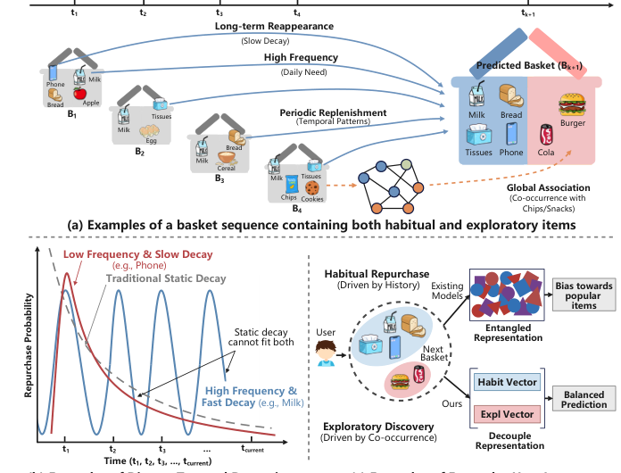
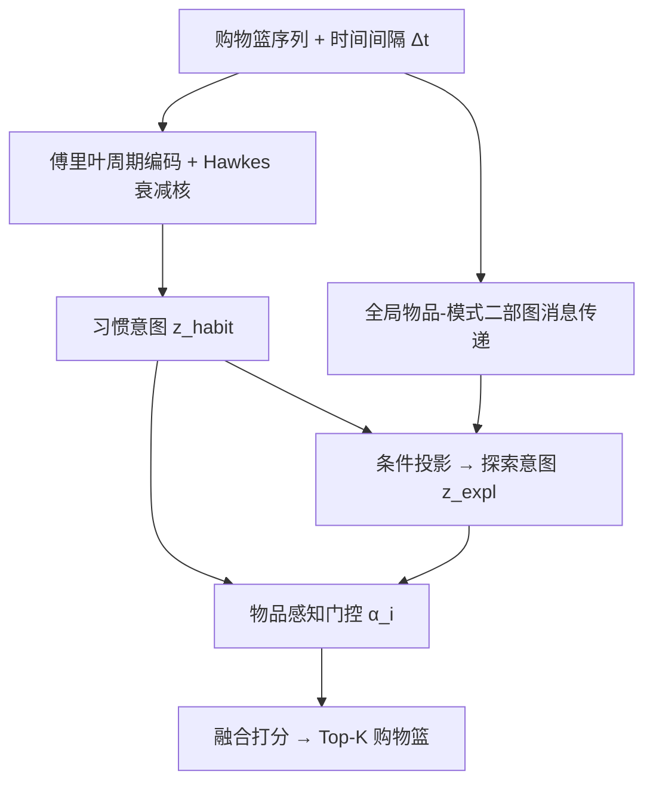
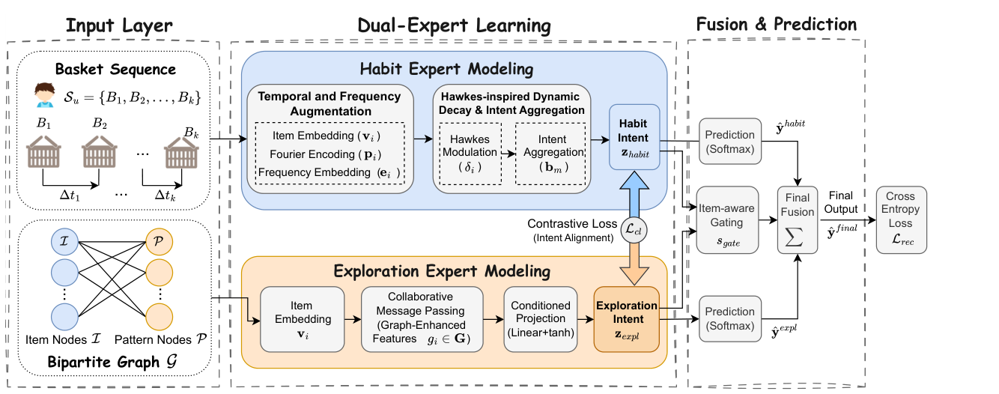

# Time-Interval-Aware Disentangled Expert Modeling for Next-Basket Recommendation (时间间隔感知的解耦专家建模用于下一购物篮推荐)

- **会议/期刊**: SIGIR 2026
- **作者与机构**: Zhiying Deng (华中师范大学)、Yuan Fu、Usman Farooq、Ziwei Tian、Wei Liu、Jianjun Li (华中科技大学)
- **推荐链路定位**: 召回（下一购物篮 Top-K 排序）
- **研究方向**: 序列与会话推荐 / 自监督对比学习与交互去噪
- **论文原文**: [https://arxiv.org/abs/2605.00499v1](https://arxiv.org/abs/2605.00499v1)
- **开源代码**: [https://github.com/Hiiizhy/TIDE](https://github.com/Hiiizhy/TIDE)

## TL;DR (1分钟核心速览)

下一购物篮推荐 (NBR) 中，用户行为同时受"习惯性复购"与"探索性发现"两种冲突动机驱动，但现有方法把二者纠缠在单一表征里，且用离散序列建模忽略连续时间间隔与物品级周期。TIDE 提出 Hawkes 增强的傅里叶时间编码刻画非单调补货节奏，并用"习惯专家 + 模式引导探索专家"双塔解耦意图，再以物品感知门控自适应融合。在 Amazon 四个数据集、Leave-One-Out 全库排序协议下，Beauty 上 R@10 较最强基线 SemTHy 提升 18.4%，Home 上 R@20 提升 34.9%。

## Background & Motivation (背景与核心矛盾)

- **主流范式**: NBR 主流做法分两支——RNN/Transformer 序列模型捕捉篮间依赖，以及静态时间衰减（越近交互权重越高）刻画兴趣演化；近期工作引入超图、对比学习、反事实推断等辅助信号。
- **前人局限**: (1) 静态衰减假设兴趣**单调指数衰减**，但耐用品的单次长峰与日用品的强周期性根本无法用同一衰减曲线拟合，模型无法回答"何时补货"；(2) 复购信号被当作权重或偏置注入单一表征塔，习惯信号在共享隐空间中**压制**了微弱的探索信号，推荐严重偏向热门/重复物品。
- **核心洞察 (Key Insight)**: 作者在四个 Amazon 域上做了统计验证——Grocery 的复购率呈倒 U 型演化、Beauty 的回购间隔呈**双峰分布**（第二峰强度接近第一峰）、Home/Sports 超 90% 物品复购概率为零。这说明时间影响本质非单调，且习惯/探索的配比随域与用户生命周期剧烈变化。
- **本文切入点**: 用 Hawkes 强度核的"激发-衰减"替代单调衰减，用架构级双专家替代共享塔内的隐式解耦。

<figure class="paper-figure" markdown="span">
  <figcaption>图 1：TIDE 的动机。(a) NBR 任务旨在基于历史购物篮序列预测目标时间 𝑡𝑘+1 的下一个购物篮；(b) 多样的时间动态表明捕捉物品特定周期性的必要性；(c) 纠缠的用户意图揭示冲突的消费动机需要解缠表示学习。</figcaption>
</figure>

## Method (核心方法设计)

### 1. 整体框架 (Overall Architecture)

输入为用户按时间戳切分的购物篮序列，每个物品先经"傅里叶周期编码 + 频次嵌入"增强，再由物品级 Hawkes 衰减核调制得到时间感知习惯表征，经篮内注意力聚合为习惯意图 $\mathbf{z}_{habit}$；同时，全局物品-模式二部图上做 LightGCN 式消息传递得到协同增强物品嵌入$\mathbf{g}_i$，并以$\mathbf{z}_{habit}$为条件投影出探索意图$\mathbf{z}_{expl}$；最后物品感知门控对每个候选物品单独计算习惯/探索权重，加权融合两路 softmax 分布输出 Top-K。训练时联合交叉熵与 InfoNCE 意图对齐损失。

<figure class="paper-figure" markdown="span">
  <figcaption>图 3：TIDE 架构，由三个关键模块组成：(1) 习惯专家，通过基于 Hawkes 的强度核和傅里叶编码捕捉非单调补货周期；(2) 探索专家，使用物品-模式二部图检索潜在协同兴趣；(3) 融合与预测，首先通过对比学习弥合两个专家之间的语义差距，并通过物品感知门控机制自适应融合专家输出。</figcaption>
</figure>

### 2. 关键设计拆解 (Key Designs)

1. **Hawkes 增强傅里叶时间编码（解决"何时补货"）**：痛点是用离散位置或单调衰减无法表达双峰周期。作者把物品距上次出现的篮间隔 $\Delta t_i$映射为可学习频率/相位的光谱向量$\mathbf{p}_i=[\sin(\mathbf{w}\Delta t_i+\boldsymbol{\phi});\cos(\mathbf{w}\Delta t_i+\boldsymbol{\phi})]$，再叠加购买频次嵌入$\mathbf{e}_i$得$\mathbf{v}'_i=\mathbf{v}_i+w_t\mathbf{p}_i+w_f\mathbf{e}_i$；随后用物品专属衰减率$\lambda_i=\sigma(e_{\lambda_i})$计算强度$\delta_i=\exp(-\lambda_i\Delta t_i)+\epsilon$，调制得$\mathbf{h}_i=\delta_i\cdot\mathbf{v}'_i$。直觉是：傅里叶项负责"周期性回访"，Hawkes 项负责"交互后的激发尖峰与差异化衰减"，二者相乘使牛奶（高频快衰减）与手机（低频慢衰减）共享同一算子但参数不同。

2. **双专家解耦 + 物品感知门控（解决"习惯压制探索"）**：痛点是在共享塔内两种动机争夺同一隐空间。TIDE 让探索专家不直接看用户历史，而是把习惯意图经 $\mathbf{z}_{expl}=\tanh(\mathbf{W}_{expl}\mathbf{z}_{habit}+\mathbf{b}_{expl})$投影为"检索查询"，去匹配全局图嵌入矩阵$\mathbf{G}$，从而把探索锚定在习惯之上、避免漂向泛热门。门控对每个候选物品独立计算$\alpha_i=\sigma(\mathbf{s}_{gate}^\top\mathbf{v}_i)$，其中$\mathbf{s}_{gate}=\tanh(\mathbf{W}_f[\mathbf{z}_{habit}\oplus\mathbf{z}_{expl}]+\mathbf{b}_f)$，最终$\hat{\mathbf{y}}_{final}=\boldsymbol{\alpha}\odot\hat{\mathbf{y}}_{habit}+(1-\boldsymbol{\alpha})\odot\hat{\mathbf{y}}_{expl}$。物品级（而非用户级）门控是关键：同一篮子里牛奶走习惯、可乐走探索。

3. **训练目标、负采样与推理效率**：总损失 $\mathcal{L}_{total}=\mathcal{L}_{rec}+\mu\mathcal{L}_{cl}+\gamma\|\Theta\|_2^2$，其中$\mathcal{L}_{rec}$为下一篮物品的交叉熵（全库 softmax，等价免负采样），$\mathcal{L}_{cl}$以 batch 内其他用户为负样本做 InfoNCE 对齐$\mathbf{z}_{habit}$与$\mathbf{z}_{expl}$。图传播仅两层线性聚合，推理时图静态复用，额外开销主要来自傅里叶编码的$O(d)$ 逐物品计算。

## Experimental Setup & Evaluation Protocol (实验设置与评估协议)

- **数据集与预处理**: Amazon 基准四域，均做 `5-core` 过滤，按交易时间戳聚合为购物篮序列：

| 数据集 | #Users | #Items | #Interactions | #Baskets | 特征/场景说明 |
| :--- | :---: | :---: | :---: | :---: | :--- |
| Beauty | 2,134 | 1,694 | 54,692 | 26,617 | 混合型，复购率振荡 |
| Sports | 4,094 | 4,726 | 80,954 | 29,589 | 耐用品，探索主导 |
| Grocery | 4,349 | 2,487 | 136,840 | 51,839 | 高频刚需，习惯主导 |
| Home | 11,886 | 9,473 | 256,221 | 101,066 | 极稀疏，>90% 物品零复购 |

- **数据划分与防穿越 (Splitting Strategy)**: `Leave-One-Out`——最后一篮测试、倒数第二篮验证、其余训练，严格按时间戳排序，无穿越。
- **排名评测协议 (Ranking Protocol)**: 无偏 `Full-Ranking`（对全库未交互物品排序），指标 Recall@{10,20} 与 NDCG@{10,20}。
- **对比基线与超参设置**: 基线含 POP、FPMC、Sets2Sets、TIFU-KNN、MMNR、M2、MCRec、HapCL、SemTHy、TREx 共 10 个；嵌入维度 $d=32$，batch size 100，Adam，学习率与$L_2$权重在$\{10^{-4},\dots,10^{-1}\}$网格搜索，$\tau=0.1$，$\epsilon=\lambda=0.1$；所有结果通过配对$t$检验（$p<0.05$）。

## Key Experimental Results (实验关键数据)

### 1. 主实验对比 (Main Results)

| 方法 | Beauty R@10 | Beauty N@10 | Sports R@10 | Grocery R@20 | Home R@10 | Home R@20 |
| :--- | :---: | :---: | :---: | :---: | :---: | :---: |
| POP | 0.0092 | 0.0038 | 0.0078 | 0.0197 | 0.0038 | 0.0042 |
| FPMC | 0.0101 | 0.0043 | 0.0032 | 0.0218 | 0.0046 | 0.0057 |
| Sets2Sets | 0.0628 | 0.0416 | 0.0165 | 0.0618 | 0.0053 | 0.0076 |
| TIFU-KNN | 0.0555 | 0.0282 | 0.0125 | 0.0932 | 0.0056 | 0.0082 |
| M2 | 0.1077 | 0.0639 | 0.0256 | 0.0654 | 0.0092 | 0.0165 |
| MCRec | 0.0931 | 0.0499 | 0.0316 | 0.0839 | 0.0097 | 0.0176 |
| SemTHy | 0.1078 | 0.0597 | 0.0369 | 0.0867 | 0.0131 | 0.0212 |
| TREx | 0.0984 | 0.0626 | 0.0350 | 0.1027 | 0.0123 | 0.0168 |
| **TIDE** | **0.1276** | **0.0728** | **0.0434** | **0.1168** | **0.0160** | **0.0286** |
| Improv.% (vs 最强基线) | +18.4% | +16.3% | +17.6% | +13.7% | +22.1% | +34.9% |

### 2. 消融实验 (Ablation Study)

| 变体 | Beauty R@10 | Sports R@10 | Grocery R@20 | Home R@10 | 说明 |
| :--- | :---: | :---: | :---: | :---: | :--- |
| TIDE 完整 | **0.1276** | **0.0434** | **0.1168** | **0.0160** | — |
| w/o Time | 0.1112 | 0.0339 | 0.1157 | 0.0153 | 去 Hawkes+傅里叶时间建模 |
| w/o Graph | 0.0510 | 0.0181 | 0.0439 | 0.0017 | 去探索专家（二部图） |
| w/o CL | 0.1153 | 0.0421 | 0.1117 | 0.0148 | 去 InfoNCE 意图对齐 |

### 3. 关键实验发现 (Key Findings)

1. **探索专家是稀疏域的命脉**：移除二部图后 Home 的 R@10 从 0.0160 崩至 0.0017（-89.4%），Beauty 从 0.1276 跌至 0.0510（-60.0%），远超其他消融项——说明在 >90% 物品零复购的耐用品域，仅靠个人历史几乎无法召回，全局协同信号不可替代。
2. **时间建模的收益集中在周期性强的域**：w/o Time 在 Beauty（R@10 -12.9%）与 Sports（-21.9%）跌幅最大，而在 Grocery 上仅 -0.9%，印证傅里叶+Hawkes 主要补偿的是非单调双峰节奏，对高频刚需域边际收益有限。
3. **对比对齐是"软增益"但不可省**：w/o CL 的跌幅最小（Sports R@10 0.0434→0.0421），但图 4 显示无 CL 时双意图余弦相似度分布横跨 $[-0.4,0.8]$，有 CL 后收敛至$[0.3,0.8]$ 且消除负相关——对齐的价值在于让门控在语义一致的前提下融合，而非直接提升单路精度。

## Highlights & Limitations (亮点、对比与审稿批判)

- **与代表作对比 (vs. Prior Work)**: 相比 TREx 的"复购-探索"后处理式平衡，TIDE 在架构层显式解耦，避免后处理调参；相比 SemTHy 用超图融合语义与协同信号，TIDE 的探索专家以习惯意图为条件查询，防止探索漂向泛热门；相比 M2 的静态多因子分解，TIDE 用 Hawkes 强度核替换单调衰减，直接建模"何时补货"。
- **可迁移亮点**: (1) 物品级门控 $\alpha_i=\sigma(\mathbf{s}_{gate}^\top\mathbf{v}_i)$ 可低成本移植到任何多兴趣/多场景融合模块，替代用户级粗粒度加权；(2) 用"主意图投影为查询去检索辅助信号"的条件投影范式，可推广到跨域迁移中的非重叠用户对齐。
- **审稿级局限批判**: (1) 二部图在推理期静态不变，无法适应用户偏好快速漂移，且模式挖掘的最小支持度超参呈非单调敏感（2/5 峰值、10/20 谷底、50 回升），工程调参成本高；(2) 仅在 $d=32$、四个 Amazon 域上验证，缺少工业级千万级物品的全库排序延迟与线上 A/B 数据，Hawkes 逐物品衰减计算的扩展性未讨论。

## Rating (四维评分)

- **方法创新性 (Novelty)**: ⭐⭐⭐⭐ （Hawkes 强度核与傅里叶编码的乘积式调制是对单调衰减的实质性替换，双专家+物品级门控的解耦粒度较 TREx 更细，但各组件单独看均非全新）
- **评估协议与实验扎实度 (Protocol & Experiments)**: ⭐⭐⭐⭐ （四域 Full-Ranking + Leave-One-Out + 配对 t 检验规范，10 个基线覆盖全面，消融与模式挖掘/序列建模策略的补充实验充分，缺线上验证）
- **写作与数学规范度 (Clarity & Rigor)**: ⭐⭐⭐⭐ （公式编号完整、符号一致，统计分析与动机图对应清晰；Hawkes 项与傅里叶项为何相乘而非相加缺少理论论证）
- **工业落地与复现价值 (Industrial & Practical Value)**: ⭐⭐⭐⭐ （代码已开源，图传播仅两层线性聚合开销可控，物品级门控易嵌入现有召回链路；静态图与逐物品衰减的在线延迟仍是部署前需验证的点）

