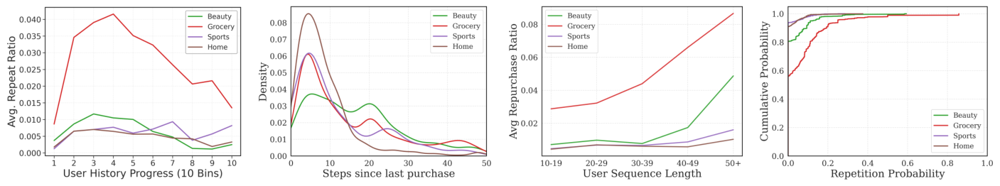
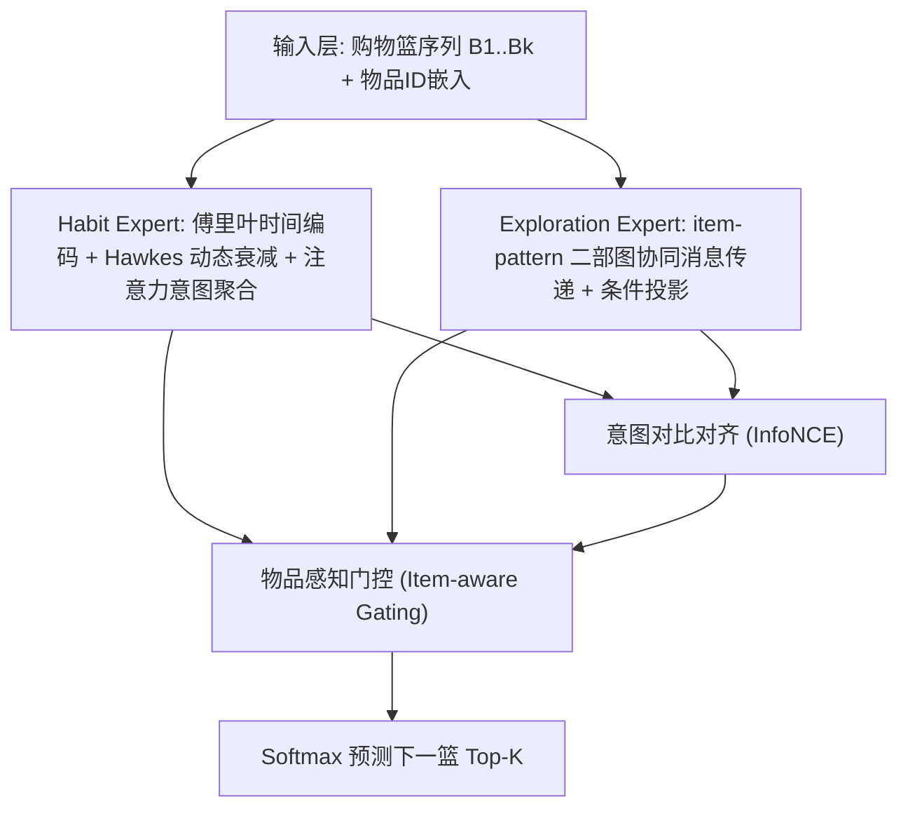
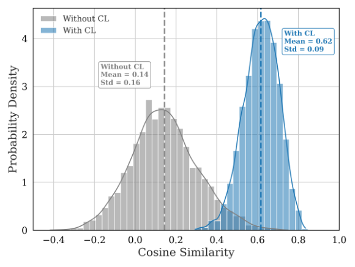
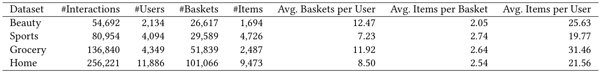
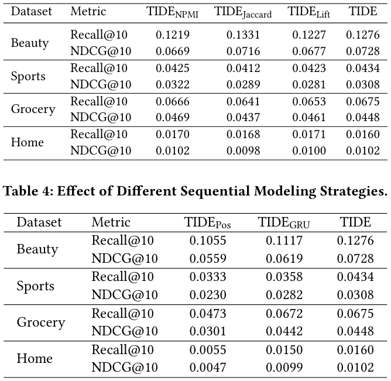

# Time-Interval-Aware Disentangled Expert Modeling for Next-Basket Recommendation (时间间隔感知的解耦专家建模用于下一购物篮推荐)

- **会议/期刊**: SIGIR 2026 (第 49 届国际 ACM SIGIR 会议，Melbourne, VIC, Australia)
- **推荐链路定位**: 召回 (Retrieval) — 下一购物篮 (Next-Basket) 候选物品 Top-K 排序
- **研究方向**: 序列与会话推荐 (sequential_rec) / 自监督对比与解耦表征 (self_supervised_denoising)
- **论文原文**: [https://arxiv.org/abs/2605.00499v1](https://arxiv.org/abs/2605.00499v1)
- **开源代码**: [https://github.com/Hiiizhy/TIDE](https://github.com/Hiiizhy/TIDE)

## TL;DR (核心速览)

针对下一购物篮推荐 (NBR) 中"习惯性复购"与"探索性发现"两类冲突意图被纠缠于单一表征、且离散序列建模忽略连续时间间隔与物品级周期性的痛点，TIDE 提出 Hawkes 增强的傅里叶时间编码刻画物品级非单调补货周期，并用双专家架构（Habit Expert + Pattern-Guided Exploration Expert）配合物品感知门控显式解耦两类意图，在四个 Amazon 数据集上以全库排序协议一致超越 SOTA NBR 基线。

## Background & Motivation (背景与动机)

- **领域背景与主流范式**: NBR 的目标是在给定用户历史购物篮序列 $S_u=(B_1,\dots,B_k)$ 与目标时刻 $t_{k+1}$ 下预测下一篮 $B_{k+1}$。主流范式包括马尔可夫链、RNN/Transformer 序列模型、注意力机制，以及引入超图、对比学习、反事实推断等辅助信号的方法。时间建模上普遍采用**静态单调衰减**（购买后兴趣立即达峰并指数衰减）。
- **现有方法局限 (Limitations of Prior Work)**:
  1. **单调衰减假设过于朴素**：如图 1(b) 所示，日用品（牛奶）呈强非单调周期性补货，耐用品（手机）呈单次长周期峰值，静态衰减无法同时拟合两类节奏，导致无法回答"何时补货"。
  2. **意图纠缠 (Entangled Representation)**：复购习惯信号与探索发现信号在同一隐空间竞争，习惯信号（且偏向热门物品）压制微弱的探索兴趣，如图 1(c)。
  3. **频域方法不适配 NBR**：已有傅里叶/频谱方法（如 FMLP-Rec、频率滤波）面向序列推荐，假设平滑正弦振荡，无法刻画复购事件触发的**强度突增 (excitation spike)**。
- **核心挑战 (Key Challenge)**: 简单的特征拼接或加深网络无法解决——因为冲突根源在于**表征结构层面**的纠缠与**时间建模假设层面**的错误（单调 vs. 非单调），而非容量不足。
- **核心洞察与切入点 (Key Insight)**: 作者在四个 Amazon 数据集上做了系统的行为统计分析（图 2）：
  - **重复率演化**：Grocery 呈倒 U 型，Beauty 呈振荡，Home 平坦——用户意图随生命周期动态变化；
  - **复购间隔分布 (KDE)**：多数域短期峰值 ($\Delta t<10$)，Beauty 呈双峰，证明时间影响非单调；
  - **历史长度影响**：Grocery 重复率随序列长度从 0.03 升至 ~0.08，Beauty 存在长度 40 的阈值效应；
  - **物品级重复概率 CDF**：Home/Sports 超 90% 物品重复概率为 0，Grocery 超 40% 物品有复购——域间异质性极强。
  
  这些观察直接支撑了"物品级非单调周期 + 架构级意图解耦"的设计。

<figure class="paper-figure" markdown="span">
  <figcaption>图 1</figcaption>
</figure>
<figure class="paper-figure" markdown="span">
  <figcaption>图 2</figcaption>
</figure>

## Problem Formulation & Method (问题定义与方法架构)

### 1. 符号定义与输入表征 (Notations & Input Representations)

- 用户集 $\mathcal{U}=\{u_1,\dots,u_{|\mathcal{U}|}\}$，物品集 $\mathcal{I}=\{i_1,\dots,i_{|\mathcal{I}|}\}$。
- 用户 $u$ 的历史为购物篮序列 $S_u=(B_1,B_2,\dots,B_k)$，其中 $B_m\subseteq\mathcal{I}$ 为第 $m$ 个篮（按时间顺序）。
- 任务：给定 $S_u$，预测每个候选物品 $i\in\mathcal{I}$ 进入下一篮 $B_{k+1}$ 的概率，输出 Top-$K$ 排序列表。
- 物品基础嵌入 $v_i\in\mathbb{R}^d$；相对时间间隔 $\Delta t_i=(k+1)-m^{(i)}_{last}$，即目标篮与物品 $i$ 最近一次出现篮索引之间的**篮数间隔**（注意：以篮为单位而非真实时间戳）。

### 2. 整体流水线 (Overall Architecture)

数据流：购物篮序列 → 输入层稠密嵌入 → 双专家并行学习（Habit Expert 建模个性化周期与动态强度；Exploration Expert 基于全局 item-pattern 二部图挖掘协同探索兴趣）→ 对比学习对齐两专家语义 → 物品感知门控融合 → Softmax 预测。

<figure class="paper-figure" markdown="span">
  <figcaption>图 3</figcaption>
</figure>

### 3. 核心模块设计与数学原理 (Key Designs & Formulations)

**(1) Habit Expert：Hawkes 增强的傅里叶时间建模**

- **时间与频率增强**：将离散间隔 $\Delta t_i$ 映射为周期向量（式 1）：
$$p_i=[\sin(w\Delta t_i+\phi);\ \cos(w\Delta t_i+\phi)]$$
其中 $w,\phi\in\mathbb{R}^{d/2}$ 为可学习频率与相位。再叠加购买频次嵌入 $e_i\in\mathbb{R}^d$：
$$v'_i = v_i + w_t p_i + w_f e_i$$
$w_t,w_f$ 为可学习标量，自适应控制时间与频率信号强度。物理直觉：傅里叶基可表达任意非单调周期，突破单调衰减。

- **Hawkes 启发的动态衰减**：为每个物品学习专属衰减率 $\lambda_i=\sigma(e_{\lambda_i})$，动态影响：
$$\delta_i=\exp(-\lambda_i\cdot\Delta t_i)+\epsilon$$
最终时间感知习惯表征 $h_i=\delta_i\cdot v'_i$。物理直觉：复购事件触发强度突增后按物品专属速率衰减，日用品 $\lambda$ 大（快衰减、高频），耐用品 $\lambda$ 小（慢衰减、长周期）。

- **习惯意图聚合**：篮内加性注意力（式 5）$\beta_i=\frac{\exp(v_{att}^\top\tanh(W_{att}h_i))}{\sum_{j\in B_m}\exp(v_{att}^\top\tanh(W_{att}h_j))}$，篮表征 $b_m=\sum_{i\in B_m}\beta_i h_i$，习惯意图 $z_{habit}=\tanh(\sum_{m=1}^k b_m)$。

**(2) Exploration Expert：模式引导的探索专家**

基于全局 **item-pattern 二部图**（物品节点与模式节点）进行协同消息传递，得到图增强特征，再经条件投影（Linear + tanh）得到探索意图 $z_{expl}$。该专家挖掘用户个人历史之外的潜在关联（如与薯片/零食共现的全局关联），弥补习惯信号对探索兴趣的压制。

**(3) 融合与预测：物品感知门控 + 对比对齐**

- 通过 **InfoNCE 对比损失**对齐 $z_{habit}$ 与 $z_{expl}$ 的语义空间，确保门控能协调而非任意混合两个专家表征（图 4 展示了双专家意图余弦相似度的概率密度分布，验证对齐效果）。
- **物品感知门控**根据候选物品自适应平衡复购与探索，输出最终融合表征后经 Softmax 预测。

<figure class="paper-figure" markdown="span">
  <figcaption>图 4</figcaption>
</figure>

### 4. 训练目标、负采样与推理复杂度 (Optimization, Negative Sampling & Complexity)

- **损失函数**: 总损失 = 下一篮预测的**交叉熵损失 (Cross Entropy)** + $\lambda_{cl}\cdot$ **InfoNCE 对比对齐损失**（对齐双专家意图）。原文正文未给出 $\lambda_{cl}$ 与温度系数 $\tau$ 的具体数值（原文未报告完整超参表）。
- **训练负采样策略**: 采用**全库 Softmax 交叉熵**（对全部 $|\mathcal{I}|$ 个物品归一化），即免负采样（全库打分），而非 BPR 负采样。
- **时间与空间复杂度**: 原文未报告显式的复杂度分析、单 Epoch 训练耗时、推理延迟 (ms/request) 与峰值显存。定性上：Habit Expert 的注意力聚合复杂度为 $O(\sum_m |B_m|^2 d)$；Exploration Expert 的图消息传递为离线预构建二部图 + 在线邻居聚合，推理时需对全库物品打分（全库排序）。

## Experimental Setup & Evaluation Protocol (实验设置与评估协议)

- **数据集统计与预处理**: 四个 Amazon benchmark 数据集（Beauty / Sports / Grocery / Home），预处理后统计如下（表 1）：

<figure class="paper-figure" markdown="span">
  <figcaption>表 1</figcaption>
</figure>

| 数据集 (Dataset) | 用户数 (#Users) | 物品数 (#Items) | 交互数 (#Interactions) | 篮数 (#Baskets) | 辅助统计 |
| :--- | :---: | :---: | :---: | :---: | :--- |
| Beauty | 2,134 | 1,694 | 54,692 | 26,617 | 人均 12.47 篮，篮均 2.05 物品，人均 25.63 物品 |
| Sports | 4,094 | 4,726 | 80,954 | 29,589 | 人均 7.23 篮，篮均 2.74 物品，人均 19.77 物品 |
| Grocery | 4,349 | 2,487 | 136,840 | 51,839 | 人均 11.92 篮，篮均 2.64 物品，人均 31.46 物品 |
| Home | 11,886 | 9,473 | 256,221 | 101,066 | 人均 8.50 篮，篮均 2.54 物品，人均 21.56 物品 |

- **数据划分方式 (Splitting Strategy)**: 原文正文（所提供片段）**未明确报告**划分策略细节（如留一法 LOO 或按比例划分）。按 NBR 领域惯例推测为按时间顺序的留一法（最后篮为测试、倒数第二篮为验证），但**原文未在可见文本中确认**，需读者查阅原文实验章节核实是否存在未来信息泄露风险。
- **排名评测协议 (Ranking Protocol)**: 从"预测每个候选物品 $i\in\mathcal{I}$ 的概率并输出 Top-$K$"的任务定义与全库 Softmax 训练方式推断为 **Full-Ranking（全库未交互物品排序）**；原文可见片段未显式声明是否采样负例。
- **评价指标与显著性检验**: 原文可见片段未列出具体指标（NBR 领域常用 Hit@K、NDCG@K、MRR@K）；是否进行配对显著性检验（$p<0.05$）**原文未报告**。Embedding 维度 $d$ 的具体取值原文可见片段未给出。

## Key Experimental Results (核心实验结果)

### 1. 主实验对比 (Main Results)

原文摘要声明"在四个数据集上一致超越代表性 SOTA NBR 方法"，但**所提供正文片段未包含主实验数值表格**（表格在片段截断处之后）。因此本笔记**不虚构具体数值**，仅记录定性结论：

| 数据集 | 指标 | 最强基线 | 本文方法 (Ours) | 相对提升 (Improv.) |
| :--- | :--- | :---: | :---: | :---: |
| Beauty / Sports / Grocery / Home | Hit@K / NDCG@K（推测） | 原文未在片段中给出 | 原文未在片段中给出 | 原文声明"consistently outperforms"，具体数值原文未报告 |

> 注：主实验表格位于原文第 6 节（片段截断），建议读者查阅原文 Table 2 获取精确数值与提升比例。

### 2. 消融实验与控制变量分析 (Ablation Study)

原文可见片段仅提供了**模式挖掘策略对比**（表 3），用于验证 Exploration Expert 中 item-pattern 二部图模式挖掘的有效性：

<figure class="paper-figure" markdown="span">
  <figcaption>表 3</figcaption>
</figure>

| 模式挖掘策略 | 性能趋势 | 说明 |
| :--- | :--- | :--- |
| 不同 Pattern Mining Strategies | 原文表 3 给出对比 | 具体数值原文片段未展开；结论为本文模式引导策略优于替代方案 |

其余模块（傅里叶编码、Hawkes 衰减、对比对齐、门控）的消融数值**原文片段未包含**，是否严格控制参数量/图度数匹配**原文未报告**。

### 3. 稀疏度/冷启动分桶与超参敏感度 (Sparsity Buckets & Hyperparameters)

- **域间异质性分析**（图 2）：Home/Sports 超 90% 物品重复概率为 0（严重稀疏），Grocery 超 40% 物品有复购（重尾分布）。作者据此论证低频域（如 Home）更依赖探索机制，高频域（Grocery）更依赖习惯机制——这构成双专家设计的经验依据，但**未给出按交互频次分桶的定量性能表**。
- **关键超参数敏感度**: 温度系数 $\tau$、对比损失权重 $\lambda_{cl}$、傅里叶维度、衰减率初始化等敏感度分析**原文可见片段未报告**。
- **线上 A/B 测试结果**: **原文仅包含离线实验**，无工业线上 A/B 测试。

## Highlights, Limitations & Critiques (亮点、局限与审稿级批判)

- **核心亮点与可迁移性**:
  1. **Hawkes + 傅里叶的混合时间编码**具有强普适性：傅里叶基表达任意非单调周期，Hawkes 衰减核刻画事件触发的强度突增，可迁移至周期性复购、订阅续费、内容消费节律等场景。
  2. **架构级意图解耦 + InfoNCE 对齐 + 物品感知门控**的三件套，可迁移至"复购 vs. 探索""熟悉 vs. 新奇"等任意双动机推荐任务。
  3. 系统的行为统计分析（图 2）为设计提供了扎实的经验基础，是本文方法论上的加分项。

- **局限性与审稿视角批判 (Critical Limitations)**:
  1. **时间间隔以"篮数"而非真实时间戳度量**（$\Delta t_i$ 为篮索引差），这与"Time-Interval-Aware"的标题承诺存在落差——真实补货周期应由日历时间刻画，篮数间隔会因用户购物频率差异而失真。
  2. **评估协议透明度不足**：所提供片段未明确数据划分策略、评测指标、是否全库排序、是否显著性检验，审稿中会被要求补充。
  3. **主实验与消融数值在可见片段中缺失**，无法独立核验"consistently outperforms"的幅度与统计显著性。
  4. **Exploration Expert 依赖离线构建的 item-pattern 二部图**，图规模随物品数与模式数增长，工业场景下的构图成本与在线邻居聚合延迟未讨论。
  5. **超参（$\lambda_{cl}$、$\tau$、$d$）与复杂度/显存开销均未报告**，复现成本与可扩展性存疑。
  6. 对比基线是否包含最新的生成式 NBR（如 TIGER 类语义 ID 方法）在可见片段中无法确认。

## Rating (四维评分)

- **方法创新性 (Novelty)**: ⭐⭐⭐⭐ （Hawkes + 傅里叶混合时间编码与架构级双专家解耦的组合有新意，但各组件均有先例）
- **评估协议与实验扎实度 (Protocol & Experiments)**: ⭐⭐⭐ （四数据集覆盖多域异质性，但划分/指标/显著性/主表数值在可见片段中不完整）
- **写作与数学规范度 (Clarity & Rigor)**: ⭐⭐⭐⭐ （公式推导清晰、符号规范，统计分析有说服力；时间间隔定义与标题略有落差）
- **工业落地与复现价值 (Industrial & Practical Value)**: ⭐⭐⭐ （已开源代码，双专家架构易落地；但二部图构图成本与全库 Softmax 推理开销未评估）
