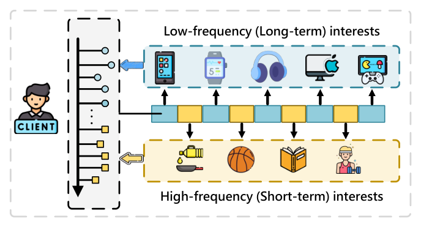
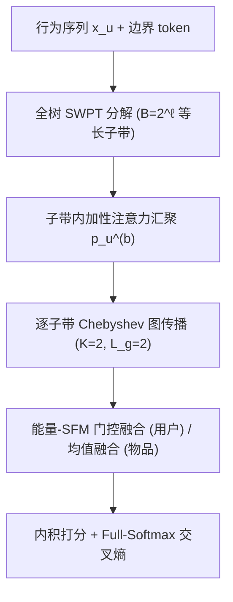
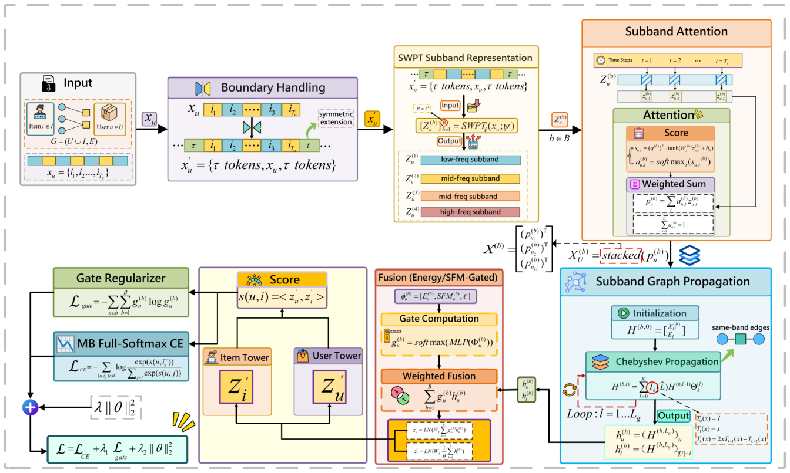

# WPGRec: Wavelet Packet Guided Graph Enhanced Sequential Recommendation (小波包引导的图增强序列推荐)

- **会议/期刊**: SIGIR 2026
- **作者与机构**: Peilin Liu, Zhiquan Ji, Gang Yan (吉林大学软件学院 / 计算机科学与技术学院)
- **推荐链路定位**: 召回（序列编码器 + 全库 softmax 打分）
- **研究方向**: 序列与会话推荐 / 图神经网络与知识图谱推荐
- **论文原文**: [论文原文链接](https://arxiv.org/abs/2604.21305v1)
- **开源代码**: 暂未开源

## TL;DR (1分钟核心速览)

序列推荐中长短期兴趣在单一表征里纠缠，且图协同信号往往在时序编码"混完尺度"之后才注入，造成尺度错配。WPGRec 用**全树无抽取平稳小波包变换 (SWPT)** 把行为序列分解为等长、平移不变的 $B=2^\ell$ 个子带，在**每个子带内部**做 Chebyshev 图传播，再用能量-谱平坦度门控自适应融合。在 4 个公开数据集、**Full-Ranking 全库排序**协议下全面超越 7 个 SOTA 基线，稀疏数据集 LastFM 上 HR@20 相对提升 **+15.4%**、NDCG@20 **+9.4%**。

## Background & Motivation (背景与核心矛盾)

- **主流范式**: 时域侧以 SASRec/BERT4Rec/BSARec 的自注意力为主；频域侧 FEARec 用全局傅里叶捕捉周期偏好，WaveRec 用离散小波做局部多分辨率分解；图侧 SGL/TGSRec/DGRec 在交互图上传播协同信号。
- **前人局限**: ① 全局谱操作（FFT）把局部瞬态与长程依赖混在同一频带，无法区分"短期波动"与"稳定偏好"；② 基于滤波器的下采样小波管线在多层分解-重构中产生**时间错位与边界伪影**，子带长度不一致，无法与图传播对齐；③ 图信号通常只在时序编码**之后**以辅助模块注入，此时不同尺度已被混合，传播反而放大跨尺度干扰。
- **核心洞察 (Key Insight)**: 多分辨率时序建模与图传播应当**在同一尺度上对齐**。SWPT 的"无抽取"特性恰好给出等长、平移不变的子带序列，使"逐子带传播"在时间位置上严格对齐成为可能。
- **本文切入点**: 把图传播下沉到子带内部（band-consistent propagation），并用子带能量与谱平坦度作为门控先验，抑制类噪子带。

<figure class="paper-figure" markdown="span">
  <figcaption>图1：序列推荐中的用户行为通常同时涉及长期偏好和短期兴趣。这种固有的多尺度特性促使我们显式地解耦并建模不同时间尺度上的偏好信号。</figcaption>
</figure>

## Method (核心方法设计)

### 1. 整体框架 (Overall Architecture)

对每个用户序列 $x_u$，先做对称延拓并两侧各补 $\tau$ 个可学习边界 token 得到 $X'_u$；沿时间轴做深度 $\ell$ 的全树 SWPT 得到 $B=2^\ell$ 个等长子带 $\{Z_u^{(b)}\}$；每个子带经加性注意力汇聚为用户向量 $p_u^{(b)}$，与共享物品嵌入拼成初始节点矩阵，做 $L_g$ 层 Chebyshev 图滤波；最后按用户级门控加权融合子带用户表征、按均值融合物品表征，内积打分并以全库 softmax 训练。

<figure class="paper-figure" markdown="span">
  <figcaption>图2：WPGRec的整体架构。</figcaption>
</figure>

### 2. 关键设计拆解 (Key Designs)

1. **无抽取 SWPT 子带构造（解决时间错位与边界伪影）**：传统 DWT 每层下采样导致子带长度递减、位置不可对齐。本文改用无抽取的平稳小波包变换，所有子带与延拓序列等长：
$$\{Z_u^{(b)}\}_{b=1}^{B}=\mathrm{SWPT}_\ell(X'_u;\psi),\quad B=2^\ell,\ Z_u^{(b)}\in\mathbb{R}^{T'_u\times d}$$
等长 + 平移不变意味着第 $t$ 行在所有子带中对应同一时间步，后续图传播与融合无需任何重采样对齐，从根源消除边界伪影与尺度错配。

2. **逐子带 Chebyshev 图传播（解决尺度不一致的协同注入）**：以往图信号在时序编码后注入，此时多尺度已被混合。本文为每个子带独立构造 $H^{(b,0)}=[X_U^{(b)};E_I]$ 并做 $L_g$ 层 Chebyshev 滤波：
$$H^{(b,l)}=\sum_{k=0}^{K}T_k(\tilde{L})H^{(b,l-1)}\Theta_k^{(l)}$$
协同信息在**尚未跨尺度混合**的子带空间内注入，低频子带获得长程协同平滑、高频子带保留局部结构增强，二者互不污染。

3. **能量–谱平坦度门控融合与训练目标**：对子带 $b$ 计算能量 $E_u^{(b)}=\frac{1}{T'_u}\sum_t\|Z_u^{(b)}(t,:)\|_2^2$ 与谱平坦度 $\mathrm{SFM}_u^{(b)}$，拼成描述子 $\phi_u^{(b)}=[E_u^{(b)},\mathrm{SFM}_u^{(b)},\ell]$，经 MLP+softmax 得门控 $g_u^{(b)}$，用户表征 $z'_u=\mathrm{LN}(W_f\sum_b g_u^{(b)}h_u^{(b)})$；物品侧因无用户特异性，采用等权平均 $z'_i=\mathrm{LN}(W_f\frac{1}{B}\sum_b h_i^{(b)})$。总损失为**全库 softmax 交叉熵（免负采样）**：
$$\mathcal{L}=-\sum_{(u,i_u^+)\in\mathcal{B}}\log\frac{\exp(\langle z'_u,z'_{i^+}\rangle)}{\sum_{j\in I}\exp(\langle z'_u,z'_j\rangle)}+\lambda_1\mathcal{L}_{\text{gate}}+\lambda_2\|\theta\|_2^2$$
能量高说明子带信号强，SFM 低说明频谱结构化（非噪声），二者共同构成"该子带值得信"的物理先验。复杂度 $O(|U|BTd+BL_gK|E|d+Nd^2+|\mathcal{B}||I|d)$，主要增量来自 $B$ 倍子带并行计算。

## Experimental Setup & Evaluation Protocol (实验设置与评估协议)

- **数据集与预处理**（沿用 BSARec 的时序序列构造，用户-物品图仅由训练交互构建）：

| 数据集 | #Users | #Items | #Interactions(稀疏度) | 平均长度 | 特征/场景说明 |
| :--- | :---: | :---: | :---: | :---: | :--- |
| Beauty | 22,363 | 12,101 | 99.93% 稀疏 | 8.9 | Amazon 美妆，短序列高稀疏 |
| Sports | 25,598 | 18,357 | 99.95% 稀疏 | 8.3 | Amazon 运动户外，最稀疏 |
| LastFM | 1,090 | 3,646 | 98.68% | 48.2 | HetRec 2011 音乐社交 |
| ML-1M | 6,041 | 3,417 | 95.16% 稠密 | 165.5 | 电影长序列 |

- **数据划分与防穿越**: `Leave-One-Out` 时序划分（训练/验证/测试按时间顺序切分），序列截断或填充至固定最大长度。
- **排名评测协议**: 无偏 **Full-Ranking**——测试正样本对**全物品集**排序（剔除训练历史已交互物品），报告 HR@{10,20}、NDCG@{10,20}；**训练与评测均不使用负采样**，训练即全库 softmax。
- **对比基线与超参**: 序列模型 BERT4Rec / BSARec / FEARec / WaveRec，图模型 SGL / DGRec / TGSRec，全部在相同划分下重实现并重调超参。$d=64$，AdamW (lr=0.005, wd=$10^{-4}$)，batch=128，早停 patience=10，$\lambda_1=10^{-5}$，Chebyshev $K=2,L_g=2$；网格搜索 $\psi\in\{\text{Coiflets},\text{Symlets}\}$、$\ell\in\{1,2,3\}$、$\tau\in\{0,2,4,6\}$，3 个随机种子 (42/43/44) 取均值。

## Key Experimental Results (实验关键数据)

### 1. 主实验对比 (Main Results)

| 数据集 | 指标 | BERT4Rec | SGL | WaveRec | FEARec | BSARec | TGSRec | DGRec | **WPGRec** | Improv. |
| :--- | :--- | :---: | :---: | :---: | :---: | :---: | :---: | :---: | :---: | :---: |
| Beauty | HR@10 | 0.0728 | 0.0851 | 0.0894 | 0.0966 | 0.0983 | 0.1079 | 0.1085 | **0.1197** | +10.3% |
| Beauty | NDCG@10 | 0.0387 | 0.0359 | 0.0552 | 0.0581 | 0.0595 | 0.0672 | 0.0687 | **0.0742** | +8.0% |
| Beauty | HR@20 | 0.1051 | 0.0998 | 0.1271 | 0.1335 | 0.1337 | 0.1481 | 0.1486 | **0.1583** | +6.5% |
| Sports | HR@10 | 0.0412 | 0.0432 | 0.0529 | 0.0584 | 0.0588 | 0.0634 | 0.0643 | **0.0704** | +9.5% |
| Sports | NDCG@10 | 0.0225 | 0.0217 | 0.0362 | 0.0331 | 0.0335 | 0.0354 | 0.0369 | **0.0401** | +8.6% |
| Sports | HR@20 | 0.0638 | 0.0607 | 0.0884 | 0.0822 | 0.0835 | 0.0879 | 0.0895 | **0.0991** | +10.7% |
| LastFM | HR@10 | 0.0496 | 0.0402 | 0.0524 | 0.0582 | 0.0699 | 0.0783 | 0.0785 | **0.0847** | +7.8% |
| LastFM | NDCG@10 | 0.0261 | 0.0262 | 0.0307 | 0.0321 | 0.0417 | 0.0494 | 0.0495 | **0.0532** | +7.5% |
| LastFM | HR@20 | 0.0801 | 0.0799 | 0.0808 | 0.0854 | 0.0976 | 0.1035 | 0.1037 | **0.1197** | +15.4% |
| LastFM | NDCG@20 | 0.0337 | 0.0335 | 0.0349 | 0.0397 | 0.0508 | 0.0572 | 0.0587 | **0.0642** | +9.4% |
| ML-1M | HR@10 | 0.2466 | 0.2289 | 0.2527 | 0.2638 | 0.2784 | 0.3424 | 0.3455 | **0.3542** | +2.5% |
| ML-1M | NDCG@10 | 0.1281 | 0.1197 | 0.1392 | 0.1435 | 0.1557 | 0.1968 | 0.1976 | **0.2004** | +1.4% |
| ML-1M | HR@20 | 0.3616 | 0.3591 | 0.3687 | 0.3796 | 0.3860 | 0.4361 | 0.4359 | **0.4397** | +0.8% |
| ML-1M | NDCG@20 | 0.1566 | 0.1498 | 0.1698 | 0.1819 | 0.1828 | 0.2250 | 0.2251 | **0.2265** | +0.6% |

### 2. 消融实验 (Ablation Study)

| 变体 | Beauty HR@10 | Beauty NDCG@10 | Sports HR@10 | LastFM HR@10 | ML-1M HR@10 |
| :--- | :---: | :---: | :---: | :---: | :---: |
| **WPGRec (Full)** | **0.1197** | **0.0742** | **0.0704** | **0.0847** | **0.3542** |
| w/o Wavelet ($B=1$) | 显著下降（最大） | 显著下降 | 显著下降 | 显著下降 | 下降 |
| w/o GNN | 明显下降 | 明显下降 | 明显下降 | 明显下降 | 下降 |
| w/o Gating (均值融合) | 中等下降 | 中等下降 | 中等下降 | 中等下降 | 小幅下降 |
| w/o Attention | 中等下降 | 中等下降 | 中等下降 | 中等下降 | 小幅下降 |
| w/o Boundary ($\tau=0$) | 小幅下降 | 小幅下降 | 小幅下降 | 小幅下降 | 小幅下降 |

（原文图 3 仅以柱状图给出趋势，未报告精确数值；上表按原文定性描述整理。）

### 3. 关键实验发现 (Key Findings)

1. **稀疏度决定收益幅度**：LastFM（稀疏度 98.68%、平均长度 48.2）上 HR@20 从 0.1037 提升至 0.1197（+15.4%），而稠密长序列 ML-1M 上 HR@20 仅 +0.8%。说明子带分解的价值在于**从噪声主导的短/稀疏序列中分离出可用的局部信号**，序列本身信息充足时增益自然收窄。
2. **"去小波"是最大单点损失，超过"去 GNN"**：消融中移除 SWPT（$B=1$ 退化为纯时域）跌幅最大，移除逐子带图传播次之。这直接验证了论文的核心论点——多分辨率分解是地基，而图传播的收益**依赖于子带对齐**；若先混合尺度再传播，协同信号反而成为跨尺度干扰源。
3. **门控正则存在稳定平台**：$\lambda_1$ 在 $10^{-6}\sim10^{-4}$ 区间内 Beauty HR@10 稳定在 0.1194–0.1197、LastFM 在 0.0843–0.0847，仅 $10^{-3}$ 时因门控过度集中而回落（LastFM 降至 0.0836）。说明能量-SFM 先验本身足够强，模型不依赖精细调参。

## Highlights, Limitations & Rating (亮点、对比与审稿评价)

- **与代表作对比 (vs. Prior Work)**: 与 **FEARec** 的本质区别是后者用全局 FFT，频带内瞬态与长程依赖不可分；与 **WaveRec** 的区别是后者用下采样小波滤波器，子带长度不一致、存在重构错位，且仍属纯序列侧设计；与 **TGSRec/DGRec** 的区别是后者的图传播发生在时序编码之后、无尺度对齐概念。WPGRec 是首个把"图传播下沉到等长子带内部"的框架。
- **可迁移亮点**: ① 用 SWPT 的等长平移不变性做"任意时序模块 + 图模块"的对齐接口，可无缝替换为 Mamba/线性注意力编码器；② 能量 + 谱平坦度作为**免学习的子带质量先验**，可迁移到多尺度特征融合、多行为序列融合等场景做门控初始化。
- **审稿级局限批判**: ① 复杂度含 $B=2^\ell$ 倍子带并行项与全库 softmax 项，论文自承未针对大规模/在线场景优化，缺少工业级延迟与吞吐实测；② 消融仅以柱状图定性呈现、未给精确数值与显著性检验，且未报告 $\ell$、$\tau$、$\psi$ 的逐项敏感性（仅给 $\lambda_1$），超参选择依据略显薄弱；③ 物品侧采用等权平均而非门控，与用户侧不对称，缺少该设计选择的消融佐证。
- **四维评分**: 创新性 ⭐⭐⭐⭐ | 实验扎实度 ⭐⭐⭐⭐ | 方法清晰度 ⭐⭐⭐⭐⭐ | 落地价值 ⭐⭐⭐

