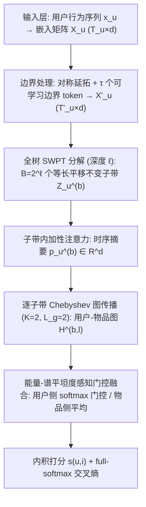
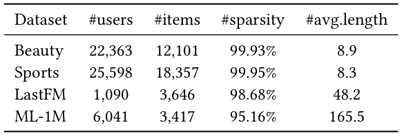
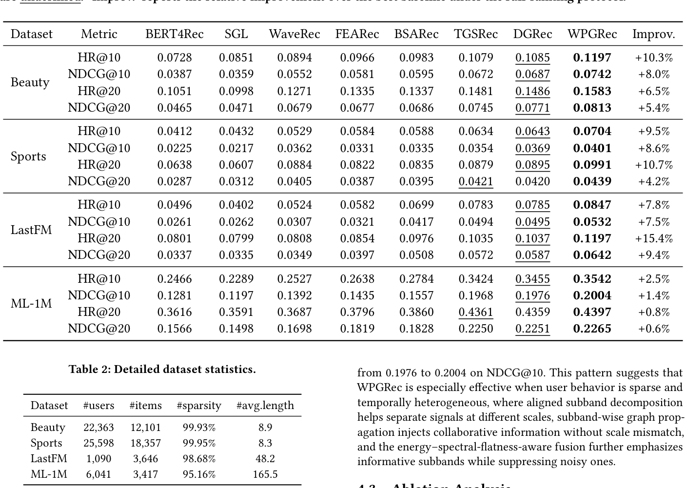
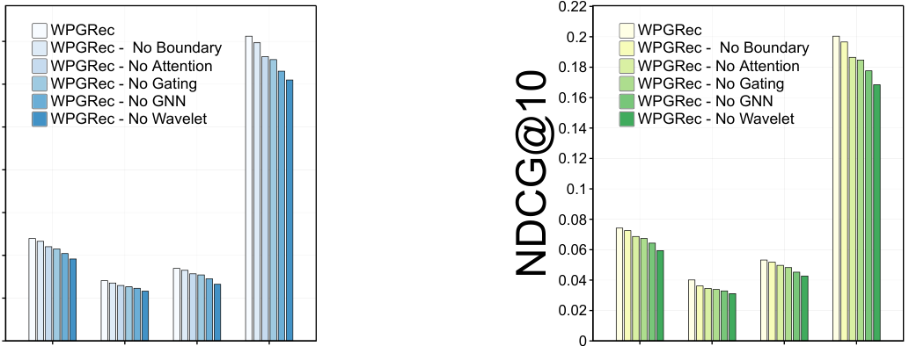
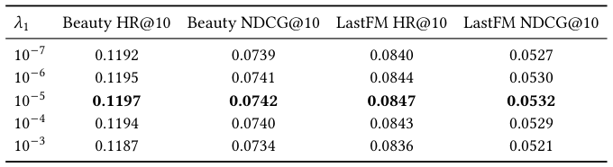

# WPGRec: Wavelet Packet Guided Graph Enhanced Sequential Recommendation (小波包引导的图增强序列推荐)

- **会议/期刊**: SIGIR 2026 (8 pages, 3 figures)
- **推荐链路定位**: 召回 (Retrieval) — 序列下一物品预测 (Next-Item Prediction)
- **研究方向**: 序列与会话推荐 / 图神经网络与知识图谱推荐
- **论文原文**: [https://arxiv.org/abs/2604.21305v1](https://arxiv.org/abs/2604.21305v1)
- **开源代码**: 暂未开源（原文与预提取均未发现代码链接）

## TL;DR (核心速览)

针对序列推荐中长短期兴趣跨时间尺度纠缠、且协同图信号常以"尺度不一致"方式注入的痛点，WPGRec 用**全树平稳小波包变换 (SWPT)** 把行为序列分解为等长、平移不变的子带，在**每个子带内**分别做 Chebyshev 图传播注入高阶协同信号，再用**能量-谱平坦度感知门控**自适应融合子带。在 4 个公开数据集、**Full-Ranking** 协议下全面超越 7 个序列/图基线，稀疏数据集 LastFM 上 HR@20 相对提升 **+15.4%**。

## Background & Motivation (背景与动机)

- **领域背景与主流范式**: 序列推荐主流范式分两条线——(1) 时域序列模型（GRU4Rec、Caser、SASRec、BERT4Rec、BSARec）用 RNN/CNN/自注意力在单一特征流中编码时序依赖；(2) 频域/时频方法（FEARec 的傅里叶增强、WaveRec 的小波变换）试图刻画用户行为的非平稳性。图推荐线（LightGCN、SGL、TGSRec、DGRec）则通过交互图传播注入协同结构。
- **现有方法局限 (Limitations of Prior Work)**:
  1. **全局谱操作纠缠尺度**：傅里叶类全局变换会把局部瞬态（短期兴趣）与长程依赖混在同一表示中，稀疏/截断/噪声序列下低频长程信号易主导，淹没短期变化。
  2. **滤波器式小波流水线的错位与边界伪影**：传统离散小波含下采样，多尺度分解-重构过程中产生时间错位 (temporal misalignment) 与端点边界伪影。
  3. **图信号注入尺度不一致**：现有方法多在时序编码**之后**才引入图结构，或经缺乏频带对齐的辅助模块融合，导致传播与融合时跨尺度信息混杂。
- **核心挑战 (Key Challenge)**: 为什么简单加深网络或常规对比学习不行？因为问题不在容量，而在**表示空间的尺度混杂**——只要长程偏好、中程转移、短期波动仍纠缠在同一向量里，图传播就只能在"已混合"的表示上做粗粒度增强，无法在正确尺度上注入协同信号。
- **核心洞察与切入点 (Key Insight)**: 作者提出一条简洁原则——**多分辨率时序建模与图传播必须在同一尺度上对齐**。相比下采样小波，**平稳小波包变换 (SWPT)** 产生等长、平移不变的子带（$B=2^\ell$ 个，每个长度与扩展序列相同），天然适合"逐子带"做时间对齐的图传播与融合。图 1 直观展示了用户行为中低频长程兴趣与高频短期兴趣共存的多尺度本质，正是这一观察驱动了显式解耦建模。

<figure class="paper-figure" markdown="span">
  <figcaption>图1：序列推荐中的用户行为通常同时涉及长期偏好和短期兴趣。这种固有的多尺度特性促使我们显式地解耦并建模不同时间尺度上的偏好信号。</figcaption>
</figure>

## Problem Formulation & Method (问题定义与方法架构)

### 1. 符号定义与输入表征 (Notations & Input Representations)

- 用户集 $\mathcal{U}$、物品集 $\mathcal{I}$，交互二部图 $G=(\mathcal{U}\cup\mathcal{I},E)$。
- 用户 $u$ 的时序行为序列 $x_u=\{i_1,\dots,i_{T_u}\}$，$i_t\in\mathcal{I}$。
- 物品嵌入 $e_i\in\mathbb{R}^d$（$d=64$），按序列顺序索引得序列嵌入矩阵 $X_u\in\mathbb{R}^{T_u\times d}$，$X_u(t,:)=e_{i_t}$。
- 任务：给定前缀 $\{i_1,\dots,i_{T_u-1}\}$ 预测下一物品 $i_{T_u}$。
- 关键超参：小波族 $\psi\in\{\text{Coiflets},\text{Symlets}\}$、分解深度 $\ell\in\{1,2,3\}$（子带数 $B=2^\ell$）、边界 token 数 $\tau\in\{0,2,4,6\}$、Chebyshev 阶数 $K=2$、图传播层数 $L_g=2$。

### 2. 整体流水线 (Overall Architecture)

数据流：序列嵌入 → 对称延拓 + 可学习边界 token → 全树 SWPT 分解为 $B$ 个等长子带 → 子带内加性注意力时序摘要 → 逐子带 Chebyshev 图传播 → 能量/谱平坦度门控融合 → 内积打分 + full-softmax。

<figure class="paper-figure" markdown="span">
  <figcaption>图2：WPGRec的整体架构。</figcaption>
</figure>

### 3. 核心模块设计与数学原理 (Key Designs & Formulations)

**(1) SWPT 子带构造（等长 + 平移不变）**
先做对称延拓并两侧各补 $\tau$ 个可学习边界 token：
$$X'_u=[\underbrace{\tau\text{ tokens}}_{\text{左}},X_u,\underbrace{\tau\text{ tokens}}_{\text{右}}],\quad T'_u=T_u+2\tau$$
再沿时间轴做深度 $\ell$ 的全树**无下采样**平稳小波包变换：
$$\{Z_u^{(b)}\}_{b=1}^{B}=\text{SWPT}_\ell(X'_u;\psi),\quad B=2^\ell$$
关键性质：每个 $Z_u^{(b)}\in\mathbb{R}^{T'_u\times d}$ 与扩展序列**等长**，时间位置跨子带严格对齐。这正是后续"逐子带图传播"不引入尺度错位的前提——物理直觉是：不下采样就不会有相位漂移，边界 token 吸收端点失真。

**(2) 子带注意力时序摘要**
对每个子带用加性注意力把 token 级特征压成用户级向量：
$$p_u^{(b)}=\sum_{t=1}^{T'_u}a_{u,t}^{(b)}z_{u,t}^{(b)},\quad z_{u,t}^{(b)}=Z_u^{(b)}(t,:)$$
堆叠得子带用户特征矩阵 $X_U^{(b)}=[p_u^{(b)}]_{u\in\mathcal{U}}\in\mathbb{R}^{|\mathcal{U}|\times d}$。

**(3) 逐子带 Chebyshev 图传播（band-consistent 注入）**
每个子带独立构图特征空间，用户块为子带摘要、物品块为共享物品嵌入：
$$H^{(b,0)}=\begin{bmatrix}X_U^{(b)}\\ E_\mathcal{I}\end{bmatrix},\quad E_\mathcal{I}=[e_i]_{i\in\mathcal{I}}\in\mathbb{R}^{|\mathcal{I}|\times d}$$
做 $L_g$ 层 Chebyshev 谱滤波：
$$H^{(b,l)}=\sum_{k=0}^{K}T_k(\tilde{L})H^{(b,l-1)}\Theta_k^{(l)}$$
其中 $\tilde{L}$ 为归一化图拉普拉斯，$T_k(\cdot)$ 为第 $k$ 阶 Chebyshev 多项式，$\Theta_k^{(l)}$ 为可学习滤波参数。**核心设计直觉**：协同信息在"尚未混合不同尺度"的子带表示内部注入，而非在时序编码器输出之后——这是全文最关键的机制。

**(4) 能量-谱平坦度门控融合**
对每个子带构造描述子 $\phi_u^{(b)}=[E_u^{(b)},\text{SFM}_u^{(b)},\ell]$，其中能量
$$E_u^{(b)}=\frac{1}{T'_u}\sum_{t=1}^{T'_u}\|Z_u^{(b)}(t,:)\|_2^2$$
SFM 为沿时间轴的谱平坦度（刻画频谱是结构化还是类噪声）。门控权重：
$$g_u^{(b)}=\text{softmax}\big(\text{MLP}(\phi_u^{(b)})\big)$$
用户侧加权融合 + 投影 + LayerNorm：
$$z'_u=\text{LN}\Big(W_f\sum_{b=1}^{B}g_u^{(b)}h_u^{(b)}\Big)$$
物品侧**不用用户特定门控**，简单平均：
$$z'_i=\text{LN}\Big(W_f\frac{1}{B}\sum_{b=1}^{B}h_i^{(b)}\Big)$$
物理直觉：能量大 = 信号强，谱平坦度高 = 更接近白噪声，门控据此**放大信息子带、压制噪声子带**。

### 4. 训练目标、负采样与推理复杂度 (Optimization, Negative Sampling & Complexity)

- **打分与概率**: $s(u,i)=\langle z'_u,z'_i\rangle$，全物品集 softmax $p(i|u)=\exp(s(u,i))/\sum_{j\in\mathcal{I}}\exp(s(u,j))$。
- **损失函数**:
$$\mathcal{L}=-\sum_{(u,i_u^+)\in\mathcal{B}}\log p(i_u^+|u)+\lambda_1\mathcal{L}_{\text{gate}}+\lambda_2\|\theta\|_2^2$$
其中 $\lambda_1=10^{-5}$（门控正则），$\lambda_2$ 为 $\ell_2$ 系数，$\mathcal{B}$ 为 mini-batch。
- **训练负采样策略**: **免负采样**——训练用覆盖全物品集的 full-softmax 交叉熵，与评测的 full-ranking 协议一致（原文明确 "No sampled negatives are used in either training or evaluation"）。
- **复杂度**: 单 epoch 时间
$$\text{Time}=O\big(|U|BTd+BL_gK|E|d+Nd^2+|\mathcal{B}||\mathcal{I}|d\big)$$
空间 $O\big(L_g(K+1)d^2+|E|+L_gNBd\big)$。相比纯序列模型，额外开销来自 $B$ 个子带的分解与图传播；full-softmax 项 $O(|\mathcal{B}||\mathcal{I}|d)$ 是大物品集下的主要瓶颈。原文**未报告**实际训练耗时、单次推理延迟 (ms/request) 与峰值显存。

## Experimental Setup & Evaluation Protocol (实验设置与评估协议)

- **数据集统计与预处理**: 采用 MovieLens-1M、Amazon-Beauty、Amazon-Sports、LastFM (HetRec 2011)，预处理遵循 BSARec：按时序构造序列、**留一法 (Leave-One-Out) 时序划分**训练/验证/测试、截断或填充到固定最大长度；用户-物品图**仅用训练交互**构建（避免测试信息泄露）。

<figure class="paper-figure" markdown="span">
  <figcaption>表2：数据集详细统计信息。</figcaption>
</figure>

| 数据集 (Dataset) | 用户数 (#Users) | 物品数 (#Items) | 交互数 (#Interactions) | 稀疏度 (Sparsity) | 平均序列长度 (Avg. Length) |
| :--- | :---: | :---: | :---: | :---: | :---: |
| Beauty | 22,363 | 12,101 | 原文未报告 | 99.93% | 8.9 |
| Sports | 25,598 | 18,357 | 原文未报告 | 99.95% | 8.3 |
| LastFM | 1,090 | 3,646 | 原文未报告 | 98.68% | 48.2 |
| ML-1M | 6,041 | 3,417 | 原文未报告 | 95.16% | 165.5 |

- **数据划分方式 (Splitting Strategy)**: **Leave-One-Out 时序划分**（最后一项测试、倒数第二项验证），图仅由训练交互构建，泄露风险较低。
- **排名评测协议 (Ranking Protocol)**: **Full-Ranking**——真值测试物品与**全物品集**排序（排除用户训练历史中已见物品），无采样负例。
- **评价指标与显著性检验**: HR@10、HR@20、NDCG@10、NDCG@20；嵌入维度 $d=64$；结果取 3 个随机种子 $\{42,43,44\}$ 的均值。原文**未报告**配对显著性检验（$t$-test / Wilcoxon）的 $p$ 值。
- **实现细节**: AdamW (lr=0.005, weight decay=$10^{-4}$)，batch size 128，验证集 NDCG@10 早停 (patience=10)；$\psi$、$\ell$、$\tau$ 在验证集上网格搜索。

## Key Experimental Results (核心实验结果)

### 1. 主实验对比 (Main Results)

<figure class="paper-figure" markdown="span">
  <figcaption>表1：7个基线模型与WPGRec在4个数据集上的详细性能。最佳结果以粗体显示，次佳结果以下划线显示。“Improv.”报告在全排序协议下相对于最佳基线的相对提升。</figcaption>
</figure>

| 数据集 | 指标 | 序列基线最强 (BSARec) | 图基线最强 (DGRec) | 本文方法 (Ours) | 相对提升 (Improv.) |
| :--- | :--- | :---: | :---: | :---: | :---: |
| Beauty | HR@10 | 0.0983 | 0.1085 | **0.1197** | +10.3% |
| Beauty | NDCG@10 | 0.0595 | 0.0687 | **0.0742** | +8.0% |
| Beauty | HR@20 | 0.1337 | 0.1486 | **0.1583** | +6.5% |
| Beauty | NDCG@20 | 0.0686 | 0.0771 | **0.0813** | +5.4% |
| Sports | HR@10 | 0.0588 | 0.0643 | **0.0704** | +9.5% |
| Sports | NDCG@10 | 0.0335 | 0.0369 | **0.0401** | +8.6% |
| Sports | HR@20 | 0.0835 | 0.0895 | **0.0991** | +10.7% |
| Sports | NDCG@20 | 0.0395 | 0.0420 | **0.0439** | +4.2% |
| LastFM | HR@10 | 0.0699 | 0.0785 | **0.0847** | +7.8% |
| LastFM | NDCG@10 | 0.0417 | 0.0495 | **0.0532** | +7.5% |
| LastFM | HR@20 | 0.0976 | 0.1037 | **0.1197** | +15.4% |
| LastFM | NDCG@20 | 0.0508 | 0.0587 | **0.0642** | +9.4% |
| ML-1M | HR@10 | 0.2784 | 0.3455 | **0.3542** | +2.5% |
| ML-1M | NDCG@10 | 0.1557 | 0.1976 | **0.2004** | +1.4% |
| ML-1M | HR@20 | 0.3860 | 0.4359 | **0.4397** | +0.8% |
| ML-1M | NDCG@20 | 0.1828 | 0.2251 | **0.2265** | +0.6% |

**规律**: 稀疏数据集（Beauty/Sports/LastFM）提升显著，稠密 ML-1M 提升小但稳定——印证"多尺度解耦 + 尺度一致图注入"在行为稀疏、时序异质时最有效。

### 2. 消融实验与控制变量分析 (Ablation Study)

<figure class="paper-figure" markdown="span">
  <figcaption>图3：消融结果（左：HR@10；右：NDCG@10）。</figcaption>
</figure>

六个变体：(1) 完整 WPGRec；(2) **No Wavelet**（SWPT 换恒等映射，$B=1$，纯时域）；(3) **No GNN**（去子带图传播）；(4) **No Gating**（门控换均匀平均）；(5) **No Attention**（去子带内注意力）；(6) **No Boundary**（$\tau=0$）。

- **No Wavelet 下降最明显** → 显式多分辨率分离是框架根基。
- **No GNN 次之** → 协同信息在"对齐子带内"注入才最有效，事后混合再传播收益受限。
- **No Gating / No Attention** 中等但一致的下降 → 自适应融合与时序摘要均有贡献。
- **No Boundary** 下降最小但稳定 → 边界处理对短/稀疏序列更关键。
- 原文**未报告**各变体的精确数值表（仅以图 3 柱状图呈现），也**未做**参数量对齐或图度数匹配的严格控制变量消融。

### 3. 稀疏度/冷启动分桶与超参敏感度 (Sparsity Buckets & Hyperparameters)

- **稀疏度层面**: 原文未做用户/物品交互频次分桶实验，但从数据集层面观察到稀疏度越高（LastFM 98.68%、Beauty 99.93%）提升越大，稠密 ML-1M (95.16%) 提升最小。
- **关键超参数敏感度**: 门控正则 $\lambda_1$ 在 $10^{-7}\sim10^{-3}$ 上做敏感性分析（表 3），$10^{-5}$ 最优，$10^{-6}\sim10^{-4}$ 形成稳定平台；$\lambda_1$ 过小正则不足、过大则门控权重过度集中。$\psi$、$\ell$、$\tau$ 通过验证集网格搜索确定，原文未给出逐值敏感性曲线。

<figure class="paper-figure" markdown="span">
  <figcaption>表3：门控正则化系数𝜆1的敏感性分析（3个随机种子的均值）。</figcaption>
</figure>

| $\lambda_1$ | Beauty HR@10 | Beauty NDCG@10 | LastFM HR@10 | LastFM NDCG@10 |
| :--- | :---: | :---: | :---: | :---: |
| $10^{-7}$ | 0.1192 | 0.0739 | 0.0840 | 0.0527 |
| $10^{-6}$ | 0.1195 | 0.0741 | 0.0844 | 0.0530 |
| $10^{-5}$ | **0.1197** | **0.0742** | **0.0847** | **0.0532** |
| $10^{-4}$ | 0.1194 | 0.0740 | 0.0843 | 0.0529 |
| $10^{-3}$ | 0.1187 | 0.0734 | 0.0836 | 0.0521 |

- **线上 A/B 测试**: 原文仅包含离线实验，**无**线上 A/B 结果。

## Highlights, Limitations & Critiques (亮点、局限与审稿级批判)

- **核心亮点与可迁移性**:
  1. **"尺度一致"原则**具有普适性——任何"时序多分辨率 + 图/结构增强"的联合建模都可借鉴"先对齐再注入"的思路，可迁移到多模态序列、时空 POI 推荐等。
  2. **SWPT 的等长平移不变性**是相对 WaveRec 的实质性改进，避免了错位与边界伪影，工程上可直接替换现有小波前端。
  3. **能量-谱平坦度门控**用信号处理统计量（而非纯学习）引导融合，可解释性强、参数少。
- **局限性与审稿视角批判 (Critical Limitations)**:
  1. **效率未验证**：$B=2^\ell$ 个子带各自做图传播，计算与显存随 $\ell$ 指数增长；原文承认"未针对大规模/在线场景优化"，且**未报告**训练耗时、推理延迟与峰值显存，工业落地存疑。
  2. **评测严谨性不足**：仅 3 个种子取均值，**未做**配对显著性检验；ML-1M 上提升仅 +0.6%~+2.5%，是否统计显著存疑。
  3. **消融呈现不完整**：图 3 仅柱状图，无精确数值表；未控制参数量/图度数对齐，"No GNN" 的下降可能部分来自参数减少而非机制本身。
  4. **物品侧融合过于简单**：用户侧用门控、物品侧仅平均，非对称设计缺乏论证；物品表示跨子带共享同一 $E_\mathcal{I}$，子带区分度可能被削弱。
  5. **超参搜索空间有限**：$\psi$ 仅试 Coiflets/Symlets，$\ell\le3$，未探索更深分解或自适应小波基（作者在结论中也将其列为未来工作）。
  6. **数据集交互总数缺失**：表 2 仅给稀疏度与平均长度，未给交互总数，复现时需自行推算。

## Rating (四维评分)

- **方法创新性 (Novelty)**: ⭐⭐⭐⭐ （SWPT 等长子带 + 逐子带图传播的"尺度一致"组合有新意，但各组件均为已有技术的巧妙拼接）
- **评估协议与实验扎实度 (Protocol & Experiments)**: ⭐⭐⭐ （Full-Ranking + LOO 协议规范、基线统一重实现是加分项，但缺显著性检验、消融无精确数值、无效率报告）
- **写作与数学规范度 (Clarity & Rigor)**: ⭐⭐⭐⭐ （公式与算法流程清晰，复杂度分析完整，符号一致）
- **工业落地与复现价值 (Industrial & Practical Value)**: ⭐⭐⭐ （思路可迁移性强，但子带图传播的指数开销与缺失的效率数据限制了大规模落地，且暂未开源）
