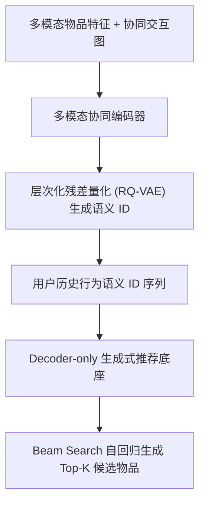

# Generative Recommendation with Hierarchical Semantic IDs (示例模板)

- **会议/期刊**: SIGIR 2026
- **主分类**: 生成式推荐与语义 ID (`generative_rec`)
- **交叉分类**: 序列与会话推荐 (`sequential_rec`)
- **论文链接**: `https://arxiv.org/abs/xxxx.xxxxx`
- **开源代码**: `https://github.com/example/generative-rec`

## TL;DR (核心速览)

本篇为推荐系统知识库初始化示例文档。当你运行 `python scripts/generate_recsys_notes.py` 时，脚本会自动提取论文 PDF 或 arXiv 全文，将其归类至对应的会议/期刊与 14 大推荐系统细分方向，并生成包含 Mermaid 架构图与实验对比表格的 5 分钟精读笔记。

## Background & Motivation (背景与动机)

- **领域背景**: 传统双塔召回依赖内积近似最近邻检索 (ANN)，特征交互能力受限。
- **现有局限**: 离散语义 ID (如 RQ-VAE) 在长尾冷启动物品上容易发生哈希碰撞 (ID Collision)，且语义空间与协同过滤交互信号存在对齐鸿沟。
- **核心洞察**: 将协同共现图谱与多模态内容特征联合注入残差量化码本，可在自回归生成阶段同时兼顾语义泛化与协同精准度。

## Method (方法架构)

## Key Experimental Results (核心实验结果)

| 数据集 | 指标 | 传统序列基线 (SASRec) | 生成式基线 (TIGER) | 本文方法 (Ours) | 相对提升 |
| :--- | :--- | :---: | :---: | :---: | :---: |
| Beauty | Recall@10 | 0.0612 | 0.0685 | **0.0742** | +8.32% |
| Beauty | NDCG@10 | 0.0324 | 0.0371 | **0.0408** | +9.97% |
| Sports | Recall@10 | 0.0351 | 0.0398 | **0.0435** | +9.30% |

## Highlights & Limitations (亮点与局限)

- **核心亮点**: 统一了多模态特征量化与序列自回归生成，显著缓解了冷启动物品的语义碰撞。
- **潜在局限**: 自回归 Beam Search 在线推理延迟高于传统双塔向量检索，工业界落地需配合投机解码或 KV Cache 压缩。
