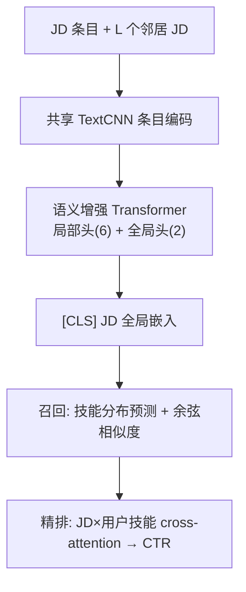
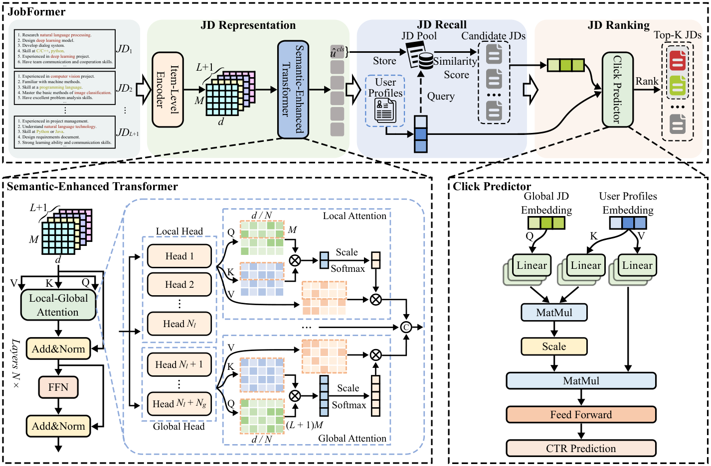

# JobFormer: Skill-Aware Job Recommendation with Semantic-Enhanced Transformer (技能感知的语义增强 Transformer 职位推荐)

- **会议/期刊**: IEEE TKDD (arXiv 2024-04 预印)
- **作者与机构**: ZhiHao Guan, Jia-Qi Yang, Yang Yang (南京理工大学 PCA Lab), Hengshu Zhu (BOSS 直聘职业科学实验室), Wenjie Li (港理工), Hui Xiong (港科广)
- **推荐链路定位**: 召回 + 精排 (两阶段)
- **研究方向**: CTR预估与特征交叉 / 冷启动与长尾推荐
- **论文原文**: [https://arxiv.org/abs/2404.04313v1](https://arxiv.org/abs/2404.04313v1)
- **开源代码**: [https://github.com/data-ming-and-application/JAT](https://github.com/data-ming-and-application/JAT)

## TL;DR (1分钟核心速览)

职位推荐面临两大痛点：JD 由多条短文本条目构成、单条 JD 信息量不足（information deficit），且 JD 文本与用户画像（隐私约束下仅保留技能分布）存在天然异构鸿沟。JobFormer 将每条 JD 的条目用共享 TextCNN 编码，再以**局部-全局注意力**把 JD 与其 $L$ 个邻居 JD 拼成 tuple 联合编码，补全跨职位语义；召回阶段用技能分布做标签分布学习（KL + 技能相关性 + 关系一致性），精排阶段用 cross-attention 融合用户技能分布做 CTR 预估。在 15,046 条真实人岗配对数据上，Recall@20 达 69.98（较 NRMS +2.31%），AUC 77.58（较 NRMS +0.70），并给出可解释的技能注意力。

## Background & Motivation (背景与核心矛盾)

- **主流范式**: 早期把职位推荐当作 person-job fit 的匹配问题（协同过滤 / TF-IDF / GLMix），近年转向 DNN 文本表征（CNN、RNN、BERT 编码 JD 与简历后做二分类匹配），以及新闻推荐式的两阶段召回-排序框架。
- **前人局限**: ① JD 本身信息不足——单条 JD 只有寥寥数条职责/要求短句，且条目间无上下文（"Design deep learning model" 中的 "Design" 只作用于本条），直接拼接成长句会造成语义混淆；② JD 短文本与用户技能分布之间存在异构鸿沟，纯相关性匹配无法刻画用户兴趣偏好。
- **核心洞察 (Key Insight)**: 同领域/同 title 的邻居 JD 含有互补信息（如多条 JD 都隐含 "machine learning" 技能需求），可作为外部语义补丁；同时 JD 条目与技能标签存在天然对应关系（"Design deep learning model" ↔ "deep learning" 技能），因此可把 JD 表征学习转化为**技能分布预测**这一标签分布学习 (LDL) 任务，从而在共享语义空间里与用户画像对齐。
- **本文切入点**: 用「JD tuple + 局部-全局注意力」补语义，用「技能分布引导 + 点击数据精排」弥合异构鸿沟。

## Method (核心方法设计)

### 1. 整体框架 (Overall Architecture)

输入为一条中心 JD 及其 $L$个邻居 JD（按全局 [CLS] 嵌入欧氏距离 + 同 title 筛选），每条 JD 的$M$个条目先经共享 TextCNN 得到条目级表示；随后拼成$(L+1)M$ 长度的序列送入语义增强 Transformer，其中局部头建模 job 内条目依赖、全局头建模 job 间依赖，取 [CLS] 得 JD 全局嵌入。召回阶段以技能分布为监督训练分类器，推理时按「预测技能分布 vs 用户技能分布」余弦相似度从 JD 池召回 Top-K；精排阶段将候选 JD 嵌入与用户技能分布做 cross-attention 得联合嵌入，经两层 FC + sigmoid 输出点击率并排序。

<figure class="paper-figure" markdown="span">
  <figcaption>图2. 所提出的JobFormer的示意图，包括用于生成候选JD的召回阶段和用于候选JD排序的排序阶段。在召回阶段，JD及其邻居构成JD元组，条目级编码器旨在获得条目表示，作为语义增强Transformer的输入token。然后，设计的语义增强Transformer编码职位内和职位间信息，以获得更具判别性的JD表示，并根据JD-用户余弦相似度进一步召回为候选JD。最后</figcaption>
</figure>

### 2. 关键设计拆解 (Key Designs)

1. **局部-全局注意力 (Local-Global Attention)**：常规 Transformer 只能在单条 JD 内部做 self-attention，无法利用邻居信息。本文将 $L+1$条 JD 拼为$U_g\in\mathbb{R}^{(L+1)M\times d}$，在$N=8$个头中划出$N_l=6$个局部头（输入$U_l$）与$N_g=2$个全局头（输入$U_g$），输出时全局头只取中心 JD 对应位置$id(U_l)$的切片再与局部头拼接：$MultiAtt(U)=[Att(U_l)_{1:N_l},\,Att(U_g)_{1:N_g}[id(U_l)]]W_U$。直觉是：局部头保留条目级细粒度语义，全局头以低比例注入跨职位互补信息，避免邻居噪声淹没主体。
2. **技能相关性增强 (Skill Correlation Enhancement)**：仅用 KL 逐维监督技能分布忽略了技能间关联（会 "Deep Learning"+"Dialog System" 的人更可能擅长 "NLP"）。本文引入被录用用户的岗位名与职级编码 $e_{aui}$，用双向排序损失对齐 JD 与辅助用户信息：$\mathcal{M}=[\alpha-s(e_{aui},\hat{u}_{cls})+s(e_{aui},\hat{u}_{cls}^*)]_++[\alpha-s(e_{aui},\hat{u}_{cls})+s(e_{aui}^*,\hat{u}_{cls})]_+$，其中$*$ 为 batch 内最难负例。该损失把「技能共现的局部结构」以对比形式注入表征。
3. **关系一致性 + 训练目标**：受结构主义语言学启发，tuple 内样本两两相似度的**预测结构**应与**表征结构**一致，故对二者相似度向量做 KL：$\mathcal{R}=KL(\Phi(g(\hat{u}_{1,cls}),\dots),\ \Phi(\hat{u}_{1,cls},\dots))$，$\Phi$用 softmax 归一化的成对距离构造关系能量。总损失$\mathcal{L}=\sum_j \ell(j)+\lambda\mathcal{M}(j)+\mu\mathcal{R}(j)$，$\ell$为技能分布 KL，$\lambda=0.2,\mu=0.4$。召回阶段每正例配 200 负例、精排阶段配 3 负例；精排用交叉熵$\mathcal{L}=-\sum_{R^+}\log\hat{y}-\sum_{R^-}\log(1-\hat{y})$。推理时单实例约 28ms。

## Experimental Setup & Evaluation Protocol (实验设置与评估协议)

- **数据集与预处理**: 真实招聘数据来自国内某高科技公司，37,540 条成功投递（接受率约 1%），因一个岗位常录用多人且技能分布相近，随机取一人构成人岗对，最终保留 15,046 对；JD 条目数上限 $M=40$（超出截断），技能标签空间$C$ 维由专家打分后 softmax 归一化为分布。公开数据集用 SBU 3DFE（2,500 张人脸图，243 维 LBP 特征，23 人标注 6 类表情的 5 级分数，归一化为标签分布）验证泛化性。

| 数据集 | #Users | #Items | #Interactions | 稀疏度/密度 | 特征/场景说明 |
| :--- | :---: | :---: | :---: | :---: | :--- |
| 真实招聘 (私有) | 15,046 人岗对 | JD 池（未披露规模） | 15,046 | 接受率 ≈1% | JD 条目文本 + 技能分布 + 点击 |
| SBU 3DFE (公开) | 2,500 图 | 6 类标签 | 2,500 | — | LBP 特征 + 表情标签分布 |

- **数据划分与防穿越 (Splitting Strategy)**: 原文未明确交代划分比例与是否按时间切分，仅说明召回/排序两阶段分别训练、各方法重复 5 次取结果——这是评估协议上的明显薄弱点。
- **排名评测协议 (Ranking Protocol)**: 召回阶段报告 Recall@K 与 NDCG@K（K=20/40/60/80/100），训练时每正例 200 负例；精排阶段报告 AUC 与 MRR，负例比 3:1。未采用全库 Full-Ranking，属采样排序口径。
- **对比基线与超参设置**: 基线含词嵌入类 NPA/NAML/NRMS/CNE-SUE、BERT 预训练类 UNBERT/MINER、CTR 类 MaskNet/FRNet。词向量维度 $d=512$，Transformer 4 层 8 头，邻居数$L=2$，batch 32，Adam，学习率 0.001（每 3 epoch 衰减 0.8），dropout 0.1，30 epoch，V100 训练。未报告显著性检验。

## Key Experimental Results (实验关键数据)

### 1. 主实验对比 (Main Results)

JD 召回（Recall@20 / NDCG@20，节选）：

| 方法 | R@20 | R@100 | N@20 | N@100 |
| :--- | :---: | :---: | :---: | :---: |
| NPA | 61.76 | 92.39 | 28.18 | 33.86 |
| NAML | 62.46 | 95.20 | 32.29 | 38.72 |
| NRMS | 67.67 | 93.09 | 33.12 | 38.72 |
| CNE-SUE | 61.66 | 96.60 | 27.70 | 32.50 |
| UNBERT | 51.43 | 85.36 | 23.77 | 31.27 |
| MINER | 59.36 | 96.60 | 27.94 | 34.78 |
| **JobFormer** | **69.98** | **97.29** | **34.30** | **39.47** |
| Improv. vs NRMS | +2.31% | +4.20% | +1.18% | +0.75% |

JD 排序（AUC / MRR）：NRMS 76.88/29.11，FRNet 76.54/29.18，MaskNet 74.93/27.92，**JobFormer 77.58/29.82**（AUC 较 NRMS +0.70，MRR +0.71）。

### 2. 消融实验 (Ablation Study)

| 变体 | R@20 | R@100 | N@20 | N@100 |
| :--- | :---: | :---: | :---: | :---: |
| LSTM+ | 62.11 | 93.02 | 29.17 | 34.81 |
| TextCNN+ | 67.74 | 96.11 | 32.44 | 37.90 |
| local-global+ | 68.85 | 96.98 | 33.06 | 38.29 |
| w/o $\mathcal{M}$ | 69.45 | 97.17 | 33.21 | 39.12 |
| w/o $\mathcal{R}$ | 69.65 | 97.27 | 34.10 | 39.17 |
| **JobFormer** | **69.98** | **97.29** | **34.30** | **39.47** |

### 3. 关键实验发现 (Key Findings)

1. **局部-全局注意力是最大增益源**：从 TextCNN+ 到 local-global+，R@20 提升 1.11、N@100 提升 0.87，说明邻居 JD 补全对信息不足的短 JD 确实有效；但全局头并非越多越好，$(N_l,N_g)=(6,2)$最优，$(7,1)$ 反而回落至 68.85，印证「邻居是补丁而非主体」。
2. **两个辅助损失各自贡献有限但方向一致**：去掉 $\mathcal{M}$或$\mathcal{R}$均使 R@20 下降 0.33–0.53，其中$\mathcal{R}$对 NDCG@20 贡献更大（34.10 vs 34.30），说明关系一致性主要改善排序质量而非召回广度；$\mu>0.4$ 后性能下滑，表明 KL 主损失仍是学习主导。
3. **词嵌入优于 BERT 预训练**：UNBERT 在召回上仅 51.43 R@20，远低于 NRMS 的 67.67，作者归因于 JD 结构特殊且数据规模小（1.5 万对），BERT 难以充分适配——这也反向支撑了本文选用 TextCNN + 轻量 Transformer 的设计；效率上训练 82 分钟、单例测试 28ms，显著快于 MINER。

## Highlights & Limitations (亮点、对比与审稿批判)

- **与代表作对比 (vs. Prior Work)**: 相比 NRMS/NAML 等新闻推荐迁移方法，本文额外引入「JD tuple 跨职位注意力」与「技能分布作为监督信号」，把纯文本匹配升级为语义+技能双通道对齐；相比 Qin 等的 ability-aware person-job fit，本文不止做匹配二分类，而是走召回+CTR 两阶段并显式建模用户兴趣；相比纯 CTR 模型 MaskNet/FRNet，本文的 JD 表征在召回阶段已被技能分布预训练，精排输入质量更高。
- **可迁移亮点**: ① 「短文档 + 同域邻居拼 tuple + 少量全局头」的轻量语义补全范式，可直接迁移到商品标题、短视频标题等短文本冷启动场景；② 用标签分布（技能/类目分布）作为中间监督对齐异构模态，是隐私受限下替代完整画像的实用技巧。
- **审稿级局限批判**: ① 评估协议交代不清——未说明训练/测试划分方式、是否时间切分，且召回用 200 负例采样排序而非全库排序，指标可能偏乐观；② 邻居 JD 依赖 title 与嵌入距离检索，线上需维护 JD 向量索引，且 $L$增大即引入噪声与过平滑（$L=5$ 时 R@20 跌至 67.84），对 JD 池动态更新场景的鲁棒性未验证；③ 公开数据集 SBU 3DFE 与人岗推荐任务差异过大，泛化性论证说服力有限。

## Rating (四维评分)

- **方法创新性 (Novelty)**: ⭐⭐⭐ （局部-全局头拆分与技能分布引导两阶段组合较务实，但各组件均为已有技术的工程化拼装，理论新意有限）
- **评估协议与实验扎实度 (Protocol & Experiments)**: ⭐⭐⭐ （双数据集 + 5 次重复 + 完整消融与参数分析，但划分方式缺失、采样排序口径与无显著性检验削弱说服力）
- **写作与数学规范度 (Clarity & Rigor)**: ⭐⭐⭐⭐ （公式与模块职责定义清晰，符号统一，复杂度与效率有交代；部分符号如 $\Phi$、$id(\cdot)$ 说明略简）
- **工业落地与复现价值 (Industrial & Practical Value)**: ⭐⭐⭐⭐ （代码开源，训练 82 分钟、推理 28ms，两阶段架构与真实招聘业务高度契合，可直接参考部署）

