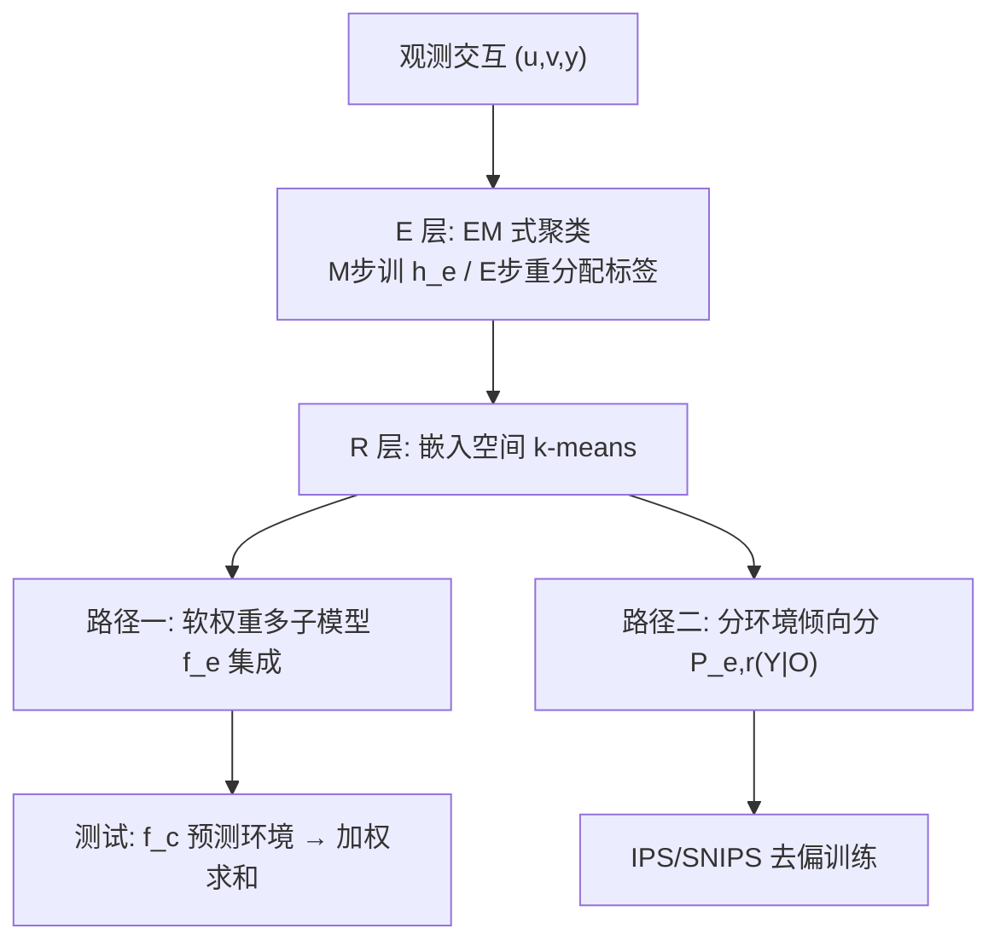
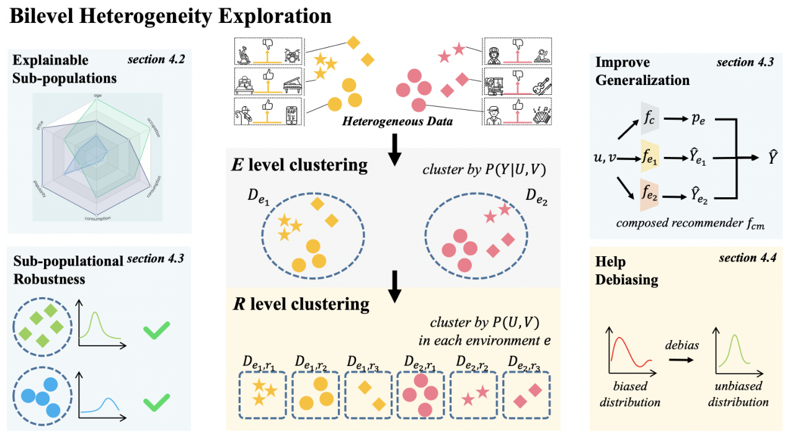

# Exploring and Exploiting Data Heterogeneity in Recommendation (推荐数据异质性的探索与利用)

- **会议/期刊**: TKDD (arXiv 2023-05 预印本)
- **作者与机构**: Zimu Wang, Jiashuo Liu, Hao Zou, Xingxuan Zhang, Yue He, Dongxu Liang, Peng Cui（清华大学；快手）
- **推荐链路定位**: 精排（打分模型训练范式 + 去偏加权）
- **研究方向**: 去偏公平与工业架构 / CTR 特征交叉
- **论文原文**: [https://arxiv.org/abs/2305.15431v1](https://arxiv.org/abs/2305.15431v1)
- **开源代码**: 暂未开源

## TL;DR (1分钟核心速览)

真实推荐数据由多个性质迥异的子群体聚合而成，忽视异质性会限制精度、损害少数群体鲁棒性并放大偏差。本文把联合分布拆为预测机制 $P(Y|U,V)$与协变量分布$P(U,V)$ 两层，提出 EM 式双层聚类 BHE 分层挖掘潜在环境标签，再以「多子模型加权集成」与「分环境倾向分估计」两种方式利用。在 Yelp/MovieLens-1M 上以 FM/NFM 为骨干，NDCG@20 相对提升约 26%–61%，Yahoo/Coat 去偏任务亦全面领先 IPS/SNIPS。

## Background & Motivation (背景与核心矛盾)

- **主流范式**: 推荐模型默认全库数据同分布，用单一模型拟合全部交互；去偏则统一用基于评分的朴素贝叶斯倾向分做 IPS/SNIPS 加权。
- **前人局限**: ① 单一模型难以同时拟合促销日与平日、新用户与意见领袖等截然不同的打分机制，稀疏子群体被主流模式淹没；② 倾向分估计把用户/物品变量视为跨环境常量，在异质环境下 $P_{e,r}(Y|O)$ 各不相同，导致权重失准。
- **核心洞察 (Key Insight)**: 推荐系统存在选择机制 $O \not\perp\!\!\!\perp Y|(U,V)$，使得预测机制异质性与协变量分布异质性天然**对齐耦合**——按$P(Y|U,V)$聚出的子群体在协变量空间同样紧致（图 1 compactness 显著下降），因此测试阶段无标签$Y$ 时也能仅凭协变量推断所属环境。
- **本文切入点**: 用「先按预测机制、再按协变量分布」的双层聚类显式解耦并挖掘两类异质性，再分别服务于多子模型预测与去偏。

## Method (核心方法设计)

### 1. 整体框架 (Overall Architecture)

BHE 把观测数据 $D=\{D_{e,r}\}_{e\in E,r\in R}$视为两层环境标签的笛卡尔积：$E$层刻画打分机制差异，$R$层刻画协变量分布差异。第一层用 EM 式迭代：M 步为每个环境训练独立因子分解模型$h_e$，E 步按各模型样本损失重新分配环境标签；第二层在每个$D_e$内部对嵌入向量做 k-means 得到$R$标签。挖掘出的异质性有两条利用路径：训练期用软权重构造多子模型集成，去偏期用$(e,r)$粒度估计倾向分。测试期通过联合训练的嵌入分类器$f_c$ 预测环境归属并加权融合各子模型输出。

<figure class="paper-figure" markdown="span">
  <figcaption>图2：中间子部分展示了BHE的框架及其流程。BHE首先根据预测机制对观测数据进行聚类。然后基于𝐸level聚类的结果，BHE探索子群体间协变量分布的异质性。周围四个子部分展示了BHE的应用场景与优势。聚类可获得可解释的子群体（第4.2节）、增强推荐模型的泛化能力（第4.3节）、提升子群体鲁棒性（第4.3节），并辅助去偏任务（第4.4节）。</figcaption>
</figure>

### 2. 关键设计拆解 (Key Designs)

1. **E 层预测机制聚类（EM-liked 环境发现）**：痛点是无子群体标签，无法直接按 $P(Y|U,V)$分组。M 步最小化$\mathcal{L}_M=\sum_{e}\frac{1}{|D_e|}\sum_{(u,v)\in D_e}\ell_{rec}(\hat{y}_{u,v,e},y_{u,v})$训练$|E|$个独立 MF/FM；E 步按$e_{u,v}\leftarrow\arg\min_{e}\ell_{rec}(\hat{y}_{u,v,e},y_{u,v})$ 重分配。直觉上「哪个模型最能解释该样本，样本就归属哪个机制」，迭代收敛即得机制一致的环境划分。

2. **R 层协变量聚类（嵌入空间 k-means）**：原始特征常仅剩 ID 且极稀疏，直接在特征空间聚类失效，故改用 $h_e$学到的拼接嵌入$a_{u,v}$做聚类：$\arg\min_R\sum_{r}\frac{1}{|R|}\sum_{(u,v)\in D_{e,r}}\|a_{u,v}-\bar{a}_{e,r}\|^2$。嵌入已吸收交互信息，使协变量分组更贴合真实子群体。

3. **软权重多子模型与去偏利用**：为避免切分加剧稀疏，样本对子模型 $f_e$的训练权重取$w^{tr}_{u,v,e}=\mathrm{Softmax}_e([-d_{u,v,e_1},\dots,-d_{u,v,e_{|E|}}])$，损失为$\mathcal{L}_e=\sum_{(u,v)\in D^w_e}\ell_{rec}(\hat{y}_{u,v,e},y_{u,v})w^{tr}_{u,v,e}$；测试时$\hat{y}_{u,v}=\sum_e\hat{y}_{u,v,e}\,p_{u,v,e}$，$p$由联合训练的$f_c$给出（$\mathcal{L}_{emb\_c}$= 推荐损失 + 交叉熵）。去偏侧将倾向分细化为$P_{e,r}(O=1|Y=y)\simeq P_{e,r}(Y=y|O=1)P(O=1)/P(Y=y)$，代入标准 IPS/SNIPS 目标。负采样沿用各骨干默认策略，无额外负采样设计；推理开销为$|E|$ 个子模型前向 + 一次分类，属可接受的线性放大。

## Experimental Setup & Evaluation Protocol (实验设置与评估协议)

- **数据集与预处理**: Yelp、MovieLens-1M 含丰富画像特征（离散化连续特征），评分 ≥4 为正样本，随机 20% 作测试；Yahoo、Coat 含偏置日志集与均匀无偏集，均匀集 5% 估倾向分、95% 作测试，评分 ≥3 为正样本。

| 数据集 | 特征/场景 | 正样本阈值 | 划分方式 |
| :--- | :--- | :---: | :---: |
| Yelp | 商户评论 + 用户粉丝/年龄 | ≥4 | 随机 80/20 |
| MovieLens-1M | 电影评分 + 年龄/类型数 | ≥4 | 随机 80/20 |
| Yahoo | 偏置+均匀日志 | ≥3 | 均匀集 5%/95% |
| Coat | 偏置+均匀日志 | ≥3 | 均匀集 5%/95% |

- **数据划分与防穿越**: 比例随机划分（非时间切分），测试阶段所有方法均不使用真实 $Y$ 判定子群体，避免标签泄漏。
- **排名评测协议**: 隐式反馈 Top-K 排序，报告 NDCG@K 与 Recall@K（K=10/20/30/40），未采用全库 Full-Ranking 的显式声明，属标准留出集排序评测。
- **对比基线与超参设置**: 骨干 FM/NFM（泛化实验）与 MF/NCF（去偏实验）；对照 cluster-user/item（专家特征分组）、raw feature/embedding（传统聚类）、IPS/SNIPS；环境数 $|E|,|R|$ 在 2–8 间网格搜索。

## Key Experimental Results (实验关键数据)

### 1. 主实验对比 (Main Results)

Yelp / MovieLens-1M 泛化实验（NDCG×10⁻²，节选）：

| Backbone | 方法 | Yelp N@10 | Yelp N@20 | ML-1M N@20 | ML-1M N@30 |
| :--- | :--- | :---: | :---: | :---: | :---: |
| FM | None | 4.99 | 6.52 | 7.86 | 8.29 |
| FM | cluster-user | 5.64 | 7.20 | 9.56 | 9.94 |
| FM | cluster-item | 5.57 | 7.08 | 10.97 | 11.33 |
| FM | embedding | 4.97 | 6.42 | 7.40 | 7.91 |
| FM | **BHE** | **6.74** | **8.24** | **12.14** | **12.37** |
| NFM | None | 9.95 | 14.01 | 11.11 | 11.30 |
| NFM | cluster-item | 13.34 | 16.84 | 13.39 | 13.56 |
| NFM | **BHE** | **18.07** | **22.57** | **14.61** | **14.86** |
| — | Improv. (NFM) | +81.6% | +61.1% | +31.5% | +31.5% |

去偏实验（Yahoo/Coat，NDCG@5×10⁻²）：MF-IPS 约 53→58、MF-SNIPS 同量级，叠加 BHE 后各组合均再提升 2–4 个点，全面优于原 IPS/SNIPS。

### 2. 消融实验 (Ablation Study)

| 配置 | Yahoo (MF-IPS) | Coat (NCF-SNIPS) | 说明 |
| :--- | :---: | :---: | :--- |
| 原 IPS/SNIPS | 基线 | 基线 | 无环境信息 |
| + BHE-E | 优于基线 | 优于基线 | 仅预测机制层 |
| + BHE-R | 优于基线 | 优于基线 | 仅协变量层 |
| + **BHE (E+R)** | **最优** | **最优** | 两层缺一不可 |

### 3. 关键实验发现 (Key Findings)

1. **异质性真实且致命**：跨环境训练/测试时 FM 的 NDCG@20 从同环境最优值骤降至接近崩溃，同环境训练显著优于全环境混合训练，证明机制差异是性能瓶颈而非噪声。
2. **利用异质性对少数群体收益最大**：MovieLens-1M 上 FM-BHE 在不流行物品上 NDCG@40 从 0.20 升至 3.71（约 18 倍），Yelp 上粉丝数少的用户从 5.46 升至 8.67，说明 BHE 有效缓解主流子群体对长尾的压制。
3. **两层异质性互补**：仅用 E 或仅用 R 的去偏增益均显著小于 E+R 联合，且环境数过少欠拟合、过多加剧稀疏，$|E|$ 在 3–5 区间最优，验证双层建模的必要性与超参敏感性。

## Highlights & Limitations (亮点、对比与审稿批判)

- **与代表作对比 (vs. Prior Work)**: 相比 IPS/SNIPS 将倾向分视为全局常量，本文按 $(e,r)$ 粒度估计，本质是把「去偏」升级为「分环境去偏」；相比 cluster-user/item 依赖人工专家特征，BHE 从数据中无监督发现机制一致子群体；相比既有鲁棒推荐工作仅考虑分布偏移，本文首次显式定义并解耦两类异质性。
- **可迁移亮点**: ① 「EM 式环境发现 + 软权重」可直接套用到多场景/多业务线联合建模，替代人工场景 ID；② 分环境倾向分估计可无缝插入任何 IPS 系去偏框架，改造成本极低。
- **审稿级局限批判**: ① 需训练 $|E|$个独立子模型并额外维护分类器，工业级候选规模下推理与存储开销线性膨胀，论文未给出延迟实测；② 环境数$|E|,|R|$ 需网格搜索且对稀疏度敏感，缺乏自适应确定机制；③ 评测为留出集排序而非全库 Full-Ranking，且未报告方差/显著性检验，结论稳健性证据偏弱。

## Rating (四维评分)

- **方法创新性 (Novelty)**: ⭐⭐⭐⭐ （首次显式定义并解耦预测机制/协变量两层异质性，EM 式环境发现思路清晰且有 compactness 实证支撑）
- **评估协议与实验扎实度 (Protocol & Experiments)**: ⭐⭐⭐ （四数据集、双骨干、泛化+去偏+鲁棒性+超参四问齐全，但缺全库排序与显著性检验）
- **写作与数学规范度 (Clarity & Rigor)**: ⭐⭐⭐⭐ （定义、命题与公式链条完整，Remark 明确观测数据下的条件化边界，符号统一）
- **工业落地与复现价值 (Industrial & Practical Value)**: ⭐⭐⭐ （软权重与分环境倾向分易落地，但多子模型开销与未开源降低复现便利性）

