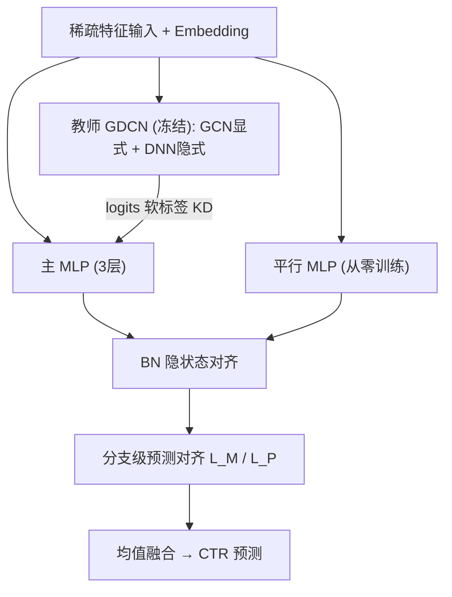
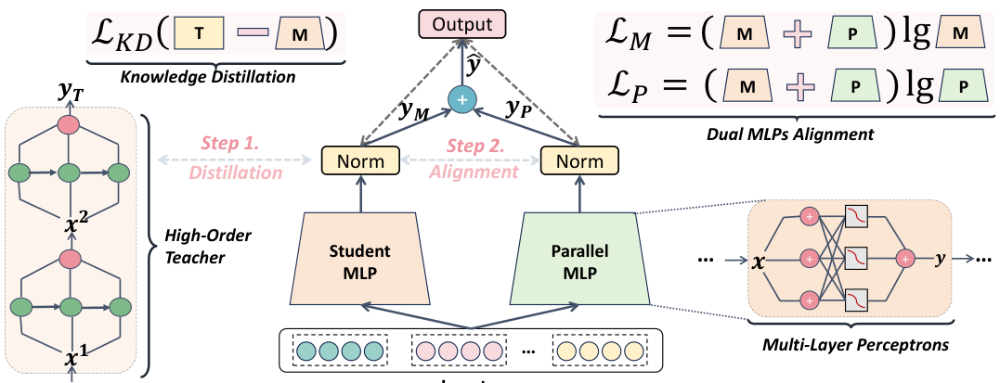

# Dual-Stream MLP is All You Need for CTR Prediction (双流MLP即你所需)

- **会议/期刊**: ACM Transactions on Knowledge Discovery from Data (TKDD)
- **作者与机构**: Kesha Ou、Wayne Xin Zhao、Ji-Rong Wen（中国人民大学高瓴人工智能学院）；Zhen Tian（字节跳动）；Long Zhang、Sheng Chen（美团）
- **推荐链路定位**: 精排（CTR 预估）
- **研究方向**: CTR预估与特征交叉 / 大模型知识蒸馏
- **论文原文**: [https://arxiv.org/abs/2606.04944v1](https://arxiv.org/abs/2606.04944v1)
- **开源代码**: [https://github.com/RUCAIBox/DS-MLP](https://github.com/RUCAIBox/DS-MLP)

## TL;DR (1分钟核心速览)

现有双流 CTR 模型靠复杂显式交叉算子（CrossNet/CIN）提精度，但计算昂贵、易过拟合，且显式与隐式两路输出量级失衡导致单路主导。本文提出 DS-MLP：先用知识蒸馏把 GDCN 等强教师的显式交叉能力压进一个三层主 MLP，再并联一个从零训练的平行 MLP 补隐式交互，并用隐状态 BN 对齐与分支级预测对齐消除两路失衡。最终模型仅含纯 MLP，在 Criteo/Avazu/MovieLens 三基准上 AUC 全面 SOTA（Criteo 0.8152、Avazu 0.7670、MovieLens 0.9752），推理延迟与 DCNv2/Final 同级。

## Background & Motivation (背景与核心矛盾)

- **主流范式**: 双流架构（DeepFM、xDeepFM、DCNv2、GDCN、FinalMLP）用显式交叉算子建模高阶特征组合、用 MLP 建模隐式交互，二者输出直接相加得预测。
- **前人局限一（高复杂度）**: 显式模块按预定义阶数枚举特征组合，参数与算力随阶数指数增长，且结构越复杂越难调参、越易过拟合。
- **前人局限二（融合失衡）**: 显式交叉经 Hadamard 积后数值范围随阶数放大，而隐式 MLP 输出被激活函数约束，直接相加时显式分量常压倒隐式分量，隐式信息被旁路。
- **核心洞察 (Key Insight)**: 作者发现用 GDCN 做教师蒸馏时，学生 MLP 只学到教师中被主导的显式行为、忽略隐式交互——失衡问题会沿蒸馏链传染；而 MLP 作为通用逼近器理论上可拟合任意连续映射。
- **本文切入点**: 不设计新交叉算子，而是"蒸馏 → 对齐 → 联合优化"三步走，把显式知识搬进同构 MLP，再用第二个 MLP 与对齐损失恢复隐式能力与两路平衡。

## Method (核心方法设计)

### 1. 整体框架 (Overall Architecture)

输入稀疏特征经嵌入层后分两阶段训练。**阶段一（蒸馏）**：冻结教师 GDCN（GCN 显式 + DNN 隐式），主 MLP（3 层）以教师 logits 为软目标做 KD，同时受真实标签 BCE 监督，从而继承显式高阶交叉。**阶段二（微调）**：并联一个从零训练、不复用教师嵌入的平行 MLP 捕捉隐式交互；两路隐状态先过 BatchNorm 拉齐数值范围，再各自接受分支级 BCE 对齐，最后以均值融合输出。推理时仅保留两个轻量 MLP，无任何交叉算子。

<figure class="paper-figure" markdown="span">
  <figcaption>图1. 我们提出的DS-MLP的架构。总体上，它通过两个主要阶段进行训练，即知识蒸馏和微调。</figcaption>
</figure>

### 2. 关键设计拆解 (Key Designs)

1. **教师→学生知识蒸馏（把显式交叉搬进 MLP）**：教师 GDCN 的交叉层 $\boldsymbol{x}_{l+1}=\boldsymbol{x}_0\odot(\mathbf{W}^X_l\boldsymbol{x}_l+\boldsymbol{b}_l)\odot\sigma(\mathbf{W}^G_l\boldsymbol{x}_l)+\boldsymbol{x}_l$中 Hadamard 积使高阶项数值膨胀，主导最终 logits。学生以带温度的交叉熵对齐教师 logits：$\mathcal{L}=\mathcal{L}_{CTR}+\lambda\mathcal{L}_{KD}$。直觉：KD 的$L_2$回归不仅拟合输出，还在 Sobolev 意义下逼近 Hessian，故学生能复现教师的二阶交互强度$I_{ij}(f)=\mathbb{E}_{\boldsymbol{x}}|\partial^2 f/\partial x_i\partial x_j|$，而非仅记忆标签。

2. **双 MLP 容量补偿 + 双重对齐（破解失衡）**：单靠蒸馏会继承教师偏置，故并联平行 MLP 专学隐式模式。隐状态对齐用 BN 统一两路数值尺度：$\hat{x}^m_i=(x^m_i-\mu^m_B)/\sqrt{(\sigma^m_B)^2+\epsilon}$；预测对齐让两分支各自直面真实标签：$\mathcal{L}_M=\mathrm{BCE}(\hat{y}_M,y)$、$\mathcal{L}_P=\mathrm{BCE}(\hat{y}_P,y)$。直觉：BN 消除量级差、分支监督迫使弱路独立变强，二者共同防止单路压倒，同时保留两路表征多样性。

3. **训练目标、负采样与推理效率**：微调总损失 $\mathcal{L}=\mathcal{L}_{CTR}+\alpha\mathcal{L}_M+\beta\mathcal{L}_P$，融合预测$\hat{y}=\sigma\big(\tfrac{1}{2}(y_M+y_P)\big)$。CTR 为二分类 BCE，无负采样环节；教师仅训练期存在，推理只跑两个 MLP，Criteo 上延迟 59.43ms，与 FinalMLP（56.71ms）、Final（25.56ms）同量级，远低于 AutoInt+（1262ms）。

## Experimental Setup & Evaluation Protocol (实验设置与评估协议)

- **数据集与预处理**（沿用 AFN 的切分与预处理）：

| 数据集 | #Instances | #Fields | #Features | 说明 |
| :--- | :---: | :---: | :---: | :--- |
| Criteo | 45,840,617 | 39 | 2,086,936 | 13 数值 + 26 类别字段，约一周展示广告日志 |
| Avazu | 40,428,967 | 22 | 1,544,250 | 约 10 天移动广告点击记录 |
| MovieLens | 2,006,859 | 3 | 90,445 | 用户-电影-标签三元组转为点击二分类 |

- **数据划分与防穿越**: 按 AFN 官方切分（比例划分），未额外声明时间戳切分。
- **排名评测协议**: 报告 AUC 与 LogLoss（概率校准指标），并给出相对基线的 RelaImpr；属全样本评估，非采样排序。
- **对比基线与超参**: 覆盖二阶（FmFM/AFM）、显式隐式联合（DeepFM/xDeepFM/DCNv2/GDCN/FCN/AutoInt+/FiBiNet/FiGNN/PNN）、双流（Final/FinalMLP）、蒸馏（ECKD）、生成式（SFG）与 scaling（WuKong）共 17 个基线；嵌入维度 $d=10$、batch 4096、默认 MLP [400,400,400]，基于 FuxiCTR 实现、严格对齐 BARS 基准配置；学生宽度按数据集取 600/900/1000，$\lambda\in[0.1,10]$、$\alpha,\beta\in[0.5,1.5]$ 网格搜索。

## Key Experimental Results (实验关键数据)

### 1. 主实验对比 (Main Results)

| 数据集 | 模型 | AUC | LogLoss | RelaImpr | Latency(ms) |
| :--- | :--- | :---: | :---: | :---: | :---: |
| Criteo | FCN | 0.8149 | 0.4368 | 3.11% | 39.26 |
| Criteo | Final | 0.8148 | 0.4369 | 3.08% | 25.56 |
| Criteo | FinalMLP | 0.8147 | 0.4374 | 3.05% | 56.71 |
| Criteo | GDCN | 0.8137 | 0.4386 | 2.72% | 45.02 |
| Criteo | ECKD | 0.8139 | 0.4401 | 2.78% | 43.15 |
| Criteo | **DS-MLP** | **0.8152** | **0.4366** | **3.21%** | 59.43 |
| Avazu | Final | 0.7664 | 0.3659 | 2.50% | 19.26 |
| Avazu | FinalMLP | 0.7659 | 0.3662 | 2.31% | 21.03 |
| Avazu | GDCN | 0.7648 | 0.3673 | 1.89% | 21.52 |
| Avazu | **DS-MLP** | **0.7670** | **0.3657** | **2.73%** | 25.89 |
| MovieLens | Final | 0.9717 | 0.1978 | 5.24% | 2.29 |
| MovieLens | FinalMLP | 0.9716 | 0.2119 | 5.22% | 2.31 |
| MovieLens | GDCN | 0.9685 | 0.2164 | 4.53% | 3.75 |
| MovieLens | **DS-MLP** | **0.9752** | **0.1971** | **6.02%** | 2.65 |

### 2. 消融实验 (Ablation Study)

| 变体 | Avazu AUC | Criteo AUC | MovieLens AUC |
| :--- | :---: | :---: | :---: |
| DS-MLP 完整 | **0.7670** | **0.8152** | **0.9752** |
| w/o alignment loss | 0.7641 | 0.8145 | 0.9703 |
| w/o student MLP | 0.7652 | 0.8137 | 0.9669 |
| w/o parallel MLP | 0.7648 | 0.8140 | 0.9690 |
| w/o dual MLP（换 CrossNet） | 0.7639 | 0.8138 | 0.9708 |
| w/o KD | 0.7655 | 0.8135 | 0.9715 |

### 3. 关键实验发现 (Key Findings)

1. **对齐损失是最大单点贡献**：去掉后 MovieLens AUC 从 0.9752 跌至 0.9703（-0.49pt），三数据集降幅均居各消融之首，印证"两路失衡"是双流架构的核心病灶而非次要工程细节。
2. **蒸馏与双流缺一不可且互补**：w/o KD 在 Criteo 掉至 0.8135（低于教师 GDCN 的 0.8137），说明无教师引导的纯 MLP 学不到显式交叉；而 w/o parallel MLP 在 MovieLens 掉 0.62pt，说明蒸馏会继承教师偏置、必须靠平行路纠偏（案例研究中负样本 3 与正样本 18 的错误预测被平行路修正）。
3. **同构 MLP 优于异构拼接**：w/o student MLP（直接用教师+平行 MLP 对齐）与 w/o dual MLP（换 CrossNet）均显著劣化，证明蒸馏的价值不止于压缩，更在于把显式范式翻译成与隐式路同构的结构，从而可对齐、可扩展；scaling 实验中 GDCN 随参数增至约 6M 后 AUC 饱和回落，而 DS-MLP 持续上升。

## Highlights & Limitations (亮点、对比与审稿批判)

- **与代表作对比 (vs. Prior Work)**: 相比 GDCN/DCNv2 等显式交叉模型，本文用蒸馏替代手工交叉算子，把显式建模成本转移到离线教师；相比 FinalMLP 的双流门控融合，本文两路同构且用 BN+分支监督显式对齐，避免门控学偏；相比 ECKD 多教师集成蒸馏，本文单教师 + 平行补偿路，结构更轻且给出 Hessian 级理论保证。
- **可迁移亮点**: ①"异构强模型 → 同构轻学生"的蒸馏范式可迁移到多场景精排的模型压缩；②分支级辅助监督 + BN 对齐是解决任意多塔输出量级失衡的通用手段。
- **审稿级局限批判**: ①教师需离线预训练且学生宽度/$\lambda,\alpha,\beta$ 对数据集与教师类型敏感（Criteo 最优 600、MovieLens 需 1000），调参成本未量化；②仅在三个公开基准做离线 AUC/LogLoss 评估，缺少线上 A/B 与校准/延迟的联合分析，且 MovieLens 仅 3 字段，特征交叉场景代表性有限。

## Rating (四维评分)

- **方法创新性 (Novelty)**: ⭐⭐⭐⭐ （不造新算子而用"蒸馏+同构对齐"重构双流范式，附 Hessian 交互恢复的理论论证，思路简洁但有洞察）
- **评估协议与实验扎实度 (Protocol & Experiments)**: ⭐⭐⭐⭐ （三基准 17 基线 + 五教师兼容性 + scaling + 保真度拟合 + 完整消融，唯缺线上验证与时间切分）
- **写作与数学规范度 (Clarity & Rigor)**: ⭐⭐⭐⭐ （公式与算法流程清晰，Sobolev 空间论证略偏形式化、平滑性假设较强）
- **工业落地与复现价值 (Industrial & Practical Value)**: ⭐⭐⭐⭐⭐ （纯 MLP 推理、代码开源、基于 FuxiCTR/BARS 可复现，延迟与主流模型同级，部署友好）

