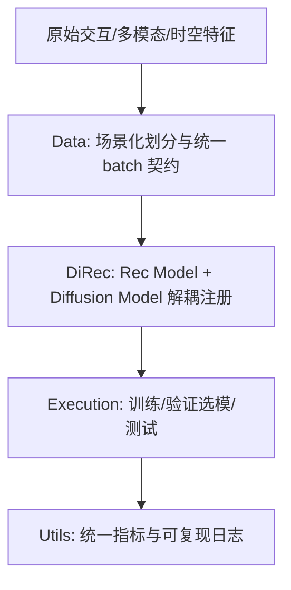
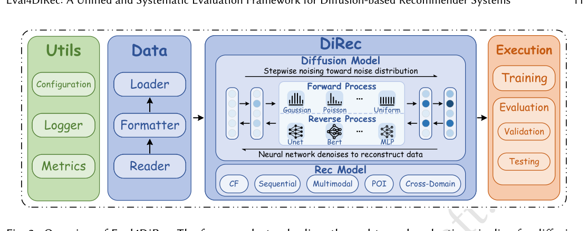

# Eval4DiRec: A Unified and Systematic Evaluation Framework for Diffusion-based Recommender Systems (面向扩散推荐系统的统一系统化评测框架)

- **会议/期刊**: ACM Transactions on Knowledge Discovery from Data (TKDD)
- **作者与机构**: Cong Wang, Shoujin Wang, Yishuo Li, Qi Zhang, Liang Hu, Wenpeng Lu（齐鲁工业大学、悉尼科技大学、同济大学）
- **推荐链路定位**: 端到端生成式（覆盖召回至排序的生成式打分）
- **研究方向**: 生成式推荐与离散语义ID / 去偏公平、可信隐私与工业架构
- **论文原文**: [论文原文链接](https://arxiv.org/abs/2609.34404v2)
- **开源代码**: [开源代码仓库链接](https://github.com/wangcong2001/Eval4DiRec)

## TL;DR (1分钟核心速览)

扩散推荐（DiRec）近三年论文激增，但各研究在数据处理、划分、扩散步数、噪声调度与采样协议上各行其是，导致结果不可复现、比较不公平。本文提出 Eval4DiRec——首个面向扩散推荐的开源统一评测框架，将 14 个代表性模型（CF/序列/多模态/POI/跨域 5 场景）纳入同一数据管线与扩散配置接口，在统一 Full-Ranking 协议下系统基准测试，并首次量化噪声调度、扩散步数、噪声分布对 Recall@20 的显著影响。

## Background & Motivation (背景与核心矛盾)

- **主流范式**: 扩散模型凭借强生成能力与稳定训练，被广泛用于交互重建（DiffRec）、序列增广（DiffuRec/CaDiRec）、多模态图生成（DiffMM）、POI 轨迹（Diff-POI）与跨域迁移（DiffCDR）。
- **前人局限**: ① 通用框架（RecBole/ReChorus/DaisyRec）只支持判别式单步预测，对扩散的迭代去噪与随机采样无原生支持；② 各 DiRec 论文的扩散步数、噪声调度、采样器被硬编码在模型内部，比较结果被推理配置混淆。
- **核心洞察 (Key Insight)**: 扩散推荐与判别式推荐存在范式差异——推荐信号由多步去噪生成，因此"扩散过程配置"本身必须作为评测协议的一部分被显式标准化，而非模型实现细节。
- **本文切入点**: 将推荐骨干（Rec Model）与扩散过程（Diffusion Model）解耦为两个可独立注册的组件，用统一 YAML 配置暴露步数/调度/分布/采样器，实现跨模型公平对比。

## Method (核心方法设计)

### 1. 整体框架 (Overall Architecture)

Eval4DiRec 由四个模块构成闭环：**Data** 模块将原始交互转为统一隐式反馈格式，按场景执行专属划分（CF 用 7:1:2、序列用 Leave-One-Out、POI 用 7:1:2 且保留时空戳），并输出标准化 batch 契约；**DiRec** 模块通过注册表将 Rec Model（用户-物品嵌入、序列编码、多模态融合）与 Diffusion Model（前向加噪、反向去噪、噪声调度）解耦实例化；**Execution** 模块编排训练-验证-测试全流程，以验证集指标选 checkpoint；**Utils** 统一随机种子、日志与 Recall/NDCG/HR/MRR 指标实现。新增模型只需实现 `calculate_loss` 与 `predict` 两个接口。

<figure class="paper-figure" markdown="span">
  <figcaption>图 2. Eval4DiRec 概览。该框架标准化了基于扩散的推荐系统的端到端评估流程，包括数据预处理/划分、模型集成、训练与推理以及指标报告。它由四个模块组成：Data 准备统一输入和场景特定划分；DiRec 集成基于扩散的推荐器并管理采样相关配置；Execution 以结构化输出编排训练、验证和测试；Utils 提供配置、随机性控制、日志记录和指标计算的实用工具。</figcaption>
</figure>

### 2. 关键设计拆解 (Key Designs)

1. **扩散配置协议化（Diffusion-as-Protocol）**：痛点在于步数 $T$、调度$\{\beta_t\}$、噪声分布被埋在模型代码里。本文将前向过程$q(x_t|x_0)=\mathcal{N}(x_t;\sqrt{\bar{\alpha}_t}x_0,\sqrt{1-\bar{\alpha}_t}\mathbf{I})$与反向采样$p_\theta(x_{t-1}|x_t)$ 的调度、采样器、预测类型全部提升为框架级可配置项，使"同一骨干 + 不同调度"可被受控对比。直觉上，这消除了跨论文比较中最大的混淆变量。
2. **骨干-扩散解耦与注册表扩展**：Rec Model 与 Diffusion Model 分别注册，模型只需暴露损失与打分接口。以 T-DiffRec 为例，其时间加权交互向量构造被隔离在 data profile 中，复用公共 loader 与 Leave-One-Out 协议，无需重写 trainer/evaluator，保证扩展不破坏评测一致性。
3. **训练目标与推理开销**：各模型沿用其原始扩散损失（DDPM 的 $\mathcal{L}_{simple}=\mathbb{E}_{t,x_0,\epsilon}\|\epsilon-\epsilon_\theta(\sqrt{\bar{\alpha}_t}x_0+\sqrt{1-\bar{\alpha}_t}\epsilon,t)\|^2$或 SDE 的得分匹配），框架不强制统一损失但统一优化器（AdamW）、早停（20 轮无提升）与 5 随机种子平均。推理需$T$ 步反向去噪，开销随步数线性增长，是扩散推荐落地的核心瓶颈。

## Experimental Setup & Evaluation Protocol (实验设置与评估协议)

- **数据集与预处理**（均为处理后统计，显式评分仅保留 5 分转隐式，`5-core` 过滤）：

| 数据集 | #Users | #Items | #Interactions | 稀疏度 | 场景说明 |
| :--- | :---: | :---: | :---: | :---: | :--- |
| Yelp | 37,232 | 47,744 | 359,330 | 99.98% | CF/序列 |
| Beauty | 9,895 | 8,455 | 73,528 | 99.91% | CF/序列 |
| ML-1M | 5,652 | 2,468 | 223,456 | 98.40% | CF/序列 |
| TikTok | 9,319 | 6,710 | 59,541 | 99.90% | 多模态（视/声/文） |
| Baby / Sports | 19,445 / 35,598 | 7,050 / 18,357 | 139,110 / 256,308 | 99.89% / 99.96% | 多模态 |
| TKY / NYC / Gowalla | 2,293 / 1,083 / 10,162 | 15,177 / 9,989 / 24,237 | 494,807 / 179,468 / 456,820 | 98.58% / 98.34% / 99.81% | POI |
| Video / Music / Book | 123,960 / 75,258 / 603,668 | 50,052 / 64,443 / 367,982 | 1.70M / 1.10M / 8.90M | 99.97%+ | 跨域（V→M, B→V, B→M） |

- **数据划分与防穿越**: CF 与 POI 用 `7:1:2 比例划分`（按时间序），序列推荐用 `Leave-One-Out`（末位测试、次末位验证），跨域按重叠用户 `7:1:2` 划分，均保证训练不泄露未来交互。
- **排名评测协议**: 统一 `Full-Ranking (全库未交互排序)`，POI 明确不使用采样负例；指标 Recall/NDCG/HR/MRR 均 @20。
- **对比基线与超参**: 每场景配非扩散基线（BPR-MF、LightGCN、BERT4Rec、STOSA、BM3、STAN、PTUPCDR）与扩散 SOTA；隐层维度 $\{64,128,256\}$，学习率$\{1e-5,\dots,1e-3\}$，扩散步数$\{2,\dots,1000\}$，调度$\{linear, exponential, sqrt, cosine\}$，5 种子平均，配对$t$-检验$p<0.05$。

## Key Experimental Results (实验关键数据)

### 1. 主实验对比 (Main Results)

| 场景/数据集 | 代表基线 | Recall@20 | NDCG@20 | 最优扩散模型 | Recall@20 | Improv. |
| :--- | :--- | :---: | :---: | :--- | :---: | :---: |
| CF / Yelp | LightGCN† | 3.31 | 1.79 | **DiffRec** | **4.82** | +45.6% |
| CF / Beauty | LightGCN† | 6.32 | 3.55 | **DDRM** | **7.60** | +20.3% |
| CF / ML-1M | LightGCN† | 12.31 | 8.74 | **DiffRec** | **15.67** | +27.3% |
| 序列 / Yelp | STOSA† | 1.32 | 0.75 | **CDDRec** | **5.19** | +293% |
| 序列 / Beauty | STOSA† | 3.51 | 1.54 | **CDDRec** | **7.29** | +107.7% |
| 多模态 / TikTok | BM3† | 7.31 | 2.97 | **DiffMM** | **10.99** | +50.3% |
| 多模态 / Sports | BM3† | 4.48 | 1.95 | **CCDRec** | **9.49** | +111.8% |
| POI / TKY | STAN† | 67.51 | 58.76 | **Diff-POI** | **70.10** | +3.8% |
| 跨域 / V→M | PTUPCDR† | 1.46 | 1.54 | **DiffCDR** | **1.88** | +28.8% |

### 2. 消融与因素分析 (Ablation & Factor Study)

| 分析维度 | 设置 | 观察（Recall@20 趋势） |
| :--- | :--- | :--- |
| 噪声调度 | linear / exponential / sqrt / cosine | 调度选择对三数据集 Recall@20 影响显著，最优调度随数据集变化 |
| 扩散步数 | 2 → 1000 | 步数过小欠拟合、过大收益饱和甚至下降，存在数据集相关最优点 |
| 噪声分布 | Gaussian / Poisson / Uniform | 高斯并非恒优，分布选择与场景强相关 |
| 缺失鲁棒性 | 缺失比例递增 | 扩散模型在部分缺失下退化慢于非扩散基线 |

### 3. 关键实验发现 (Key Findings)

1. **扩散并非"免费午餐"但确有增益**：CF 场景 DiffRec 相对 LightGCN 提升 20%–46%，序列场景 CDDRec 相对 STOSA 提升超 100%，但 POI 场景 Diff-POI 仅比 STAN 高 3.8%，说明增益高度依赖场景与骨干匹配度。
2. **扩散超参是性能的一阶变量**：噪声调度与步数的选择可造成 Recall@20 的显著波动（图 4/图 5），这直接证明"不标准化扩散配置的跨论文比较不可信"，也解释了文献中结果难以复现的根因。
3. **效率是落地硬约束**：每轮训练时间与总推理时间随步数线性增长（图 3），扩散推荐在工业级全库排序下的推理延迟远高于单步判别模型，需在精度-时延间权衡。

## Highlights & Limitations (亮点、对比与审稿批判)

- **与代表作对比 (vs. Prior Work)**: 相较 RecBole/ReChorus 仅支持判别式单步预测，本文首次将扩散过程配置（步数/调度/采样器）作为协议级组件；相较 Benigni et al. 仅复现 9 个 DDPM 模型的批判性研究，本文提供可复用、跨 5 场景的基础设施而非一次性结论。
- **可迁移亮点**: ① "骨干-生成过程解耦 + 注册表"的框架设计可直接迁移到 LLM4Rec、扩散/流匹配等其他生成式推荐的基准建设；② 将随机种子、指标实现、早停规则集中到 Utils 的做法，是消除复现偏差的低成本高收益技巧。
- **审稿级局限批判**: ① 仅覆盖 14 个模型，且部分模型因原始实现缺失需重写，统一配置后数值与原论文不可直接对齐，削弱"复现"说服力；② 未纳入大规模工业数据集与线上 A/B，推理延迟分析停留在单卡 RTX 3090，工业部署结论有限；③ 未与非扩散强基线做同等调参预算的深度对比，"扩散优越性"结论仍偏保守。

## Rating (四维评分)

- **方法创新性 (Novelty)**: ⭐⭐⭐ （框架与协议标准化贡献扎实，但属基础设施型工作，算法层面无新模型）
- **评估协议与实验扎实度 (Protocol & Experiments)**: ⭐⭐⭐⭐⭐ （5 场景 14 模型、统一 Full-Ranking、5 种子 + 配对 t 检验，协议严谨度为本领域标杆）
- **写作与数学规范度 (Clarity & Rigor)**: ⭐⭐⭐⭐ （DDPM/SDE 预备知识完整、模块契约清晰，但部分表格排版与符号重复略显冗长）
- **工业落地与复现价值 (Industrial & Practical Value)**: ⭐⭐⭐⭐ （开源完整、扩展成本低，但扩散推理延迟与大规模数据缺失限制直接上线价值）
