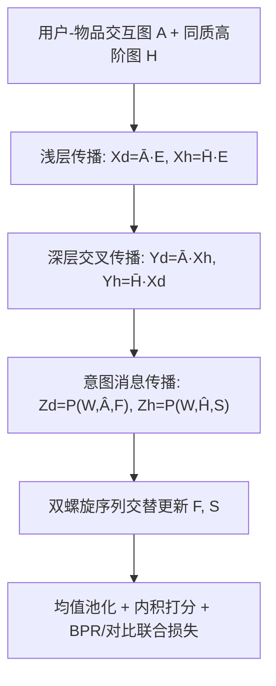
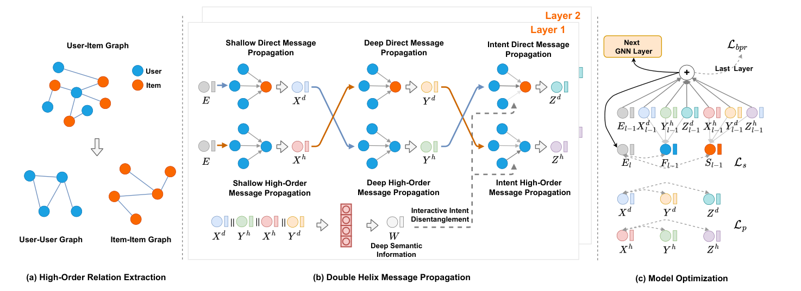

# Intent Propagation Contrastive Collaborative Filtering (意图传播对比协同过滤)

- **会议/期刊**: IEEE TKDE, 37(5):2665-2679, May 2025
- **作者与机构**: Haojie Li, Junwei Du, Guanfeng Liu, Feng Jiang, Yan Wang, Xiaofang Zhou（青岛科技大学、麦考瑞大学、香港科技大学）
- **推荐链路定位**: 召回（图协同过滤表征学习）
- **研究方向**: 协同过滤与双塔召回 / 自监督对比学习与交互去噪
- **论文原文**: [https://arxiv.org/abs/2604.15704v1](https://arxiv.org/abs/2604.15704v1)
- **开源代码**: [https://github.com/rookitkitlee/IPCCF](https://github.com/rookitkitlee/IPCCF)

## TL;DR (1分钟核心速览)

现有意图解耦推荐存在两大痛点：(1) 仅依赖直接交互的局部结构，忽视高阶/复合语义关系；(2) 解耦过程仅靠推荐任务反向传播的间接监督，易偏置与过拟合。IPCCF 提出**双螺旋消息传播**（直接/高阶关系交替传递）与**意图消息传播**（把图结构纳入解耦视野），并用对比学习对齐结构视图与意图视图，为解耦提供直接监督。在 Gowalla/Amazon-book/Tmall 三个数据集、**Full-Ranking 全库排序**协议下，相比最强基线 BIGCF，Precision/Recall/NDCG 平均提升 6.37%/6.14%/9.36%。

## Background & Motivation (背景与核心矛盾)

- **主流范式**: 以 LightGCN 为代表的 GCN 协同过滤通过直接交互图传播生成节点表征；DGCF/DCCF/BIGCF 等解耦方法将用户/物品表征切分为 $K$ 个意图块，以捕捉细粒度交互模式。
- **前人局限一（结构视野窄）**: 现有解耦方法仅从直接交互的局部结构提取语义，受 GCN 层数限制只能感知局部邻域，无法覆盖高阶与复合交互关系；且仅从直接交互角度解耦，缺乏从全局图结构审视解耦合理性的视角。
- **前人局限二（监督信号弱）**: 交互意图是隐变量，现有方法依赖推荐任务反向传播的间接信号，解耦目标退化为"让最终表征满足推荐任务"而非"真实反映交互意图"，导致偏置与过拟合；EM 类迭代估计又强依赖初始化。
- **核心洞察 (Key Insight)**: 若把"结构传播"与"意图传播"视为两条相互缠绕、彼此校验的螺旋链，则结构关系可反过来为意图解耦提供直接监督。
- **本文切入点**: 用双螺旋传播挖掘深层语义 + 意图传播把图结构引入解耦 + 对比学习对齐两视图，一举同时缓解"视野窄"与"监督弱"。

## Method (核心方法设计)

### 1. 整体框架 (Overall Architecture)

IPCCF 由三模块构成：**高阶关系提取**用 Jaccard 相似度在同质节点（用户-用户、物品-物品）间构造高阶关系图 $\hat{H}$，与直接交互图$\hat{A}$互补；**双螺旋消息传播**维护两条螺旋序列$F$（直接链）与$S$（高阶链），浅层传播后交叉输入对方做深层传播，再各自执行意图传播，交替更新；**模型优化**将多层表征均值池化后内积打分，并以 BPR + 多路对比损失联合训练。

<figure class="paper-figure" markdown="span">
  <figcaption>图 1. IPCCF 模型的整体框架包含三个关键模块：高阶关系提取模块，能够更好地捕捉图的结构特征；双螺旋消息传播模块，通过融合结构与意图生成节点表示；模型优化模块，从多个角度对齐节点表示以提升其质量。</figcaption>
</figure>

### 2. 关键设计拆解 (Key Designs)

1. **双螺旋交叉传播（Double Helix Propagation）**：针对"GCN 层数受限只能看局部"的痛点，不再让直接链与高阶链各自独立堆叠，而是让浅层高阶输出 $X^h$作为深层直接传播的输入、浅层直接输出$X^d$作为深层高阶传播的输入，即$Y^d=\bar{A}\cdot X^h$、$Y^h=\bar{H}\cdot X^d$，并更新$F=X^d+Y^h$、$S=X^h+Y^d$。直觉上两条链像 DNA 双螺旋般互相缠绕，使节点在同等层数下吸收跨跳数、跨关系类型的复合语义，缓解过平滑。

2. **意图消息传播（Intent Message Propagation）**：针对"解耦只看直接交互"的痛点，先用深层语义 $W$模拟交互强度$\tilde{R}=T\odot R$（$T_{u,v}=(s(w_u,w_v)+1)/2$），再将交互按意图分解为传播矩阵：
$$\ddot{R}^k_{u,v}=\tilde{R}_{u,v}\cdot\frac{(w_u\odot w_v)^\top c_k}{\sum_{o=1}^{K}(w_u\odot w_v)^\top c_o},\quad \bar{R}_{u,v}=\frac{1}{K}\sum_{k=1}^{K}\frac{\ddot{R}_{u,v}}{\sum_{j\in N_R(u)}\ddot{R}_{u,j}}$$
随后 $N=\bar{R}\cdot M$完成意图传播。关键技巧：因意图近似正交，可对$K$个意图邻接矩阵做**平均池化**，把$K$ 次传播压缩为一次矩阵乘法，兼顾解耦效果与效率。

3. **多路对比监督与联合优化**：为解耦提供直接监督，设计双螺旋序列对比 $\mathcal{L}_s=\mathcal{I}(E,F)+\mathcal{I}(E,S)$与传播过程对比$\mathcal{L}_p=\mathcal{I}(X^d,Y^d)+\mathcal{I}(X^d,Z^d)+\mathcal{I}(X^h,Y^h)+\mathcal{I}(X^h,Z^h)$，其中$\mathcal{I}$为 InfoNCE；再加意图正交约束$\mathcal{L}_i$。总损失：
$$\mathcal{L}=\mathcal{L}_{BPR}+\lambda_1\mathcal{L}_s+\lambda_2\mathcal{L}_p+\lambda_3\mathcal{L}_i+\lambda_4\|\Theta_1\|_F^2+\lambda_5\|\Theta_2\|_F^2$$
负样本采用批内（in-batch）不同节点作为负例，无需额外负采样；推理时仅需一次前向得到 $E'$ 做内积，开销与 LightGCN 同阶。

## Experimental Setup & Evaluation Protocol (实验设置与评估协议)

- **数据集与预处理**:

| 数据集 | #Users | #Items | #Interactions | 密度 | 场景说明 |
| :--- | :---: | :---: | :---: | :---: | :--- |
| Gowalla | 50,821 | 57,440 | 1,172,425 | 4.0e-4 | LBS 签到 |
| Amazon-book | 78,578 | 77,801 | 2,240,156 | 3.7e-4 | 图书评论 |
| Tmall | 47,939 | 41,390 | 2,357,450 | 1.2e-3 | 电商购买 |

- **数据划分与防穿越**: 采用与 LightGCN/DCCF/BIGCF 一致的隐式反馈标准划分（每用户留出固定比例交互作测试），训练/验证/测试严格隔离。
- **排名评测协议**: 无偏 **Full-Ranking（全库未交互物品排序）**，报告 Precision@20/40、Recall@20/40、NDCG@20/40。
- **对比基线与超参**: 基线分三类——GNN 类（NGCF、LightGCN）、自监督类（SLRec、SGL-ED/ND、HCCF、LightGCL）、解耦类（DisenGCN、DisenHAN、CDR、DGCF、DGCL、DCCF、BIGCF）。嵌入维度 $d=32$，批大小 10,240，层数$L=2$，意图数$K=8$，高阶过滤阈值$Q=5$、$\eta=0.8$，Adam 学习率 0.001。

## Key Experimental Results (实验关键数据)

### 1. 主实验对比 (Main Results)

| 模型 | Gowalla R@20 | Gowalla N@20 | Amazon R@20 | Amazon N@20 | Tmall R@20 | Tmall N@20 |
| :--- | :---: | :---: | :---: | :---: | :---: | :---: |
| LightGCN | 0.1799 | 0.1053 | 0.0732 | 0.0544 | 0.0555 | 0.0381 |
| SGL-ED | 0.1809 | 0.1067 | 0.0774 | 0.0578 | 0.0574 | 0.0393 |
| LightGCL | 0.1825 | 0.1077 | 0.0836 | 0.0643 | 0.0632 | 0.0444 |
| DGCF | 0.1784 | 0.1069 | 0.0688 | 0.0513 | 0.0544 | 0.0372 |
| DCCF | 0.1876 | 0.1123 | 0.0889 | 0.0680 | 0.0668 | 0.0469 |
| BIGCF | 0.2086 | 0.1242 | 0.0989 | 0.0761 | 0.0755 | 0.0535 |
| **IPCCF** | **0.2178** | **0.1310** | **0.1106** | **0.0894** | **0.0803** | **0.0579** |
| Improv.% | +4.41% | +5.48% | +11.83% | +17.48% | +6.36% | +8.22% |

### 2. 消融实验 (Ablation Study)

| 变体 | Gowalla R@20 | Amazon R@20 | Tmall R@20 | Tmall N@20 |
| :--- | :---: | :---: | :---: | :---: |
| w/o ho（去高阶关系） | 0.1926 | 0.0921 | 0.0681 | 0.0479 |
| w/o dp（去深层传播） | 0.2086 | 0.1050 | 0.0760 | 0.0546 |
| w/o he（去交叉传递） | 0.2078 | 0.1043 | 0.0757 | 0.0543 |
| w/o ip（去意图传播） | 0.1747 | 0.0858 | 0.0674 | 0.0476 |
| w/o spc（去全部对比） | 0.1978 | 0.0998 | 0.0701 | 0.0492 |
| w/o sc（去序列对比） | 0.2148 | 0.1096 | 0.0798 | 0.0574 |
| w/o pc（去过程对比） | 0.2121 | 0.1030 | 0.0726 | 0.0516 |
| **IPCCF** | **0.2178** | **0.1106** | **0.0803** | **0.0579** |

### 3. 关键实验发现 (Key Findings)

1. **意图传播是最大贡献源**：移除 `w/o ip` 后 Gowalla R@20 从 0.2178 骤降至 0.1747（-19.8%），降幅远超其他变体，说明把图结构引入解耦视野是性能跃升的核心；高阶关系（`w/o ho`，-11.6%）次之，验证"局部结构视野窄"确为关键瓶颈。
2. **对比监督存在功能冗余但整体必要**：单独移除任一对比模块（`w/o sc`/`w/o pc`）仅小幅下降，但全部移除（`w/o spc`）降幅显著（Gowalla -9.2%），且浅层-深层传播对比（`w/o pcd`）影响最大，因其控制模型初始阶段。
3. **稀疏鲁棒性与效率双优**：在 Gowalla 按交互数分桶（0-10 至 40-50）的实验中，IPCCF 在所有稀疏度分组均领先 LightGCN/DCCF/BIGCF；每 epoch 训练耗时 16.5s（Gowalla），仅需 BIGCF 约 25.29% 的训练时间即可达到其峰值性能，意图数 $K$在 4–32 间波动时性能变化极小（$K=8$ 最优）。

## Highlights & Limitations (亮点、对比与审稿批判)

- **与代表作对比 (vs. Prior Work)**: 相比 DGCF 的"单意图独立传播"，IPCCF 用平均池化把 $K$ 次意图传播压缩为一次矩阵乘法，效率更高；相比 DCCF/BIGCF 仅从直接交互解耦，IPCCF 将高阶关系与全局图结构纳入解耦视野；相比 KGIN 按意图分类聚合消息，IPCCF 保留同意图消息的完整传播路径以校验解耦合理性。
- **可迁移亮点**: (1) "交叉输入对方链输出"的双螺旋传播范式可低成本移植到任意多视图 GNN（如社交+交互双图）；(2) 意图邻接矩阵平均池化技巧，在意图近似正交假设下把 $O(K)$传播降为$O(1)$，对大规模解耦模型极具工程价值。
- **审稿级局限批判**: (1) 高阶关系提取依赖 Jaccard 阈值 $\eta$与 top-$Q$两个超参，论文显示性能对$\eta$ 较敏感，跨数据集需重调；(2) 对比学习需维护两条螺旋序列与多层表征，显存开销随层数线性增长，且实验仅在中等规模数据集（百万级交互）验证，未给出工业亿级场景的分布式方案。

## Rating (四维评分)

- **方法创新性 (Novelty)**: ⭐⭐⭐⭐ （双螺旋交叉传播 + 意图传播纳入图结构 + 对比直接监督的三位一体设计较新颖，但各组件均为已有技术的巧妙组合，缺乏理论收敛性分析）
- **评估协议与实验扎实度 (Protocol & Experiments)**: ⭐⭐⭐⭐ （三数据集 Full-Ranking、13 个基线、9 组消融、稀疏分桶/意图数/过平滑 MAD/效率/案例研究齐全，但缺少显著性检验与线上 A/B）
- **写作与数学规范度 (Clarity & Rigor)**: ⭐⭐⭐⭐ （公式与符号表完整、复杂度分析清晰，但意图传播的平均池化近似缺乏误差界论证，部分符号如 $\ddot{R}$与$\bar{R}$ 易混淆）
- **工业落地与复现价值 (Industrial & Practical Value)**: ⭐⭐⭐⭐ （代码已开源、超参全公开、意图传播简化使训练开销可控，达到 BIGCF 峰值仅需其 1/4 时间，具备较高复现与部署价值）

