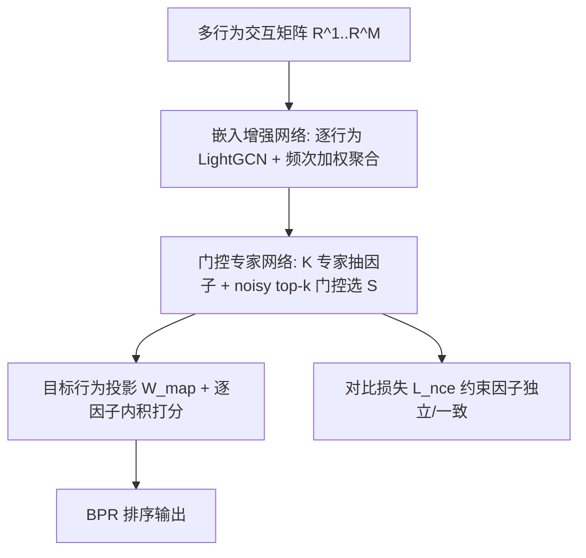
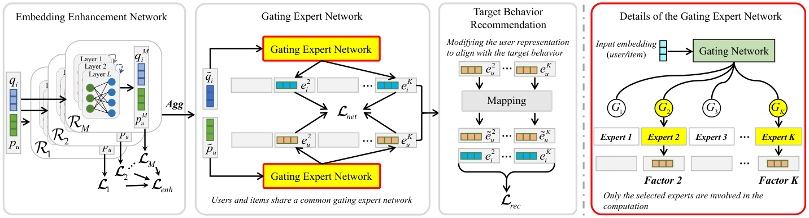

# Latent Factor Modeling with Expert Network for Multi-Behavior Recommendation (基于专家网络的多行为推荐潜在因子建模)

- **会议/期刊**: IEEE TKDE
- **作者与机构**: Mingshi Yan, Zhiyong Cheng, Yahong Han, Meng Wang（天津大学、合肥工业大学）
- **推荐链路定位**: 召回（多行为协同过滤表征学习）
- **研究方向**: 协同过滤与双塔召回 / 自监督对比学习与交互去噪
- **论文原文**: [论文原文链接](https://arxiv.org/abs/2603.18556v1)
- **开源代码**: [开源代码仓库链接](https://github.com/MingshiYan/MBLFE)

## TL;DR (1分钟核心速览)

多行为推荐的主流做法把多种行为揉成一个整体用户表征，导致无关因子混入、意图不可解释。MBLFE 用 $K$个专家分别建模场景中全部共享潜在因子，门控网络为每个用户自适应挑选 top-$k$ 专家组合，并以对比学习强制"同专家一致、异专家独立"。在 Tmall/Taobao/Yelp 三数据集、Leave-One-Out + Full-Ranking 协议下，HR@10 相对最强基线 BCIPM 分别提升 2.69%/3.95%/2.39%，NDCG@10 提升 6.21%/11.03%/4.51%。

## Background & Motivation (背景与核心矛盾)

- **主流范式**: 多行为推荐以目标行为（如 purchase）为主、辅助行为（click/cart/collect）为辅，代表工作分两派——并行聚合派（MBGCN、S-MBRec 分行为建模后加权融合）与级联/关系派（CRGCN、MB-CGCN、PKEF 用序列或投影建模行为间依赖）。
- **前人局限**: ① 表征纠缠：整体表征中混入与用户核心偏好无关的因子（如用户只看导演，却混入演员、年份信息），引入噪声；② 解耦不彻底：Disen-CGCN 虽做了解耦，但只学"若干方面"，既忽略同一因子下不同用户/物品之间的共性关联，也无法刻画不同用户关注因子数量的差异。
- **核心洞察 (Key Insight)**: 潜在因子是**全场景共享且数量有限**的——正如电影类型有限，"动画"因子同时描述多部电影与多类用户；且单个用户交互时只关注少数几个因子（Tom 看《钢铁侠》只因剧情与类型）。
- **本文切入点**: 用专家网络显式铺满全部潜在因子，再用门控为每个用户"点菜"式选取少量因子，把"解耦"从隐式正则变成显式结构。

## Method (核心方法设计)

### 1. 整体框架 (Overall Architecture)

输入为多行为交互矩阵，先经**嵌入增强网络**（每行为一个 LightGCN，按交互频次加权聚合）得到含丰富协同信息的 $\tilde{p}_u,\tilde{q}_i$；再送入**门控专家网络**，$K$个专家各自抽取一个潜在因子，门控为用户选出 top-$k$专家子集$S$；最后在**目标行为推荐模块**中把用户因子投影到目标行为空间，与物品因子逐因子内积求和打分。训练采用嵌入增强 BPR、门控专家交叉熵 + 对比学习、目标行为 BPR 三路联合优化。

<figure class="paper-figure" markdown="span">
  <figcaption>图2. MBLFE 概览。（左侧展示 MBLFE 的整体架构，右侧展示门控专家网络的内部细节。初始化嵌入首先由嵌入增强网络增强。随后，门控专家网络分别提取用户和物品的潜在因子。最后，用户的潜在因子被投影到目标行为空间以生成推荐。用户和物品共享一个门控专家网络。）</figcaption>
</figure>

### 2. 关键设计拆解 (Key Designs)

1. **嵌入增强网络（为专家提供可抽取的协同信号）**：随机初始化嵌入无信息量，专家无从抽取因子。对每个行为 $m$跑 LightGCN 并以 BPR 监督，再按用户/物品在该行为的交互数占比加权聚合：$w_u^m = n_u^m / \sum_j n_u^j$，$\tilde{p}_u=\sum_m w_u^m p_u^m$。直觉是"行为越活跃、贡献越大"，同时把辅助行为的稀疏信号灌入共享输入。

2. **门控专家网络（自适应因子选择）**：专家 $k$输出$e_u^k=G_k(\tilde{p}_u)\cdot E_k(\tilde{p}_u)$，其中$E_k$为两层 MLP；门控用 noisy top-k：$H(\tilde{p}_u)=\eta(\tilde{p}_u W_g + S\cdot\delta(\tilde{p}_u W_{noise}))$，并以**向量均值**作自适应阈值$t_k=x_k$若$x_k>\bar{x}$否则$0$——这直接对应"不同用户关注因子数不同"的分布事实。关键工程细节：**物品侧不设门控**（固定$G_k=1$），避免用户与物品选中专家集合交集为空导致无法计算相关性、训练不收敛。

3. **对比学习约束与训练目标**：为保证同专家跨用户/物品一致、异专家独立，构造因子级 InfoNCE：$\mathcal{L}_{nce}=-\sum_{a,b\in\mathcal{U},k\in\mathcal{K}}\log\frac{S(e_a^k,e_b^k)}{S(e_a^k,e_b^k)+\sum_{j\neq k}S(e_a^j,e_b^k)}$，其中$S(\cdot)=\exp(\cdot^\top/\tau)$。总损失$\mathcal{L}=\mathcal{L}_{enh}+\mathcal{L}_{net}+\mathcal{L}_{rec}+\gamma\|\Theta\|_2$，$\mathcal{L}_{net}=\mathcal{L}_{log}+\alpha\mathcal{L}_{nce}$。负采样沿用 BPR 的未交互采样（非全库），推理时物品仅需按用户选中专家子集抽取因子，开销可控。

## Experimental Setup & Evaluation Protocol (实验设置与评估协议)

- **数据集与预处理**: 保留原始交互并去重，未做 k-core 截断：

| 数据集 | #Users | #Items | #Interactions | 行为类型 | 场景说明 |
| :--- | :---: | :---: | :---: | :---: | :--- |
| Tmall | 41,738 | 11,953 | 2.3×10⁶ | click/collect/cart/**purchase** | 电商 |
| Taobao | 48,749 | 39,493 | 2.0×10⁶ | click/cart/**purchase** | 电商 |
| Yelp | 19,800 | 22,734 | 1.4×10⁶ | tips/dislike/neutral/**like** | 本地生活 |

- **数据划分与防穿越**: `Leave-One-Out`（每位用户留最后一次目标行为交互作测试）。
- **排名评测协议**: 无偏 `Full-Ranking`（对用户未交互的全部物品排序），指标 HR@10/20、NDCG@10/20。
- **对比基线与超参设置**: 3 个单行为基线（MF、LightGCN、DGCF）+ 9 个多行为基线（MBGCN、S-MBRec、CRGCN、CIGF、MB-CGCN、PKEF、Disen-CGCN、COPF、BCIPM）；嵌入维度统一 $d=64$，GCN 层数 2，Adam 优化，$\tau\in\{0.1,\dots,0.9\}$，$K\in[4,32]$，显著性用双尾 t 检验$p<0.05$。

## Key Experimental Results (实验关键数据)

### 1. 主实验对比 (Main Results)

| 数据集 | 指标 | LightGCN | MBGCN | CRGCN | Disen-CGCN | COPF | BCIPM | **MBLFE** | Improv. |
| :--- | :--- | :---: | :---: | :---: | :---: | :---: | :---: | :---: | :---: |
| Tmall | HR@10 | 0.0393 | 0.0549 | 0.0840 | 0.1217 | 0.1229 | 0.1414 | **0.1452** | 2.69% |
| Tmall | NDCG@10 | 0.0209 | 0.0285 | 0.0442 | 0.0581 | 0.0683 | 0.0741 | **0.0787** | 6.21% |
| Taobao | HR@10 | 0.0254 | 0.0434 | 0.1152 | 0.1101 | 0.1043 | 0.1292 | **0.1343** | 3.95% |
| Taobao | NDCG@10 | 0.0138 | 0.0259 | 0.0629 | 0.0644 | 0.0585 | 0.0716 | **0.0795** | 11.03% |
| Yelp | HR@10 | 0.0400 | 0.0356 | 0.0367 | 0.0399 | 0.0398 | 0.0502 | **0.0514** | 2.39% |
| Yelp | NDCG@10 | 0.0202 | 0.0183 | 0.0178 | 0.0197 | 0.0191 | 0.0244 | **0.0255** | 4.51% |

### 2. 消融实验 (Ablation Study)

| 变体 | Tmall HR@10 | Tmall NDCG@10 | Taobao HR@10 | Yelp HR@10 |
| :--- | :---: | :---: | :---: | :---: |
| w/o EEN（去增强网络） | 0.0116 | 0.0056 | 0.0071 | 0.0073 |
| w/o $\mathcal{L}_{enh}$ | 0.1306 | 0.0702 | 0.1133 | 0.0418 |
| w/o EXP（去专家网络） | 0.0745 | 0.0376 | 0.0512 | 0.0423 |
| w/o $\mathcal{L}_{log}$ | 0.1227 | 0.0666 | 0.0825 | 0.0313 |
| w/o $\mathcal{L}_{nce}$ | 0.1418 | 0.0759 | 0.1201 | 0.0470 |
| w/ all GN（双侧门控） | 0.0890 | 0.0463 | 0.0718 | 0.0249 |
| w/o GN（全专家） | 0.1341 | 0.0730 | 0.1224 | 0.0480 |
| **MBLFE** | **0.1452** | **0.0787** | **0.1343** | **0.0514** |

### 3. 关键实验发现 (Key Findings)

1. **专家网络是命门，嵌入增强是地基**：去掉专家网络后 Tmall HR@10 从 0.1452 崩至 0.0745（-48.7%）；而完全去掉嵌入增强网络更惨（0.0116），说明随机初始化嵌入下专家根本抽不出有效因子，二者是串联依赖而非可替代模块。
2. **门控的"单侧设计"是收敛性刚需**：双侧都加门控（w/ all GN）反而使 Tmall HR@10 跌至 0.0890，远低于单侧门控——用户与物品选中专家集合交集为空会直接破坏因子级相关性计算；而完全去门控（w/o GN，0.1341）则因纳入大量无关因子引入噪声，验证了"少而准"的 top-$k$ 选择价值。
3. **因子选择数呈正态分布，与真实偏好结构吻合**：Tmall/Taobao/Yelp 用户平均选中 7/4/5 个专家（总数 18/10/14），均不足一半；t-SNE 可视化显示因子按专家清晰聚成 $K$ 簇，定量佐证了对比学习确实实现了"簇内一致、簇间独立"。

## Highlights & Limitations (亮点、对比与审稿批判)

- **与代表作对比 (vs. Prior Work)**: 相比 MBGCN/S-MBRec 的"分行为建模再聚合"，MBLFE 把解耦粒度下沉到因子级；相比 Disen-CGCN 只解耦"用户行为的若干方面"且不建模因子级用户-物品关联，本文让因子在全场景共享并显式计算逐因子相关性；相比同用专家网络的 CIGF（高阶图交互易引入兴趣混叠）与 COPF（行为约束下仍隐式保留噪声），本文的对比学习约束更直接地作用于因子独立性。
- **可迁移亮点**: ① "物品侧不设门控"这一非对称设计，可直接迁移到任何双塔/因子级匹配架构中以规避稀疏交集导致的训练不稳定；② 用向量均值作自适应 top-$k$阈值，比固定$k$ 更贴合用户兴趣数异质的分布，实现成本极低。
- **审稿级局限批判**: ① 效率上每 epoch 训练耗时 116s（Tmall），是 CRGCN（17s）的近 7 倍，虽与 MBGCN 相当但远重于轻量基线，且专家数 $K$ 需逐数据集网格搜索（18/10/14），超参敏感；② 评估仅覆盖三个隐式反馈数据集、单一 Leave-One-Out 划分，缺少冷启动分桶与线上 A/B 验证，"可解释性提升"也仅停留在 t-SNE 定性展示，未做人工或定量可解释性评测。

## Rating (四维评分)

- **方法创新性 (Novelty)**: ⭐⭐⭐⭐ （把 MoE 从多任务路由迁移到因子级解耦，配合因子级 InfoNCE 与自适应 top-k，思路清晰但组件均为已知技术的巧妙重组）
- **评估协议与实验扎实度 (Protocol & Experiments)**: ⭐⭐⭐⭐ （Full-Ranking + 12 个基线 + 显著性检验 + 完整消融与效率分析，但缺冷启动/长尾分桶与线上验证）
- **写作与数学规范度 (Clarity & Rigor)**: ⭐⭐⭐⭐ （公式与符号定义完整、含时间复杂度分析，但三路损失权重直接省略调优、部分符号如 $S(\cdot)$与专家集合$S$ 复用易混淆）
- **工业落地与复现价值 (Industrial & Practical Value)**: ⭐⭐⭐⭐ （代码已开源，门控仅激活部分专家控制开销，但训练成本偏高、$K$ 需逐场景调参，落地需额外工程权衡）

