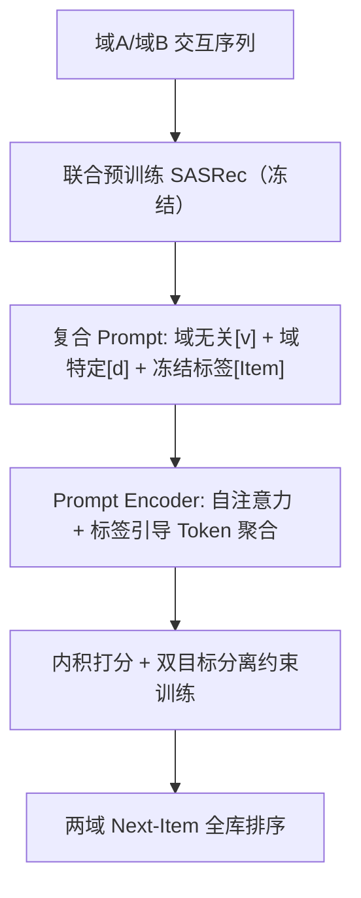
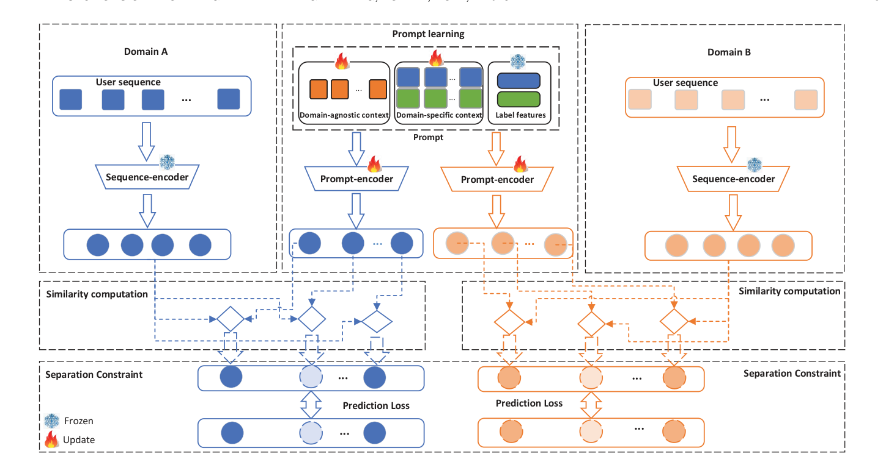

# Automated Prompting for Non-overlapping Cross-domain Sequential Recommendation (面向非重叠跨域序列推荐的自动化提示学习)

- **会议/期刊**: IEEE Transactions on Knowledge and Data Engineering (TKDE)
- **作者与机构**: Lei Guo, Chunxiao Wang, Xinhua Wang, Lei Zhu (山东师范大学), Hongzhi Yin (昆士兰大学)
- **推荐链路定位**: 召回（Next-Item 序列召回）
- **研究方向**: 跨域与多场景推荐 / 序列推荐
- **论文原文**: [论文原文链接](https://arxiv.org/abs/2304.04218v1)
- **开源代码**: 暂未开源

## TL;DR (1分钟核心速览)

本文研究最严苛的 **非重叠跨域序列推荐 (NCSR)**：两域用户与物品完全不相交、仅有隐式正反馈、无任何内容信息，因此传统依赖重叠实体或对抗域对齐的 CR 方法全部失效。PLCR 放弃域对齐约束，改为在统一特征空间联合预训练 SASRec 并冻结，再用「域无关上下文 + 域特定上下文 + 冻结标签特征」组成的连续 Prompt 做自动化适配，配合双目标分离约束实现双向增益。在 Amazon Movie-Book / Food-Kitchen 上采用 HR/NDCG@10,20 评测，Movie 域 HR@10 由最优基线 6.84% 提升至 8.06%（+17.8%），Book 域由 4.76% 提升至 7.21%（+51.5%）。

## Background & Motivation (背景与核心矛盾)

- **主流范式**: CSR 主流做法假设域间存在全部/部分重叠用户或物品，通过共享实体桥接（如 DA-GCN 的域感知图、π-net 的并行信息共享网络）或对抗训练学习域不变特征。
- **前人局限**: ① 无重叠实体时既无桥接锚点，又无内容信息可做属性对齐；② 对抗式域对齐会扭曲域内语义结构（用户偏好/意图），与"保留语义"目标天然冲突，只能在两者间做微妙权衡；③ 现有 NCR 多聚焦评分数据与单目标迁移，序列交互模式与双目标场景几乎未被探索。
- **核心洞察 (Key Insight)**: 域无关语义与域特定信息本可**解耦**而非**对齐**——只要把先验知识嵌入统一特征空间，再用少量可学习 Prompt 做域适配，就无需任何显式对齐约束，也无需重叠实体。
- **本文切入点**: 用自动化 Prompt Learning 替代域对齐，把"跨域迁移"转化为"共享域无关 Prompt 上下文 + 各自域特定上下文"的参数高效适配问题。

## Method (核心方法设计)

### 1. 整体框架 (Overall Architecture)

PLCR 分三阶段闭环：(a) **联合预训练**：将两域序列合并训练同一个 SASRec，其自注意力块作序列编码器 $f(\cdot)$、嵌入层作物品编码器，得到统一特征空间中的先验知识，此后**全部冻结**；(b) **Prompt 优化**：为每个候选物品构造复合 Prompt，经 Prompt Encoder 得到表示$g(t_k)$，与冻结的序列表示做内积打分，仅更新 Prompt 与 Prompt Encoder（参数量极小）；(c) **双目标分离训练**：先以$\mathcal{L}_A$优化域 A 并共享域无关上下文，再以$\mathcal{L}_B$ 微调域 B 的域无关上下文并学习其域特定上下文，两域同时受益。推理时对全库物品的 Prompt 表示与序列表示做内积排序。

<figure class="paper-figure" markdown="span">
  <figcaption>图 3. PLCR 的系统架构，由预训练的序列编码器和物品编码器、提示优化模块以及分离约束组件组成。序列编码器和物品编码器在统一特征空间中预训练。在提示学习过程中，仅更新提示编码器和提示，而预训练模型保持固定。</figcaption>
</figure>

### 2. 关键设计拆解 (Key Designs)

1. **三段式复合 Prompt（解耦域无关/域特定语义）**：痛点是无重叠域无法对齐，作者把 Prompt 拆成共享的域无关 token $[v]_{1..M_1}$、域内共享的域特定 token$[d]^A_{1..M_2}$与冻结的真实标签特征$[\text{Item}]^A_k$：
$$t^A_k=[v]_1\ldots[v]_{M_1}[d]^A_1\ldots[d]^A_{M_2}[\text{Item}]^A_k$$
域无关 token 跨域共享承载通用兴趣模式（可解释为"用户簇级兴趣"），域特定 token 吸收分布偏移；标签特征冻结可防止标签信息泄漏进 Prompt 表示，保证打分是"序列—物品"的真实匹配而非标签自证。

2. **标签引导的 Token 聚合（Prompt Encoder）**：Prompt 内 token 对目标物品的贡献不均，作者以冻结标签特征为 query 做注意力聚合：
$$\gamma^*_{k,i}=\mathbf{w}_2^\top\sigma(\mathbf{W}_1[\text{Item}^A_k\oplus x^A_{k,i}]+\mathbf{b}_1)+b_2,\quad z^A_k=\sum_{i}\gamma_{k,i}x^A_{k,i}$$
使聚合后的 Prompt 表示聚焦于与目标物品相关的上下文，消融显示去掉该模块 Book 域 HR@20 从 11.47% 掉到 9.80%。

3. **双目标分离约束与训练目标**：因两域样本无法一一配对，不能直接优化 $\mathcal{L}=\mathcal{L}_A+\mathcal{L}_B$，改用两阶段 SGD：先$\mathcal{L}_A=-\frac{1}{|\mathcal{S}^A|}\sum_i\log p(\hat{y}^A_i=y^A_i)$学域 A 并共享$[v]$，再以$\mathcal{L}_B$微调$[v]$并学$[d]^B$。不同目标迫使$[v]$学共性、$[d]$ 学个性，从而在**无对齐约束**下实现解耦。打分采用全库 softmax（式 12），训练负样本由每步随机采样构造，无额外难负样本挖掘；推理仅需前向计算 Prompt 表示，开销远低于重训骨干。

## Experimental Setup & Evaluation Protocol (实验设置与评估协议)

- **数据集与预处理**: Amazon 两个互补子集，过滤保留交互数 >5 的用户与物品（5-core）：

| 数据集 | 域 | #Items | #Interactions | 平均序列长 | 说明 |
| :--- | :---: | :---: | :---: | :---: | :--- |
| Movie-Book | Movie | 12,669 | 1,052,443 | 9.68 | 观影行为 |
| Movie-Book | Book | 36,776 | 1,060,974 | 9.75 | 阅读行为 |
| Food-Kitchen | Food | 24,434 | 217,409 | 6.37 | 食品购买 |
| Food-Kitchen | Kitchen | 24,658 | 180,657 | 5.29 | 厨具购买 |

- **数据划分与防穿越 (Splitting Strategy)**: 每条序列末位物品作标签，序列级 **75%/10%/15% 比例划分**（train/val/test）；Food-Kitchen 测试序列过少，验证集与测试集合并评测。
- **排名评测协议 (Ranking Protocol)**: HR@10/20 与 NDCG@10/20，Top-K 排序；未明确声明是否为全库 Full-Ranking，从打分公式（对域内全部 $N_A$ 个物品做 softmax）推断为**域内全库排序**。
- **对比基线与超参设置**: 基线含 8 个单域 SR（Session-POP、BPR-MF、GRU4REC、HRNN、NARM、Caser、SRGNN、SASRec）与 5 个跨域方法（CoOp、π-net、PSJ-net、DA-GCN、SASRec-joint），另设 PLCR(single) 变体；嵌入维度 $d=50$，Prompt 长度$M_2=5$、$M_1\in[1,5]$，block 数 2、head 数 1，学习率 1e-4、batch 128、200 epoch，显著性用$t$-test ($p<0.05$)。

## Key Experimental Results (实验关键数据)

### 1. 主实验对比 (Main Results)

| 方法 | Movie HR@10 | Movie NDCG@10 | Book HR@10 | Book NDCG@10 | Food HR@10 | Kitchen HR@10 |
| :--- | :---: | :---: | :---: | :---: | :---: | :---: |
| SRGNN | 4.26 | 2.27 | 2.34 | 1.36 | 3.35 | 0.95 |
| SASRec | 5.71 | 2.72 | 3.85 | 1.82 | 3.23 | 1.15 |
| CoOp | 6.84 | 3.32 | 4.76 | 2.45 | 3.15 | 0.81 |
| π-net | 4.04 | 2.29 | 1.62 | 1.04 | 2.27 | 0.34 |
| PSJ-net | 4.31 | 2.56 | 1.68 | 1.02 | 2.79 | 0.37 |
| DA-GCN | 1.72 | 0.98 | 1.84 | 1.13 | 2.61 | 0.84 |
| SASRec (joint) | 5.17 | 2.56 | 3.62 | 1.79 | 2.87 | 1.08 |
| PLCR (single) | 7.09 | 3.52 | 5.23 | 2.59 | 3.54 | 1.15 |
| **PLCR** | **8.06*** | **4.06*** | **7.21*** | **3.62*** | **4.67*** | **1.16** |
| Improv.% (vs 最优基线) | +17.8% | +22.3% | +51.5% | +47.8% | +39.4% | +0.9% |

### 2. 消融实验 (Ablation Study)

| 变体 | Movie HR@10 | Book HR@10 | Book HR@20 | Food HR@10 | Kitchen HR@20 |
| :--- | :---: | :---: | :---: | :---: | :---: |
| SASRec (joint) | 5.17 | 3.62 | 6.24 | 2.87 | 1.86 |
| PLCR (no specific) | 7.83 | 7.19 | 11.53 | 4.28 | 1.70 |
| PLCR (no independent) | 7.97 | 6.49 | 10.03 | 4.64 | 1.64 |
| PLCR (no separation) | 7.62 | 6.45 | 9.95 | 4.53 | 1.80 |
| PLCR (no attention) | 7.81 | 6.56 | 9.80 | 4.37 | 1.80 |
| **PLCR** | **8.06** | **7.21** | **11.47** | **4.67** | **1.97** |

### 3. 关键实验发现 (Key Findings)

1. **简单合并数据反而有害**：SASRec(joint) 在 Movie 域 HR@10 仅 5.17%，低于单域 SASRec 的 5.71%，说明无 Prompt 适配的联合训练无法迁移知识；而 PLCR 相对 SASRec(joint) 提升 55.9%，证明增益来自 Prompt 适配而非数据量。
2. **域特定上下文是最大贡献项**：去掉 $[d]$ 后 Book 域 HR@10 从 7.21% 降至 7.19%（几乎无损）但 Food 域从 4.67% 降至 4.28%、Kitchen HR@20 从 1.97% 降至 1.70%，说明分布偏移越大的域对域特定 token 越敏感；去掉分离约束 Book HR@20 掉 1.52 个点，验证双目标解耦的必要性。
3. **重叠假设方法在 NCSR 上全面崩塌**：π-net/PSJ-net/DA-GCN 在 Book 域 HR@10 仅 1.62–1.84%，甚至低于多数单域模型，说明强制域匹配在无重叠实体时引入负迁移；而 PLCR 在双域同时最优，是少数真正实现 dual-target 增益的方案。

## Highlights & Limitations (亮点、对比与审稿批判)

- **与代表作对比 (vs. Prior Work)**: 相比 DA-GCN/π-net 依赖重叠实体与对抗对齐，PLCR 彻底移除对齐约束，仅优化约 $O((M_1+M_2)d)$ 量级 Prompt 参数；相比 CoOp 直接移植视觉 Prompt，PLCR 的三段式设计显式区分域无关/域特定/标签语义，Book 域 HR@10 高出 2.45 个点；相比 DisenCDR 类解耦方法，PLCR 无需内容信息即可处理非重叠场景。
- **可迁移亮点**: ① "冻结骨干 + 仅训 Prompt"的参数高效跨域适配范式可低成本迁移到多业务场景冷启动；② 冻结标签特征作聚合 query 的技巧可防止标签泄漏，适用于任何 Prompt-based 召回。
- **审稿级局限批判**: ① 仅两个 Amazon 子集、$d=50$ 的小规模设定，缺乏工业级千万级物品与线上 A/B 验证，全库排序的推理延迟未量化；② 两阶段训练顺序（先 A 后 B）引入域顺序偏置，域 B 的域无关上下文被二次微调，公平性存疑；③ 未与近年基于 LLM/生成式语义 ID 的跨域方法对比，SOTA 覆盖略显陈旧。

## Rating (四维评分)

- **方法创新性 (Novelty)**: ⭐⭐⭐⭐ （首次将自动化 Prompt 学习引入非重叠跨域序列推荐，三段式 Prompt + 分离约束的组合设计有清晰动机）
- **评估协议与实验扎实度 (Protocol & Experiments)**: ⭐⭐⭐ （双数据集双域 + 13 个基线 + 完整消融与超参分析较扎实，但缺全库排序声明、显著性仅 $t$-test、无线上验证）
- **写作与数学规范度 (Clarity & Rigor)**: ⭐⭐⭐⭐ （公式与符号定义清晰、Prompt 位置等设计讨论充分，但部分符号如 $D$ 与 dropout 混用、复杂度分析缺失）
- **工业落地与复现价值 (Industrial & Practical Value)**: ⭐⭐⭐⭐ （仅训 Prompt 的轻量适配对多业务场景极具工程价值，但代码未开源、推理开销未量化扣一星）

