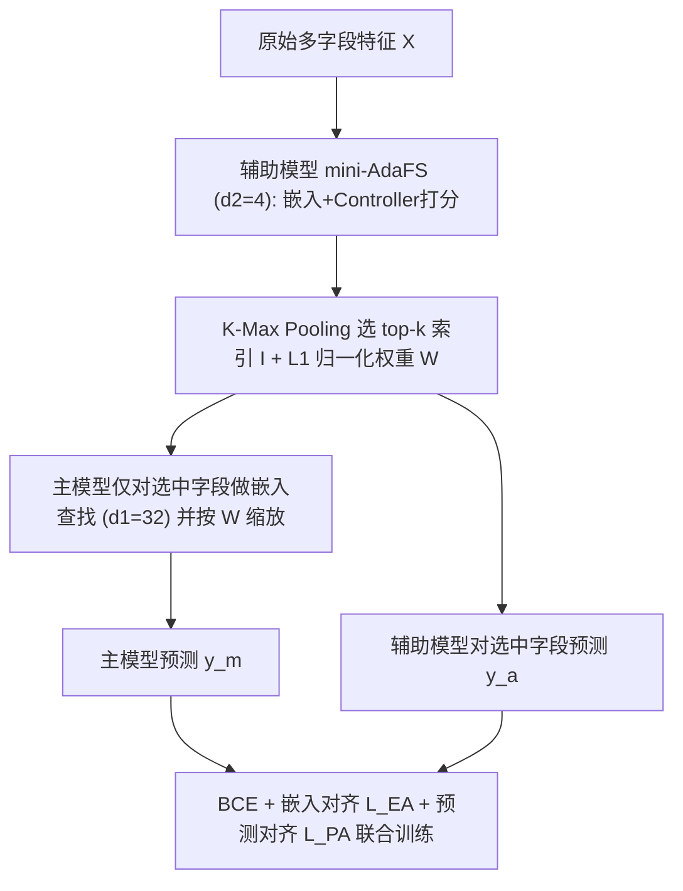
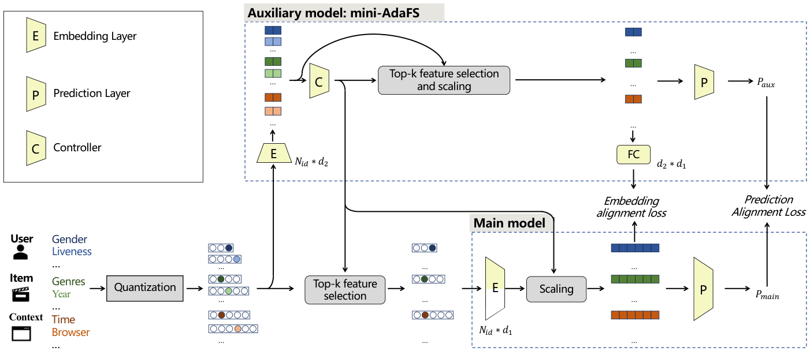

# AEFS: Adaptive Early Feature Selection for Deep Recommender Systems (面向深度推荐系统的自适应早期特征选择)

- **会议/期刊**: IEEE TKDE 2025
- **作者与机构**: Fan Hu, Gaofeng Lu, Jun Chen, Chaonan Guo, Yuekui Yang, Xirong Li（中国人民大学、中国科学技术大学、腾讯）
- **推荐链路定位**: 精排（CTR 预估）
- **研究方向**: CTR/CVR 预估与特征交叉
- **论文原文**: [https://arxiv.org/abs/2509.12076v1](https://arxiv.org/abs/2509.12076v1)
- **开源代码**: [https://github.com/fuyuanlyu/optfs](https://github.com/fuyuanlyu/optfs)

## TL;DR (1分钟核心速览)

工业 DRS 的嵌入层占 99.99% 参数，而现有自适应特征选择（AdaFS/MvFS）发生在嵌入层**之后**，虽能按样本动态选特征却几乎不省参数；早期选择（AutoField）虽省参数却因全局固定子集而掉点。本文提出 AEFS：用一个嵌入维度仅为主模型 1/8 的 mini-AdaFS 辅助模型在嵌入层**之前**为每个样本打分并选出 top-$k$字段，主模型只查这$k$ 个字段的嵌入，并以嵌入对齐损失与预测对齐损失协同训练两模型。在 Avazu/Criteo/KDD12 三个数据集、MLP/DeepFM/DCN 三种骨干上，AEFS 精度与 AdaFS/MvFS 无统计显著差异，同时激活嵌入参数降低 37.5%。

## Background & Motivation (背景与核心矛盾)

- **主流范式**: 特征选择按发生位置分为早期（嵌入层前，AutoField/OptFS/LPFS/SHARK 等搜索-重训式）与晚期（嵌入层后，AdaFS/MvFS 的实例级自适应加权）。
- **前人局限**: 早期方法选的是**全局固定子集**，因特征长尾分布，某些字段整体不重要却对特定交互关键，删 37.5%–50% 字段后 AUC 常不升反降；晚期方法虽按样本自适应，但选择发生在嵌入层之后，**嵌入查找与反向更新仍全量发生**，参数效率为零。
- **核心洞察 (Key Insight)**: 表 I 显示嵌入层参数是预测层的万倍量级（Avazu 64.58M vs 0.0115M），因此"选择发生在嵌入层前还是后"直接决定参数效率；而"自适应"所需的字段重要性信号，未必需要主模型自己的全尺寸嵌入来产生。
- **本文切入点**: 用一个小嵌入维度的辅助模型先算出实例级字段重要性并给出 top-$k$索引，主模型据此**只查$k$ 个字段**，从而同时拿到自适应的精度与早期选择的效率。

## Method (核心方法设计)

### 1. 整体框架 (Overall Architecture)

输入原始多字段特征 $X=\{x_1,\dots,x_N\}$后，辅助模型（mini-AdaFS，嵌入维度$d_2=4$）先做一次轻量嵌入与控制器打分，经 K-Max Pooling 得到 top-$k$字段索引$I$与 L1 归一化权重$W$；主模型（嵌入维度$d_1=32$）仅对$X_s=\text{Selection}(X,I)$做嵌入查找并按$W$缩放，送入预测层输出$\hat{y}_m$；辅助模型自身也用选中字段输出$\hat{y}_a$。训练时联合优化 BCE 损失、嵌入对齐损失与预测对齐损失，推理时辅助模型只承担一次小维度前向，主模型嵌入查找量减半。

<figure class="paper-figure" markdown="span">
  <figcaption>图 2. 所提出的自适应早期特征选择（AEFS）方法的概念图。主模型（嵌入维度 d1 = 32）负责推荐预测。为了在主模型嵌入层之前实现自适应特征选择，我们提出使用辅助模型（此处为嵌入维度小得多的 d2 = 4 的 mini-AdaFS）来估计各特征的重要性，并据此选择 k 个最重要的特征。除用于监督训练的常规 BCE 损失外，我们以协同方式训练主模型与辅助模型</figcaption>
</figure>

### 2. 关键设计拆解 (Key Designs)

1. **辅助模型驱动的早期 top-$k$选择**：痛点是晚期选择无法省参数、早期选择无法自适应。AEFS 让辅助模型输出重要性$S=M_a.C(E_a)=[s_1,\dots,s_N]$，取$I=\text{kmaxpooling}(S,k)$、$W=\text{L1norm}(S_I)$，主模型输入变为$X_s=\text{Selection}(X,I)$，嵌入为$E^s_m=\text{Scaling}(M_m.E(X_s),W)$。直觉上，字段重要性主要由字段语义与粗粒度取值决定，小维度嵌入足以判别，故$d_2 \ll d_1$ 不损判别力却大幅省算力。

2. **双粒度协同对齐损失**：若只让辅助模型独立学，其选出的字段与主模型偏好不一致。为此引入细粒度嵌入对齐 $\mathcal{L}_{EA}=\frac{1}{M}\sum_{i}\lVert M_a.FC(E^{s(i)}_a)-E^{s(i)}_m\rVert^2$（经 FC 升维对齐）与粗粒度预测对齐$\mathcal{L}_{PA}=\frac{1}{M}\sum_i(P^{(i)}_a-P^{(i)}_m)^2$。与知识蒸馏"小模型模仿大模型输出"不同，这里对齐的是**特征重要性排序与决策行为**，使辅助模型成为主模型的"特征筛选代理"而非精度复制品。

3. **训练目标与效率核算**：总损失 $\min_{\theta_m,\theta_a}\frac{1}{M}\sum_i \mathcal{L}_{BCE}+\mathcal{L}_{PA}+\mathcal{L}_{EA}$，无需额外负采样（CTR 二分类 BCE 直接监督）。参数节省可解析给出：当$d_1=8d_2$、选 50% 字段时，$\Delta PaE=50\%-d_2/d_1=37.5\%$；嵌入查找次数同步下降 50%。推理时辅助模型仅一次$d_2$ 维度前向，主模型嵌入表访问量减半。

## Experimental Setup & Evaluation Protocol (实验设置与评估协议)

- **数据集与预处理**:

| 数据集 | #Fields | #Interactions | 特征/场景说明 |
| :--- | :---: | :---: | :--- |
| Avazu | 22 | ~40M | 10 天点击日志，部分字段匿名 |
| Criteo | 26 类 + 13 数值 | ~45M | 数值特征按 $\lfloor\log_2 x\rfloor$ 离散化 |
| KDD12 | 11 类 | 搜索会话日志 | 低频类替换为 OOV（阈值 10） |

- **数据划分与防穿越 (Splitting Strategy)**: 沿用 AutoField/AdaFS 的 **8:1:1 随机划分**（训练/验证/测试），非时间切分。
- **排名评测协议 (Ranking Protocol)**: CTR 二分类评测，指标为 **AUC↑ 与 Logloss↓**（非全库排序），并引入 $\Delta PaE$衡量激活嵌入参数下降比例；显著性用双侧 t 检验（$p<0.05$）。
- **对比基线与超参设置**: 基线含 No FS、AutoField、OptFS、LPFS、SHARK、AdaFS、MvFS；骨干为 MLP/DeepFM/DCN；$d_1=32$、$d_2=4$、batch=2048、Adam + BN + Xavier 初始化。

## Key Experimental Results (实验关键数据)

### 1. 主实验对比 (Main Results)

以 MLP 骨干为例（AUC↑ / Logloss↓ / $\Delta PaE$↑）：

| 方法 | Avazu | Criteo | KDD12 | $\Delta PaE$ |
| :--- | :---: | :---: | :---: | :---: |
| No FS | 0.7763 / 0.3823 | 0.8025 / 0.4496 | 0.7774 / 0.1575 | 0.0% |
| AutoField | 0.7584 / 0.3908 | 0.7963 / 0.4546 | 0.7642 / 0.1605 | 37.5% |
| OptFS | 0.7779 / 0.3812 | 0.8001 / 0.4512 | 0.7702 / 0.1592 | 37.5% |
| SHARK | 0.7764 / 0.3823 | 0.8028 / 0.4489 | 0.7745 / 0.1581 | 37.5% |
| AdaFS | 0.7785 / 0.3808 | 0.8056 / 0.4467 | 0.7750 / 0.1587 | 0.0% |
| MvFS | **0.7796** / **0.3801** | 0.8055 / 0.4467 | **0.7791** / **0.1572** | 0.0% |
| AEFS (miniAdaFS) | 0.7785 / 0.3808 | **0.8057** / **0.4465** | 0.7755 / 0.1590 | **37.5%** |
| AEFS (miniMvFS) | 0.7794 / 0.3800 | 0.8054 / 0.4484 | 0.7795 / 0.1570 | **37.5%** |

在 DeepFM/DCN 骨干上结论一致：AEFS(miniMvFS) 在 Avazu 上达 0.7814/0.3789（DCN），与 MvFS 的 0.7812/0.3789 持平，但 $\Delta PaE$ 为 37.5%。

### 2. 消融实验 (Ablation Study)

| 配置 | Avazu AUC↑ | Avazu Logloss↓ | Criteo AUC↑ | Criteo Logloss↓ |
| :--- | :---: | :---: | :---: | :---: |
| AEFS 完整 | **0.7785** | **0.3808** | **0.8057** | **0.4465** |
| w/o $\mathcal{L}_{EA}$ | 0.7780 | 0.3814 | 0.8053 | 0.4474 |
| w/o $\mathcal{L}_{PA}$ | 0.7778 | 0.3812 | 0.8054 | 0.4686 |
| w/o 两者 | 0.7776 | 0.3840 | 0.8051 | 0.4633 |
| $d_2/d_1=2/32$ | 0.7766 | 0.3823 | 0.8043 | 0.4480 |
| $d_2/d_1=16/32$ | 0.7791 | 0.3806 | 0.8062 | 0.4463 |

### 3. 关键实验发现 (Key Findings)

1. **"自适应"与"省参数"首次同时成立**：AdaFS/MvFS 的 $\Delta PaE$恒为 0%，而 AEFS 在 AUC 与 AdaFS 无显著差异（$p<0.05$ 双侧 t 检验）的前提下取得 37.5% 参数下降；图 4 显示 Avazu 平均激活嵌入参数从 64.58M 降至 37.9M（辅助模型仅增 8.07M）。
2. **对齐损失是精度不掉点的关键，且 $\mathcal{L}_{PA}$影响更大**：去掉$\mathcal{L}_{PA}$ 使 Criteo Logloss 从 0.4465 恶化到 0.4686，去掉两者进一步到 0.4633，说明辅助模型必须被"锚定"到主模型的决策行为上，否则选出的字段与主模型偏好脱节。
3. **$d_2$存在明确甜点区**：$2/32$时 AUC 显著掉点（Avazu 0.7766），$4/32$与$6/32$均与 AdaFS 无显著差异，而$16/32$虽精度略升但$\Delta PaE$ 归零——即辅助模型一旦变大，效率收益被自身开销吃掉，验证了"小代理"设计的必要性。

## Highlights & Limitations (亮点、对比与审稿批判)

- **与代表作对比 (vs. Prior Work)**: 相较 AutoField/OptFS 的"搜索-重训"固定子集范式，AEFS 是**逐样本**选择且无需重训；相较 AdaFS/MvFS 的嵌入后加权，AEFS 把选择前移到嵌入层之前，是唯一同时具备实例自适应与真实参数节省的方案；与知识蒸馏的区别在于对齐的是特征重要性而非输出分布。
- **可迁移亮点**: (1) "小模型做路由/筛选、大模型做精算"的双模型范式可迁移到粗排特征裁剪、多场景字段路由；(2) 用 $\Delta PaE$ 这类**解析可算的参数效率指标**替代纯 latency 报告，便于工业侧预估收益。
- **审稿级局限批判**: (1) 效率验证停留在单机 PyTorch 的 per-iteration latency（图 3），作者自承需系统级优化才能兑现真实收益，缺少线上 A/B 或分布式训练吞吐证据；(2) 划分采用随机 8:1:1 而非时间切分，存在特征分布穿越风险，且未报告新 ID 涌现场景下辅助模型选择漂移的鲁棒性。

## Rating (四维评分)

- **方法创新性 (Novelty)**: ⭐⭐⭐⭐ （把"自适应"与"早期选择"这两个此前互斥的属性用轻量代理模型缝合，思路简洁但组合价值明确）
- **评估协议与实验扎实度 (Protocol & Experiments)**: ⭐⭐⭐⭐ （三数据集 × 三骨干 × 七基线的矩阵完整、含显著性检验与迁移性实验，扣分在随机划分与缺线上验证）
- **写作与数学规范度 (Clarity & Rigor)**: ⭐⭐⭐⭐ （早期/晚期分类框架清晰，$\Delta PaE$ 有解析推导，公式与算法伪代码齐备）
- **工业落地与复现价值 (Industrial & Practical Value)**: ⭐⭐⭐⭐ （代码开源、改动极小可插拔，37.5% 嵌入参数与 50% 查找节省对十亿级 ID 特征场景直接有吸引力）

