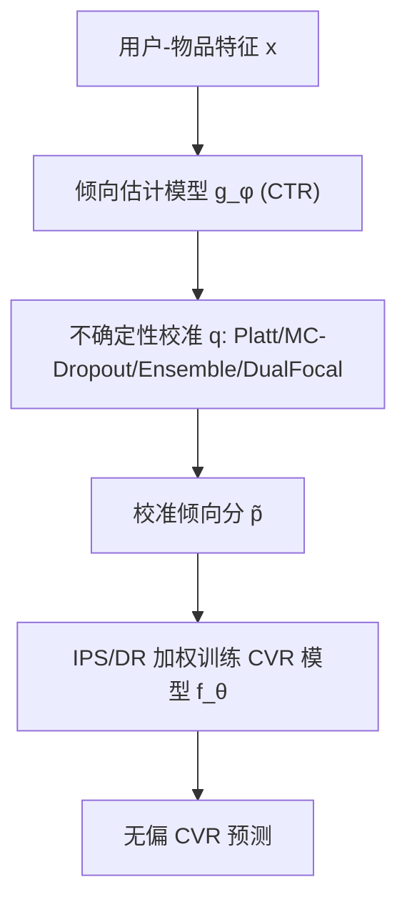

# Uncertainty Calibration for Counterfactual Propensity Estimation in Recommendation (推荐中反事实倾向估计的不确定性校准)

- **会议/期刊**: IEEE TKDE 2025 (Vol.37, No.6)
- **作者与机构**: Wenbo Hu, Xin Sun, Qiang Liu, Le Wu, Liang Wang (合肥工业大学 / 中科大 / 中科院自动化所)
- **推荐链路定位**: 精排 (CVR 预估去偏)
- **研究方向**: CTR/CVR 预估与特征交叉 / 去偏公平与可信推荐
- **论文原文**: [https://arxiv.org/abs/2303.12973v3](https://arxiv.org/abs/2303.12973v3)
- **开源代码**: [https://github.com/sunxin000/uncertainty4recsys](https://github.com/sunxin000/uncertainty4recsys)

## TL;DR (1分钟核心速览)

CVR 预估中 IPS/DR 去偏的有效性完全依赖倾向分 $\hat{p}_{u,i}$ 的准确性，但现有倾向估计器普遍**过自信、严重失准**（图1显示原始倾向分与观测频率大幅偏离对角线），导致 IPS 权重被扭曲、去偏失效。本文首次从**不确定性校准**视角提出以 ECE 作为倾向分质量度量，并给出模型无关的校准框架（MC Dropout / Deep Ensembles / Dual Focal Loss / Platt Scaling）。理论证明校准后 IPS 偏差更小、泛化界与 ECE 成正比。在 Coat/Yahoo! R3/KuaiRand 的 MAR 测试集上，Platt Scaling 将 ECE 降低 3 倍以上，CVR 预测 AUC 相对提升 1.51%–2.07%。

## Background & Motivation (背景与核心矛盾)

- **主流范式**: CVR 预估本质是反事实问题，观测反馈为 MNAR；IPS 用 $\hat{p}_{u,i}$ 逆加权观测误差，DR 进一步结合误差插补，是当前去偏 SOTA 范式。
- **前人局限**: ① 现有工作（DR-JL、MRDR、GPL、CDR 等）只关注倾向分的**点估计精度**，从未系统考察其**概率可靠性**，倾向分过自信导致 IPS 权重失真；② 深度与浅层模型（如逻辑回归）均因仅优化误差指标而天然过自信，ECE 无法被完全消除。
- **核心洞察 (Key Insight)**: 倾向分本质是"点击事件发生概率"，一个 0.95 的倾向分应意味着 95% 的样本被观测到。作者发现原始倾向分严重偏离完美校准对角线（图1），而校准后不仅 ECE 骤降，倾向分布极化也减弱。
- **本文切入点**: 将倾向分估计视为概率校准问题，用 ECE 量化质量，并证明"低 ECE $\Rightarrow$低 IPS 偏差$\Rightarrow$ 更好 CVR 预测"的因果链。

## Method (核心方法设计)

### 1. 整体框架 (Overall Architecture)

两阶段解耦训练：先训练倾向估计模型 $g_\phi$（CTR 分类器），再对其输出施加模型无关校准$q$得到校准倾向分$\tilde{p}=q(g_\phi(x))$，最后用逆校准倾向分训练 CVR 模型$f_\theta$。校准模块不改变任何下游去偏模型结构，可即插即用地挂载到 IPS、DR-JL、MRDR 等任意倾向加权框架上。

### 2. 关键设计拆解 (Key Designs)

1. **ECE 作为倾向分质量度量**：痛点在于倾向分缺乏可靠性度量。将倾向预测分箱为 $M$个等宽区间$B_m$，定义
$$\mathrm{ECE}(g_\phi)=\sum_{m=1}^{M}\frac{|B_m|}{n}\left|\mathrm{freq}(B_m)-\mathrm{conf}(B_m)\right|$$
其中 $\mathrm{conf}$为箱内平均倾向分、$\mathrm{freq}$ 为箱内实际观测比例。ECE 越小说明倾向分越接近真实观测频率，IPS 权重越可信——这是首次把校准误差引入倾向分评估。

2. **模型无关校准算子**：给出两类校准路径。① 后处理式 Platt Scaling：$q(g_\phi(x))=\sigma(b\cdot g_\phi(x)+c)$，$b,c$ 在留出集上用 NLL 优化，计算开销极小；② 不确定性量化式：MC Dropout（测试期多次前向平均）、Deep Ensembles（多随机种子模型平均）、Dual Focal Loss（最大化真值 logit 与次高 logit 的间隔以平衡过/欠自信）。四者均不改动下游去偏模型。

3. **训练目标与理论保证**：倾向模型用交叉熵 $\mathcal{L}_{g_\phi}$训练，CVR 模型用校准倾向分加权的 IPS 损失$\mathcal{L}_{\mathrm{IPS}}=\frac{1}{|\mathcal{D}|}\sum o_{u,i}e_{u,i}/\tilde{p}_{u,i}$。理论侧：Lemma 1 表明 IPS 偏差正比于倾向偏差$\nabla=(\hat{p}-p)/\hat{p}$；Theorem 1 证明校准后偏差更小；Theorem 2 给出泛化界，Corollary 2 进一步证明偏差项被 ECE 上界约束$\sum\tilde{\nabla}/|\mathcal{D}|\le n\cdot\mathrm{ECE}/|\mathcal{D}|$。推理时仅需一次前向（Platt）或$T$ 次前向（MC Dropout），无额外负采样。

## Experimental Setup & Evaluation Protocol (实验设置与评估协议)

- **数据集与预处理**: 三个含 MAR 测试集的公开数据，转换标签 $r_{u,i}=\mathbb{I}(\text{rating}\ge 4)$，点击标签$o_{u,i}=\mathbb{I}(\text{已评分})$：

| 数据集 | #Users | #Items | #Interactions | 特性说明 |
| :--- | :---: | :---: | :---: | :--- |
| Coat Shopping | 290 | 300 | 6960 MNAR + 4640 MAR | 模拟网购自选择偏差 |
| Yahoo! R3 | ~15.4K | ~1K | ~300K (54K MAR) | 音乐评分，含随机调查 MAR 集 |
| KuaiRand | 27285 | 7583 | 1.44M biased + 1.19M unbiased | 短视频，含无偏曝光数据 |

- **数据划分与防穿越 (Splitting Strategy)**: MNAR 数据按 90%/10% 划分为训练/验证；MAR 数据完全隔离作为测试集（KuaiRand 无偏数据 10% 验证、90% 测试），严格避免穿越。
- **排名评测协议 (Ranking Protocol)**: 在 MAR 测试集上做**全库排序**评估，指标为 AUC、DCG@K、Recall@K ($K=2,4,6$)，重复 10 次取均值，显著性检验$p<0.05$（‡ 标记）。
- **对比基线与超参设置**: 基础去偏器 IPS / DR-JL / MRDR；SOTA 对比 MRDR-GPL、MRDR-CDR、DR-V2、ESCM2-DR；基础推荐模型 NeuMF；ECE 用 100 个 bin 计算；Platt Scaling 用 LBFGS 优化。

## Key Experimental Results (实验关键数据)

### 1. 主实验对比 (Main Results)

Coat Shopping 上 IPS 去偏（NeuMF 为基座，‡ 表示相对 Raw 显著）：

| 方法 | AUC | DCG@2 | DCG@4 | DCG@6 | Recall@6 |
| :--- | :---: | :---: | :---: | :---: | :---: |
| NeuMF base | 0.7604 | 0.7478 | 1.0152 | 1.1989 | 1.9371 |
| Raw IPS | 0.7578 | 0.7472 | 1.0204 | 1.2010 | 1.9451 |
| MC Dropout | 0.7632‡ | 0.7651‡ | 1.0322‡ | 1.2101‡ | 1.9443 |
| Deep Ensembles | 0.7675‡ | 0.7584 | 1.0256 | 1.2065 | 1.9454 |
| Dual Focal Loss | 0.7611 | 0.7491 | 1.0264 | 1.2034 | 1.9479 |
| **Platt Scaling** | **0.7693‡** | **0.7627‡** | **1.0405‡** | **1.2259‡** | **1.9806‡** |
| Improv. (vs Raw) | +1.51% | +2.08% | +1.98% | +2.07% | +1.83% |

KuaiRand 上与 SOTA 去偏方法对比（MRDR 基座）：

| 方法 | AUC | DCG@2 | DCG@4 | DCG@6 | Recall@6 |
| :--- | :---: | :---: | :---: | :---: | :---: |
| MRDR-GPL | 0.5401 | 0.4335 | 0.6446 | 0.8049 | 1.4101 |
| MRDR-CDR | 0.5498 | 0.4326 | 0.6573 | 0.8297 | 1.4739 |
| DR-V2 | 0.5765 | 0.4465 | 0.6795 | 0.8533 | 1.5117 |
| ESCM2-DR | 0.5836 | 0.4773 | 0.7059 | 0.8760 | 1.5258 |
| **MRDR-CAL (Ours)** | **0.6247‡** | **0.4928‡** | **0.7259‡** | **0.8963‡** | **1.5549‡** |

### 2. 消融实验 (Ablation Study)

倾向分校准质量（ECE，100 bins）与效率（Coat，单卡 3090）：

| 校准方法 | Coat ECE | Yahoo ECE | 训练耗时 | 推理耗时 |
| :--- | :---: | :---: | :---: | :---: |
| Raw (无校准) | 0.1458 | 0.1131 | 34.12s | 2.51s |
| MC Dropout | 0.1369 | 0.1064 | 34.12s | 5.78s |
| Deep Ensembles | 0.1408 | 0.1039 | 246.34s | 6.11s |
| **Platt Scaling** | **0.0433** | **0.0301** | 36.31s | 2.53s |

### 3. 关键实验发现 (Key Findings)

1. **ECE 与推荐性能强相关**：Platt Scaling 将 Coat ECE 从 0.1458 降至 0.0433（降幅 70%），对应 AUC 从 0.7578 升至 0.7693；而 Deep Ensembles 虽 ECE 略高（0.1408）但 AUC 达 0.7675，说明校准质量与下游收益总体正相关但非严格单调，ECE 是必要非充分指标。
2. **未校准倾向分几乎无去偏收益**：Raw IPS 在 Yahoo! R3 上 Recall@4/6 甚至低于 NeuMF base（1.0661 vs 1.0769），印证失准倾向分扭曲权重、反而引入噪声；校准后所有指标全面转正。
3. **校准可跨去偏器迁移**：在 DR-JL 与 MRDR 上叠加 Platt Scaling，Coat 上 MRDR 的 AUC 从 0.7691 提升至 0.7728、DCG@6 从 1.1578 升至 1.2223，证明校准是模型无关的通用增益模块，且 Platt Scaling 以最低开销（训练仅 +2.2s）取得最优校准。

## Highlights & Limitations (亮点、对比与审稿批判)

- **与代表作对比 (vs. Prior Work)**: 相比 DR-JL/MRDR 只优化倾向点估计精度，本文首次引入 ECE 可靠性度量并给出偏差-泛化界理论；相比 GPL/CDR 改进倾向学习结构，本文的校准是**后处理式、零侵入**的，可直接叠加在它们之上（MRDR-CAL 即 MRDR+GPL 思路的校准增强）。
- **可迁移亮点**: ① ECE 可作为任何 IPS/DR 系统的倾向分质量监控指标，用于线上告警；② Platt Scaling 两参数后处理几乎零成本，适合工业级 CVR 去偏流水线即插即用。
- **审稿级局限批判**: ① 校准参数 $b,c$ 依赖留出集，小样本场景下方差可能偏大，且仅验证了二分类 Platt Scaling，未探索 Beta calibration/等渗回归等更强校准器；② 实验基座仅 NeuMF，未在真实工业级深度 CTR 模型（如 DCN/DeepFM）上验证，且 KuaiRand 上 AUC 绝对值偏低（0.62），泛化性证据仍偏弱。

## Rating (四维评分)

- **方法创新性 (Novelty)**: ⭐⭐⭐⭐ （首次将不确定性校准引入倾向分质量评估，ECE 度量 + 偏差/泛化界理论链条完整，但校准算子本身为已有技术迁移）
- **评估协议与实验扎实度 (Protocol & Experiments)**: ⭐⭐⭐⭐ （三数据集 MAR 隔离测试、10 次重复 + 显著性检验、覆盖 IPS/DR-JL/MRDR 与 4 个 SOTA，但基座模型单一）
- **写作与数学规范度 (Clarity & Rigor)**: ⭐⭐⭐⭐ （Lemma/Theorem/Corollary 层层递进，ECE 上界推导清晰，符号表完备）
- **工业落地与复现价值 (Industrial & Practical Value)**: ⭐⭐⭐⭐⭐ （代码开源，Platt Scaling 训练仅增 2.2s、推理几乎零开销，模型无关可直接嵌入现有去偏链路）

