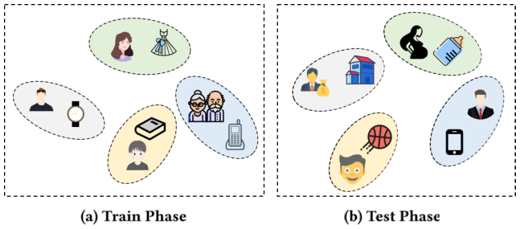
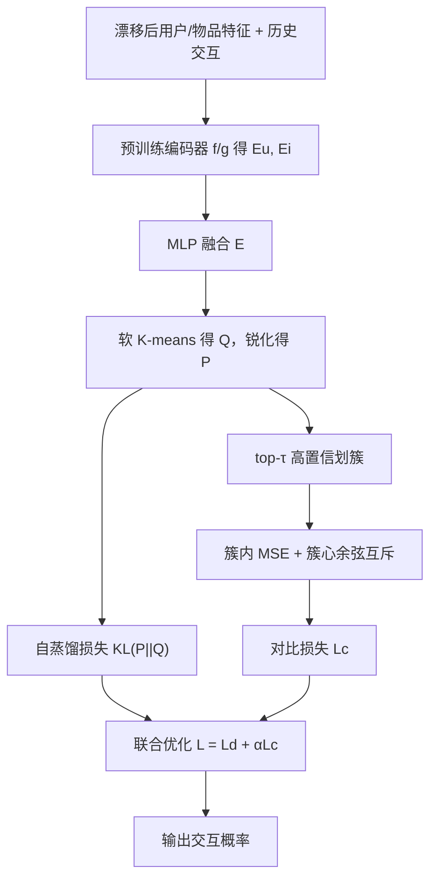

# Dual Test-time Training for Out-of-distribution Recommender System (面向分布外推荐的双重测试时训练)

- **会议/期刊**: IEEE TKDE 2025
- **作者与机构**: Xihong Yang, Yiqi Wang, Jin Chen, Wenqi Fan, Xiangyu Zhao, En Zhu, Xinwang Liu, Defu Lian（国防科大、港理工、港城大、中科大等）
- **推荐链路定位**: 重排 / 测试阶段模型适配（可挂载于任意预训练骨干）
- **研究方向**: 去偏公平与工业架构 / 自监督对比与交互去噪
- **论文原文**: [https://arxiv.org/abs/2407.15620v2](https://arxiv.org/abs/2407.15620v2)
- **开源代码**: 暂未开源（原文仅引用 SASRec 数据仓库）

## TL;DR (1分钟核心速览)

现有推荐模型默认训练/测试同分布，而真实场景中用户偏好随时间演化、物品属性随季节更替，导致特征漂移（OOD）下性能骤降。本文提出 DT3OR：不改训练流程，仅在**测试阶段**用「软 K-means 聚类 + 锐化自蒸馏」与「高置信簇内正样本 + 簇心互斥负样本」两个自监督任务对预训练模型做少量 epoch 微调，并给出 TTT 有效的凸性/β-光滑理论证明。在 5 个数据集、全库排序协议下，R@50 相对最强基线最高提升 11.56%（Meituan），N@100 在 Steam 上提升 14.20%。

## Background & Motivation (背景与核心矛盾)

- **主流范式**: 解耦表征（MacridVAE）、因果学习（COR、CausPref、InvCF）、分布鲁棒优化（DR-GNN）等，均在**训练阶段**注入不变性约束以抵抗分布漂移。
- **前人局限**: ① 因果类方法需要训练期干预（反事实采样、环境划分），当线上只有冻结的预训练模型时不可用；② 重训练方案需反复全量更新，计算开销与漂移频率强耦合，工业上难以承受。
- **核心洞察 (Key Insight)**: 测试样本本身携带漂移后的特征信息——用户兴趣虽随特征演化，但「同类用户偏好同类物品」的**簇结构不变性**依然成立；只要在测试时把这种不变结构重新"提纯"，模型即可平滑适配新分布。
- **本文切入点**: 把 CV 领域的 Test-Time Training 首次迁移到推荐，用聚类伪标签构造无需真值的代理损失，在推理前对模型做轻量自适应。

<figure class="paper-figure" markdown="span">
  <figcaption>图1：OOD推荐示意图。测试阶段用户和物品特征发生分布偏移，导致推荐性能下降。</figcaption>
</figure>

## Method (核心方法设计)

### 1. 整体框架 (Overall Architecture)

给定漂移后的用户/物品特征 $X_u, X_i$与历史交互$D$，先用预训练编码器$f(\cdot), g(\cdot)$得到$E_u, E_i$，经 MLP 融合为$E=\gamma(E_u\oplus E_i)$；对$E$做软 K-means 得分配分布$Q$，锐化得低熵目标$P$，构成自蒸馏损失；同时取 top-$\tau$ 高置信样本划簇，簇内拉近、簇心互斥构成对比损失；两损失联合反向传播更新编码器若干 epoch 后输出交互概率。整个流程只在测试阶段运行，训练阶段完全复用原骨干。

### 2. 关键设计拆解 (Key Designs)

1. **锐化自蒸馏任务（Self-distillation）**：痛点是无标签无法定义"好"的兴趣中心。做法是对软分配 $q=\varphi(E)$ 施加温度锐化，得到低熵目标分布，再以 KL 散度回拉：
$$P=S(q,T)_i=\frac{q_i^{1/T}}{\sum_j q_j^{1/T}},\qquad \mathcal{L}_d=\mathrm{KL}(P\|Q)=\sum_i p_i\log\frac{p_i}{q_i}$$
直觉：$T\to 0$时$P$ 逼近 one-hot，等价于用"更自信的伪标签"监督"更犹豫的当前分配"，迫使同类兴趣在潜空间收紧、簇间边界清晰，从而在漂移特征上重建稳定的兴趣中心。

2. **高置信对比任务（Contrastive）**：常规对比把所有非正样本当负样本，会引入大量假阴性。本文先用 $h=\mathrm{Top}(q)$取 top-$\tau$高置信样本，按伪标签划分为$K$个不相交簇$R_i$，簇内用 MSE 拉近、簇心间用余弦相似度推远：
$$\mathcal{L}_p=\frac{1}{KN(N-1)}\sum_{m=1}^{K}\sum_{i<j}(R_i^m-R_j^m)^2,\qquad \mathcal{L}_n=\frac{1}{K^2-K}\sum_{i<j}\mathrm{sim}(C_i,C_j)$$
由于负样本只取"不同高置信簇心"而非全部异类样本，假阴性概率被显著压低，对比信号更判别。

3. **训练目标与推理开销**：总损失 $\mathcal{L}=\mathcal{L}_d+\alpha\mathcal{L}_c$，$\alpha$平衡两项；测试阶段仅 10 epoch、batch=500，损失复杂度$O(Bd+N^2d)$，空间$O(B+N^2)$，实测训练时间与 COR/DR-GNN 同量级，显存可接受。理论上作者证明 CE 损失对嵌入凸且 β-光滑（Hessian 特征值$\le 2$、梯度$\ell_2$范数$\le 2$），进而由 Theorem 2 得：当主任务与 SSL 任务梯度内积$\langle\nabla L_{SUP},\nabla L_{SSL}\rangle>\epsilon$时，按$\delta=\epsilon/(\beta B^2)$ 步长更新必使主任务损失严格下降，为 TTT 提供了收敛性依据。

## Experimental Setup & Evaluation Protocol (实验设置与评估协议)

- **数据集与预处理**: 评分 $\ge 4$ 视为正样本，构造三类漂移场景（合成高斯重采样、Yelp 地理位置漂移、Meituan/Amazon/Steam 工作日 vs 周末消费水平漂移）：

| 数据集 | #Users | #Items | #IID Int. | #OOD Int. | 密度 | 漂移类型 |
| :--- | :---: | :---: | :---: | :---: | :---: | :--- |
| Synthetic | 1,000 | 1,000 | 145,270 | 112,371 | 0.2576 | 特征重采样 $N(0,1)\to N(1,1)$ |
| Meituan | 2,145 | 7,189 | 11,400 | 6,944 | 0.0012 | 工作日/周末消费水平 |
| Yelp | 7,975 | 74,722 | 305,128 | 99,525 | 0.0007 | 地理位置迁移 |
| Amazon-Book | 11,000 | 9,332 | 75,138 | 45,326 | 0.0012 | 工作日/周末 |
| Steam | 23,310 | 5,237 | 135,961 | 180,229 | 0.0026 | 工作日/周末 |

- **数据划分与防穿越 (Splitting Strategy)**: 稀疏比例划分 80%/10%/10%（train/val/test），OOD 交互全部落入测试侧，训练集仅含 IID 交互，严格避免漂移信息泄漏。
- **排名评测协议 (Ranking Protocol)**: 无偏 **Full-Ranking**（全库未交互物品排序），指标 Recall@K 与 NDCG@K；Synthetic 取 K=10/20，Meituan/Yelp 取 K=50/100。
- **对比基线与超参设置**: 11 个基线覆盖 FM/NFM（特征交叉）、MultiVAE/MacridVAE（解耦）、CausPref/COR/InvCF/PopGo/CausalDiffRec（因果）、DR-GNN（鲁棒图）；骨干统一用 COR，Adam，lr 1e-4~1e-5，dropout 0.5，测试期 10 epoch，$\alpha\in\{0.01,...,100\}$、$K\in\{2,4,10,20,100\}$、$\tau\in\{0.1,...,0.9\}$，$p<0.05$ 显著性检验。

## Key Experimental Results (实验关键数据)

### 1. 主实验对比 (Main Results)

| 数据集 | 方法 | R@50 | R@100 | N@50 | N@100 |
| :--- | :--- | :---: | :---: | :---: | :---: |
| Synthetic (K=10/20) | COR | 7.67 | 14.43 | 8.04 | 10.56 |
| | DR-GNN | 7.95 | 14.21 | 8.00 | 10.34 |
| | **DT3OR** | **8.20** | **14.84** | **8.42** | **10.86** |
| | Improv. | +3.14% | +2.84% | +4.08% | +2.36% |
| Meituan | COR | 3.68 | 5.78 | 1.01 | 1.35 |
| | DR-GNN | 3.72 | 5.75 | 1.04 | 1.35 |
| | **DT3OR** | **4.15** | **5.83** | **1.13** | **1.40** |
| | Improv. | +11.56% | +0.87% | +8.65% | +3.70% |
| Yelp | COR | 14.16 | 19.86 | 5.00 | 5.95 |
| | DR-GNN | 14.11 | 19.76 | 4.87 | 5.03 |
| | **DT3OR** | **14.41** | **19.90** | **5.10** | **6.02** |
| | Improv. | +1.77% | +0.20% | +2.00% | +1.18% |
| Amazon-Book | COR | 4.12 | 6.57 | 1.24 | 2.35 |
| | CausalDiffRec | 4.65 | 6.98 | 1.57 | 2.63 |
| | **DT3OR** | **5.07** | **7.56** | **2.26** | **2.85** |
| | Improv. | +9.03% | +8.31% | +4.08% | +8.37% |
| Steam | InvCF | 14.64 | 23.16 | 6.85 | 8.52 |
| | **DT3OR** | **15.72** | **24.17** | **7.65** | **9.73** |
| | Improv. | +7.38% | +4.36% | +11.68% | +14.20% |

### 2. 消融实验 (Ablation Study)

| 变体 | Synthetic R@10 | Meituan R@50 | Yelp R@50 | 说明 |
| :--- | :---: | :---: | :---: | :--- |
| w/o Cau&Con（仅骨干） | 最低 | 最低 | 最低 | 无测试时适配 |
| w/o SSL1（去自蒸馏） | 明显下降 | 明显下降 | 明显下降 | 兴趣中心不收敛 |
| w/o SSL2（去对比） | 明显下降 | 明显下降 | 明显下降 | 判别性不足 |
| **DT3OR 完整** | **最优** | **最优** | **最优** | 双任务互补 |

### 3. 关键实验发现 (Key Findings)

1. **漂移越强、增益越大**：Meituan 的 R@50 提升 11.56% 远超 Yelp 的 1.77%，说明消费水平漂移比地理漂移更剧烈，而 TTT 的收益与漂移强度正相关；在 Amazon-Book 上 N@50 从 1.57 跃至 2.26（+4.08% 相对 CausalDiffRec），验证了簇结构重建对稀疏场景的补偿作用。
2. **两个 SSL 任务缺一不可且互补**：消融显示单独移除任一任务性能均显著下滑，自蒸馏负责"把兴趣中心收紧"（提升表征均匀性），对比任务负责"把不同中心推开"（提升判别性），二者共同构成对漂移的鲁棒约束。
3. **超参存在明确甜点区**：$K\approx 4$时最优，$K=100$时兴趣中心过度分散导致性能骤降，$K=2$又无法覆盖多样偏好；$\alpha$在 1.0 附近最佳，极端值破坏两项损失的平衡；$\tau$越大高置信簇心越可靠、性能单调上升，$T$ 越低（趋近 one-hot）效果越好。

## Highlights & Limitations (亮点、对比与审稿批判)

- **与代表作对比 (vs. Prior Work)**: COR/InvCF 在训练期做因果干预或不变性约束，需重训且依赖环境划分；DR-GNN 做分布鲁棒优化但同样绑定训练流程；本文是首个把 TTT 引入 OOD 推荐的工作，**只改测试阶段、可插拔于任意预训练骨干**，工程侵入性最低。
- **可迁移亮点**: ① "软聚类 + 锐化伪标签"可作为通用无监督代理任务，迁移到冷启动或跨域场景的在线自适应；② 用"高置信簇心互斥"替代全量负采样，是低成本抑制假阴性的通用技巧。
- **审稿级局限批判**: ① 测试期需对每个漂移批次跑 10 epoch 聚类+反向传播，在线延迟与漂移检测触发机制未讨论，高 QPS 场景落地存疑；② 聚类数 $K$需人工调参且对数据规模敏感（$K=100$即崩），缺乏自适应确定$K$ 的方案；③ 理论证明依赖凸性与梯度有界假设，而真实推荐骨干（如 GNN）非凸，定理与实际之间存在 gap。

## Rating (四维评分)

- **方法创新性 (Novelty)**: ⭐⭐⭐⭐ （首个将 TTT 引入 OOD 推荐，双 SSL 任务设计有聚类结构直觉支撑，但组件本身均为已有技术组合）
- **评估协议与实验扎实度 (Protocol & Experiments)**: ⭐⭐⭐⭐ （5 数据集 × 3 类漂移 × 11 基线 + 全库排序 + 显著性检验，消融与稳定性分析完整，但缺少线上 A/B）
- **写作与数学规范度 (Clarity & Rigor)**: ⭐⭐⭐⭐ （框架图与算法伪代码清晰，Theorem 1/2 证明完整，但部分符号（如 $R_i$ 同时表簇与嵌入）略有歧义）
- **工业落地与复现价值 (Industrial & Practical Value)**: ⭐⭐⭐ （可插拔设计降低改造成本，但测试期逐批微调延迟、$K$ 敏感与未开源代码制约直接复用）

