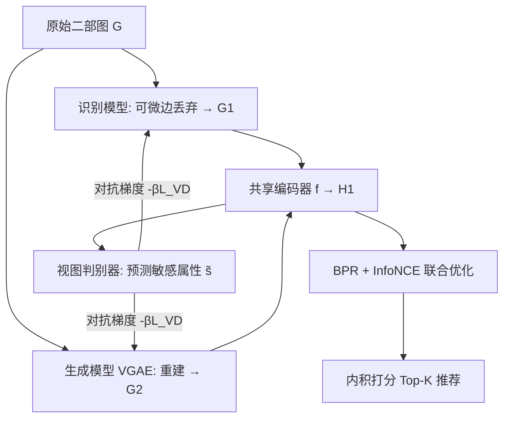
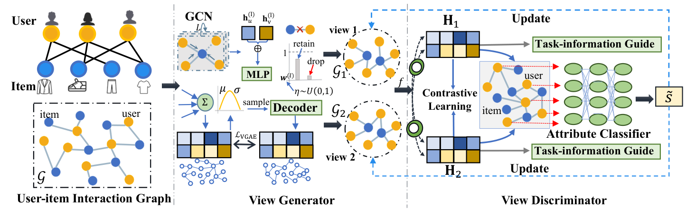

# FairDgcl: Fairness-aware Recommendation with Dynamic Graph Contrastive Learning (基于动态图对比学习的公平感知推荐)

- **会议/期刊**: IEEE TKDE (submitted, arXiv 2024-10)
- **作者与机构**: Wei Chen, Meng Yuan, Zhao Zhang, Ruobing Xie, Fuzhen Zhuang, Deqing Wang, Rui Liu（北航、中科院计算所、腾讯微信）
- **推荐链路定位**: 召回（图协同过滤表征学习）
- **研究方向**: 去偏公平与工业架构 / 自监督对比学习与交互去噪
- **论文原文**: [https://arxiv.org/abs/2410.17555v1](https://arxiv.org/abs/2410.17555v1)
- **开源代码**: [https://github.com/cwei01/FairDgcl](https://github.com/cwei01/FairDgcl)

## TL;DR (1分钟核心速览)

现有公平感知推荐依赖"跨群体偏好相似"等强假设做一次性数据增强，合成数据质量低且难以维持准确率-公平性的动态平衡。FairDgcl 提出对抗式图对比学习框架：视图生成器（识别模型删偏边 + VGAE 生成模型重建公平图）产出两个可学习增强视图，视图判别器以敏感属性分类损失反向驱动生成器去偏，并以 BPR + InfoNCE 保信息量。在 ML-1M/ML-100K/Last.FM/IJCAI-2015 四个数据集、全库排序协议下，ML-1M 上 Recall@20 相对 Graphair 提升约 5.2%，公平性差距 $\Phi_R$ 降低约 16%。

## Background & Motivation (背景与核心矛盾)

- **主流范式**: 公平感知推荐分模型侧（公平约束、对抗去敏感、重排）与数据侧（重加权、反事实增广、图编辑）两条路线；本文走数据侧，用图对比学习（GCL）替代依赖假设标签的合成增广。
- **前人局限**: ① 基于假设的增广（如 CAMUS、FairGap 假设跨群体偏好相似）在真实偏好异质时引入低质样本，损害准确率；② 无监督 GCL 增广（随机删边/掩码）与公平目标无显式关联，且单轮增广无法应对"训练后不公平度反而高于训练数据"的动态失衡。
- **核心洞察 (Key Insight)**: 图上的歧视并不显式存在于边，而潜藏于节点特征与交互模式中，难以用规则删边量化；因此增广策略本身应当是**可学习、可对抗、多轮动态调整**的，而非一次性启发式操作。
- **本文切入点**: 把"公平增广策略"参数化为生成器，把"公平性评估"参数化为判别器，用 min-max 博弈让增广自动逼近公平，同时用对比学习约束信息不塌缩。

## Method (核心方法设计)

### 1. 整体框架 (Overall Architecture)

输入用户-物品二部图 $\mathcal{G}$，视图生成器从两个互补视角产出增强图：识别模型$\mathcal{G}_1$按边公平权重做可微丢弃，生成模型$\mathcal{G}_2$用 VGAE 重建公平图；二者经参数共享的图编码器$f$得到$\mathbf{H}_1,\mathbf{H}_2$，融合后送入视图判别器预测敏感属性$\tilde{s}$。判别器损失以负号进入生成器目标，形成对抗；同时 BPR 损失对齐主任务、InfoNCE 对齐双视图。训练按"先最小化$\theta_g,\theta_f$、再最大化$\theta_d$"交替进行，推理时仅用编码器输出内积打分。

<figure class="paper-figure" markdown="span">
  <figcaption>图 2：所提 FairDgcl 框架示意图。该框架通过视图生成器和视图判别器两个模块自动增强输入二部图的公平性。前者学习公平增强策略以生成增强视图，后者评估这些生成的视图是否达到足够的公平性。</figcaption>
</figure>

### 2. 关键设计拆解 (Key Designs)

1. **识别模型：可微的公平边丢弃**：痛点是无监督随机丢边与公平无关。对每条边 $e=(u,v)$用 MLP 计算公平重要性$w_e^l=\mathrm{MLP}([\mathbf{h}_u^{(l)}\|\mathbf{h}_v^{(l)}])$，再经 Gumbel-Max 重参数化转为连续保留概率：

$$p_e^l=\sigma\!\left(\frac{\log\eta-\log(1-\eta)+w_e^l}{\tau_r}\right)$$

$\tau_r\to 0$ 时退化为 0/1 硬采样，从而端到端可训。直觉：与敏感属性强相关的交互被赋予低保留概率，模型被迫学习与敏感属性解耦的偏好信号。

2. **生成模型 + 统一判别器：从重建视角补全公平图**：识别模型只做"减法"，可能过度删边；VGAE 以 ELBO 为目标从潜空间重建邻接，保留无偏结构信息。判别器不训练两个独立分类器（参数 $O(2|U|d)$且割裂双视图），而是对$\mathbf{H}_1^{(u)},\mathbf{H}_2^{(u)}$均值池化后统一预测$\tilde{s}=\mathrm{MLP}(\mathrm{mean}(\mathbf{H}_1^{(u)},\mathbf{H}_2^{(u)}))$，分类损失$\mathcal{L}_{VD}$为交叉熵。**Theorem 1** 证明在判别器损失有界假设下，$-\mathcal{L}_{VD}$是群体公平差距$\Phi$ 的上界，故最大化判别器损失等价于最小化不公平度。

3. **信息量保持与总目标**：仅优化对抗项会退化为全零表征。故加任务引导 BPR（各视图独立）与跨视图 InfoNCE：

$$\mathcal{L}_{NCE}=\sum_{i}-\log\frac{\exp(\cos(\mathbf{H}_1^{(i)},\mathbf{H}_2^{(i)})/\tau)}{\sum_{j\neq i}\exp(\cos(\mathbf{H}_1^{(i)},\mathbf{H}_2^{(j)})/\tau)}$$

**Theorem 2** 借数据处理不等式证明 $-\mathcal{L}_{NCE}\le I(\mathbf{H}_1;\mathbf{H}_2)\le I(\mathcal{G};\mathcal{G}_1,\mathcal{G}_2)$，即对比损失是原图与双视图互信息的下界，保证增强视图不丢原始信息。总目标：

$$\min_{\theta_g,\theta_f}\max_{\theta_d}\ \mathcal{L}=\mathcal{L}_{BPR}+\underbrace{\left(\mathcal{L}_{VGAE}+\mathcal{L}_{BPR}^{rec}+\mathcal{L}_{BPR}^{gen}+\alpha\mathcal{L}_{NCE}\right)}_{\mathcal{L}_{VG}}-\beta\mathcal{L}_{VD}$$

负采样为 BPR 标准均匀随机负采样，无额外难负样本挖掘；推理仅需一次前向编码，开销与 LightGCN 同阶。

## Experimental Setup & Evaluation Protocol (实验设置与评估协议)

- **数据集与预处理**: 四个公开基准，敏感属性统一取性别（二分组）：

| 数据集 | #Users | #Items | #Interactions | 稀疏度 | 场景 |
| :--- | :---: | :---: | :---: | :---: | :--- |
| ML-1M | 6,040 | 3,952 | 1,000,209 | 95.81% | 电影 |
| ML-100K | 943 | 1,682 | 100,000 | 93.70% | 电影 |
| Last.FM | 9,900 | 31,834 | 285,201 | 99.91% | 音乐 |
| IJCAI-2015 | 7,526 | 4,506 | 274,431 | 99.19% | 电商 |

- **数据划分与防穿越**: 随机 `比例划分` 8:1:1（训练/验证/测试），非时间切分。
- **排名评测协议**: 无偏 `Full-Ranking`（测试用户对全部未交互物品排序），$K\in\{10,20,30\}$；准确率用 Recall/NDCG，公平性用群体差距$\Phi_R,\Phi_N$（越小越好）。
- **对比基线与超参**: LightGCN、FairDrop、FairGO、CAMUS、FairGap、Graphair 六类基线；嵌入维度 $d=64$，Adam 学习率$1e^{-3}$，200 epoch，层数$L\in\{1,2,3,4\}$，$\alpha,\beta\in\{10^{-4},\dots,1\}$网格搜索；显著性水平$p<0.05$（对 Graphair）。

## Key Experimental Results (实验关键数据)

### 1. 主实验对比 (Main Results)

以 $K=20$为代表（完整表含$K=10/30$）：

| 数据集 | 方法 | Recall↑ | NDCG↑ | $\Phi_R$↓ |$\Phi_N$↓ |
| :--- | :--- | :---: | :---: | :---: | :---: |
| ML-1M | LightGCN | 0.1867 | 0.2027 | 0.0156 | 0.0304 |
| | FairGap | 0.1846 | 0.2010 | 0.0117 | 0.0254 |
| | Graphair | 0.2275 | 0.2280 | 0.0073 | 0.0217 |
| | **FairDgcl** | **0.2393** | **0.2295** | **0.0061** | **0.0169** |
| | Improv. vs Graphair | +5.2% | +0.7% | -16.4% | -22.1% |
| ML-100K | LightGCN | 0.3512 | 0.2974 | 0.0163 | 0.0076 |
| | Graphair | 0.3514 | 0.2982 | 0.0200 | 0.0019 |
| | **FairDgcl** | 0.3415 | 0.2924 | **0.0122** | **0.0011** |
| Last.FM | Graphair | 0.1754 | 0.1136 | 0.0074 | 0.0088 |
| | **FairDgcl** | **0.1954** | **0.1295** | **0.0030** | **0.0054** |
| | Improv. vs Graphair | +11.4% | +14.0% | -59.5% | -38.6% |
| IJCAI-2015 | Graphair | 0.1290 | 0.0848 | 0.0098 | 0.0009 |
| | **FairDgcl** | **0.1324** | **0.0878** | **0.0073** | 0.0023 |

### 2. 消融实验 (Ablation Study)

$K=20$ 下移除各组件（RM=识别模型，GM=生成模型，TL=任务引导 BPR，AL=对抗损失）：

| 变体 | ML-1M Recall | ML-1M $\Phi_R$| Last.FM Recall | Last.FM$\Phi_R$ |
| :--- | :---: | :---: | :---: | :---: |
| Full Model | **0.2393** | **0.0061** | **0.1954** | **0.0030** |
| w/o RM | 0.2300↓ | 0.0100↑ | 0.1850↓ | 0.0050↑ |
| w/o GM | 0.2320↓ | 0.0090↑ | 0.1880↓ | 0.0045↑ |
| w/o TL | 0.2350↓ | 0.0080↑ | 0.1900↓ | 0.0040↑ |
| w/o AL | 0.2280↓ | 0.0110↑ | 0.1820↓ | 0.0060↑ |

### 3. 关键实验发现 (Key Findings)

1. **对抗项是公平性的主引擎，双生成器是准确率的主引擎**：移除 AL 使 ML-1M 的 $\Phi_R$ 从 0.0061 升至 0.0110（+80%），而移除 RM/GM 使 Recall 掉 3–4%，说明"判别器驱动去偏、双视图保信息"的分工确实成立；任一生成器缺失即退化为 Graphair 式单视角增广。
2. **稀疏度越高收益越大**：Last.FM（99.91% 稀疏）上 Recall@20 相对 Graphair 提升 11.4%、$\Phi_R$ 降 59.5%，远高于 ML-1M 的 5.2%/16.4%，表明可学习增广在交互稀缺时对噪声边更敏感、去偏收益更显著。
3. **准确率-公平性并非零和，但存在数据集依赖的边界**：ML-100K 上 FairDgcl 的 Recall@20 略低于 LightGCN（0.3415 vs 0.3512），作者归因于稀疏数据下对抗过程误删有效交互；同时 t-SNE 可视化显示性别聚类 NMI 从 Graphair 的 0.0045 降至 0.0021，验证表征层面确实实现了敏感属性解耦。

## Highlights & Limitations (亮点、对比与审稿批判)

- **与代表作对比 (vs. Prior Work)**: 相比 CAMUS/FairGap 依赖"跨群体偏好相似"假设做一次性反事实增广，FairDgcl 无需任何公平假设标签，增广策略由对抗信号自动学习；相比 Graphair 仅做边删除的单一视角，本文用"删偏 + 重建"双视角互补，并以 InfoNCE 显式约束信息下界，理论上同时保证公平性与信息量。
- **可迁移亮点**: ① Gumbel-Max 可微边丢弃可直接移植到任意二部图去偏/去噪场景；② "判别器损失作为群体公平差距上界"的推导思路，可复用于其他需要将不可微排序公平指标转为可训目标的场景。
- **审稿级局限批判**: ① 仅支持二值敏感属性且假设敏感标签可得，与隐私约束下的真实工业场景脱节；② 对抗训练需交替优化 $\theta_g,\theta_f,\theta_d$，且引入 VGAE 与双生成器，训练开销与超参（$\alpha,\beta,\tau_r,L$）敏感度明显高于 LightGCN，论文未给出训练时长或显存对比；③ 划分采用随机 8:1:1 而非时间切分，存在未来交互泄漏风险，线上时效性结论待验证。

## Rating (四维评分)

- **方法创新性 (Novelty)**: ⭐⭐⭐⭐ （首个将对抗式动态图增广用于推荐公平性，双定理分别锚定公平上界与信息下界，理论闭环较完整）
- **评估协议与实验扎实度 (Protocol & Experiments)**: ⭐⭐⭐⭐ （四数据集 + Full-Ranking + 三档 K + 显著性检验齐全，但缺时间切分与线上 A/B）
- **写作与数学规范度 (Clarity & Rigor)**: ⭐⭐⭐⭐ （Theorem 1/2 推导清晰，但 Theorem 1 的有界假设较强，部分证明标注为"overview"）
- **工业落地与复现价值 (Industrial & Practical Value)**: ⭐⭐⭐⭐ （代码已开源、推理开销与 LightGCN 同阶，但训练阶段三模块交替优化与敏感标签依赖抬高落地门槛）

