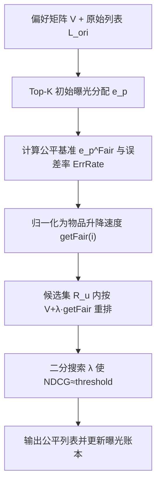

# FairSort: Learning to Fair Rank for Personalized Recommendations in Two-Sided Platforms (面向双边平台个性化推荐的公平排序学习)

- **会议/期刊**: IEEE TKDE
- **作者与机构**: Guoli Wu, Zhiyong Feng, Shizhan Chen, Hongyue Wu, Xiao Xue 等（天津大学智能与计算学部；江西师范大学）
- **推荐链路定位**: 重排（Post-processing Re-ranking）
- **研究方向**: 去偏公平与工业架构 / 多任务学习与列表级重排
- **论文原文**: [https://arxiv.org/abs/2412.00424v2](https://arxiv.org/abs/2412.00424v2)
- **开源代码**: [https://github.com/WuGL-CS/FairSort](https://github.com/WuGL-CS/FairSort)

## TL;DR (1分钟核心速览)

传统 Top-K 推荐以用户为中心，导致提供方曝光严重不均；而现有双边公平重排（FairRec/TFROM/CPFair）习惯把问题建模为背包问题并用贪心求解，造成用户间推荐质量损失不可控、部分用户 NDCG 骤降。本文提出 FairSort，将每条推荐列表视为“跑道”：为每个物品按提供方曝光误差分配升降速度，再通过二分搜索确定统一“运行时间” $\lambda$，从而在保证每个用户 NDCG 不低于阈值的前提下实现双边公平。在 Ctrip/Amazon/Google 三数据集上，FairSort 仅牺牲不到 10% 总推荐质量，即把提供方公平方差收敛至 0，且 UIR 综合指标全面优于 TFROM、FairRec、CPFair。

## Background & Motivation (背景与核心矛盾)

- **主流范式**: 双边公平重排主流做法将 Top-K 列表重选建模为背包问题（容量 $K$、物品为候选、双边公平为约束），用贪心策略优先塞入高分物品以最大化推荐质量。
- **前人局限**: 其一，贪心策略对推荐质量的保障不可靠——实验显示 TFROM 在 Ctrip 上产生大量 NDCG 落在 $[0,0.5]$ 的低质量列表，用户间质量损失分布极不均匀；其二，FairRec 的 EF1 强约束与 CPFair 的粗粒度分组（仅 Active/In-Active 两组）在细粒度多提供方场景下易退化为 Top-K，提供方公平改善有限。
- **核心洞察 (Key Insight)**: 作者发现，若把列表视为跑道，给物品赋予与“提供方曝光误差”成比例的速度，则随统一时间 $\lambda$ 增大，列表 NDCG 单调不增（Theorem 1 严格证明），这一单调性使二分搜索可精确控制质量损失。
- **本文切入点**: 用“速度+时间”的连续重排替代离散贪心选择，以二分搜索锁定满足最低效用阈值的 $\lambda$，把不可控的质量损失变为可控的阈值约束。

## Method (核心方法设计)

### 1. 整体框架 (Overall Architecture)

FairSort 是模型无关的后处理重排器：输入任意推荐算法产出的偏好矩阵 $V$与原始排序列表$L^{ori}$，先按 Top-K 为各提供方分配初始曝光$e_p$，并与公平基准$e_p^{Fair}$比较得到误差率，归一化为每个物品的升降速度$getFair(i_k)$；随后对每个用户仅在原始列表前$ratio$比例候选集$R_u$内，以$V_{u,i_k}+\lambda\cdot getFair(i_k)$重排，$\lambda$由二分搜索确定，使 NDCG 逼近但不低于阈值；最后用重排结果更新曝光账本，进入下一用户。离线版一次性服务全体用户，在线版对随机到达请求逐条执行（总曝光按请求数$c\_num$ 动态估算）。

### 2. 关键设计拆解 (Key Designs)

1. **跑道速度分配（Fair Lift Velocity）**：痛点是把公平约束塞进背包后贪心无法感知“谁该多曝光”。本文对每个提供方计算其当前转化率与公平转化率的误差，按符号定方向、按幅值定速度：
$$ErrRate_{p_j}=\frac{e^{Fair}_{p_j}-e_{p_j}}{|I_{p_j}|},\quad Lift_{p_j}=\frac{ErrRate_{p_j}}{\sum_{i=1}^{|P|}|J(ErrRate_{p_i})|}$$
其中 $J(\cdot)$ 为符号过滤函数（分子分母异号则置 0）。同一提供方物品共享速度，既保留组内偏序，又让曝光不足者整体上浮、超额者整体下沉，物理直觉即“转化率向公平值收敛”。

2. **二分搜索最小效用保证（Minimum Utility Guarantee）**：痛点是贪心导致质量损失不可控。基于 Theorem 1（$\lambda\in[0,+\infty]$增大时 NDCG 单调不增），在$[0,\lambda_{max}]$上二分，终止条件为区间长度$\le gap$，取左端点保证 NDCG 不低于阈值：
$$\lambda=\begin{cases}\lambda_{target} & (m_2-m_1)>gap\\ m_1 & (m_2-m_1)\le gap\end{cases}$$
迭代轮数上界 $\lceil\log_2(\lambda_{max}/gap)\rceil$，把“公平换质量”的交换比从经验贪心变为可证明的阈值契约。

3. **训练目标、负采样与推理效率**：本方法无训练损失、无负采样，属纯推理期重排。离线复杂度 $O(m(l+g\log g))$，在线单请求$O(l+g\log g)$，其中$l$为提供方数、$g$为参与重排的候选数（由$ratio$ 控制），二分搜索的快速排序是主要开销。

## Experimental Setup & Evaluation Protocol (实验设置与评估协议)

- **数据集与预处理**:

| 数据集 | #Users | #Items | #Interactions | 稀疏度/密度 | 特征/场景说明 |
| :--- | :---: | :---: | :---: | :---: | :--- |
| Ctrip Flight | 3,814 | 6,006 | 25,190 | 密度约 0.11% | 机票订单，含航司/舱位/价格，CF 算法生成偏好矩阵 |
| Amazon Clothing | 1,851 | 7,538 | — | — | 过滤评论 <10 条，矩阵分解打分；无提供方信息，按 1–100 物品聚类构造 161 个提供方 |
| Google Local | 3,335 | 4,927 | 97,658 | 密度约 0.59% | 每物品即一个提供方（细粒度公平），基于位置的隐式分解 |

- **数据划分与防穿越 (Splitting Strategy)**: 离线场景为一次性全量重排；在线场景用随机请求序列模拟，每用户 10 次推荐机会并打乱顺序，属流式评估而非传统留一/比例划分。
- **排名评测协议 (Ranking Protocol)**: 以原始 Top-K 列表为最优基准计算 NDCG（$NDCG_u=DCG_{u,l_u}/DCG_{u,l^{ori}_u}$），属列表级全量重排评估；公平侧用 DCF（NDCG 方差）与 DPF（UF/QF 两种曝光转化率方差），综合指标 UIR 越小越好。
- **对比基线与超参设置**: 基线含 Top-K、Mixed-K、All Random、Minimum Exposure、FairRec (WWW'20)、CPFair (SIGIR'22)、TFROM (SIGIR'21)；$\lambda_{max}\in\{2^2,2^3,2^4\}$，$gap\in\{2^{-5},2^{-6},2^{-7}\}$，$threshold\in\{0.85,0.90,0.95\}$，$ratio\in\{0.1,0.2,1\}$，$K$ 取 5–25。

## Key Experimental Results (实验关键数据)

### 1. 主实验对比 (Main Results)

原文主结果为跨 $K$ 的曲线图（图 4–11），核心定量证据集中在 NDCG 分布表与 UIR 曲线。下表摘取在线场景 NDCG 分布（Ctrip，Quality Weighted）与 UIR 定性结论：

| 模型 | NDCG<0.85 的列表数 (Ctrip) | NDCG≥0.95 的列表数 | 提供方 DPF 收敛 | UIR (QF, 三数据集) |
| :--- | :---: | :---: | :---: | :---: |
| Top-K | 0 | 28545 | 随 $K$ 指数上升 | 1.00（基准） |
| Minimum Exposure | 大量 | 极少 | 收敛至 0 | 高（质量崩塌） |
| FairRec (WWW'20) | 较多 | 较少 | 部分改善 | 不稳定，易退化 |
| CPFair (SIGIR'22) | 较多 | 较少 | 改善有限 | 偏高，Ctrip 上劣于 Top-K |
| TFROM (SIGIR'21) | 42+147+977+1457+2285+4161+7146=**16215** | 10406 | 收敛至 0 | 次优 |
| **FairSort (Ours)** | **0** | **28545** | **收敛至 0** | **最优（三数据集）** |

### 2. 消融实验 (Ablation Study)

原文未设传统模块消融，而以“变体对比”承担消融角色（UF vs QF 两种公平定义、离线 vs 在线两版本、$ratio$与$threshold$ 敏感性）：

| 变体/配置 | 总推荐质量 | DCF | DPF(UF) | DPF(QF) | 说明 |
| :--- | :---: | :---: | :---: | :---: | :--- |
| FairSort-QF | 高（损失<10%） | 收敛 0 | 收敛 0 | 最优 | 质量加权公平主版本 |
| FairSort-UF | 高 | 收敛 0 | 最优 | 略逊 QF | 均匀公平版本 |
| w/o 二分（贪心，即 TFROM 式） | 高但方差大 | 波动 | 收敛 0 | 收敛 0 | 出现 16215 条低质列表 |
| $ratio=0.1$vs$1$ | 候选越少质量越稳 | — | 略降 | 略降 | 效率与公平的折中 |
| $threshold$ 0.85→0.95 | 单调下降 | — | 改善 | 改善 | 阈值即质量-公平旋钮 |

### 3. 关键实验发现 (Key Findings)

1. **贪心的质量保障确实不可靠**：Ctrip 在线实验中 TFROM 有 16,215 条列表 NDCG 低于 0.85，而 FairSort 为 0 条且 28,545 条全部落在 $[0.95,1]$，直接验证二分搜索对“最低效用”的硬约束优于贪心启发式。
2. **公平与质量可近似解耦**：FairSort 在三个数据集、UF/QF 两种定义下 DPF 均收敛至 0，总质量损失不足 10%，说明跑道速度机制能在几乎不损效用的前提下完成曝光再分配。
3. **细粒度公平更难**：Google 数据集（物品即提供方）上除 Minimum Exposure 外所有模型 DPF 均不收敛，仅起缓解作用，揭示细粒度约束下效用-公平存在内在张力；同时 FairSort 在 QF 下比 UF 更稳，提示质量加权定义更契合真实平台。

## Highlights & Limitations (亮点、对比与审稿批判)

- **与代表作对比 (vs. Prior Work)**: 与 FairRec 的 EF1 强约束+固定服务顺序相比，FairSort 用连续速度场避免了个体公平约束导致的退化；与 CPFair 的 MILP 粗粒度分组相比，它支持提供方级细粒度公平且无需求解器；与 TFROM 同用公平基准 $e^{Fair}$，但以二分搜索替代贪心，把质量损失从“事后观测”变为“事前保证”。
- **可迁移亮点**: ①“误差率→速度→统一时间参数”的连续重排范式可迁移到多样性、新颖性等多目标重排；②Theorem 1 的单调性证明为任何“打分线性叠加公平偏置”的重排器提供了二分调参的理论依据。
- **审稿级局限批判**: ①物品效用估计依赖现成 CF/MF 打分，效用估计偏差会直接传导至公平分配，作者亦在结论中承认此简化；②式 (14) 的隐函数缺乏公平度上下界的理论刻画，且 $ratio$、$threshold$、$\lambda_{max}$三超参需按场景网格搜索，在线部署的调参成本与最坏情况延迟（$g\log g$ 排序×二分轮数）未被充分讨论。

## Rating (四维评分)

- **方法创新性 (Novelty)**: ⭐⭐⭐⭐ （“跑道替代背包”的视角转换新颖，Theorem 1 单调性证明为二分搜索提供严谨理论支撑）
- **评估协议与实验扎实度 (Protocol & Experiments)**: ⭐⭐⭐⭐ （三数据集×离线/在线×UF/QF 共 150 组实验较全面，但主结果为曲线图、缺标准 Top-N 表格，且无显著性检验）
- **写作与数学规范度 (Clarity & Rigor)**: ⭐⭐⭐⭐ （公平定义、误差率与二分终止条件推导清晰，附录证明完整；部分符号如 $J(\cdot)$、$R$ 集合定义略简）
- **工业落地与复现价值 (Industrial & Practical Value)**: ⭐⭐⭐⭐ （模型无关后处理、代码开源、在线单请求复杂度可控，适合作为推荐链路末端公平插件）

