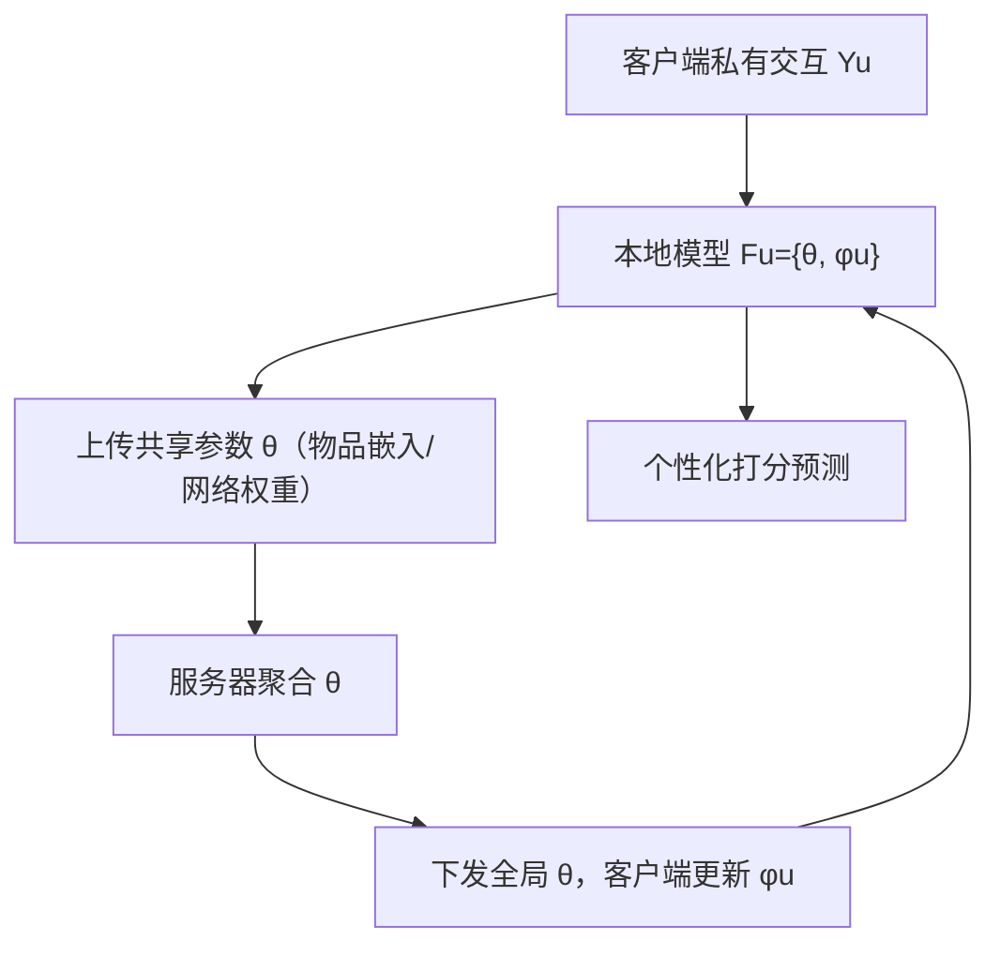
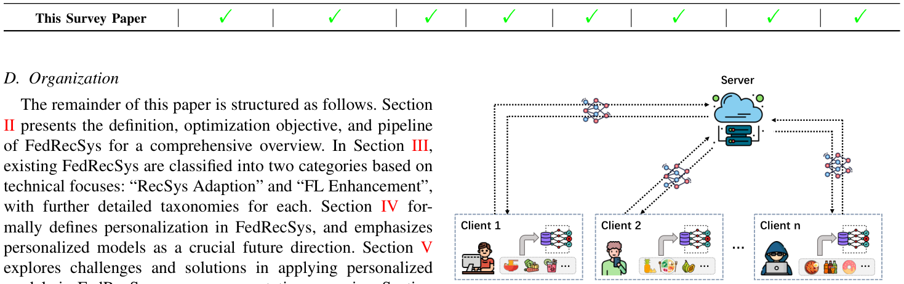

# Personalized Recommendation Models in Federated Settings: A Survey (联邦场景下的个性化推荐模型：综述)

- **会议/期刊**: IEEE TKDE 2025（arXiv:2504.07101v1, 20 页 8 图）
- **作者与机构**: Chunxu Zhang, Guodong Long, Zijian Zhang, Zhiwei Li, Honglei Zhang, Qiang Yang, Bo Yang（吉林大学、悉尼科技大学、北京交通大学、香港科技大学/微众银行）
- **推荐链路定位**: 端到端联邦训练（客户端本地训练 + 服务器聚合，覆盖召回/排序模型）
- **研究方向**: 去偏公平、可信隐私与工业架构 / 冷启动与长尾
- **论文原文**: [https://arxiv.org/abs/2504.07101v1](https://arxiv.org/abs/2504.07101v1)
- **开源代码**: 暂未开源（论文给出匿名仓库 `anonymous.4open.science/r/Personalized_FedRecSys` 汇总各方法代码链接）

## TL;DR (1分钟核心速览)

现有 FedRecSys 研究几乎全部聚焦于“把集中式推荐架构搬进联邦框架”以及安全、鲁棒、通信效率三大 FL 固有难题，却系统性忽视了推荐系统的立身之本——用户个性化建模。本文首次给出联邦场景下个性化的形式化定义（全局参数 $\theta$+ 私有参数$\phi_u$ 的双层优化），论证“个性化模型”是应对 non-IID 客户端数据的核心抓手，并按静态物品 ID、语义属性表征、公平/安全挑战场景、基础模型四类维度梳理挑战与解法。作为综述，本文不含自建实验，其价值在于统一优化目标框架与代码资源汇总。

## Background & Motivation (背景与核心矛盾)

- **主流范式**: FedRecSys 将推荐模型嵌入 FL 框架，客户端本地保存交互数据、仅上传物品嵌入与网络权重，服务器聚合成全局模型；研究主线分为 RecSys Adaptation（MF/MLP/CNN/GNN/Transformer 架构适配 + 跨域/公平/社交/新闻/POI 场景）与 FL Enhancement（同态加密/差分隐私/伪物品梯度、投毒攻防、哈希二值化/聚类选客/低秩分解）。
- **前人局限**: 其一，几乎所有工作沿用“仅本地保留用户 ID 嵌入、其余参数全局共享”的解耦策略，隐含假设“物品语义与交互机制对所有用户一致”，无法刻画同一物品在不同用户认知下的差异化解读；其二，现有综述（Alamgir、Javeed、Sun、Li 等）只覆盖架构/安全/效率，无一讨论个性化模型，且缺乏统一优化目标与代码资源。
- **核心洞察 (Key Insight)**: FL 天然为每个客户端训练独立模型，这一“多模型协同优化”特性恰好与个性化推荐的需求同构——个性化不必是集中式推荐的补丁，而应是联邦架构的原生能力。
- **本文切入点**: 以“学习个性化模型”重新定义 FedRecSys 的个性化，把表示空间（用户/物品嵌入）与交互机制（打分函数、注意力层）一并本地化，并据此重构挑战—解法图谱。

## Method (核心方法设计)

### 1. 整体框架 (Overall Architecture)

本文是综述，其“方法”体现为统一的形式化框架与分类体系。基础层给出 FedRecSys 通用目标 $\min_{\theta}\sum_{u\in\mathcal{U}}\alpha_u\mathcal{L}_u(\theta;\mathcal{Y}_u)$，聚合权重$\alpha_u=|\mathcal{Y}_u|/|\mathcal{Y}|$；在此之上将个性化定义为每个客户端维护$\mathcal{F}_u=\{\theta,\phi_u\}$ 的双参数架构，并升级为双层优化。分类层沿“RecSys 适配（架构 × 场景）”与“FL 增强（安全/鲁棒/效率）”两轴盘点文献，再以个性化模型为主线，按物品表征形态（静态 ID / 语义属性）、挑战场景（公平 / 安全）、基础模型三条支线展开挑战—解法映射。

<figure class="paper-figure" markdown="span">
  <figcaption>图 3. FedRecSys 框架。用户（客户端）存储个人数据并在本地训练推荐模型。云服务器通过迭代聚合和分发所有用户的模型参数来协调全局训练。训练收敛后，每个客户端设备可为用户预测可能感兴趣的物品。</figcaption>
</figure>

### 2. 关键设计拆解 (Key Designs)

1. **联邦个性化的双层优化定义（全文理论基石）**：前人把个性化等同于“本地保留用户嵌入”，无法解释物品侧与打分函数的异构性。本文将其升格为 bi-level 问题：外层学全局共享参数，内层各客户端在私有数据上求最优个性化参数，
$$\min_{\theta}\sum_{u\in\mathcal{U}}\alpha_u\mathcal{L}_u(\theta,\phi_u^{*};\mathcal{Y}_u),\quad \phi_u^{*}=\arg\min_{\phi_u}\mathcal{L}_u(\theta,\phi_u;\mathcal{Y}_u)$$
直觉上，$\theta$承担跨用户知识共享（缓解 non-IID 统计偏差），$\phi_u$ 承担本地适配，二者通过参数隔离同时实现隐私保护与细粒度偏好刻画。

2. **四类挑战的约束化建模（把定性讨论变成可优化问题）**：本文为每条支线在式 (17) 上追加一个带阈值的辅助损失，形成统一“基础损失 + 约束项”模板。静态 ID 支线加入内存/通信损失 $\mathcal{L}_{mem}(\phi_u^{I})+\mathcal{L}_{comm}(\phi_u^{I})$并约束其小于$\delta_{mem},\delta_{comm}$；语义属性支线加入泛化损失$\mathcal{L}_{gene}$防止属性嵌入过度特化；挑战场景支线加入稳定性损失$\mathcal{L}_{vers}$抑制个性化模型过拟合或被噪声扰动；基础模型支线加入平衡损失$\mathcal{L}_{bal}$与偏差检测损失$\mathcal{L}_{det}$。这种“一挑战一约束”的写法使异构文献可在同一坐标系下比较。

3. **对应解法与效率权衡**：静态 ID 侧以“仅保留交互过的物品嵌入”和“物品嵌入矩阵低秩分解”降内存与通信；语义属性侧以“部分个性化属性嵌入”与“相似用户共享同一属性嵌入”平衡特化与协同；公平场景用“共享模型 + 个性化模型联合预测”缓解高能力客户端过拟合，安全场景用“复用历史轮次无噪模型”抵抗加噪干扰；基础模型侧用自适应融合与对抗去偏。效率上，客户端仅传共享参数，通信量与物品嵌入规模而非全模型规模成正比。

## Experimental Setup & Evaluation Protocol (实验设置与评估协议)

本文为综述，**不含自建实验与主实验表格**，其“评估协议”体现为对领域内 100+ 篇工作的实验设置归纳：

- **数据集分布**: 高度集中于 MovieLens（100K/1M/10M/20M）、Amazon 系列、Filmtrust、Ciao、Epinions、LastFM、Foursquare、MIND/Adressa、KuaiRand 等公开集；少数工作使用工业内数据（如 FCF 的 in-house production、RF2 的淘宝广告日志）。
- **任务与指标**: 隐式反馈任务主流用 HR/NDCG/Recall/Precision/MAP/F1/AUC；显式评分预测用 MAE/RMSE；公平场景额外报告 MDAC 等公平性指标；效率类工作报告计算时间与通信开销。
- **划分与打分协议**: 综述未统一各文的划分方式（多数沿用集中式推荐的 Leave-One-Out 或比例划分），亦未区分 Full-Ranking 与 Sampled Ranking——这正是作者在 Future Directions 中呼吁建设标准化 Benchmark 的直接动因。
- **代码可得性**: 文中逐表标注 Code Repository / Not Available，是少数提供代码资源索引的 FedRecSys 综述。

## Key Experimental Results (实验关键数据)

### 1. 文献覆盖对比 (Survey Coverage Comparison)

原文 Table I 以定性覆盖矩阵对比 7 篇既有综述，可视为本文的“主实验”：

| 综述 | 模型架构 | 推荐场景 | 安全 | 鲁棒 | 效率 | 个性化模型 | 目标形式化 | 代码资源 |
| :--- | :---: | :---: | :---: | :---: | :---: | :---: | :---: | :---: |
| Alamgir 2022 | ✓ | ✗ | ✓ | ✓ | ✓ | ✗ | ✗ | ✗ |
| Javeed 2023 | ✗ | ✓ | ✓ | ✗ | ✗ | ✗ | ✗ | ✗ |
| Chronis 2024 | ✗ | ✓ | ✓ | ✓ | ✗ | ✗ | ✗ | ✗ |
| Harasic 2024 | ✓ | ✓ | ✗ | ✗ | ✗ | ✗ | ✗ | ✗ |
| Sun 2024 | ✓ | ✓ | ✓ | ✓ | ✓ | ✗ | ✗ | ✗ |
| Wang 2024 | ✓ | ✗ | ✓ | ✓ | ✓ | ✗ | ✗ | ✓ |
| Li 2024 | ✗ | ✗ | ✓ | ✗ | ✓ | ✗ | ✗ | ✗ |
| **本文** | **✓** | **✓** | **✓** | **✓** | **✓** | **✓** | **✓** | **✓** |

### 2. 方法族谱消融式统计 (Taxonomy Breakdown)

| 维度 | 代表方法 | 关键技术 | 代码 |
| :--- | :--- | :--- | :---: |
| MF 架构 | FCF / FedMF / FedRec++ / LightFR | 同态加密、伪物品、哈希二值化 | 部分 |
| 深度架构 | FedNCF / PFedRec / FedPerGNN / GPFedRec | MLP、GNN、双个性化 | 部分 |
| 跨域 | FedCDR / FedHCDR / PFCR | 辅助域迁移解新用户冷启动 | 部分 |
| 公平 | F2MF / F2PGNN / RF2 / Cali3F | 公平感知聚合、校准 | 部分 |
| 安全攻防 | PipAttack / FedRecAttack / UNION | 投毒、对比学习防御 | 部分 |
| 效率 | FedFast / FedKD / CoLR / AeroRec | 聚类选客、蒸馏、低秩 | 部分 |

### 3. 关键实验发现 (Key Findings)

- **个性化模型维度是唯一“全空”列**：Table I 中 7 篇既有综述在“Personalized Model”一列全部为 ✗，本文是首个填补该空白的系统性工作，这构成其最核心的增量定位。
- **架构演进呈现清晰代际**：Table II/III 显示 MF 时代（2019–2021）以隐私增强与通信压缩为主，GNN/Transformer 时代（2022 后）转向图关系恢复与多模态融合，但物品侧参数仍普遍全局共享，个性化仅停留在用户嵌入层。
- **代码可得性约半数**：逐表统计显示 MF 类方法开源比例明显低于深度架构类，且跨域、公平、POI 场景多数标注 Not Available，这直接支撑了作者“亟需标准化 Benchmark”的论断。

## Highlights & Limitations (亮点、对比与审稿批判)

- **与代表作对比 (vs. Prior Work)**: 相较 Sun 等（2024）覆盖架构/安全/鲁棒/效率四维但无个性化视角，本文新增“个性化模型”主线并给出双层优化形式化；相较 Li 等（2024）聚焦基础模型与 FedRecSys 结合，本文将基础模型仅作为四条支线之一，视野更完整；相较 Wang 等（2024）提供代码资源但缺目标形式化，本文两者兼备。
- **可迁移亮点**: ①“基础损失 + 带阈值约束项”的统一建模模板可直接迁移到任何多目标联邦优化问题的形式化写作；②“共享模型 + 个性化模型联合预测”与“复用历史轮次模型抗噪”两个技巧，对隐私噪声下的鲁棒推荐与公平聚合均有直接借鉴价值。
- **审稿级局限批判**: 其一，全文无任何定量实验或统一复现，四类挑战的“解法”多为示意图级建议（图 5–8），缺乏收敛性或精度上的实证支撑，约束阈值 $\delta$ 的取值亦无讨论；其二，对非 IID 程度、客户端规模、通信轮次等关键因素缺少敏感性分析，且未覆盖纵向联邦与跨设备/跨孤岛划分差异，工业落地指导性偏弱。

## Rating (四维评分)

- **方法创新性 (Novelty)**: ⭐⭐⭐⭐ （首个联邦个性化形式化定义与双层优化框架，但本质是综述性整合而非新算法）
- **评估协议与实验扎实度 (Protocol & Experiments)**: ⭐⭐⭐ （文献覆盖与代码索引扎实，但无自建实验、无统一 Benchmark 验证）
- **写作与数学规范度 (Clarity & Rigor)**: ⭐⭐⭐⭐ （统一优化目标贯穿全文、挑战—解法映射清晰，部分约束项仅给符号未给具体实例化）
- **工业落地与复现价值 (Industrial & Practical Value)**: ⭐⭐⭐⭐ （代码资源汇总与四类落地解法对工程实践有直接参考，但缺线上验证与开销实测）

