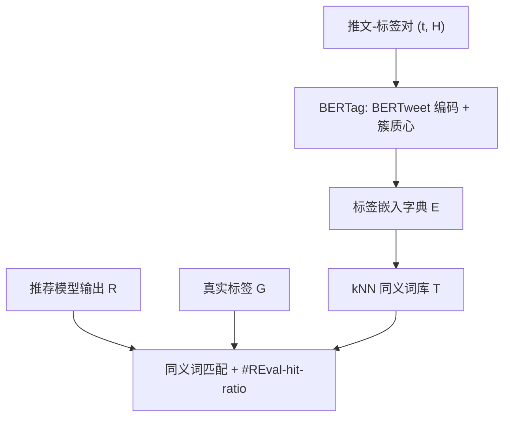
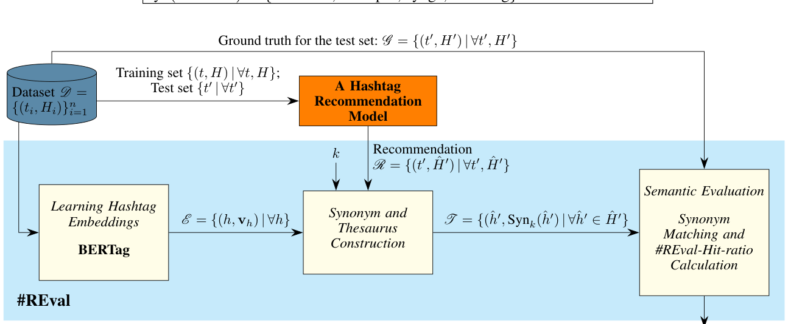

# #REVAL: a semantic evaluation framework for hashtag recommendation (话题标签推荐的语义评估框架)

- **会议/期刊**: IEEE TKDE
- **作者与机构**: Areej Alsini (Umm Al-Qura University)；Du Q. Huynh, Amitava Datta (The University of Western Australia)
- **推荐链路定位**: 评测基准（面向话题标签推荐模型的离线评估协议）
- **研究方向**: 去偏公平、可信隐私与工业架构 / 大语言模型推荐
- **论文原文**: [论文原文链接](https://arxiv.org/abs/2305.18330v1)
- **开源代码**: [BERTweet 预训练模型](https://huggingface.co/vinai/bertweet-base)（框架本身暂未开源）

## TL;DR (1分钟核心速览)

话题标签推荐长期沿用**精确字符串匹配**计算 hit rate / hit ratio，导致语义等价但拼写不同的标签（如 `#Covid_19` 与 `#coronavirus`）被误判为未命中，系统性低估模型性能。本文提出 #REval 语义评估框架：用 BERTweet 编码推文、以簇质心得到话题标签嵌入 BERTag，再经 kNN 自动构建同义词库，并将 hit ratio 改写为同义词感知的 #REval-hit-ratio。在三个大规模 Twitter 数据集上，仅取 $k=5\sim10$ 个同义词即可使 AU Trends 与 Health 数据集的指标近乎翻倍，且 BERTag 显著优于 Word2Vec/FastText。

## Background & Motivation (背景与核心矛盾)

- **主流范式**: 话题标签推荐模型的评估几乎全部依赖精确匹配——将推荐列表 $R$与真实标签集$G$ 做字符串交集，再算 hit rate、hit ratio、Precision/Recall/F1。
- **前人局限**: 其一，用户生成标签存在大量同义变体（`#Covid19`/`#Covid_19`/`#coronavirus`）与拼写噪声（`#coron. . .`、`#Covid19...Don't`），精确匹配把这些语义正确的推荐全部判错；其二，标签存在**上下位关系**（`#hockey` 之于 `#sport`），精确匹配无法刻画这种非对称语义相关性，迫使部分工作退回昂贵且不可复现的人工评估。
- **核心洞察 (Key Insight)**: 若把话题标签投影到与推文共享的语义空间，则"同义"可退化为"嵌入空间近邻"，评估问题即转化为**近邻集合的软匹配**问题；且同义关系天然非对称，匹配方向必须受控。
- **本文切入点**: 用预训练 BERTweet 的推文嵌入聚类质心作为标签嵌入，kNN 建同义词库，并只在推荐侧 $R$扩张同义词，从而在保持指标有界$[0,1]$ 的前提下修正精确匹配的偏差。

## Method (核心方法设计)

### 1. 整体框架 (Overall Architecture)

框架由三个解耦模块串联：**BERTag** 负责把 $(t_i, H_i)$数据集转成标签嵌入字典$E=\{(h,\boldsymbol{v}_h)\mid\forall h\}$；**同义词与词库构建** 在$E$上对每个标签做 kNN 检索得到$Syn_k(h)$，形成词库$\mathcal{T}=\{(h,Syn(h))\mid\forall h\}$；**语义评估** 接收任意推荐模型输出的$\langle R,G\rangle$ 对，查表做同义词匹配并输出平均 #REval-hit-ratio。整个流程与推荐模型完全解耦（图 2 中推荐模型位于框架阴影区之外），训练一次即可复用；新增推文时标签嵌入可用增量均值更新而无需重算。

<figure class="paper-figure" markdown="span">
  <figcaption>图2：#REval 框架包含三个主要模块：BERTag 模块、同义词与词库构建模块以及语义评估模块。</figcaption>
</figure>

### 2. 关键设计拆解 (Key Designs)

1. **BERTag：把标签变成推文语义空间的簇质心**：标签是噪声极大的用户自造串，直接训词向量会因稀疏与拼写变体而失效。本文先把多标签推文按标签数复制拆分为单标签样本 $(t_j^{(i)}, h)$，用 BERTweet 得到 768 维推文嵌入$\boldsymbol{v}_t$，再对同一标签下所有推文取归一化算术均值作为标签嵌入：
$$\boldsymbol{v}_h=\frac{1}{s\,n_h}\sum_{t:\,h\in H_t}\boldsymbol{v}_t$$
其中 $s$为归一化因子使$\|\boldsymbol{v}_h\|=1$。直觉是：共享同一标签的推文文本高度相似、在 BERTweet 空间中本就成簇，质心即该标签的"语义原型"，且与推文同处一个空间，余弦距离可直接解释为语义接近度。增量更新为$\boldsymbol{v}_h\leftarrow\frac{1}{s}\big(\frac{n_h}{n_h+1}\boldsymbol{v}_h+\frac{1}{n_h+1}\boldsymbol{v}_t\big)$，$O(d)$ 即可完成。

2. **非对称同义词匹配的 #REval-hit-ratio**：精确匹配的 hit ratio 为 $|R\cap G|/\min(|R|,|G|)$，对同义变体一律记零。本文将其改写为：
$$\text{\#REval-hit-ratio}(R,G)=\frac{1}{\min(|R|,|G|)}\begin{cases}\sum_{\hat{h}\in R}\rho\big(Syn(\hat{h})\cap G\neq\varnothing\big), & |R|\le|G|\\[2pt] \sum_{h\in G}\rho\big(h\in Syn(R)\big), & \text{otherwise}\end{cases}$$
关键设计是**只对推荐侧 $R$扩张同义词、$G$保持原样**。这样 `R={#hockey}, G={#sport}` 可命中（下位词的同义词含上位词），而 `R={#sport}, G={#hockey}` 不命中，符合"推荐更泛的标签不应算对"的评估直觉；同时避免了双向扩张在$k\to\infty$时两集合必然重叠导致的指标崩塌。$k=0$ 时公式退化为原始 hit ratio，构成天然基线。

3. **训练目标、负采样与推理效率**：本框架无监督、无负采样、无对比损失——BERTag 直接复用冻结的 BERTweet 权重，唯一"训练"是前向编码加均值聚合；同义词库构建为一次 $O(m^2 d)$的 kNN（$m$ 为唯一标签数，可换 ANN 索引）。评估阶段每条测试推文仅需一次词库查表，开销可忽略。

## Experimental Setup & Evaluation Protocol (实验设置与评估协议)

- **数据集与预处理**: 三个 Twitter 数据集，保留至少含一个标签的推文，清洗停用词/mention/URL/标点（保留 `#`），转小写并剔除非英文；按 90/10 划分训练/测试。

| 数据集 | #Users | #Items | #Interactions | 稀疏度/密度 | 特征/场景说明 |
| :--- | :---: | :---: | :---: | :---: | :--- |
| AU Trends (2020-03) | — | 15,375 唯一标签 | 272,686 推文 / 547,227 标签 | 平均 2.1 标签/推文 | 16 个澳洲热搜种子爬取，通用域 |
| US Trends (2020-03) | — | 5,608 唯一标签 | 146,963 推文 / 206,663 标签 | 平均 1.3 标签/推文 | 14 个美国热搜种子，通用域 |
| Health (2015) | — | 2,710 唯一标签 | 11,210 推文 / 15,548 标签 | 平均 1.2 标签/推文 | 16 家新闻机构健康推文，领域特定 |

- **数据划分与防穿越 (Splitting Strategy)**: 比例划分 90%/10%（训练/测试），训练集仅用于训练被评估的推荐模型与构建标签嵌入，测试集标签作为 $G$。
- **排名评测协议 (Ranking Protocol)**: 非全库排序，而是对每条测试推文取推荐模型输出的 top-$r$（$r\in\{1,5,10\}$）列表$R$与真实标签集$G$做集合级软匹配；被评估的推荐器为 Alsini et al. [2020a] 的推文相似度方法（MOWE + 余弦阈值 0.5 + 标签热度排序），因此$|R|$可能小于$r$。
- **对比基线与超参设置**: 四种标签嵌入变体——Word2Vec（window=2, min_count=1, 30 epochs）、FastText、BERTag-base、BERTag-covid；同义词数 $k\in\{0,5,10,20,\dots,70\}$，$k=0$ 即精确匹配基线；嵌入维度 768（BERTag）/ 各自默认（Word2Vec、FastText）。

## Key Experimental Results (实验关键数据)

### 1. 主实验对比 (Main Results)

原文主结果为图 3 的曲线，此处抽取 $k=10$处平均 #REval-hit-ratio 的近似读数（$k=0$ 为精确匹配基线）：

| 数据集 / 指标 | 精确匹配 ($k=0$) | Word2Vec | FastText | BERTag-base | BERTag-covid | Improv. (BERTag vs$k{=}0$) |
| :--- | :---: | :---: | :---: | :---: | :---: | :---: |
| AU Trends, top-1 | ~0.20 | ~0.24 | ~0.25 | **~0.40** | ~0.39 | ~+100% |
| AU Trends, top-5 | ~0.22 | ~0.27 | ~0.28 | ~0.42 | **~0.43** | ~+95% |
| AU Trends, top-10 | ~0.23 | ~0.28 | ~0.29 | ~0.43 | **~0.44** | ~+91% |
| US Trends, top-10 | ~0.55 | ~0.58 | ~0.59 | **~0.78** | ~0.77 | ~+42% |
| Health, top-1 | ~0.18 | ~0.21 | ~0.22 | ~0.36 | **~0.37** | ~+105% |
| Health, top-10 | ~0.20 | ~0.23 | ~0.24 | **~0.38** | ~0.38 | ~+90% |

### 2. 消融实验 (Ablation Study)

以"嵌入方式 × 同义词数 $k$"作为核心消融维度（AU Trends, top-10）：

| 配置 | $k=0$|$k=5$|$k=10$|$k=30$|$k=70$ |
| :--- | :---: | :---: | :---: | :---: | :---: |
| w/o 同义词（精确匹配） | 0.23 | — | — | — | — |
| Word2Vec 同义词库 | 0.23 | ~0.26 | ~0.28 | ~0.31 | ~0.33 |
| FastText 同义词库 | 0.23 | ~0.27 | ~0.29 | ~0.32 | ~0.34 |
| BERTag-base 同义词库 | 0.23 | ~0.38 | ~0.43 | ~0.47 | ~0.50 |
| BERTag-covid 同义词库 | 0.23 | ~0.39 | ~0.44 | ~0.48 | ~0.51 |

### 3. 关键实验发现 (Key Findings)

1. **精确匹配是系统性低估而非随机噪声**：$k$ 从 0 增至 5–10 时，BERTag 变体在 AU Trends 与 Health 上的指标近乎翻倍，而 Word2Vec/FastText 仅提升 3–5 个点——说明被"漏判"的推荐大量是语义正确但拼写不同的标签，且这部分偏差只有高质量上下文嵌入才能召回。
2. **嵌入质量决定同义词质量，进而决定评估可信度**：表 5 的定性对比显示，Word2Vec 把 `#aging` 的近邻判为 `#lasagna`、`#grilling`，FastText 则被后缀绑架（`#aging` 的五个近邻中四个含 `-ing`），而 BERTag 给出 `#memory/#dementia/#stroke` 等医学相关词，甚至为 `#stockmarket` 召回 `#sensex`、`#nifty` 两个具体股指——这直接解释了图 3 中 BERTag 曲线更陡的上升。
3. **指标曲线形态本身可作为模型优劣判据**：所有曲线在 $k$较小时陡升、$k$增大后趋缓，符合"真正语义正确的推荐应被少量近邻即可召回"的预期；因此**在更小$k$下达到同等 #REval-hit-ratio 的推荐模型更优**，这为跨模型比较提供了$k$ 之外的第二个判别维度。此外 US Trends 上基线本身已达 ~0.55，说明该数据集标签集中、推荐更易，跨数据集绝对数值不可直接比较。

## Highlights & Limitations (亮点、对比与审稿批判)

- **与代表作对比 (vs. Prior Work)**: 相比 BLEU/METEOR/ROUGE/CIDEr/SPICE 等依赖人工参考文本的语义指标，#REval 无需人工标注、完全自动；相比 METEOR 的 WordNet 同义词匹配，它用领域自适应的嵌入近邻替代通用词典，能覆盖 `#covid2019`、`#coronav` 这类词典外变体；相比 Hashtag2Vec、EmTaggeR 等标签表示工作，本文不追求推荐精度，而是把表示能力用于**评估协议**本身。
- **可迁移亮点**: (1) "只在一侧扩张同义词"的非对称匹配约束，可直接迁移到任何存在上下位关系的集合级评估（如商品类目、POI 品类推荐）；(2) 用簇质心 + 增量均值维护动态标签/物品嵌入，适合流式场景下的低成本语义索引更新。
- **审稿级局限批判**: (1) 同义词数 $k$为全局固定超参且缺乏余弦距离阈值约束，$k$增大时指标单调上升，跨论文比较仍缺一个"公平的$k$"约定；(2) 评估仅基于单一推荐器（Alsini et al. [2020a]）与三个 2020 年前后的 Twitter 快照，未验证对生成式或多模态推荐器的适用性，也未报告人工一致性校验（如与人工判断的 correlation）。

## Rating (四维评分)

- **方法创新性 (Novelty)**: ⭐⭐⭐⭐ （把"评估偏差"本身作为建模对象，非对称同义词匹配的设计有巧思，但技术组件均为成熟模块的组合）
- **评估协议与实验扎实度 (Protocol & Experiments)**: ⭐⭐⭐ （三数据集覆盖通用与领域场景、四嵌入变体对比充分，但缺人工标注一致性与多推荐器验证）
- **写作与数学规范度 (Clarity & Rigor)**: ⭐⭐⭐⭐ （公式简洁、$k=0$ 退化关系与有界性论证清晰，符号表完整；主结果以曲线呈现，缺精确数值表）
- **工业落地与复现价值 (Industrial & Practical Value)**: ⭐⭐⭐⭐ （框架与推荐模型解耦、增量更新 $O(d)$、可直接嵌入现有离线评测流水线；但代码未开源、kNN 建库在百万级标签下需 ANN 加速）

