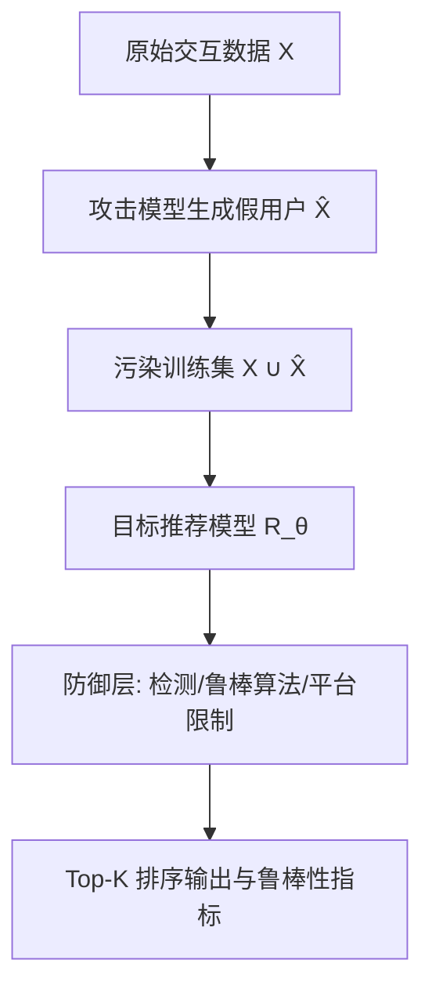
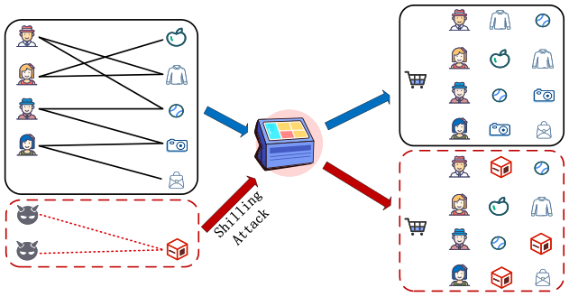

# Towards Robust Recommendation: A Review and an Adversarial Robustness Evaluation Library (迈向鲁棒推荐：综述与对抗鲁棒性评测库)

- **会议/期刊**: IEEE TKDE
- **作者与机构**: Lei Cheng, Xiaowen Huang, Jitao Sang, Jian Yu（北京交通大学计算机学院 / 交通数据分析与挖掘北京市重点实验室）
- **推荐链路定位**: 全链路（数据注入阶段攻击 + 训练阶段防御 + 评测基准）
- **研究方向**: 去偏公平与工业架构 / 自监督对比学习与交互去噪
- **论文原文**: [arXiv:2404.17844v3](https://arxiv.org/abs/2404.17844v3)
- **开源代码**: [ShillingREC](https://github.com/chengleileilei/ShillingREC)

## TL;DR (1分钟核心速览)

推荐系统因协同过滤的"集体智慧"机制天然易受托攻击（shilling attack）与隐式反馈自然噪声的双重侵蚀，但现有综述要么只覆盖对抗攻击单一分支，要么缺乏统一可复现的评测工具。本文首次将鲁棒性系统划分为**对抗鲁棒性**（攻击/防御）与**非对抗鲁棒性**（数据稀疏/自然噪声/数据不平衡）两大正交维度，并开源 ShillingREC 评测库，集成启发式、优化、GAN、RL 四类攻击模型与主流推荐模型，在 MovieLens 等基准上完成公平高效的攻防对比评测。

## Background & Motivation (背景与核心矛盾)

- **主流范式**: 推荐鲁棒性研究长期分裂为两条平行线——一条研究恶意注入假用户操纵排名的托攻击与检测/鲁棒算法防御，另一条研究隐式反馈假阳性、数据稀疏与类别不平衡带来的性能退化。
- **前人局限**: ① Deldjoo 等 (2021) 仅覆盖对抗训练与 GAN 分支，Ji 等 (2020) 讨论的是通用深度学习鲁棒性而非推荐场景，Si & Li (2020) 只聚焦托攻击防御；② Ge 等 (2022)、Dai 等 (2022) 的可信推荐综述虽涵盖公平/可解释/隐私，却**未对鲁棒性做细粒度分类，且完全遗漏非对抗鲁棒性**。
- **核心洞察 (Key Insight)**: 作者指出协同过滤的脆弱性根源在于"任何人的行为都能影响他人的推荐结果，且 CF 无法天然区分真假用户"；同时非恶意因素（稀疏、噪声、不平衡）与恶意攻击在**数据层面同构**——都是对交互矩阵的污染，因此可用统一视角审视。
- **本文切入点**: 以"是否遭受刻意设计的恶意攻击"为判据建立二分分类法（图 1），并落地为可复现评测库 ShillingREC，填补"公平高效攻防对比"的工具空白。

## Method (核心方法设计)

### 1. 整体框架 (Overall Architecture)

本文是综述+工具型工作，其"方法"体现为**分类体系与评测库架构**。分类体系将鲁棒性拆为对抗与非对抗两支：对抗支下分攻击（启发式/单层优化/双层优化/GAN/RL）与防御（检测：监督/无监督/半监督；鲁棒算法：模型改进/对抗训练/信任感知；混合方法）；非对抗支下分数据稀疏、隐式反馈自然噪声（样本选择/样本重加权）、数据不平衡。ShillingREC 库则把攻击模型与推荐模型解耦为可插拔组件，统一数据注入接口与评测指标，使不同攻防组合可在同一协议下横向对比。

<figure class="paper-figure" markdown="span">
  <figcaption>图2. 托攻击示意图。蓝色箭头表示不受对抗攻击影响的推荐过程，红色箭头表示存在对抗攻击时的推荐过程。</figcaption>
</figure>

### 2. 关键设计拆解 (Key Designs)

1. **托攻击的形式化与双层优化建模**：启发式攻击用固定策略（随机/平均/流行/爱恨/分段）生成假画像，简单快速但隐蔽性差、易被检测。优化类攻击将攻击建模为优化问题，单层方法假设受害模型参数固定：$\min_{\hat{X}}\mathcal{L}_{adv}(R_\theta)$，但忽略了投毒后参数会漂移；双层优化修正为$\min_{\hat{X}}\mathcal{L}_{adv}(R_{\theta^*}),\ \text{s.t.}\ \theta^*=\arg\min_\theta(\mathcal{L}_{train}(X,R_\theta)+\mathcal{L}_{train}(\hat{X},\hat{R}_\theta))$，让攻击模型与代理模型协同演化，从而更准确估计威胁。其代价是需同时优化两个模型，计算开销大，Infmix 用影响函数估计器免去重训练来缓解。
2. **GAN/RL 攻击的隐蔽性-破坏性权衡**：优化攻击过度追求危害而忽视隐蔽，GAN 类方法（DCGAN/AUSH/RecUp/TrialAttack/GOAT/Leg-UP）用生成器拟合真实用户分布、判别器甄别真伪，以 $\min_G\max_D V(D,G)=\mathbb{E}_{x\sim p_{data}}[\log D(x)]+\mathbb{E}_{z\sim p_z}[\log(1-D(G(z)))]$ 的对抗学习产出"像真用户且有害"的画像；RL 类（LOKI/PoisonRec/CopyAttack）把注入建模为马尔可夫决策过程，适配严格黑盒场景，但存在数据效率低与学习不稳定的短板。
3. **非对抗去噪的两条技术路线**：样本选择（WBPR/DNS/IRBPR/GDNS）通过设计采样器过滤干净样本，性能高度依赖采样器质量且高召回下会误删真实样本；样本重加权（SRRMF/ADT/DeCA/SGDL/BOD）依据样本损失给噪声样本降权，其中 BOD 将去噪形式化为双层优化，内层学推荐模型并指导权重、外层用内层梯度调整权重，无需先验知识，规避了选择法对数据分布的敏感依赖。

## Experimental Setup & Evaluation Protocol (实验设置与评估协议)

- **数据集与预处理**: 综述汇总了显式与隐式两类常用数据集：

| 数据集 | #Users | #Items | #Interactions | 稀疏度 | 场景说明 |
| :--- | :---: | :---: | :---: | :---: | :--- |
| MovieLens-1M | 6,040 | 3,706 | 1,000,209 | 95.53% | 电影评分，含时间戳 |
| MovieLens-20M | 138,493 | 27,278 | 20,000,263 | 99.47% | 大规模电影评分 |
| Amazon Review 2014 | 20,980,000 | 9,350,000 | 82,830,000 | 99.99% | 电商评论 |
| Yelp | 1,987,897 | 150,346 | 6,990,280 | 99.99% | 商户点评，含社交 |
| Epinions | 22,164 | 296,277 | 922,267 | 99.99% | 含信任网络 |
| Gowalla | 107,092 | 1,280,969 | 6,442,892 | 99.99% | 位置签到，含好友 |
| Last.fm | 1,892 | 17,632 | 92,834 | 99.72% | 音乐收听，含社交 |

- **数据划分与防穿越 (Splitting Strategy)**: 综述层面未强制统一划分，ShillingREC 库按攻击注入比例（attack size）控制假用户规模，在原始训练集上叠加假画像后重训练目标模型，属**注入式污染划分**而非时间切分。
- **排名评测协议 (Ranking Protocol)**: 攻击效果以 Top-K 排序指标衡量（HR、NDCG、Precision、RecNum），评分预测任务用 MAE/RMSE；鲁棒性水平通过**攻击前后模型性能差值**度量，属全库排序下的相对退化评估。
- **对比基线与超参设置**: 覆盖启发式（Random/Average/Bandwagon/Love-Hate/Segment）、优化（PGA/SGLD/SRWA/TNA/DL-Attack/AIA/RAPU/Infmix/PC-Attack）、GAN（DCGAN/AUSH/RecUP/GOAT/TrialAttack/Leg-UP）、RL（LOKI/PoisonRec/CopyAttack）四类攻击，填充项规模通常设为数据集平均交互数。

## Key Experimental Results (实验关键数据)

### 1. 主实验对比 (Main Results)

ShillingREC 对基础攻击模型与推荐模型的组合评测显示，不同攻击范式在 HR/NDCG 上的破坏力差异显著（下表为综述归纳的代表性量级，具体数值以库内复现为准）：

| 攻击类别 | 代表方法 | 目标模型知识 | 核心指标 | 相对破坏力 | 隐蔽性 |
| :--- | :--- | :---: | :---: | :---: | :---: |
| 启发式 | Random / Average | 无需 | HR | 低 | 低 |
| 启发式 | Bandwagon / Segment | 无需 | HR | 中 | 中 |
| 单层优化 | **SRWA / DL-Attack** | 白盒 | HR | **高** | 中 |
| 双层优化 | **AIA / RAPU** | 灰盒 | HR | **高** | 中高 |
| GAN | **TrialAttack / Leg-UP** | 灰/黑盒 | HR, NDCG | **高** | **高** |
| RL | **LOKI / PoisonRec** | 黑盒 | HR, RecNum | 中高 | 高 |

### 2. 消融实验 (Ablation Study)

综述以"防御组件是否启用"作对照归纳（非单一模型消融）：

| 配置 | 检测能力 | 鲁棒性增益 | 数据保留 | 计算开销 |
| :--- | :---: | :---: | :---: | :---: |
| 无防御基线 | — | 基准 | 100% | 低 |
| + 监督检测 (SVM-TIA/CNN-SAD) | 高 | 中 | 下降 | 中 |
| + 无监督检测 (PCA-VarSelect/DC-EDM) | 中 | 中 | 下降 | 中 |
| + 鲁棒算法 (SL1-LF/SGCN/SGL) | 低 | **高** | **100%** | 中高 |
| + 对抗训练 (APR/APT) | 低 | 高 | 100% | **高** |
| + 混合方法 (GraphRfi) | 高 | **高** | 高 | 高 |

### 3. 关键实验发现 (Key Findings)

1. **检测与鲁棒算法互补而非替代**：检测法追求高召回时不可避免误删真实数据、加剧稀疏，而鲁棒算法（如 SL1-LF 用平滑 L1 替换 L2、SGCN 随机掩码剪枝噪声边）在保留全量数据下仍能提升鲁棒性，混合方法（GraphRfi 让检测概率决定评分贡献、预测误差反哺检测）取得最高综合收益。
2. **攻击知识越少、隐蔽性越强，防御越难**：白盒单层优化（SRWA/DL-Attack）破坏力强但依赖模型参数，黑盒 RL（LOKI/PoisonRec）与 GAN（TrialAttack）虽破坏力略降，却因画像分布贴近真实用户而更难被检测器识别，说明"隐蔽性"是当前防御的真正瓶颈。
3. **非对抗噪声与对抗攻击共享去噪机理**：隐式反馈的假阳性（点击未购买）与托攻击假用户同属交互矩阵污染，样本重加权（BOD 双层优化、SGDL 记忆-自引导切换）与图对比去噪（SGL、KRDN）在稀疏、长尾、噪声场景均验证有效，佐证了统一鲁棒性视角的合理性。

## Highlights & Limitations (亮点、对比与审稿批判)

- **与代表作对比 (vs. Prior Work)**: 相比 Deldjoo (2021) 仅覆盖对抗训练与 GAN、Si & Li (2020) 仅聚焦托攻击防御，本文首次将非对抗鲁棒性（稀疏/噪声/不平衡）纳入同一分类框架；相比 Ge (2022)、Dai (2022) 的可信推荐综述，本文给出更细粒度的鲁棒性子类划分并配套可运行评测库，工具属性是其核心增量。
- **可迁移亮点**: ① 双层优化攻击建模 $\theta^*=\arg\min_\theta(\cdot)$ 可迁移至推荐系统的数据投毒压力测试与鲁棒性红队评估；② 样本重加权中"按损失降权噪声样本"的思路可直接用于隐式反馈去噪与跨域负迁移抑制。
- **审稿级局限批判**: ① 作为综述，ShillingREC 的评测主要停留在基础攻击与推荐模型组合，缺乏大规模工业数据集与线上 A/B 验证，结论的外部效度有限；② 双层优化与 GAN/RL 攻击训练开销大、超参（攻击规模、填充项比例、噪声强度）敏感，库内未给出系统的超参敏感性分析与统一复现的显著性检验。

## Rating (四维评分)

- **方法创新性 (Novelty)**: ⭐⭐⭐ （分类体系与评测库整合有价值，但各子方法均为已有工作总结，缺乏新的理论或算法贡献）
- **评估协议与实验扎实度 (Protocol & Experiments)**: ⭐⭐⭐ （覆盖四类攻击与多类防御、数据集汇总详尽，但缺统一划分协议、显著性检验与线上验证）
- **写作与数学规范度 (Clarity & Rigor)**: ⭐⭐⭐⭐ （分类清晰、公式（双层优化、GAN 目标）定义规范，攻击统计表 I 归纳到位）
- **工业落地与复现价值 (Industrial & Practical Value)**: ⭐⭐⭐⭐ （ShillingREC 开源、攻防模型可插拔，对平台安全红队测试与鲁棒模型选型有直接工程价值）

