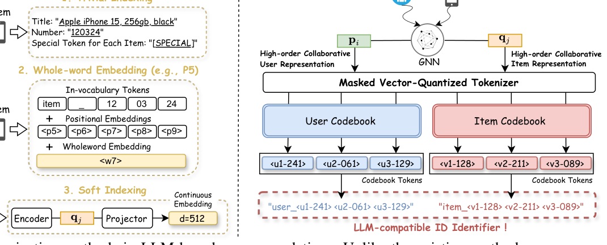
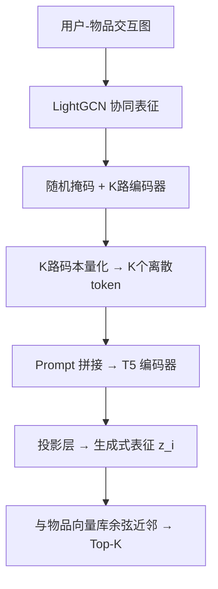
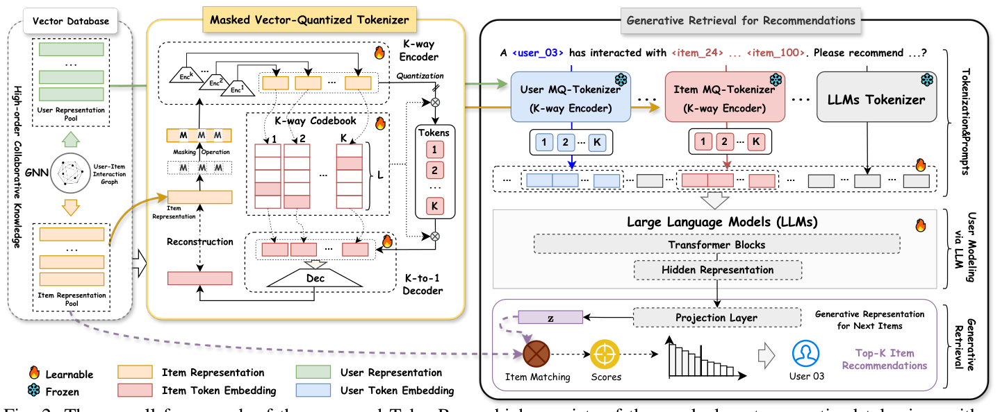

# TokenRec: Learning to Tokenize ID for LLM-based Generative Recommendation (面向LLM生成式推荐的可学习ID分词)

- **会议/期刊**: IEEE TKDE
- **作者与机构**: Haohao Qu, Wenqi Fan, Zihuai Zhao, Qing Li（香港理工大学 COMP / MM）
- **推荐链路定位**: 端到端生成式（召回级生成式检索）
- **研究方向**: 生成式推荐与离散语义ID / 大语言模型推荐
- **论文原文**: [https://arxiv.org/abs/2406.10450v3](https://arxiv.org/abs/2406.10450v3)
- **开源代码**: [https://github.com/Quhaoh233/TokenRec](https://github.com/Quhaoh233/TokenRec)

## TL;DR (1分钟核心速览)

LLM4Rec 的核心卡点是用户/物品 ID 如何变成 LLM 能吃的 token：独立索引会撑爆词表，标题索引丢协同信号，软索引又与离散词表错位。TokenRec 提出掩码向量量化分词器（MQ-Tokenizer），把 LightGCN 学到的协同表征经"随机掩码 + K 路编码器 + K 路码本"压成少量 OOV 离散 token，再用生成式检索（LLM 输出隐向量直接与物品向量库做余弦近邻）替代自回归解码。在 LastFM/ML1M/Beauty/Clothing 四个数据集、Leave-One-Out + 全库排序协议下，HR@20 较最强基线平均提升约 19.08%，推理时延降低 10–14 倍。

## Background & Motivation (背景与核心矛盾)

- **主流范式**: LLM4Rec 把推荐改写成"文本到文本"任务（P5、POD、TIGER、CoLLM），关键前置步骤是把用户/物品 ID 映射为 LLM 词表中的 token。
- **前人局限一（协同知识缺失）**: 标题索引（P5 的 whole-word embedding）与语义 ID（TIGER 的 RQ-VAE）只编码内容语义，无法把高阶协同信号写进 token；CID 仅用共现矩阵，粒度粗。
- **前人局限二（泛化与效率）**: 软索引（CoLLM/LlaRA）用连续 embedding 与 LLM 离散词表天然错位；且几乎所有方法推理时都要自回归解码 + beam search，单用户耗时近百毫秒，且新用户/新物品必须重训。
- **核心洞察 (Key Insight)**: 若把 GNN 协同表征空间中的近邻关系"保序"地映射为码本索引，则共享 token 即隐含协同相似性——token 本身就成了协同知识的载体。
- **本文切入点**: 用带掩码与 K 路并行的 VQ 分词器做"协同感知的离散化"，并把 LLM 从"生成文本"改为"生成查询向量"。

<figure class="paper-figure" markdown="span">
  <figcaption>图 1：基于 LLM 的推荐中 ID 分词方法的比较。与现有方法不同，我们的方法利用高阶协同知识，能够使用 LLM 兼容的 token 对用户和物品进行分词。</figcaption>
</figure>

## Method (核心方法设计)

### 1. 整体框架 (Overall Architecture)

两阶段解耦训练：**阶段一**用 LightGCN 预训练得到用户/物品协同表征 $\mathbf{p}_i,\mathbf{q}_j$存入向量库，再分别训练用户与物品的 MQ-Tokenizer（结构相同），把每个实体压成$K$个离散码本 token；**阶段二**冻结分词器，将 token 序列填入 prompt 送入 T5 编码器，取隐状态经投影层得到"下一物品的生成式表征"$\mathbf{z}_i$，与物品向量库做余弦近邻检索返回 Top-$K$。全程无自回归解码。

<figure class="paper-figure" markdown="span">
  <figcaption>图 2：所提出的 TokenRec 的整体框架，由用于物品 ID 分词的带 K 路编码器的掩码向量量化分词器，以及用于推荐生成的生成式检索范式组成。注意，我们详细展示了物品 MQ-Tokenizer，而为了简洁省略了用户 MQ-Tokenizer。</figcaption>
</figure>

### 2. 关键设计拆解 (Key Designs)

1. **掩码向量量化分词器（MQ-Tokenizer）**：朴素 VQ 在"用户→物品"级联分词中会累积传播误差、且对未见实体脆弱。本文先对协同表征做逐元素伯努利掩码 $\mathbf{q}'_j=\text{Mask}(\mathbf{q}_j,\mathcal{E}),\ \mathcal{E}\sim\text{Bernoulli}(\rho)$，再送入$K$个独立 MLP 编码器得到$\mathbf{a}^k_j=\text{MLP}_k(\mathbf{q}'_j)$，各自在子码本$\mathbf{c}_k$中取最近码字$w^k_j=\arg\min_l\|\mathbf{a}^k_j-\mathbf{c}^k_l\|_2$。掩码迫使分词器从残缺输入恢复码字，等价于对表征做数据增广，从而在推理时对新增实体的表征扰动更鲁棒；K 路并行则让不同子空间捕捉不同协同模式，避免单码本容量瓶颈。

2. **K-to-1 解码与三重损失**：$K$个码字嵌入平均池化后经三层 MLP 重建$\mathbf{r}_j=\text{MLP}(\frac{1}{K}\sum_k \mathbf{c}^k_{w^k_j})$，总目标为
$$\mathcal{L}^{\text{Item}}_{MQ}=\underbrace{\|\mathbf{q}_j-\mathbf{r}_j\|^2}_{\text{重建}}+\underbrace{\sum_k\|\text{sg}[\mathbf{a}^k_j]-\mathbf{c}^k_{w^k_j}\|^2}_{\text{码本}}+\beta\underbrace{\sum_k\|\mathbf{a}^k_j-\text{sg}[\mathbf{c}^k_{w^k_j}]\|^2}_{\text{承诺}}$$
其中 $\arg\min$ 不可导，用 straight-through 估计器把解码器梯度直传编码器；码本损失只更新码字、承诺损失只更新编码器，二者用 stop-gradient 分离，避免码字与编码器互相拖拽导致的码本坍缩。

3. **生成式检索与训练目标**：LLM 主干只做编码器，$\mathbf{h}_i=\text{LLM4Rec}(X_i)$，$\mathbf{z}_i=\text{Proj}(\mathbf{h}_i)$，打分$y_{ij}=\cos(\mathbf{z}_i,\mathbf{q}_j)$。微调用 pairwise margin 损失：正样本$1-\text{sim}(\mathbf{z}_i,\mathbf{q}_j)$，负样本$\max(0,\text{sim}(\mathbf{z}_i,\mathbf{q}_j)-\gamma)$，负采样为**全库均匀 1:1 随机负采样**（非 in-batch、非难负样本），margin$\gamma\in[0,0.2]$。推理仅一次前向 + ANN 检索，彻底绕开 beam search。

## Experimental Setup & Evaluation Protocol (实验设置与评估协议)

- **数据集与预处理**:

| 数据集 | #Users | #Items | #Interactions | 密度 | 场景说明 |
| :--- | :---: | :---: | :---: | :---: | :--- |
| LastFM | 1,090 | 3,646 | 37,080 | 0.9330% | 音乐艺人收听 |
| ML1M | 6,040 | 3,416 | 447,294 | 2.1679% | 电影评分 |
| Beauty | 22,363 | 12,101 | 197,861 | 0.0731% | 亚马逊美妆 |
| Clothing | 23,033 | 39,387 | 278,641 | 0.0307% | 亚马逊服装 |

  交互序列截断至最长 100，以适配 T5 的 512 token 上下文。

- **数据划分与防穿越**: `Leave-One-Out`（最后一条交互作测试、倒数第二条作验证）；且**刻意打乱用户历史顺序**，以对齐协同过滤的非时序设定，避免序列泄漏。
- **排名评测协议**: 全库 `Full-Ranking`（对全部未交互物品排序），指标 HR@{10,20,30} 与 NDCG@{10,20,30}，测试集全用户平均。
- **对比基线与超参**: 5 类共 14 个基线——CF（MF/NCF/LightGCN/GTN/LTGNN）、序列（BERT4Rec/SASRec/S3Rec/CoSeRec）、LLM4Rec（P5-RID/P5-SID/CID/POD/TIGER/TIGER-G/CoLLM）。所有 LLM 方法统一用 T5-small 保证公平；码本数 $K\in\{1..5\}$、子码本容量$L\in\{128,256,512,1024\}$、掩码率$\rho\in[0,1]$步长 0.1，默认$K=3$、$\rho=0.2$；单卡 A800 训练。

## Key Experimental Results (实验关键数据)

### 1. 主实验对比 (Main Results)

| 模型 | LastFM HR@20 | LastFM N@20 | ML1M HR@20 | ML1M N@20 | Beauty HR@20 | Beauty N@20 | Clothing HR@20 | Clothing N@20 |
| :--- | :---: | :---: | :---: | :---: | :---: | :---: | :---: | :---: |
| LightGCN | 0.0661 | 0.0269 | 0.1288 | 0.0509 | 0.0498 | 0.0233 | 0.0226 | 0.0103 |
| LTGNN | 0.0760 | 0.0318 | 0.1387 | 0.0570 | 0.0564 | 0.0252 | 0.0218 | 0.0110 |
| P5-SID | 0.0536 | 0.0255 | 0.1380 | 0.0550 | 0.0516 | 0.0231 | 0.0222 | 0.0086 |
| CID | 0.0552 | 0.0260 | 0.1294 | 0.0525 | 0.0516 | 0.0236 | 0.0226 | 0.0087 |
| TIGER | 0.0749 | 0.0306 | 0.1382 | 0.0562 | 0.0574 | 0.0248 | 0.0225 | 0.0087 |
| TIGER-G | 0.0767 | 0.0310 | 0.1409 | 0.0565 | 0.0586 | 0.0251 | 0.0227 | 0.0088 |
| CoLLM | 0.0786 | 0.0319 | 0.1499 | 0.0620 | 0.0606 | 0.0259 | 0.0218 | 0.0091 |
| **TokenRec** | **0.0936** | **0.0348** | **0.1677** | **0.0697** | **0.0615** | **0.0276** | **0.0240** | **0.0112** |
| Improv.% (vs 最强基线) | +19.08% | +9.09% | +11.87% | +12.42% | +1.49% | +6.56% | +5.73% | +8.74% |

### 2. 消融实验 (Ablation Study)

| 变体 | LastFM HR@20 | LastFM N@20 | Beauty HR@20 | Beauty N@20 |
| :--- | :---: | :---: | :---: | :---: |
| Full TokenRec | **0.0936** | **0.0348** | **0.0615** | **0.0276** |
| w/o Masking | 0.0848 | 0.0332 | 0.0573 | 0.0253 |
| w/o K-way | 0.0820 | 0.0309 | 0.0592 | 0.0250 |
| w/o HOCK（改用 MF 表征） | 0.0549 | 0.0172 | 0.0407 | 0.0149 |
| 替换为 RQ-VAE | 0.0831 | 0.0314 | 0.0596 | 0.0253 |
| 替换为 VQ-VAE | 0.0810 | 0.0308 | 0.0589 | 0.0247 |
| 替换为 K-Means | 0.0750 | 0.0281 | 0.0567 | 0.0237 |

### 3. 关键实验发现 (Key Findings)

1. **协同表征质量是天花板**：去掉高阶协同知识（MF 替代 LightGCN）后 LastFM HR@20 从 0.0936 暴跌至 0.0549（−41.3%），跌幅远超掩码（−9.4%）与 K 路（−12.4%）的移除，说明分词器的收益上限由底层 GNN 表征质量决定，量化模块只是"保真搬运工"。
2. **效率是数量级而非百分比优势**：Top-20 单用户推理时延 TokenRec 为 5.76–8.43 ms，而 P5/CID/POD 约 85–101 ms、TIGER 约 76–86 ms，加速 1046%–1402%；同时"仅用用户 ID token"（无交互历史）的变体仍超过多数基线，证明协同知识已被压进用户 token 本身，可规避 LLM 上下文长度限制。
3. **泛化来自分词器而非重训**：剔除 5% 交互最少用户作 unseen 用户后，P5/POD 的 HR@20 跌幅超 40%，CoLLM/CID 仍跌逾 20%，而 TokenRec 在 Beauty 上仅跌约 7%（0.0629→0.0591），只需更新 GNN 与向量库即可服务新实体；TIGER 因引入物品文本语义 ID 跌幅仅 6.10%，说明内容侧信息与协同侧信息具有互补的冷启动价值。

## Highlights & Limitations (亮点、对比与审稿批判)

- **与代表作对比**: 相比 **TIGER**（RQ-VAE 残差量化 + 语义 ID + 序列到序列自回归），本文量化对象换成 GNN 协同表征、量化结构换成并行 K 路 + 掩码、解码换成向量检索，三点同时改动；相比 **CoLLM**（连续软 embedding 拼进 LLM 输入），本文坚持离散 token 以贴合 LLM 词表本质；相比 **P5**（标题/整词索引），本文用极少量 OOV token（Clothing 上仅 3×512=1536 个 token 覆盖 39,387 个物品）实现词表零膨胀。
- **可迁移亮点**: ①"掩码 + 多码本并行"的量化正则化可直接移植到任何 RQ-VAE/VQ 语义 ID 流水线以提升冷启动鲁棒性；②"LLM 输出查询向量 + 向量库近邻"的生成式检索范式可替换任意 LLM4Rec 的自回归解码，是低成本的工业级时延优化手段。
- **审稿级局限批判**: ①负采样仅为全库均匀 1:1，未探索难负样本或 in-batch 负样本，pairwise margin 损失的判别力可能被低估，且未报告方差/显著性检验；②掩码率 $\rho$、码本数$K$、容量$L$三个超参均需按数据集规模网格搜索（小数据集$L=256$、大数据集$L=512$），缺乏自适应设定准则；③生成式检索依赖离线 LightGCN 向量库，物品表征更新存在滞后，且论文未给出大规模（亿级）物品下 ANN 索引的召回损失分析。

## Rating (四维评分)

- **方法创新性 (Novelty)**: ⭐⭐⭐⭐ （把"掩码自监督 + K 路并行码本"引入协同 ID 分词，思路清晰但属 VQ 变体的组合式创新，缺乏理论层面的码本容量/误差界分析）
- **评估协议与实验扎实度 (Protocol & Experiments)**: ⭐⭐⭐⭐ （四数据集 + 全库排序 + 14 个基线 + 泛化/效率/消融/超参四组实验相当完整，扣分在于无显著性检验与难负样本对比）
- **写作与数学规范度 (Clarity & Rigor)**: ⭐⭐⭐⭐ （三重损失与 stop-gradient 的职责划分交代清楚，公式编号完整；但 Eq.20 的分段损失写法略欠紧凑，部分符号如 $\lambda$ 与负采样比例混用易混淆）
- **工业落地与复现价值 (Industrial & Practical Value)**: ⭐⭐⭐⭐⭐ （代码开源、仅需 T5-small、推理提速一个数量级、新实体只需更新 GNN 与向量库，工程可落地性在同类 LLM4Rec 工作中属上乘）

