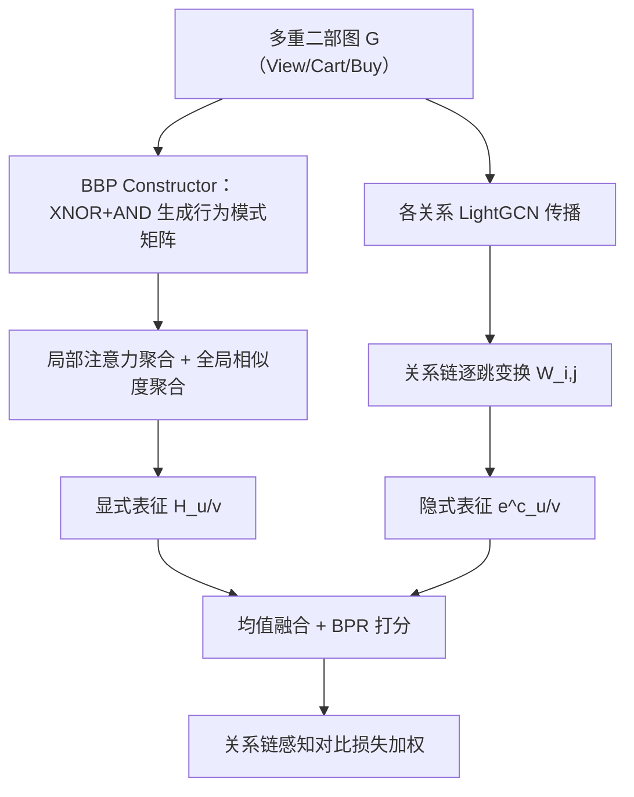
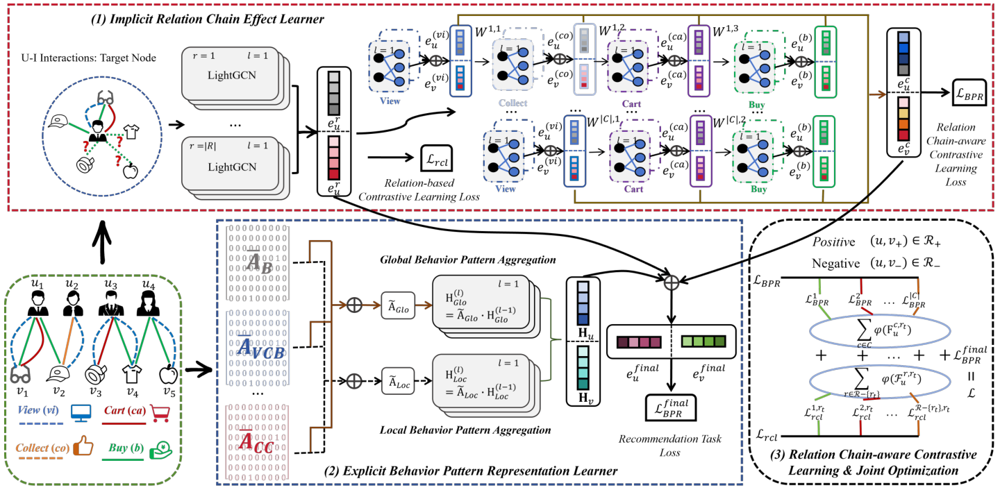

# Dual-Channel Multiplex Graph Neural Networks for Recommendation (面向推荐的双通道多路图神经网络)

- **会议/期刊**: IEEE TKDE 2025, Vol.37 No.6
- **作者与机构**: Xiang Li, Chaofan Fu, Zhongying Zhao, Guanjie Zheng, Chao Huang, Yanwei Yu*, Junyu Dong（中国海洋大学、山东科技大学、上海交通大学、香港大学）
- **推荐链路定位**: 召回（多行为协同过滤表征学习）
- **研究方向**: 图神经网络与知识图谱推荐 / 自监督对比学习
- **论文原文**: [https://arxiv.org/abs/2403.11624v5](https://arxiv.org/abs/2403.11624v5)
- **开源代码**: 暂未开源

## TL;DR (1分钟核心速览)

多行为推荐中，现有方法把 View/Cart/Buy 等多路关系当作可加性信号聚合，既未显式刻画"哪些关系共现构成一种行为模式"，也忽略了同一模式内辅助关系对目标关系的**有序依赖**。DCMGNN 提出双通道多路 GNN：显式通道用 BBP（基本行为模式）矩阵做局部注意力+全局相似度聚合，隐式通道用关系链（如 $\langle View \to Cart \to Buy\rangle$）做逐跳变换，并以关系链感知对比学习为不同链定制损失权重。在 Retail/Tmall/Yelp 三数据集、70/10/20 比例划分+等量负采样协议下，Recall@10 与 NDCG@10 平均超越最优基线 10.06% 与 12.15%。

## Background & Motivation (背景与核心矛盾)

- **主流范式**: 多行为推荐以 LightGCN 为骨架，在统一 U-I 图上按关系类型分别传播再聚合（MBGCN、MB-CGCN、CML、KMCLR），或引入元路径/图解耦/对比学习区分行为语义。
- **前人局限一**: 多路关系被当作"单层交互的线性组合"，无法区分 $u_1\!-\!v_1$的$\langle View, Cart, Buy\rangle$与$u_4\!-\!v_5$的$\langle View, Buy\rangle$——缺失 Cart 这一过渡步意味着完全不同的购买意图强度。
- **前人局限二**: 模式内各辅助关系对目标关系的贡献并非可加：高频 View 只反映初始兴趣，低频 Cart 才代表审慎意图；且关系间存在顺序依赖，现有方法（除 NMTR/MB-CGCN 的级联设计外）普遍忽略。
- **核心洞察 (Key Insight)**: 多路交互天然构成多重二部图，其"关系共现组合"（BBP）与"关系先后次序"（关系链）是两类互补信息，应分别从显式结构与隐式依赖两个通道建模。
- **本文切入点**: 用 BBP 矩阵显式编码行为模式，用可学习变换矩阵刻画关系链逐跳传播，再用链感知对比权重把辅助关系的影响注入目标关系预测。

## Method (核心方法设计)

### 1. 整体框架 (Overall Architecture)

输入为多重二部图 $\mathcal{G}=\{\mathcal{U},\mathcal{V},\mathbf{X},\mathcal{E}\}$。显式通道先由 BBP Constructor 通过 XNOR+AND 逻辑运算从$|\mathcal{R}|$个关系邻接矩阵生成全部$2^{|\mathcal{R}|}-1$个 BBP 矩阵；再分别做局部（BBP 注意力加权）与全局（BBP 频率相似度）LightGCN 聚合，均值池化得$\mathbf{H}_{u/v}$。隐式通道对每个关系跑 LightGCN 得关系专属嵌入，再沿预定义关系链逐跳做特征变换得$\mathbf{e}^c_{u/v}$。三路嵌入取均值作为最终表征，配合 BPR 与两级对比损失联合优化。

<figure class="paper-figure" markdown="span">
  <figcaption>图 1：所提出的 DCMGNN 的总体框架。¯AB、¯AV CB 和 ¯ACC 是包含相应关系的 BBP 矩阵，其中 B 表示“Buy”，V CB 表示“View”、“Cart”和“Buy”，CC 表示“Collect”和“Cart”。</figcaption>
</figure>

### 2. 关键设计拆解 (Key Designs)

1. **显式行为模式学习器（BBP 双视角聚合）**：痛点是把多关系当线性叠加。做法是对每个 BBP 矩阵 $\mathbf{A}_i$赋可学习注意力$a_i$得$\tilde{\mathbf{A}}_{loc}=\sum_{i=1}^{N}a_i\mathbf{A}_i$，同时按列求和构造模式频率矩阵$\mathbf{Q}=\big(\oplus_{i=1}^{N}\mathbf{Q}_i\big)\Lambda_b$，归一化相似度$\tilde{\mathbf{A}}_{glo}=\mathrm{norm}(\mathbf{Q}\mathbf{Q}^{\top})$ 作为全局图。局部刻画"哪些模式重要"，全局刻画"行为相似的用户"，二者互补弥补了单一 BBP 聚合对跨用户共性的忽视。

2. **隐式关系链效应学习器（有序依赖建模）**：痛点是辅助关系对目标关系的影响有先后。对第 $i$条链的第$j$跳，用可学习矩阵做$\mathbf{e}^{[i,j+1]}_{u/v}=\mathbf{W}^{i,j}_{u/v}\mathbf{e}^{[i,j]}_{u/v}$，再对全部链求和得$\mathbf{e}^c_{u/v}$。由于链尾固定为目标关系，前序关系的语义被逐级"搬运"到 Buy 表征中，等价于一条可微的软元路径。

3. **关系链感知对比学习与联合优化**：先用 InfoNCE 区分同用户不同关系（正样本=同用户异关系，负样本=异用户），再构造链感知知识 $\mathbf{F}^{c,rt}_u=(\mathrm{dup}(\sum_{r\in c}\mathcal{L}^{r,rt}_{rcl})\cdot\mu)\oplus\mathbf{e}^c_u\oplus\mathbf{e}^{final}_u$，经 LeakyReLU 映射为每条链 BPR 损失与每类关系对比损失的**定制权重**。总损失$\mathcal{L}=\mathcal{L}_{finalBPR}+\lambda_1\mathcal{L}_{rcl}+\lambda_2\mathcal{L}_{BPR}$，负采样为等量随机负样本（非难负采样），推理为内积全库排序。

## Experimental Setup & Evaluation Protocol (实验设置与评估协议)

- **数据集与预处理**:

| 数据集 | #Users | #Items | #Interactions | 关系类型 | 目标关系/关系链 |
| :--- | :---: | :---: | :---: | :---: | :--- |
| Retail | 2,174 | 30,113 | 9.7×10⁴ | View, Cart, Buy | Buy / ⟨V→C→B⟩ |
| Tmall | 15,449 | 11,953 | 1.2×10⁶ | View, Cart, Buy | Buy / ⟨V→C→B⟩ |
| Yelp | 19,800 | 22,734 | 1.4×10⁶ | Tips, Like, Neutral, Dislike | Like / ⟨N→T→L⟩ |

- **数据划分与防穿越**: 正样本按 **70%/10%/20%** 比例随机划分为训练/验证/测试，非全局时间戳切分，存在轻度未来信息泄漏风险。
- **排名评测协议**: **Sampled Ranking**——训练与测试均随机采样与正样本等量的负样本，报告 R@{5,10,20,40} 与 N@{5,10,20,40}，非 Full-Ranking。
- **对比基线与超参**: 22 个基线，含单行为（BPR/LightGCN/HCCF/DCCF/AutoCF/LightGCL）与多行为（MBGCN/MB-CGCN/CRGCN/BPHGNN/S-MBRec/NMTR/MBGMN/MBA/HPMR/CML/KMCLR 等）；$d$搜索于$\{8,\dots,256\}$最优 64，LightGCN 层数最优$L=3$，$\tau=0.1$，$\mu=0.98$，Xavier 初始化，10 次重复取均值，$t$-test$p<0.01$ 显著性标记。

## Key Experimental Results (实验关键数据)

### 1. 主实验对比 (Main Results)

| 方法 | Retail R@10 | Retail N@10 | Tmall R@10 | Tmall N@10 | Yelp R@10 | Yelp N@10 |
| :--- | :---: | :---: | :---: | :---: | :---: | :---: |
| LightGCN | 0.0383 | 0.0209 | 0.0411 | 0.0240 | 0.0191 | 0.0119 |
| LightGCL | 0.0409 | 0.0229 | 0.0441 | 0.0255 | 0.0249 | 0.0149 |
| MB-CGCN | 0.0418 | 0.0249 | 0.1233 | 0.0660 | 0.0573 | 0.0285 |
| BPHGNN | 0.0376 | 0.0217 | 0.0991 | 0.0641 | 0.0537 | 0.0275 |
| MBA | 0.0428 | 0.0251 | 0.1230 | 0.0665 | 0.0578 | 0.0296 |
| CML | 0.0428 | 0.0247 | 0.1203 | 0.0661 | 0.0577 | 0.0294 |
| KMCLR | 0.0428 | 0.0251 | 0.1215 | 0.0659 | 0.0578 | 0.0297 |
| **DCMGNN** | **0.0471** | **0.0287** | **0.1379** | **0.0727** | **0.0626** | **0.0333** |
| Improv.% | +10.05% | +14.34% | +11.84% | +9.98% | +8.30% | +12.12% |

### 2. 消融实验 (Ablation Study)

| 变体 | 移除组件 | 性能趋势（R@10 / N@10） |
| :--- | :--- | :--- |
| w/o EBP | 显式行为模式学习器 | 显著下降，验证显式模式建模必要性 |
| w/o MRE | 多关系嵌入聚合 | 下降，说明多关系信息不可省略 |
| w/o RCR | 关系链表征学习 | **降幅最大**，链式依赖是核心增益源 |
| w/o RCL | 关系级对比学习 | 降幅次大，关系区分度关键 |
| w/o RCE | 关系链感知编码器 | 下降，链感知加权有效 |
| w/o FNL | 最终 BPR 损失 | 下降，联合优化必要 |

### 3. 关键实验发现 (Key Findings)

1. **关系链是最大增益源**：消融中 `w/o RCR` 性能最差，且关系顺序实验显示目标关系置于链尾的 $C_5/C_6$ 一致优于其他 4 种排列，证明"View→Cart→Buy"的因果递进顺序本身携带信息，而非任意组合等价。
2. **稀疏用户上优势更明显**：按交互度数分 6 组（[0,4) 至 [10,60)）后，DCMGNN 在低度数组相对 CML/KMCLR 的领先幅度更大，说明 BBP 全局相似度聚合起到了跨用户行为补全作用。
3. **收敛效率优于精度相近的基线**：单 epoch 耗时略高于 MB-CGCN/CML，但总收敛时间最短且训练损失下降最快，说明对比权重机制加速了优化而非单纯堆叠算力。

## Highlights & Limitations (亮点、对比与审稿批判)

- **与代表作对比**: 相比 BPHGNN（仅显式 BBP 建模，忽略辅助关系对目标关系的影响），本文补上了关系链通道；相比 CML（对比学习捕捉行为依赖但无显式模式结构），本文增加了 BBP 局部+全局双视角；相比 MB-CGCN（级联 GCN 但受残差设计限制只能用单层），本文的链式变换支持多层且可学习。
- **可迁移亮点**: (1) 用 XNOR+AND 逻辑运算从多关系邻接矩阵批量构造组合模式矩阵，可低成本迁移到任意多行为/多场景图；(2) 把对比损失系数做成由链结构生成的样本级权重，这一"元损失加权"思路可复用到多任务精排的损失平衡。
- **审稿级局限批判**: (1) BBP 矩阵数量随关系类型指数增长（$2^{|\mathcal{R}|}-1$），Yelp 四关系已需 15 个$N\times N$矩阵，工业场景十几种行为时空间复杂度$O((N+1)N^2)$ 难以承受；(2) 评估采用等量负采样的 Sampled Ranking 而非 Full-Ranking，且 70/10/20 随机划分未做时间切分，指标可能偏乐观，缺少线上 A/B 验证。

## Rating (四维评分)

- **方法创新性 (Novelty)**: ⭐⭐⭐⭐ （双通道显式模式+隐式关系链的分解视角清晰，链感知对比加权有巧思，但各组件均为已有技术的组合式创新）
- **评估协议与实验扎实度 (Protocol & Experiments)**: ⭐⭐⭐ （22 基线+三数据集+显著性检验充分，但 Sampled Ranking 与随机划分削弱说服力，缺 Full-Ranking 与线上验证）
- **写作与数学规范度 (Clarity & Rigor)**: ⭐⭐⭐⭐ （符号表完整、复杂度分析到位、消融与参数敏感性齐全，部分公式如 Eq.17 的 dup 与 $\mu$ 作用解释略含糊）
- **工业落地与复现价值 (Industrial & Practical Value)**: ⭐⭐⭐ （BBP 指数级矩阵开销限制大规模部署，且未开源，但关系链建模与损失加权思路对多行为电商场景有直接参考价值）

