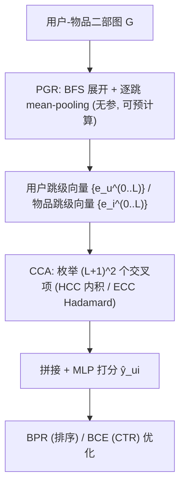
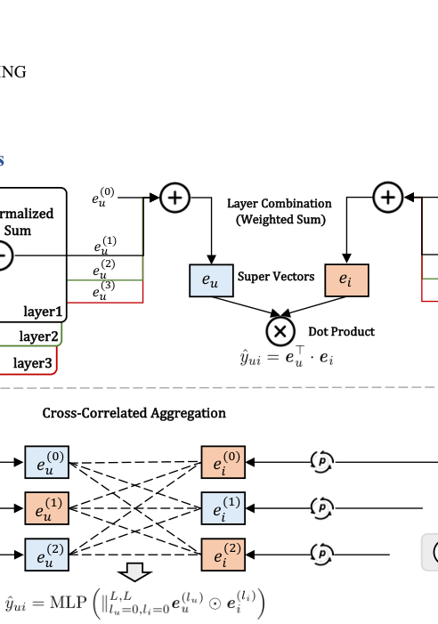
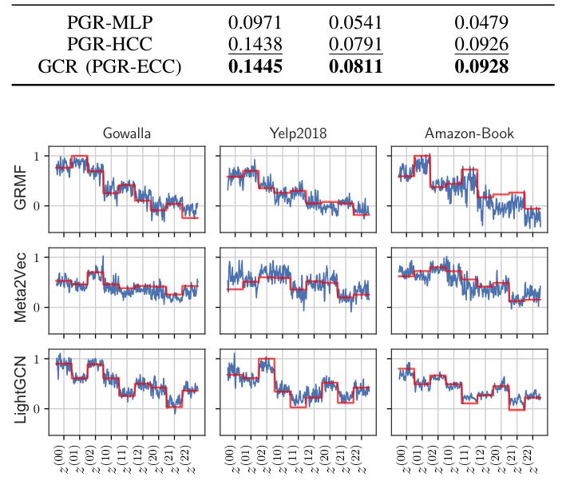

# Graph Cross-Correlated Network for Recommendation (图交叉相关推荐网络)

- **会议/期刊**: IEEE TKDE
- **作者与机构**: Hao Chen, Yuanchen Bei, Wenbing Huang, Shengyuan Chen, Feiran Huang, Xiao Huang（澳门城市大学、浙江大学、中国人民大学、香港理工大学、暨南大学）
- **推荐链路定位**: 精排 / 通用相关性打分函数（可插拔于召回后排序与 CTR 预估）
- **研究方向**: 图神经网络与知识图谱推荐 / CTR 预估与特征交叉
- **论文原文**: [https://arxiv.org/abs/2411.01182v1](https://arxiv.org/abs/2411.01182v1)
- **开源代码**: 暂未开源

## TL;DR (1分钟核心速览)

现有 GNN 推荐把用户/物品子图递归卷积后压成单一 super vector 再做内积，导致各跳邻居的异质语义被混合、交叉信息被内积结构性地抹掉。本文提出 GCR：先用无参、非递归的 PGR 逐跳读出纯语义向量，再用 HCC（跳级内积）或 ECC（元素级 Hadamard）枚举全部 $(L+1)^2$ 个交叉相关项并交由 MLP 灵活加权。在 Gowalla/Yelp2018/Amazon-Book 的 Full-Ranking 协议下，NDCG@20 相对最强基线 SimGCL 提升 1.05%–2.92%，且作为即插模块使 DIN 的 AUC 相对提升 2.79%（Amazon-Book）。

## Background & Motivation (背景与核心矛盾)

- **主流范式**: NGCF/LightGCN 类模型在二部图上递归传播消息，将各层图嵌入拼接或加权求和为 super vector，最终以 $\boldsymbol{e}_u^\top\boldsymbol{e}_i$ 推断相关性；CTR 侧则以 DIN/DIEN 等对行为序列做注意力池化。
- **前人局限**: 其一，用户-物品二部图是异质图，1 跳邻居是"历史交互物品"、2 跳是"兴趣相似用户"，语义截然不同，递归卷积把不同跳的信息混为一谈，得到"不纯"的跳级表示；其二，即便拿到多层表示，NGCF 的拼接内积等价于 $\sum_l \boldsymbol{e}_u^{(l)\top}\boldsymbol{e}_i^{(l)}$，只保留对角项，跨跳的$z^{(l_u,l_i)}$（$l_u\neq l_i$）被结构性丢弃，LightGCN 更只有$2(L+1)$ 个自由度。
- **核心洞察 (Key Insight)**: 交叉项本身有明确物理语义——$\boldsymbol{e}_u^{(0)\top}\boldsymbol{e}_i^{(1)}$刻画"目标用户与点击过该物品的用户群"的相关性，$\boldsymbol{e}_u^{(0)\top}\boldsymbol{e}_i^{(2)}$ 刻画"目标用户与目标物品的二跳相似物品"的相关性；这些视角互补，应被显式建模而非隐式抹平。
- **本文切入点**: 用"先展开、再逐跳聚合"的非递归表示替代递归卷积，把相关性函数从固定内积换成可学习的交叉相关聚合器。

## Method (核心方法设计)

### 1. 整体框架 (Overall Architecture)

GCR 将相关性函数重写为 $\hat{y}_{ui}=\mathrm{CCA}(\mathrm{PGR}(u),\mathrm{PGR}(i))$。PGR 阶段对每个节点做 BFS 展开，得到$\{\mathcal{N}_j^{(0)},\dots,\mathcal{N}_j^{(L)}\}$，对每一跳独立做 mean-pooling 读出$\boldsymbol{e}_j^{(l)}$，该过程无参数、可预计算并入库；CCA 阶段枚举用户侧与物品侧全部跳级组合，构造$(L+1)^2$ 个交叉项，拼接后经单隐层 MLP 输出打分。训练时 PGR 冻结、仅优化 CCA 参数与底层 ID 嵌入；推理时 PGR 向量直接查表，在线开销仅一次 MLP 前向。

<figure class="paper-figure" markdown="span">
  <figcaption>图 2. (a) 与 (b)：现有推荐模型的示意图；(c)：我们提出的 GCR 的整体框架架构。(a) 基于 CF 的推荐模型利用学习到的用户/物品嵌入的点积来推断用户-物品交互。(b) 基于 GNN 的推荐模型首先执行图卷积以生成多跳邻居的嵌入。随后将这些嵌入组合以构建超向量，用于进行预测。(c) GCR 首先通过 Plain Graph Representation 提取图嵌入，然后灵活考虑所有潜在的交叉相关项。</figcaption>
</figure>

### 2. 关键设计拆解 (Key Designs)

1. **Plain Graph Representation (PGR，逐跳纯语义读出)**：针对递归卷积混合异质节点、放大噪声边的问题，PGR 放弃逐层消息传递，改为一次性展开子图后对每跳独立池化：
$$\boldsymbol{e}_j^{(l)}=\frac{1}{|\mathcal{N}_j^{(l)}|}\sum_{k\in\mathcal{N}_j^{(l)}}\boldsymbol{e}_k^{(0)},\quad l=0,\dots,L$$
由于不跨类型混叠嵌入，用户与物品的个性化表示保持纯净；mean-pooling 对观测噪声与缺失边更鲁棒；且无参数、可并行预计算，避免了高阶 GNN 的过平滑。

2. **Cross-Correlated Aggregation (CCA，显式交叉项建模)**：针对内积只保留对角项的问题，CCA 枚举全部跳级对。HCC 用跳级内积 $z_{ui}^{(l_u,l_i)}=\boldsymbol{e}_u^{(l_u)\top}\boldsymbol{e}_i^{(l_i)}$，聚合向量仅$(L+1)^2$个标量，MLP 参数极少、抗过拟合；ECC 用元素级乘积$z_{ui}^{(l_u,l_i)}=\boldsymbol{e}_u^{(l_u)}\odot\boldsymbol{e}_i^{(l_i)}$，保留$d$维潜空间信息，聚合维度为$(L+1)^2 d$。二者统一写作$\hat{y}_{ui}=\mathrm{MLP}(\parallel_{l_u,l_i} z_{ui}^{(l_u,l_i)})$。作者以"自由度"论证灵活性：$L=2,d=64,H_n=256$ 时，NGCF/LightGCN/HCC/ECC 的自由度分别为 0/6/2304/147456。

3. **训练目标、负采样与推理效率**：排序任务用 BPR 损失 $\mathcal{L}_{\text{BPR}}=-\sum_{(u,i,j)\in\mathcal{O}}\ln\sigma(\hat{y}_{ui}-\hat{y}_{uj})$，负样本按常规均匀采样；CTR 任务替换为 BCE。PGR 无参可离线预存，在线仅需查表 + MLP，实测推理时间与点积/MLP 同量级，远低于 super-vector 方案。

## Experimental Setup & Evaluation Protocol (实验设置与评估协议)

- **数据集与预处理**:

| 数据集 | #Users | #Items | #Interactions | 密度 | 场景说明 |
| :--- | :---: | :---: | :---: | :---: | :--- |
| Gowalla | 107,092 | 1,280,969 | 6,442,892 | 0.0047% | 签到 POI |
| Yelp2018 | 31,668 | 38,048 | 1,561,406 | 0.1296% | 本地商户评论 |
| Amazon-Book | 52,463 | 91,599 | 2,984,108 | 0.0620% | 图书电商 |
| WeiXin（工业） | ~20,000 | ~100,000 | ~7,300,000 | 0.3650% | 短视频播放（观看>90% 为正样本） |

- **数据划分与防穿越 (Splitting Strategy)**: 排序任务按 65%/15%/20% 随机划分为嵌入预训练集、训练（验证）集与测试集，用户/物品初始嵌入由 LightGCN 预训练后作为原始特征输入；CTR 任务采用逐用户时间序切分，前 $T-2$条训练、第$T-1$条验证、第$T$ 条测试。
- **排名评测协议 (Ranking Protocol)**: 无偏 `Full-Ranking`——对测试用户将全部未交互物品作为候选排序，截断 @20 计算 Precision/Recall/NDCG；CTR 侧用 AUC 与 RelaImpr。
- **对比基线与超参设置**: 排序基线含 GRMF、MetaPath2Vec、NGCF、LightGCN、UltraGCN、SGL、GTN、NCL、SimGCL、CGCL；CTR 基线含 DIN、DIEN、UBR4CTR、SIM、GMT、DCIN。嵌入维度统一 $d=64$，PGR 子图深度$L=3$，MLP 隐层 256、层数 1，Adam 学习率网格$\{0.01,\dots,0.0001\}$，batch 512，$\ell_2$系数$1\text{e-}5$，dropout 0.7，10 次随机种子取均值，显著性$p<0.05$。

## Key Experimental Results (实验关键数据)

### 1. 主实验对比 (Main Results)

| 数据集 | 方法 | Precision@20 | Recall@20 | NDCG@20 |
| :--- | :--- | :---: | :---: | :---: |
| Gowalla | LightGCN | 0.0537 | 0.1834 | 0.1422 |
| Gowalla | SGL | 0.0554 | 0.1848 | 0.1467 |
| Gowalla | NCL | 0.0568 | 0.1920 | 0.1523 |
| Gowalla | SimGCL | 0.0579 | 0.1932 | 0.1543 |
| Gowalla | CGCL | 0.0563 | 0.1893 | 0.1504 |
| Gowalla | **GCR** | **0.0604** | **0.1982** | **0.1588** |
| Gowalla | Improv. | +4.32%* | +2.59%* | +2.92%* |
| Yelp2018 | SimGCL | 0.0463 | 0.0968 | 0.0858 |
| Yelp2018 | **GCR** | **0.0476** | **0.0991** | **0.0867** |
| Yelp2018 | Improv. | +2.81%* | +2.38%* | +1.05%* |
| Amazon-Book | SimGCL | 0.0474 | 0.0973 | 0.0878 |
| Amazon-Book | **GCR** | **0.0485** | **0.0992** | **0.0891** |
| Amazon-Book | Improv. | +2.32%* | +1.74%* | +1.48%* |

CTR 任务上，DIN+GCR 在 Amazon-Book 取得 AUC 0.8681（相对最强基线 GMT 0.8445 提升 2.79%，相对 DIN 的 RelaImpr 达 18.51%），在 WeiXin 取得 AUC 0.8277（相对 GMT 提升 1.25%，相对 DIN 的 RelaImpr 为 6.71%）。

### 2. 消融实验 (Ablation Study)

以 MetaPath2Vec 嵌入、NDCG@20 为指标：

| 变体 | Gowalla | Yelp2018 | Amazon-Book |
| :--- | :---: | :---: | :---: |
| GNN (Super-Vector) | 0.1240 | 0.0712 | 0.0838 |
| GNN-HCC | 0.1361 | 0.0738 | 0.0853 |
| GNN-ECC | 0.1371 | 0.0742 | 0.0860 |
| PGR-MLP | 0.0971 | 0.0541 | 0.0479 |
| PGR-HCC | 0.1438 | 0.0791 | 0.0926 |
| **GCR (PGR-ECC)** | **0.1445** | **0.0811** | **0.0928** |

### 3. 关键实验发现 (Key Findings)

1. **PGR 与 CCA 缺一不可，且互补增益显著**：仅换 PGR 但用 MLP 直接拼接（PGR-MLP）反而最差（Gowalla 0.0971，低于 GNN 的 0.1240），说明"纯语义向量 + 无结构 MLP"无法建模跨跳关系；而 PGR-ECC 相比 GNN-ECC 在三个数据集上分别提升 5.4%/9.3%/7.9%，证明非递归表示与交叉聚合是乘性协同。
2. **CCA 对任意嵌入即插即用，且能缓解过平滑**：在 GRMF/MetaPath2Vec/LightGCN 三种嵌入上，GCR 相对最强相关性函数在 NDCG@20 上平均提升 8.76%，其中 MetaPath2Vec 上最高达 16.53%；值得注意的是 super-vector 内积在 LightGCN 嵌入上反而劣于原始点积，而 GCR 仍稳定增益，说明交叉项绕开了高阶卷积的过平滑退化。
3. **交叉项权重呈现可解释的嵌入依赖性**：图 4 的权重可视化显示，GRMF 嵌入下 $z^{(01)}$权重显著最大，LightGCN 嵌入下$z^{(00)}$与$z^{(02)}$ 更重要，且 HCC 与 ECC 归一化后趋势一致——说明不同嵌入所携带的图信息纯度不同，模型会自动调节对显式交互项与高阶相关项的依赖。

<figure class="paper-figure" markdown="span">
  <figcaption>图 4. 交叉相关项权重的可视化。对于 HCC，这些项具有单权重参数（红线），而对于 ECC 的这些项，我们具有 64 个权重参数（蓝线）。</figcaption>
</figure>

## Highlights & Limitations (亮点、对比与审稿批判)

- **与代表作对比 (vs. Prior Work)**: 与 NGCF/LightGCN 的本质区别在于把"先卷积再内积"改为"先逐跳读出再显式交叉"，将相关性函数的自由度从 0/6 提升至万级；与 NIA-GCN 相比，NIA-GCN 只在中心节点与其邻居间做交互、不涉及用户子图与物品子图之间的跨侧相关，GCR 则枚举双侧全部跳级组合；与 NCF 类 MLP 方案相比，GCR 保留了拓扑感知且避免了 MLP 难以拟合内积的实践困境。
- **可迁移亮点**: PGR 的"无参预计算 + 查表"范式可直接迁移到大规模在线系统的图特征工程，把图卷积开销完全移到离线；HCC/ECC 的交叉项枚举思路可迁移到多行为或多场景推荐中，用于显式建模不同行为跳之间的交叉信号。
- **审稿级局限批判**: 其一，ECC 的聚合维度随 $L$平方增长（$(L+1)^2 d$），当$L$增大或与长行为序列结合时 MLP 输入维度与显存开销会快速膨胀，论文仅验证$L=3$；其二，PGR 依赖 LightGCN 预训练嵌入作为输入，预训练质量与额外离线成本未被充分讨论，且 mean-pooling 对邻居度分布极不均衡的工业图可能损失区分度，缺少按度分桶的鲁棒性分析。

## Rating (四维评分)

- **方法创新性 (Novelty)**: ⭐⭐⭐⭐ （把"内积丢交叉项"这一被忽视的结构性缺陷形式化，并用自由度分析给出理论刻画，思路简洁但有洞察）
- **评估协议与实验扎实度 (Protocol & Experiments)**: ⭐⭐⭐⭐ （三公开集 + 一工业集、Full-Ranking、10 次种子与显著性检验齐备，但缺少采样排序协议与冷启动分桶实验）
- **写作与数学规范度 (Clarity & Rigor)**: ⭐⭐⭐⭐ （PGR/CCA 公式与自由度推导清晰，HCC 与 ECC 的维度对比交代到位，个别符号在不同章节复用略密）
- **工业落地与复现价值 (Industrial & Practical Value)**: ⭐⭐⭐⭐ （PGR 无参可预计算、在线仅一次 MLP，已在微信工业数据验证；但代码未开源、ECC 维度膨胀需工程裁剪）

