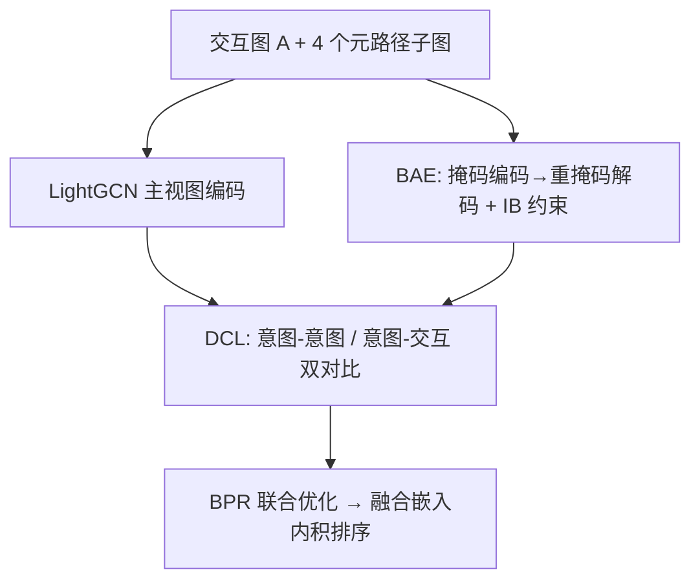

# Intent-guided Heterogeneous Graph Contrastive Learning for Recommendation (意图引导的异构图对比学习推荐)

- **会议/期刊**: IEEE TKDE
- **作者与机构**: Lei Sang, Yu Wang, Yi Zhang, Yiwen Zhang (安徽大学), Xindong Wu (合肥工业大学)
- **推荐链路定位**: 召回
- **研究方向**: 图神经网络与知识图谱推荐 / 自监督对比学习与交互去噪
- **论文原文**: [论文原文链接](https://arxiv.org/abs/2407.17234v2)
- **开源代码**: [开源代码仓库链接](https://github.com/wangyu0627/IHGCL)

## TL;DR (1分钟核心速览)

现有异构图对比学习推荐把元路径辅助信息与主交互视图做对比，却忽略了元路径背后"用户为何选该物品"的细粒度意图，且元路径引入的边本身含噪。本文提出 IHGCL：用元路径子图构建**意图-意图**与**意图-交互**双层对比（DCL），再用**双掩码 + 信息瓶颈自编码器（BAE）**压缩掉元路径噪声。在 6 个数据集、全库排序协议下，Recall@20 相对最强基线最高提升 12.43%（Amazon），且在最稀疏用户分组上仍领先 SimGCL 4.05%–10.19%。

## Background & Motivation (背景与核心矛盾)

- **主流范式**: SGL/SimGCL 用随机边扰动或高斯噪声造增广视图；HGCL/SMIN 等异构图方法把元路径辅助视图与主交互视图对齐做对比学习。
- **前人局限**: ① 这些方法只做"辅助视图 vs 主视图"的二元对齐，从未按元路径语义构建**多意图对比视图**，丢失了"同年龄段用户""同类型电影"这类细粒度意图；② 元路径补边虽缓解稀疏，但图 2 显示某类元路径补边数从 0 增至 $1.5\times10^7$ 时 Recall@20 反而下降，说明补边中混有大量不可辨噪声，且会沿 HGNN 层向远端节点传播。
- **核心洞察 (Key Insight)**: 元路径连接本质是节点"**表现出的偏好**"（exhibited preference），而非"**真实偏好**"（real preference）；对比学习需要的是后者，因此必须先用信息瓶颈把前者压缩为最小充分表征，再做意图对齐。
- **本文切入点**: 把元路径当作意图载体，一边用双对比把意图注入主任务，一边用 IB 约束的掩码自编码器在意图层面去噪。

## Method (核心方法设计)

### 1. 整体框架 (Overall Architecture)

输入为 1 个用户-物品交互图 $A$与 4 个元路径子图（用户侧$A_u^1,A_u^2$，物品侧$A_i^1,A_i^2$）。主视图经 LightGCN 得$E'_u,E'_i$；每个元路径子图经 BAE（掩码编码-重掩码解码 + IB 损失）得意图表征$E_{uu}^1,E_{uu}^2,E_{ii}^1,E_{ii}^2$。DCL 模块在此之上做两类对比：意图-意图对齐（$E_{uu}^1$vs$E_{uu}^2$）与意图-交互对齐（$E'_u+E_{uu}^1$vs$E'_u+E_{uu}^2$）。最终以 BPR 为主损失联合优化，推理时用加权融合嵌入做内积排序。

### 2. 关键设计拆解 (Key Designs)

1. **双对比学习 DCL（把意图注入主任务）**：痛点是对比视图只来自随机扰动、语义空洞。DCL 用 InfoNCE 在元路径意图间对齐：$\mathcal{L}^{\text{user}}_{\text{ICL}}=\sum_{i\in\mathcal{B}}-\log\frac{\exp(s(e'_i,e''_i)/\tau')}{\sum_{j\in\mathcal{B}}\exp(s(e'_i,e''_j)/\tau')}$，其中$e',e''$分别来自两条元路径；意图-交互对比则把意图嵌入**加性注入**主视图嵌入后再对齐。直觉：ICL 保证意图表征的均匀性，IICL 把意图作为"方向偏置"推主表征朝真实偏好偏移（图 5(a) 的$\theta_1,\theta_2$ 偏角），从而在表示层面完成数据增广而非依赖不可靠的图扰动。

2. **瓶颈自编码器 BAE（压掉元路径噪声）**：痛点是元路径补边含噪且掩码率低时节点仍残留原始特征。BAE 先以比例 $p$均匀采样掩码节点嵌入，经 LightGCN 编码得$H_u$，再**二次重掩码**后解码得$E_{uu}$；并引入信息瓶颈$\mathcal{L}^{\text{IB}}_U=-I(S_u;Y_{\text{Rec}})+\beta\cdot I(A_u;S_u)$，其中$S_u=E_{uu}+H_u$。上界用高斯近似$r(\cdot)$与重参数化$a_{x,y}\sim\text{Ber}(\pi_{x,y})$可微优化，下界用变分分布$q(Y|S)$近似。直觉：最大化$I(S;Y)$保任务信息、最小化$I(A;S)$ 丢弃元路径冗余，等价于学"最小充分表征"，图 8 的案例显示训练后 UU 子图被阈值剪枝为稀疏骨架。

3. **训练目标、负采样与推理效率**：总损失 $\mathcal{L}_{\text{IHGCL}}=\mathcal{L}_{\text{BPR}}+\lambda_1\mathcal{L}_{\text{IB}}+\mathcal{L}_{\text{DCL}}+\lambda_2\|\Theta\|_2^2$，负采样沿用 BPR 的均匀负采样（每正样本 1 负），对比学习负样本来自 in-batch。编码复杂度$O\big(2(|V_{ui}|\cdot L+|V_u|\cdot L'+|V_i|\cdot L')d\big)$，损失侧$O((M+N+4B+2BC)d)$；推理仅需主视图 + BAE 前向，无额外候选枚举开销。

## Experimental Setup & Evaluation Protocol (实验设置与评估协议)

- **数据集与预处理**: 6 个公开数据集，沿用经典工作 [5,10,37] 的过滤与格式：

| 数据集 | #Users | #Items | #Interactions | 元路径 | 场景 |
| :--- | :---: | :---: | :---: | :---: | :--- |
| Last.fm | 1,892 | 17,632 | 92,834 | UU, UATAU, AA, ATA | 音乐 |
| Amazon | 6,170 | 2,753 | 195,791 | UIU, UIBIU, IBI, ICI | 电商 |
| Yelp | 16,239 | 14,284 | 198,397 | UU, UBU, BCiB, BCaB | 本地生活 |
| Douban Book | 13,024 | 22,347 | 792,062 | UU, UGU, BAB, BYB | 图书 |
| Movielens-1M | 6,040 | 3,952 | 1,000,209 | UMU, UOU, MUM, MGM | 电影 |
| Douban Movie | 13,367 | 12,677 | 1,068,278 | UU, UGU, MAM, MDM | 电影 |

- **数据划分与防穿越 (Splitting Strategy)**: 沿用 LightGCN/SGL 的 `Leave-One-Out` 式训练-测试划分（每用户留最后一次交互测试），训练集内再切验证集调参。
- **排名评测协议 (Ranking Protocol)**: 无偏 `Full-Ranking`（对全部未交互物品排序），报告 Recall@{5,10,20} 与 NDCG@{5,10,20}；显著性用双尾配对 t 检验，表中给出 $p$-value（$10^{-4}\sim10^{-8}$ 量级）。
- **对比基线与超参设置**: 13 个基线分三类——图推荐（LightGCN/SGL/SimGCL/LightGCL）、意图推荐（DisenHAN/DCCF/BIGCF）、异构图推荐（HERec/HAN/HeCo/SMIN/HGCL）。统一 embedding 维度 $d=64$、学习率 0.001、batch 4096、Adam + Xavier 初始化；HAN/HeCo 的监督损失替换为 BPR 以保证公平。

## Key Experimental Results (实验关键数据)

### 1. 主实验对比 (Main Results)

下表摘取 6 个代表性基线在 Recall@20 / NDCG@20 上的结果（完整 13 基线见原文表 II）：

| 数据集 | 指标 | LightGCN | SGL | SimGCL | BIGCF | HGCL | **IHGCL** | Improv.% |
| :--- | :---: | :---: | :---: | :---: | :---: | :---: | :---: | :---: |
| Last.fm | R@20 | 0.2626 | 0.2714 | 0.2760 | 0.2752 | 0.2698 | **0.2824** | +2.32% |
| Last.fm | N@20 | 0.2628 | 0.2694 | 0.2755 | 0.2764 | 0.2683 | **0.2815** | +1.85% |
| Amazon | R@20 | 0.1592 | 0.1646 | 0.1751 | 0.1758 | 0.1670 | **0.1805** | +2.67% |
| Amazon | N@20 | 0.1151 | 0.1215 | 0.1306 | 0.1307 | 0.1247 | **0.1346** | +2.98% |
| Yelp | R@20 | 0.0883 | 0.0961 | 0.1003 | 0.1009 | 0.0963 | **0.1044** | +3.47% |
| Yelp | N@20 | 0.0555 | 0.0604 | 0.0616 | 0.0620 | 0.0605 | **0.0649** | +4.68% |
| Douban Book | R@20 | 0.1471 | 0.1665 | 0.1701 | 0.1679 | 0.1627 | **0.1726** | +1.47% |
| Douban Book | N@20 | 0.1370 | 0.1551 | 0.1579 | 0.1591 | 0.1547 | **0.1611** | +1.26% |
| Movielens | R@20 | 0.2509 | 0.2569 | 0.2667 | 0.2625 | 0.2530 | **0.2713** | +1.72% |
| Movielens | N@20 | 0.3763 | 0.3837 | 0.3942 | 0.3916 | 0.3843 | **0.4010** | +1.72% |
| Douban Movie | R@20 | 0.1781 | 0.1880 | 0.1972 | 0.1963 | 0.1849 | **0.2003** | +1.57% |
| Douban Movie | N@20 | 0.2001 | 0.2046 | 0.2158 | 0.2144 | 0.2037 | **0.2195** | +1.71% |

原文摘要口径的"相对 HG 类 SOTA 提升 11.48%（Douban Movie）/12.43%（Amazon）"对应 Recall@5 等更小截断指标，说明**截断越短、意图增益越明显**。

### 2. 消融实验 (Ablation Study)

| 变体 | Last.fm R@20 | Amazon R@20 | Yelp R@20 | Douban Book R@20 | Movielens R@20 | Douban Movie R@20 |
| :--- | :---: | :---: | :---: | :---: | :---: | :---: |
| w/o DCL | 0.2690 | 0.1687 | 0.0949 | 0.1568 | 0.2557 | 0.1898 |
| w/o BAE | 0.2754 | 0.1742 | 0.0952 | 0.1589 | 0.2623 | 0.1950 |
| w/o IB | 0.2787 | 0.1781 | 0.1010 | 0.1714 | 0.2687 | 0.1966 |
| w/o ICL | 0.2769 | 0.1773 | 0.1021 | 0.1696 | 0.2685 | 0.1956 |
| w/o IICL | 0.2677 | 0.1713 | 0.0961 | 0.1543 | 0.2604 | 0.1921 |
| **IHGCL** | **0.2824** | **0.1795** | **0.1044** | **0.1726** | **0.2713** | **0.2003** |

### 3. 关键实验发现 (Key Findings)

1. **DCL 是主增益来源，IICL 是其中枢**：去掉整个 DCL 在 Douban Book 上掉 9.2%（0.1726→0.1568），而单独去掉 IICL 掉 10.6%（0.1726→0.1543），比去掉 ICL（掉 1.7%）严重得多——说明"意图注入主视图"比"意图间对齐"更关键，ICL 主要起均匀性正则作用。
2. **IB 是 BAE 的灵魂而非附属**：去掉 IB 后 Yelp 从 0.1044 降至 0.1010（-3.3%），而整个 BAE 去掉仅降至 0.0952，说明掩码自编码器若无 IB 约束几乎无法抑制元路径噪声；图 8 的边权剪枝案例进一步佐证。
3. **稀疏用户与元路径选择鲁棒性**：在最稀疏用户组（Yelp 前 6,721 用户，交互 ≤22），IHGCL 相对 SimGCL 提升 4.05%–10.19%；图 9 显示任意两条元路径组合的最差值仍优于所有基线，且 3-MP/4-MP 增加视图数反而在 Movielens 上从 0.2713 降至 0.2688，印证"意图信息已被充分挖掘、过度对比触发信息瓶颈"。

## Highlights & Limitations (亮点、对比与审稿批判)

- **与代表作对比 (vs. Prior Work)**: 与 SGL/SimGCL 的本质区别在于增广来源——前者靠随机边丢弃或高斯噪声（无语义），本文靠元路径意图（有语义且可解释）；与 HGCL/SMIN 的区别在于后者只做"辅助 vs 主"二元对齐，本文构建意图-意图、意图-交互两层对比；与 DCCF/BIGCF 的区别在于后者在二部图上做意图解耦，本文把意图锚定在异构图元路径上并显式处理其噪声。
- **可迁移亮点**: ① "加性注入意图嵌入 + 对比对齐"的表示级增广范式，可直接移植到多模态或多场景推荐的视图融合；② 用 IB 上/下界 + 重参数化对离散图结构做可微剪枝，适用于任何需要"补边去噪"的图推荐场景。
- **审稿级局限批判**: ① 每个数据集需人工指定 2 条用户元路径 + 2 条物品元路径，元路径选择虽鲁棒但仍依赖领域先验，缺少自动元路径搜索；② BAE 需对 4 个子图各跑一次编解码，训练开销约为 LightGCN 的 2–3 倍，论文未报告实际 wall-clock 与显存占用；③ 仅离线全库排序评测，无线上 A/B 或工业级延迟数据，落地说服力有限。

## Rating (四维评分)

- **方法创新性 (Novelty)**: ⭐⭐⭐⭐ （把元路径重解释为"表现偏好"并用 IB 压缩为"真实偏好"，DCL+BAE 的组合有清晰的理论动机与图 5 的几何解释）
- **评估协议与实验扎实度 (Protocol & Experiments)**: ⭐⭐⭐⭐ （6 数据集 + 13 基线 + Full-Ranking + t 检验 + 稀疏分桶 + 元路径消融，覆盖全面；扣分在于缺少效率对比与线上验证）
- **写作与数学规范度 (Clarity & Rigor)**: ⭐⭐⭐⭐ （IB 上下界推导完整、复杂度分析到位；但 Eq. 9–15 符号较密，$S_u$与$H_u$ 的定义分散在正文与附录间，阅读成本偏高）
- **工业落地与复现价值 (Industrial & Practical Value)**: ⭐⭐⭐⭐ （代码已开源、基于 LightGCN 易复现；但元路径需人工设计与 2–3 倍训练开销使其更适合离线召回而非实时链路）

