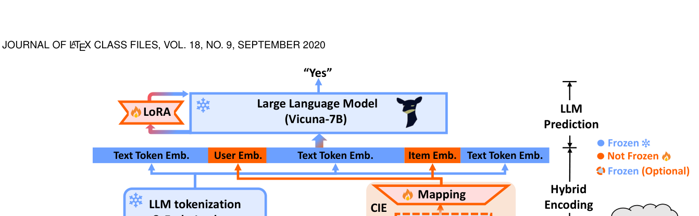
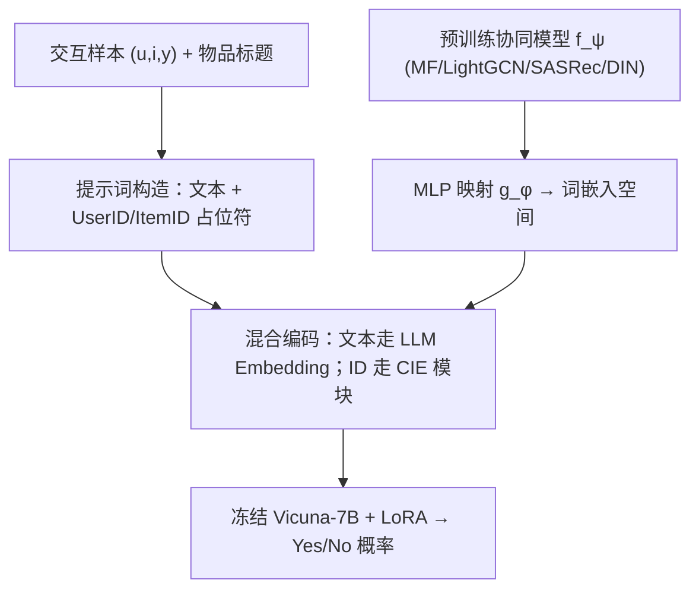

# CoLLM: Integrating Collaborative Embeddings into Large Language Models for Recommendation (将协同嵌入注入大语言模型的推荐方法)

- **会议/期刊**: IEEE TKDE 2025
- **作者与机构**: Yang Zhang, Fuli Feng, Jizhi Zhang, Keqin Bao, Qifan Wang (Meta AI), Xiangnan He — 中国科学技术大学、Meta AI
- **推荐链路定位**: 精排（用户-物品匹配打分 / Yes-No 判别）
- **研究方向**: 大语言模型推荐 / 协同过滤
- **论文原文**: [https://arxiv.org/abs/2310.19488v3](https://arxiv.org/abs/2310.19488v3)
- **开源代码**: [https://github.com/zyang1580/CoLLM](https://github.com/zyang1580/CoLLM)

## TL;DR (1分钟核心速览)

现有 LLMRec 方法（如 TALLRec）把用户/物品都写成文本 token，只利用语义先验，忽略了交互共现中的协同信号，导致暖启动场景反而不如 DIN 等传统模型（图 1 中 Amazon-Book 暖启动 AUC：MF 78 vs. TALLRec 74）。CoLLM 把协同信息当作独立模态：用预训练好的 MF/LightGCN/SASRec/DIN 产出用户/物品隐向量，经 MLP 映射到 LLM 词嵌入空间，作为 `<UserID>`/`<ItemID>` 占位符的嵌入注入提示词。在 ML-1M 与 Amazon-Book 上采用全局时间戳切分、AUC/UAUC/NDCG 评估，CoLLM-DIN 在 Amazon-Book 上 AUC 达 0.8245、UAUC 达 0.6474，相对 TALLRec 平均提升约 8%。

## Background & Motivation (背景与核心矛盾)

- **主流范式**: LLMRec 分两派——In-Context Learning 直接提示（ICL、Chat-Rec）与指令微调（TALLRec、Prompt4NR），二者均以物品标题、历史标题列表等**文本**描述用户与物品。
- **前人局限**: ① 文本语义无法区分"描述相似但受众迥异"的物品，协同共现信号被完全丢弃，暖启动用户/物品上打不过 DIN（ML-1M AUC：TALLRec 0.7097 vs. DIN 0.7166）；② 直接给 LLM 加 user/item 新 token 会加剧 tokenization 冗余、破坏 LLM 的信息压缩率，且无法复用 LightGCN 等高阶协同建模机制。
- **核心洞察 (Key Insight)**: 协同信息本质是低秩的独立模态，LLM 缺乏提取它的专用通道；而多模态 LLM（MiniGPT-4）已证明"外部编码器 + 映射层对齐到词嵌入空间"是可行范式。
- **本文切入点**: 不改动 LLM 本体，把传统协同模型的输出**映射**为 LLM 可读的协同嵌入，从而在保留 LLM 语义/推理能力的同时补齐协同短板。

<figure class="paper-figure" markdown="span">
  <figcaption>图 2：CoLLM 的模型架构概览，包含三个关键组件：提示构建、混合编码和 LLM 预测。“Collab.”为“collaborative”的缩写，“Rec.”为“recommendation”的缩写，“Emb.”为“embedding”的缩写。</figcaption>
</figure>

## Method (核心方法设计)

### 1. 整体框架 (Overall Architecture)

输入一条样本 $(u,i,y)$，先按固定模板构造提示词，其中除历史物品标题列表$\langle\text{HisItemTitleList}\rangle$与目标物品标题外，额外插入两个无语义的 ID 占位符$\langle\text{UserID}\rangle$、$\langle\text{TargetItemID}\rangle$。混合编码阶段：文本部分走 LLM 自带 tokenizer 与 embedding lookup 得到$\boldsymbol{e}_{t_k}$；两个 ID 占位符则由 CIE 模块（预训练协同模型$f_\psi$+ MLP 映射$g_\phi$）生成协同嵌入$\boldsymbol{e}_u,\boldsymbol{e}_i$，替换原位置的词嵌入，拼成完整嵌入序列送入冻结的 Vicuna-7B（仅挂 LoRA）输出 "Yes/No" 概率。训练采用两阶段：先纯文本训 LoRA 学推荐任务，再冻结其余部分只训 CIE 模块。

### 2. 关键设计拆解 (Key Designs)

1. **协同信息编码模块 CIE（把协同信号翻译成 LLM 的"母语"）**：痛点是 LLM 词表里没有协同通道。做法是先由任意传统模型得到低秩表征 $\boldsymbol{u}=f_\psi(u;\mathcal{D})$、$\boldsymbol{i}=f_\psi(i;\mathcal{D})\in\mathbb{R}^{1\times d_1}$，再用 MLP 升维对齐：
   $$\boldsymbol{e}_u=g_\phi(\boldsymbol{u}),\quad \boldsymbol{e}_i=g_\phi(\boldsymbol{i}),\quad \boldsymbol{e}_u,\boldsymbol{e}_i\in\mathbb{R}^{1\times d_2}$$
   其中 $d_1<d_2$。直觉：协同信息保持低秩、不新增词表 token，既避免压缩率下降，又能通过换用不同$f_\psi$ 灵活接入高阶协同建模（如 LightGCN 邻域聚合、DIN 注意力）。

2. **两阶段解耦调优（先学任务、再学协同）**：若 LoRA 与 CIE 同时从零训练，模型会过度依赖协同嵌入，冷启动样本上崩塌。故第一阶段只用纯文本提示 $\boldsymbol{E}_t$ 训 LoRA：
   $$\hat{\Theta}'=\arg\min_{\Theta'}\sum_{(u,i,y)\in\mathcal{D}}\ell\big(h_{\hat{\Theta}+\Theta'}(\boldsymbol{E}_t),y\big)$$
   第二阶段冻结 LLM 与 LoRA，仅优化 CIE 参数 $\Omega$（可取$\Omega=\{\phi\}$或$\{\phi,\psi\}$）：
   $$\min_{\Omega}\sum_{(u,i,y)\in\mathcal{D}}\ell\big(h_{\hat{\Theta}+\hat{\Theta}'}(\boldsymbol{E}),y\big)$$
   直觉：第一阶段让 LLM 在词嵌入空间内学会"用户-物品匹配"这一判别任务，第二阶段只需把协同向量搬到该空间的正确位置即可被直接消费，无需再动 LoRA。

3. **训练目标、负采样与推理效率**：$\ell$为二分类交叉熵（Yes/No），无显式负采样（每条交互自带正负标签）。LoRA 配置$r=8,\alpha=16$、target 为 q/v proj。相比 TALLRec，训练时间仅增约 15.5%（ML-1M 32→36 min，Book 354→418 min），推理仅增约 12.5%，额外开销来自 CIE 小模块与提示词中少量 ID token。

## Experimental Setup & Evaluation Protocol (实验设置与评估协议)

- **数据集与预处理**: ML-1M 评分 >3 记正例；Amazon-Book 评分 >4 记正例（防正负失衡），并过滤交互数 <20 的用户/物品以度量暖启动。

| 数据集 | #Users | #Items | #Train | #Valid | #Test | 说明 |
| :--- | :---: | :---: | :---: | :---: | :---: | :--- |
| ML-1M | 839 | 3,256 | 33,891 | 10,401 | 7,331 | 电影评分，2000–2003 |
| Amazon-Book | 22,967 | 34,154 | 727,468 | 25,747 | 25,747 | 图书评论，仅保留 2017 年 |

- **数据划分与防穿越 (Splitting Strategy)**: **全局时间戳切分**。ML-1M 取最近 20 个月，前 10 月训练 / 中 5 月验证 / 后 5 月测试；Amazon-Book 取 2017 年，前 11 月训练、后两个半月分别为验证与测试，显式规避数据泄漏。
- **排名评测协议 (Ranking Protocol)**: 采用 AUC、UAUC（用户级 AUC 平均）、NDCG 三项指标，在测试集全量样本上计算（非采样负例排序）；暖/冷子集按"训练集中用户与物品均出现 ≥3 次"划分暖集，其余为冷集（非严格零样本冷启动）。
- **对比基线与超参设置**: 三类基线——协同类（MF、LightGCN、SASRec、DIN）、LM+协同类（CTRL(DIN)）、LLMRec 类（ICL、Prompt4NR(Vicuna)、TALLRec）。嵌入维度搜索 $\{64,128,256\}$，学习率$\{10^{-2},10^{-3},10^{-4}\}$，LLM 用 AdamW、其余用 Adam，LLM 类权重衰减$10^{-3}$；CIE 的 MLP 隐层为输入维度 10 倍。

## Key Experimental Results (实验关键数据)

### 1. 主实验对比 (Main Results)

| 数据集 | ML-1M AUC | ML-1M UAUC | ML-1M NDCG | Book AUC | Book UAUC | Book NDCG |
| :--- | :---: | :---: | :---: | :---: | :---: | :---: |
| MF | 0.6482 | 0.6361 | 0.8447 | 0.7134 | 0.5565 | 0.8194 |
| LightGCN | 0.5959 | 0.6499 | 0.8564 | 0.7103 | 0.5639 | 0.8245 |
| SASRec | 0.7078 | 0.6884 | 0.8612 | 0.6887 | 0.5714 | 0.8244 |
| DIN | 0.7166 | 0.6459 | 0.8496 | 0.8163 | 0.6145 | 0.8419 |
| CTRL (DIN) | 0.7159 | 0.6492 | 0.8559 | 0.8202 | 0.5996 | 0.8363 |
| ICL | 0.5320 | 0.5268 | 0.8114 | 0.4820 | 0.4856 | 0.7917 |
| Prompt4NR (Vicuna) | 0.7071 | 0.6739 | 0.8663 | 0.7224 | 0.5881 | 0.8346 |
| TALLRec | 0.7097 | 0.6818 | 0.8711 | 0.7375 | 0.5983 | 0.8361 |
| **CoLLM-MF** | 0.7295 | 0.6875 | 0.8714 | 0.8109 | 0.6225 | 0.8457 |
| **CoLLM-DIN** | **0.7353** | 0.6923 | 0.8735 | **0.8245** | **0.6474** | **0.8550** |
| **CoLLM-SASRec** | 0.7235 | **0.6990** | **0.8765** | 0.7746 | 0.5962 | 0.8361 |
| Improv. (vs TALLRec) | +3.6% | +2.5% | +0.6% | +11.8% | +8.2% | +2.3% |

### 2. 消融实验 (Ablation Study)

| 变体 (ML-1M / Book) | AUC | UAUC |
| :--- | :---: | :---: |
| CoLLM-MF | 0.7295 / 0.8133 | 0.6875 / 0.6314 |
| w/o CIE（即 TALLRec） | 0.7097 / 0.7375 | 0.6818 / 0.5983 |
| w/ UI-token（直接加新 token） | 0.7214 / 0.7273 | 0.6563 / 0.5956 |
| T1（两阶段 + 全 CIE 微调） | 0.7360 / 0.8154 | 0.6946 / 0.6139 |
| T2（两阶段 + CIE 从零训） | **0.7418** / **0.8288** | 0.6906 / **0.6352** |
| T3（单阶段联合训练） | 0.7131 / 0.8104 | 0.6661 / 0.5753 |

### 3. 关键实验发现 (Key Findings)

1. **协同嵌入是暖启动的"补药"而非"替代品"**：暖启动子集上 CoLLM 全面超过 MF 与 TALLRec（图 3），冷启动子集上仍与 TALLRec 持平（AUC 略优、UAUC 略逊），说明映射式注入没有牺牲 LLM 的语义泛化能力；而直接加 UI-token 反而比不加更差（Book AUC 0.7273 < 0.7375），印证了 tokenization 冗余假说。
2. **两阶段解耦是冷启动不崩的关键**：单阶段联合训练 T3 在 ML-1M 冷启动上明显掉点（UAUC 0.6661 vs. 默认 0.6875），而 T2 虽整体最优（ML-1M AUC 0.7418）但训练开销至少 5 倍，作者选择默认配置作为效率-效果折中。
3. **协同模型越强，CoLLM 越强**：CoLLM 性能与所挂协同模型大致正相关（DIN 版在 Book 上 AUC 0.8245 最高），且优于简单集成（MF+TALLRec 集成 Book AUC 0.7782 < CoLLM-MF 0.8109），说明收益来自"信息注入生成过程"而非分数融合；换用 Qwen2-1.5B 骨干仍稳定领先（ML-1M AUC 0.7354 vs. TALLRec 0.7027）。

## Highlights & Limitations (亮点、对比与审稿批判)

- **与代表作对比 (vs. Prior Work)**: 与 TALLRec 的本质区别是引入非文本模态通道，而非仅靠指令微调；与 BIGRec 的"LLM 与协同模型后融合"不同，CoLLM 把协同信息注入 LLM 前向过程，保留 LLM 推理能力；与 CTRL 的"LM 知识蒸馏进 DIN"方向相反，CoLLM 以 LLM 为主体、协同为辅，规避了语义遗忘。
- **可迁移亮点**: ① "外部编码器 + MLP 对齐词嵌入"的多模态对齐思路可平移到多模态推荐、跨域推荐；② 两阶段"先任务后模态"的解耦调优可推广到任何向冻结 LLM 注入新模态的场景。
- **审稿级局限批判**: ① 冷启动定义为"交互 <3 次"而非严格零样本，真正的 strict cold-start 与增量学习未验证；② 推理仍需 7B 级 LLM 前向，单条打分成本远高于 DIN，且未探索缓存/量化等加速；③ 协同模型预训练与 LLM 调优分离，二者表征空间可能存在次优对齐，端到端联合优化留待未来。

## Rating (四维评分)

- **方法创新性 (Novelty)**: ⭐⭐⭐⭐ （把协同信息显式建模为独立模态并对齐词嵌入空间，思路清晰且有多模态 LLM 理论支撑，但映射层本身较朴素）
- **评估协议与实验扎实度 (Protocol & Experiments)**: ⭐⭐⭐⭐ （时间戳切分防泄漏、暖/冷子集分析、四种协同模型 + 两种 LLM 骨干 + 四个数据集，消融与效率分析完整；冷启动定义偏宽松）
- **写作与数学规范度 (Clarity & Rigor)**: ⭐⭐⭐⭐ （公式简洁、符号统一，与 soft prompt tuning 的关系讨论到位；对 CIE 映射为何有效的理论刻画偏直觉）
- **工业落地与复现价值 (Industrial & Practical Value)**: ⭐⭐⭐⭐ （代码开源、仅增约 15% 训练与 12% 推理开销、可插拔任意协同模型；但 7B LLM 在线精排成本仍是落地门槛）

