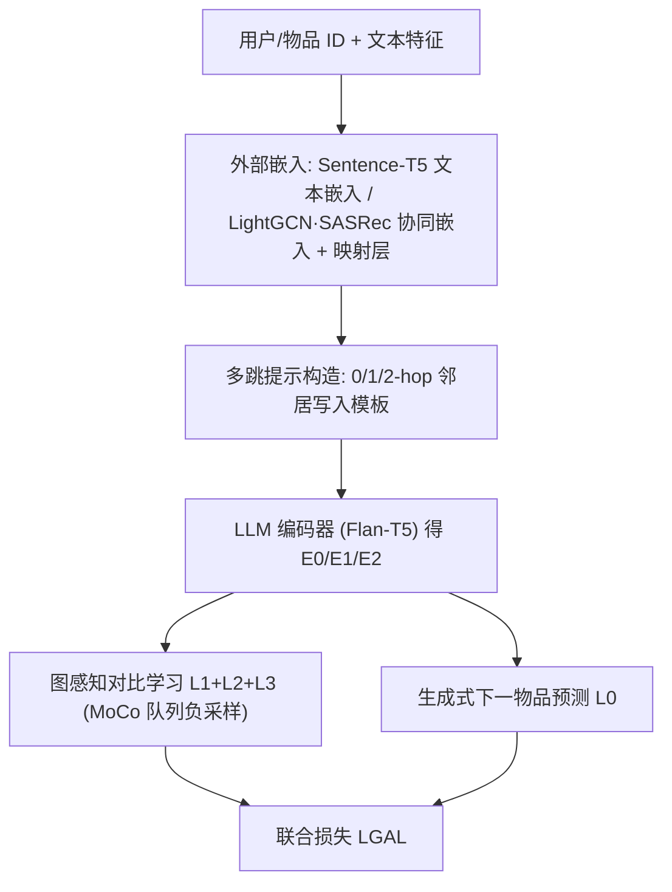

# Enhancing Collaborative Semantics of Language Model-Driven Recommendations via Graph-Aware Learning (通过图感知学习增强语言模型驱动推荐的协同语义)

- **会议/期刊**: IEEE TKDE (arXiv 2024-06 预印)
- **作者与机构**: Zhong Guan, Likang Wu, Hongke Zhao, Ming He, Jianping Fan（天津大学管理与经济学部 CACMS 实验室；联想研究院 AI Lab）
- **推荐链路定位**: 召回（序列下一物品预测，LLM 作为预测器）
- **研究方向**: 大语言模型推荐 / 自监督对比学习
- **论文原文**: [https://arxiv.org/abs/2406.13235v1](https://arxiv.org/abs/2406.13235v1)
- **开源代码**: 暂未开源

## TL;DR (1分钟核心速览)

LLM 在自然语言语义空间里能区分"文本相似"的物品，却无法区分协同语义上截然不同的物品，且 SFT 难以对齐两个语义空间。本文提出 GAL-Rec：把用户-物品二部图的多跳邻居写进提示模板（模拟 GNN 感受野），再用三组跨跳对比损失（user-0-hop↔user-2-hop、user-2-hop↔item-1-hop、user-1-hop↔item-0-hop）以自监督方式迫使 LLM 编码器学会"聚合"算子，并借 MoCo 动态队列解决 LLM 负样本不足。在 Beauty/Toys/Yelp 三数据集、Leave-One-Out + Full-Ranking 协议下，GAL(Text) 在 Beauty 上 HR@10 达 0.0491（较最强基线 SID 的 0.0486 略优），Toys 上 HR@10 0.0712 较 SASRec 的 0.0675 提升约 5.5%，Yelp 上 HR@10 0.0491 较 SID 提升约 1.0%。

## Background & Motivation (背景与核心矛盾)

- **主流范式**: 以 P5 为代表的"推荐即语言处理"范式，将用户历史序列序列化为自然语言提示，对 LLM 做指令微调（式 1 的负对数似然），或用 CID/IID/SID 等物品索引方案增强 ID 语义。
- **前人局限**: 其一，自然语言语义空间与协同语义空间存在系统性偏差——同一大类下文本差异极小的物品，在协同空间中被不同用户群体严格区分，LLM 却视作近似（图 1）；其二，LLM 擅长学习可形式化为知识的频繁模式，却不擅长挖掘社区群体内的隐式交互行为模式，而这恰是 GNN 的强项。
- **核心洞察 (Key Insight)**: 直接把 GNN/传统模型嵌入映射进 LLM 词嵌入空间做微调并不够——这只是"喂特征"，LLM 并未习得聚合算子本身；必须让 LLM 在编码阶段就"模仿"GNN 的多跳聚合意图。
- **本文切入点**: 用提示结构承载多跳邻居（1-hop 物品、2-hop 同好用户），再用跨跳对比学习把"聚合后应相似"这一 GNN 先验写成自监督损失，让 LLM 自己学会处理图结构。

<figure class="paper-figure" markdown="span">
  <figcaption>图1. 大语言模型与传统模型在区分项目上的差异。</figcaption>
</figure>

## Method (核心方法设计)

### 1. 整体框架 (Overall Architecture)

GAL-Rec 由四部分组成：外部嵌入初始化、多跳提示构造、图感知学习（GAL）模块、MoCo 动态队列。输入侧为每个用户/物品扩展专属 token，其嵌入由两条路提供——物品文本经 Sentence-T5 编码（式 2），或由 LightGCN/SASRec 等传统模型产出协同嵌入再经映射层 $g_\theta$ 对齐到 LLM 维度（式 3）。提示侧按跳数构造四种模板（0/1/2-hop 及其组合），把"用户 1-hop 连接物品列表、2-hop 连接同好用户列表"写成自然语言。编码后对同一实体的不同跳数表示施加三组跨跳 InfoNCE，与下一物品生成的交叉熵联合优化；负样本由 MoCo 队列提供。

### 2. 关键设计拆解 (Key Designs)

1. **多跳提示构造（把 GNN 感受野写进自然语言）**：痛点在于 LLM 看不到图拓扑。做法是把用户 $u$ 的 1-hop 物品列表与 2-hop 同好用户列表一并写入指令，物品侧对称处理，使提示本身即是一次"邻域采样"。直觉：LLM 的注意力在 token 序列上做加权，等价于在文本化的邻域上做一次软聚合，跳数即感受野深度。

2. **三组跨跳对比损失（把聚合先验写成自监督目标）**：核心假设是"同质邻居聚合后应逼近中心节点"。据此定义三组对齐：user-0-hop 与 user-2-hop 对齐（同好用户聚合 ≈ 本人画像）、user-2-hop 与 item-1-hop 对齐（同好群体 ≈ 邻接物品的交互人群）、user-1-hop 与 item-0-hop 对齐（历史物品 ≈ 待预测邻接物品）。以第一组为例：

$$\mathcal{L}^{u}_{1} = -\log \frac{\exp(\mathrm{sim}(E^{0}_{u}, E^{2}_{u})/\tau)}{\sum_{v\in\mathcal{U}}\exp(\mathrm{sim}(E^{0}_{v}, E^{2}_{u})/\tau)}$$

   三组损失对称相加得 $\mathcal{L}_1,\mathcal{L}_2,\mathcal{L}_3$。直觉：这实质上是把 GNN 的"邻域平滑"约束搬到表示空间，用对比目标替代显式消息传递，从而在不改 LLM 结构的前提下注入结构归纳偏置。

3. **MoCo 动态队列与联合优化**：LLM 参数量巨大，靠增大 batch 扩充负样本不可行，故维护长度 $L=512$的队列$Q$，查询编码器$f_q$走梯度回传、动量编码器$f_k$按$\theta_k = m\theta_k + (1-m)\theta_q$ 缓慢更新，保证队列内负样本表示的一致性。总损失为

$$\mathcal{L}_{\mathrm{GAL}} = \mathcal{L}_0 + \lambda_1\mathcal{L}_1 + \lambda_2\mathcal{L}_2 + \lambda_3\mathcal{L}_3 + \lambda_4\|\Theta\|_2^2$$

   其中 $\mathcal{L}_0$为式 (1) 的生成交叉熵，$\lambda_{1:3}$ 为对比损失权重。推理时仅需前向生成，对比分支与队列全部丢弃，无额外在线开销。

## Experimental Setup & Evaluation Protocol (实验设置与评估协议)

- **数据集与预处理**: 沿用 P5 的 `5-core` 过滤（用户与物品交互数均 ≥ 5），并修正了 P5 预处理中的数据泄漏问题后重新对比。

| 数据集 | #Users | #Items | #Interactions | 稀疏度 | 场景说明 |
| :--- | :---: | :---: | :---: | :---: | :--- |
| Beauty | 22,363 | 12,101 | 198,502 | 0.0734% | Amazon 美妆评论 |
| Toys | 19,412 | 11,924 | 167,597 | 0.0724% | Amazon 玩具评论 |
| Yelp | 30,431 | 20,033 | 316,354 | 0.0519% | 本地商户评论 |

- **数据划分与防穿越**: `Leave-One-Out`（最后一条交互为测试、倒数第二条为验证），与 P5 一致。
- **排名评测协议**: 无偏 `Full-Ranking`（全库未交互物品排序），指标 HR@5/10、NDCG@5/10。
- **对比基线与超参**: 传统侧 Caser、BERT4Rec、LightGCN、SASRec、S3-Rec；LLM 侧 P5、CID、IID、SID。传统模型嵌入维度统一 64；LLM 主干为 Flan-T5（选其编码器做表示学习）；AdamW + 0.05 warmup + 线性衰减，学习率 $[10^{-4},10^{-5}]$，温度$\tau\in[0.05,0.2]$，权重衰减$10^{-3}$，队列长度 512，batch 8 + 梯度累积 8 步，二阶邻居每节点至少采样 8 个。

## Key Experimental Results (实验关键数据)

### 1. 主实验对比 (Main Results)

| 方法 | Yelp HR@10 | Yelp N@10 | Beauty HR@10 | Beauty N@10 | Toys HR@10 | Toys N@10 |
| :--- | :---: | :---: | :---: | :---: | :---: | :---: |
| Caser | 0.0253 | 0.0129 | 0.0347 | 0.0176 | 0.0270 | 0.0141 |
| BERT4Rec | 0.0090 | 0.0045 | 0.0347 | 0.0170 | 0.0203 | 0.0099 |
| LightGCN | 0.0427 | 0.0218 | 0.0511 | 0.0260 | 0.0440 | 0.0234 |
| SASRec | 0.0274 | 0.0136 | 0.0605 | 0.0318 | 0.0675 | 0.0374 |
| S3-Rec | 0.0341 | 0.0168 | 0.0647 | 0.0327 | 0.0700 | 0.0376 |
| P5 | 0.0095 | 0.0053 | 0.0582 | 0.0298 | 0.0267 | 0.0150 |
| CID | 0.0428 | 0.0225 | 0.0680 | 0.0357 | 0.0256 | 0.0141 |
| SID | 0.0486 | 0.0287 | 0.0602 | 0.0368 | 0.0218 | 0.0139 |
| **GAL(Text)** | **0.0491** | **0.0298** | **0.0768** | **0.0406** | **0.0587** | **0.0325** |
| **GAL(SASRec)** | 0.0329 | 0.0198 | 0.0759 | 0.0399 | **0.0712** | **0.0393** |
| **GAL(LightGCN)** | 0.0457 | 0.0256 | 0.0537 | 0.0279 | 0.0448 | 0.0241 |

以 HR@10 计，GAL(Text) 相对 Yelp 最强基线 SID 提升约 1.0%，相对 Beauty 最强基线 CID 提升约 12.9%，GAL(SASRec) 相对 Toys 最强基线 S3-Rec 提升约 1.7%（相对 SASRec 提升约 5.5%）。

### 2. 消融实验 (Ablation Study)

| 配置 | Yelp HR@10 | Beauty HR@10 | Toys HR@10 |
| :--- | :---: | :---: | :---: |
| w/o GAL (SASRec 嵌入) | 0.0267 | 0.0705 | 0.0661 |
| w/ GAL (SASRec 嵌入) | **0.0329** | **0.0759** | **0.0712** |
| w/o GAL (LightGCN 嵌入) | 0.0369 | 0.0490 | 0.0393 |
| w/ GAL (LightGCN 嵌入) | **0.0457** | **0.0537** | **0.0448** |
| w/o GAL (Text 嵌入) | 0.0425 | 0.0705 | 0.0554 |
| w/ GAL (Text 嵌入) | **0.0491** | **0.0768** | **0.0587** |

损失项与跳数消融（Toys，GAL(LightGCN)，表中数值为百分数）：

| 配置 | H@5 | N@5 | H@10 | N@10 |
| :--- | :---: | :---: | :---: | :---: |
| w/o $\mathcal{L}_1$ | 2.69 | 4.00 | 1.81 | 2.19 |
| w/o $\mathcal{L}_2$ | 2.77 | 4.25 | 1.80 | 2.26 |
| w/o $\mathcal{L}_3$ | 2.83 | 4.29 | 1.84 | 2.39 |
| ALL | **2.89** | **4.48** | **1.90** | **2.41** |
| 1-hop | 2.69 | 4.31 | 1.80 | 2.24 |
| 2-hop | **2.89** | **4.48** | **1.90** | **2.41** |
| 3-hop | 2.90 | 4.43 | 1.84 | 2.33 |

### 3. 关键实验发现 (Key Findings)

1. **GAL 增益与外部嵌入质量正相关，但并非简单叠加**：同一数据集上，LightGCN 嵌入在 Yelp 上从 0.0369 涨到 0.0457（+23.8%），而 SASRec 嵌入在 Toys 上从 0.0661 涨到 0.0712（+7.7%），说明 GAL 学到的是"如何聚合"而非"复制嵌入"，嵌入本身越强、可挖掘的结构信号越多，但边际收益递减。
2. **三组对比损失缺一不可，且 $\mathcal{L}_1$最关键**：去掉$\mathcal{L}_1$（user-0-hop↔user-2-hop）后 Toys HR@5 从 2.89 掉到 2.69，降幅最大；去掉$\mathcal{L}_3$ 影响最小（2.83），说明"同好用户聚合 ≈ 本人画像"这一先验对 LLM 最具信息量，而 1-hop 物品与 0-hop 物品的对齐相对冗余。
3. **跳数存在最优值，2-hop 是甜点，3-hop 反而退化**：Toys 上 3-hop 的 HR@5 为 2.90 略高于 2-hop 的 2.89，但 NDCG@10 从 2.41 掉到 2.33，与 GNN 过平滑现象同构；KDE 可视化（图 4）进一步证实无 GAL 时 2-hop 表示出现明显塌缩，加入 GAL 后分布显著均匀化，说明对比学习实质上起到了"抗过平滑"作用。

## Highlights & Limitations (亮点、对比与审稿批判)

- **与代表作对比 (vs. Prior Work)**: 与 P5 的纯指令微调相比，本文不改 LLM 结构而改"提示+损失"，把结构先验写进自监督目标；与 CoLLM 的两阶段微调相比，本文不依赖额外的协同嵌入对齐阶段，而是让 LLM 在编码阶段直接习得聚合；与 CID/IID/SID 等物品索引方案相比，本文的增益来自用户侧多跳结构而非物品 ID 语义，二者理论上可正交叠加。
- **可迁移亮点**: 其一，"多跳邻居文本化 + 跨跳对比"这一套组合可直接迁移到任何需要 LLM 处理图结构的下游任务（如社交推荐、KG 增强推荐）；其二，MoCo 队列 + 动量编码器在 LLM 对比学习中的负采样方案，对显存受限的 LLM 微调场景具有普适参考价值。
- **审稿级局限批判**: 其一，主实验提升幅度偏小且不稳定——Yelp 上 GAL(Text) 相对 SID 仅 +1.0%，Toys 上 GAL(Text) 甚至低于 SASRec，作者未给出多次运行的方差或显著性检验，结论稳健性存疑；其二，二阶邻居采样、队列长度、温度三个超参均需逐数据集调优，且 3-hop 已出现退化，感受野扩展的工程代价与收益边界未充分讨论；其三，仅在 Flan-T5 编码器上验证，对 Decoder-only 主流 LLM（作者自己在结论中也承认）的适用性完全未知。

## Rating (四维评分)

- **方法创新性 (Novelty)**: ⭐⭐⭐⭐ （把 GNN 聚合意图转译为跨跳对比目标，思路清晰且自监督，但"多跳提示 + 对比学习"的组合在 LLM4Rec 中已有若干近邻工作，新颖度属稳健而非突破）
- **评估协议与实验扎实度 (Protocol & Experiments)**: ⭐⭐⭐ （三数据集 + Full-Ranking + 修正 P5 数据泄漏值得肯定，但缺少显著性检验与方差报告，部分提升幅度在噪声量级）
- **写作与数学规范度 (Clarity & Rigor)**: ⭐⭐⭐ （三组损失定义完整、算法伪代码清晰，但式 (11)(12) 的文字描述与符号存在笔误，表 I 中 LightGCN 在 Toys 的 HR@10 写作 0.440 明显为排版错误）
- **工业落地与复现价值 (Industrial & Practical Value)**: ⭐⭐⭐ （推理阶段对比分支可完全剥离、无额外在线开销，但训练需 LLM + 动量编码器双份显存、二阶邻居采样开销大，且未开源代码，复现门槛较高）

