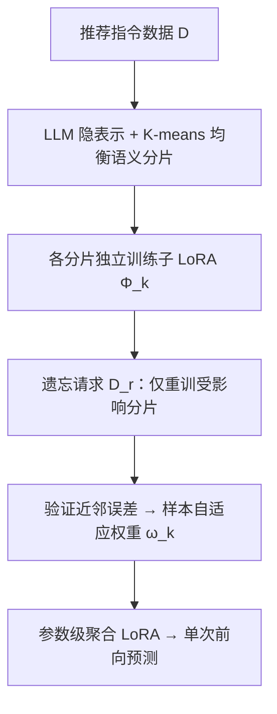
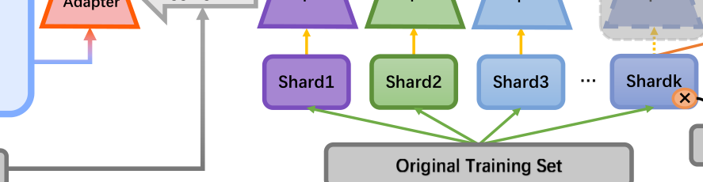

# Exact and Efficient Unlearning for Large Language Model-based Recommendation (面向大语言模型推荐的精确高效遗忘)

- **会议/期刊**: TKDE 2025
- **作者与机构**: Zhiyu Hu, Yang Zhang, Minghao Xiao, Wenjie Wang, Fuli Feng, Xiangnan He（中国科学技术大学、新加坡国立大学）
- **推荐链路定位**: 端到端生成式（LLM 指令微调推荐模型的后训练/服务阶段）
- **研究方向**: 大语言模型推荐 / 去偏公平、可信隐私与工业架构
- **论文原文**: [论文原文链接](https://arxiv.org/abs/2404.10327v1)
- **开源代码**: 暂未开源

## TL;DR (1分钟核心速览)

LLMRec 用 LoRA 微调把用户历史行为写进参数，一旦用户要求删除数据，全量重训代价极高，而现有近似遗忘（梯度上升、In-Context 翻转标签）无法保证"精确删除"，传统分片重训（SISA/RecEraser）又因需对 $K$个子模型各推理一次而使 LLM 推理成本膨胀$K$倍。本文提出 APA：按文本语义把指令数据均衡切成$K$ 片、各训一个子 LoRA，遗忘时只重训受影响分片；服务时用"验证集近邻误差"驱动的样本自适应权重在**参数级**聚合 LoRA，实现单次前向。在 Book/Movie 上 AUC 达 0.6846/0.7259，反超全量重训（+0.0108/-0.0169），遗忘时间提速约 3.96 倍。

## Background & Motivation (背景与核心矛盾)

- **主流范式**: TALLRec 式 LLMRec 将用户-物品交互转成 "Yes/No" 指令，用 LoRA 等 PEFT 适配器微调冻结 LLM，个性化知识几乎全部沉淀在适配器参数 $\Phi$ 中。
- **前人局限一（精确性）**: 近似遗忘（梯度上升、标签翻转的 In-Context Unlearning）计算便宜但只做"影响削弱"，无法满足 GDPR 类法规要求的**完整擦除**；而传统推荐遗忘方法（RecEraser、GraphEraser）依赖协同 embedding 分片，直接搬到十亿级参数的 LLM 上不可行。
- **前人局限二（推理成本）**: 分片重训类精确遗忘（SISA）必须在**预测结果层**聚合 $K$个子模型，等于$K$ 次 LLM 前向，服务延迟与能耗不可接受。
- **核心洞察 (Key Insight)**: 个性化数据只存在于 LoRA 适配器而非基座 LLM，且 TALLRec 具备少样本学习能力（数百条即可训出有效适配器）——因此可以把分片做得足够细，使单次遗忘只触发 $|D_r|/K$ 量级的重训成本。
- **本文切入点**: 用"语义感知均衡分片 + 参数级自适应聚合"把分片重训从"精确但昂贵"改造成"精确且可服务"。

## Method (核心方法设计)

### 1. 整体框架 (Overall Architecture)

APA 分三阶段闭环：①**数据与适配器分片**——用未微调 LLM 提取每条指令输入的隐表示，K-means 聚类后按簇容量阈值 $t$做均衡再分配，得到$K$个语义同质、规模均衡的不相交分片，每片独立训练一个子 LoRA$\Phi_k$；②**遗忘**——用户请求删除$D_r$时，仅定位并重训包含$D_r$的分片适配器，其余冻结，理论上只需$|D_r|/K$ 的全量重训开销；③**聚合与服务**——对每个测试样本，用验证集近邻的预测误差为各子适配器打分，softmax 得到权重后在 LoRA 权重层合并为单一适配器，一次前向完成推理。

<figure class="paper-figure" markdown="span">
  <figcaption>图2：我们的APA框架示意图，由数据划分、适配器训练和适配器聚合三部分组成。当用户请求擦除数据𝐷𝑟时，仅需重新训练受𝐷𝑟影响的子LoRA适配器。</figcaption>
</figure>

### 2. 关键设计拆解 (Key Designs)

1. **均衡语义感知分片（Balanced Semantic-aware Partition）**：传统方法按协同 embedding 或随机/用户维度切分，对以文本语义为预测依据的 LLM 不适配，且 K-means 原始簇严重不均衡会让大分片拖慢遗忘。本文先算样本隐表示 $h_i$与簇心$a_k$的余弦距离$dist(h_i,a_k)=-\cos(h_i,a_k)$，将所有三元组升序排序后贪心分配：仅当最近簇未满阈值$t$ 才落入，否则退到次近的未满簇。直觉是"同片知识同质、跨片异质"，既让少样本子适配器学得充分，又让聚合时各适配器提供互补知识。

2. **参数级适配器聚合（Adapter Aggregation）**：预测级聚合需 $K$次 LLM 前向，本文改为在 LoRA 权重上合并。分解层直接加权平均低秩矩阵：$\bar{B}=\sum_{k}\omega_k B_k,\ \bar{A}=\sum_{k}\omega_k A_k$，输出$\bar{o}=W_0x+\bar{B}\bar{A}x$；非分解层则聚合乘积：$\overline{BA}=\sum_{k}\omega_k B_kA_k$。由于$r\ll\min(d_1,d_2)$，权重合并是毫秒级操作，把$K$ 倍推理压回 1 倍。

3. **样本自适应权重与训练目标**：仅按输入语义相似度选适配器并不保证预测准，本文改用"验证集上最相似样本的实际误差"作代理：对测试样本取验证集 top-$n$近邻$\mathcal{N}_v$，计算各适配器平均误差$error_k=\frac{1}{|\mathcal{N}_v|}\sum_{(x_i,y_i)\in\mathcal{N}_v}error(y,P_{\Theta+\Phi_k}(y_i|x_i))$，再以$\omega_k=\frac{\exp(\tau\cdot(-error_k))}{\sum_{k'}\exp(\tau\cdot(-error_{k'}))}$分配注意力（$\tau=1000$）。该权重**无需额外训练**，避免引入新的遗忘成本。各子适配器训练目标沿用 TALLRec 的 token 级对数似然$\max_{\Phi_k}\sum_{(x_i,y_i)\in D_k}\sum_{t}\log P_{\Theta_0+\Phi_k}(y_{i,t}|x_i,y_{i,<t})$，无负采样环节。

## Experimental Setup & Evaluation Protocol (实验设置与评估协议)

- **数据集与预处理**: 严格沿用 TALLRec 的过滤与指令构造流程；Book 评分 >5 记为 like，Movie 评分 >3 记为 like；训练集截断为 1024 条（TALLRec 原文最大 256），验证集 500、测试集 1000。

| 数据集 | #Train | #Valid | #Test | 来源 | 特征/场景说明 |
| :--- | :---: | :---: | :---: | :---: | :--- |
| Book | 1024 | 500 | 1000 | BookCrossing | 书名/作者文本属性，二值化偏好 |
| Movie | 1024 | 500 | 1000 | MovieLens-100K | 片名/导演文本属性，二值化偏好 |

- **数据划分与防穿越 (Splitting Strategy)**: 沿用 TALLRec 的固定训练/验证/测试划分（非 Leave-One-Out、非时间戳切分），遗忘实验每次仅移除 1 条训练样本（$|D_r|=1$）。
- **排名评测协议 (Ranking Protocol)**: 采用 **Sampled 二分类评测**——对给定 (用户, 目标物品) 指令让模型输出 Yes/No，以 AUC 衡量排序质量，而非 Full-Ranking 全库排序；这是 TALLRec 系列的标准协议，也是本文评估的主要局限之一。
- **对比基线与超参设置**: Retraining（金标准）、SISA、RecEraser（UBP 分片 + SISA 聚合）、GraphEraser（BEKM 分片 + SISA 聚合）；分片大小 256（$K=4$），$\tau=1000$，近邻数$|\mathcal{N}_v|$ 为 Movie 20 / Book 100，NVIDIA A40。

## Key Experimental Results (实验关键数据)

### 1. 主实验对比 (Main Results)

| 方法 | Book AUC | Book $\Delta$| Movie AUC | Movie$\Delta$ |
| :--- | :---: | :---: | :---: | :---: |
| 子模型平均 (Bef. Agg.) | 0.6578 | - | 0.6696 | - |
| Retraining（金标准） | 0.6738 | - | 0.7428 | - |
| SISA | 0.6728 | -0.0010 | 0.7035 | -0.0393 |
| GraphEraser | 0.6684 | -0.0052 | 0.6903 | -0.0525 |
| RecEraser | 0.6732 | -0.0006 | 0.6937 | -0.0491 |
| **APA(D)** | **0.6829** | **+0.0091** | 0.7259 | -0.0169 |
| **APA(ND)** | **0.6846** | **+0.0108** | **0.7256** | **-0.0172** |

### 2. 消融实验 (Ablation Study)

| 变体 | Book AUC | Movie AUC | 说明 |
| :--- | :---: | :---: | :--- |
| APA 完整版 | 0.6829 | 0.7259 | 语义分片 + 自适应聚合 |
| 分片替换为 Random | 0.6503 | — | 随机切分 |
| 分片替换为 User-based | 0.6627 | — | RecEraser 用户维度 |
| 分片替换为 BEKM | 0.6411 | — | 图聚类切分 |
| 聚合替换为 Average | 低于完整版 | 低于完整版 | 等权平均 |
| 聚合替换为 Semantic | 低于完整版 | 低于完整版 | 仅按语义相似度 |
| 聚合替换为 Major | 低于完整版 | 低于完整版 | 只取最优单适配器 |

### 3. 关键实验发现 (Key Findings)

1. **聚合本身即增益，自适应聚合再放大增益**：所有分片方法的聚合结果都高于其子模型平均 AUC（如 Book 上 0.6578 → 0.6829），说明跨片知识融合是必要的；而 APA 在 Book 上比金标准 Retraining 还高 0.0108，说明"分片 + 加权聚合"起到了隐式集成正则作用。
2. **语义分片是性能命门**：Book 上把语义分片换成 Random/User/BEKM，AUC 从 0.6829 掉到 0.6503/0.6627/0.6411，最大跌幅 0.0418，验证了 LLMRec 的预测依赖文本语义而非协同 ID，传统推荐遗忘的分片准则在此失效。
3. **效率与精度的可调折中**：Movie 上遗忘仅需 10,335 秒，较全量重训提速 3.96 倍（约等于 $K$）；推理侧 APA 每样本仅比单模型多约 0.02 秒，而 SISA 因预测级聚合推理时间成倍上升；Book 上分片从 512 缩到 256 性能几乎不变、缩到 128 才明显下降，说明可在精度平台区内通过减小分片换取更高遗忘效率。

## Highlights & Limitations (亮点、对比与审稿批判)

- **与代表作对比 (vs. Prior Work)**: 与 SISA/RecEraser/GraphEraser 的本质区别在于**聚合发生在参数层而非预测层**，把 $K$ 次 LLM 前向压成 1 次，且分片依据从协同/图结构改为 LLM 文本语义；与梯度上升、In-Context Unlearning 等 LLM 近似遗忘方法相比，本文走的是重训路线，天然保证精确删除，代价是仍需一次分片级重训。
- **可迁移亮点**: ①"验证集近邻误差 → softmax 权重"是一种免训练的模型/适配器动态选择技巧，可直接迁移到多 LoRA 多任务服务、多领域适配器路由；②"语义聚类 + 容量阈值贪心再分配"的均衡分片算法可复用于任何需要分片训练 + 局部更新的联邦/增量场景。
- **审稿级局限批判**: ①评估仅用 Sampled 二分类 AUC，未做 Full-Ranking 或生成式列表指标，且训练/测试各仅 1024/1000 条，规模偏小，结论外推性存疑；②遗忘效率的 3.96 倍加速依赖 $|D_r|=1$的流式假设与$K=4$的小分片数，批量删除或$K$增大时聚合权重计算与验证近邻检索的额外开销未被充分剖析；③样本自适应权重需在线检索验证集近邻并做$K$ 次子适配器前向估计误差，实际服务延迟可能高于文中报告的 0.02 秒。

## Rating (四维评分)

- **方法创新性 (Novelty)**: ⭐⭐⭐⭐ （首个形式化 LLMRec 精确遗忘问题，参数级聚合 + 验证误差驱动权重组合新颖，但分片重训骨架源自 SISA）
- **评估协议与实验扎实度 (Protocol & Experiments)**: ⭐⭐⭐ （数据集与基线覆盖合理、消融完整，但仅 Sampled AUC、数据规模小、缺 Full-Ranking 与显著性检验）
- **写作与数学规范度 (Clarity & Rigor)**: ⭐⭐⭐⭐ （三阶段框架与公式定义清晰，聚合两层设计交代明确，复杂度分析略简）
- **工业落地与复现价值 (Industrial & Practical Value)**: ⭐⭐⭐⭐ （遗忘提速约 4 倍、推理近零额外开销，契合合规删除需求；但未开源，且验证近邻检索的线上开销需实测）

