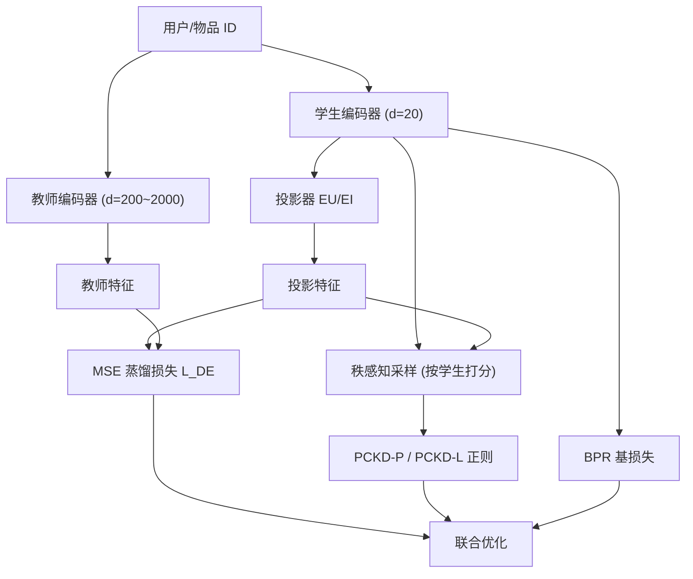

# Preference-Consistent Knowledge Distillation for Recommender System (面向推荐系统的偏好一致性知识蒸馏)

- **会议/期刊**: IEEE TKDE
- **作者与机构**: Zhangchi Zhu, Wei Zhang (华东师范大学计算机科学与技术学院)
- **推荐链路定位**: 精排（模型压缩/蒸馏部署）
- **研究方向**: 大语言模型推荐（知识蒸馏）/ CTR 特征交叉
- **论文原文**: [https://arxiv.org/abs/2311.04549v2](https://arxiv.org/abs/2311.04549v2)
- **开源代码**: [https://github.com/woriazzc/KDs](https://github.com/woriazzc/KDs)

## TL;DR (1分钟核心速览)

特征级知识蒸馏用投影器把学生特征对齐到教师维度，但现有方法只约束"投影后特征"逼近教师，忽略了投影器本身可能扭曲学生特征蕴含的用户偏好。本文形式化定义了**偏好不一致 (Preference Inconsistency)** 现象——投影前后用户对物品对的排序发生翻转，实证发现训练全程至少 20% 偏好被干扰、高分物品上仍达 30%。为此提出 PCKD，用成对 (PCKD-P) 与列表 (PCKD-L) 两种正则项约束投影器，配合秩感知采样聚焦高分物品。在 3 数据集 × 4 骨干的全库排序评测中，NDCG@20 相对最强基线提升 1.3%–6.7%，相对最强特征蒸馏基线提升 3.4%–20.0%。

## Background & Motivation (背景与核心矛盾)

- **主流范式**: 推荐模型靠增大 Embedding 维度提升精度，但 Embedding 占参数大头，推理延迟高。知识蒸馏（KD）将大教师知识迁移到小容量学生，推理时只用学生。特征级 KD（DE、PHR、FitNet）先用投影器对齐维度，再用 MSE 拉近投影后特征与教师特征。
- **前人局限**: ① 现有特征级方法只保证"投影后特征"与教师一致，默认学生特征（投影前）也学到了正确偏好，但投影器缺乏约束，可能"作弊"——投影后排序正确、投影前排序相反（图 1）；② 该现象在训练全程持续存在，且在高分物品（KD 中最关键的部分）上依然严重，导致特征蒸馏能力被大量浪费，实际效果常不如响应级方法。
- **核心洞察 (Key Insight)**: 作者将偏好定义为成对符号函数 $Pref(u,i,j)=\mathrm{sign}(score(u,i)-score(u,j))$，并定义偏好不一致率$C_u$为投影前后偏好翻转的物品对占比。实证（图 3、图 4）显示：训练初期近半数偏好翻转，收敛后仍有约 25%；分组统计中最高分物品组内$C^{1,1}\approx 0.3$，即最可能被交互的物品上仍有 30% 偏好被投影器干扰。
- **本文切入点**: 既然投影器是"作弊通道"，就直接对投影器加正则，强制投影前后偏好一致，从而筛掉不反映学生真实状态的投影器。

## Method (核心方法设计)

### 1. 整体框架 (Overall Architecture)

PCKD 构建在 DE 之上（DE 用 K 个投影器 + 选择网络做聚类式特征蒸馏），在其损失上叠加偏好一致性正则。流程：学生/教师特征经投影器得到投影特征；对每个用户按学生打分降序做**秩感知采样**（高分物品更易被采）；用采样物品分别计算成对或列表正则，约束"学生特征导出的偏好"与"投影特征导出的偏好"一致；总损失与 BPR 基损失、DE 蒸馏损失端到端联合优化。推理时丢弃教师与投影器，仅保留学生。

### 2. 关键设计拆解 (Key Designs)

1. **成对 PCKD (PCKD-P)**：痛点是用 MSE 对齐投影特征不保证排序一致。做法是借鉴 BPR，以学生特征算出的偏好符号作为"伪标签"，约束投影特征的打分差同向：
$$ \mathcal{L}_{PCKD\text{-}P}=-\sum_{u}\log\sigma\Big(Pref(\mathbf{u}_s,\mathbf{i}_s,\mathbf{j}_s)\cdot\big(score(\tilde{\mathbf{u}}_s,\tilde{\mathbf{i}}_s)-score(\tilde{\mathbf{u}}_s,\tilde{\mathbf{j}}_s)\big)\Big) $$
直觉：当学生认为 $i\succ j$时，投影特征也必须给出$i$ 分更高，从而把投影器"钉"在学生真实偏好上，而非让它自由拟合教师。

2. **列表 PCKD (PCKD-L)**：成对只约束相对序，不约束分数分布。做法是对每个用户采样 $Q$个物品构成$\mathcal{Q}_u$，用交叉熵对齐学生特征与投影特征上的 softmax 偏好分布：
$$ \mathcal{L}_{PCKD\text{-}L}=-\sum_{u}\sum_{i\in\mathcal{Q}_u}P(\mathbf{i}_s|\mathcal{Q}_u,\mathbf{u}_s)\log P(\tilde{\mathbf{i}}_s|\mathcal{Q}_u,\tilde{\mathbf{u}}_s) $$
其中 $P(\mathbf{i}_s|\mathcal{Q}_u,\mathbf{u}_s)=\frac{\exp(score(\mathbf{u}_s,\mathbf{i}_s))}{\sum_{j\in\mathcal{Q}_u}\exp(score(\mathbf{u}_s,\mathbf{j}_s))}$。直觉：分布级对齐比序级对齐信息更丰富，故 PCKD-L 精度更高但训练开销更大。

3. **秩感知采样与混合 PCKD-H**：采样概率 $p_u(k)\propto e^{-k/T}$（$k$为学生打分排名），$T$控制斜率，使高分物品更易入选——因为高分物品对 KD 贡献最大且偏好不一致最需修复。混合版 PCKD-H 中，PCKD-L 保持原采样负责头部物品，PCKD-P 改为从两个不同温度$T_1<T_2$的分布分别采$i$、$j$，保证至少一个头部物品同时拉开分数差，二者以$\alpha$加权：$\mathcal{L}_{PCKD\text{-}H}=(1-\alpha)\mathcal{L}_{PCKD\text{-}L}+\alpha\mathcal{L}'_{PCKD\text{-}P}$。

**训练目标、负采样与推理效率**：总损失 $\mathcal{L}=\mathcal{L}_{base}+\lambda_{DE}\mathcal{L}_{DE}+\lambda_{PCKD}\mathcal{L}_{PCKD}$，$\mathcal{L}_{base}$为 BPR（随机均匀负采样）。学生维度固定 20，教师 200–2000；每$K=5$ 轮更新一次学生排序以摊销采样开销。推理仅用学生，模型规模约为教师 1/10、延迟约 1/3。

## Experimental Setup & Evaluation Protocol (实验设置与评估协议)

- **数据集与预处理**: 过滤交互数 < 10 的用户与物品：

| 数据集 | #Users | #Items | #Interactions | 稀疏度 | 场景说明 |
| :--- | :---: | :---: | :---: | :---: | :--- |
| CiteULike | 5,219 | 25,181 | 125,580 | 99.89% | 学术论文收藏 |
| Gowalla | 29,858 | 40,981 | 1,027,370 | 99.92% | LBSN 签到 |
| Yelp2018 | 41,801 | 26,512 | 1,022,604 | 99.91% | 本地商户点评 |

- **数据划分与防穿越 (Splitting Strategy)**: 按时间顺序 `8:1:1` 比例划分为训练/验证/测试，属全局时间戳切分。
- **排名评测协议 (Ranking Protocol)**: 无偏 `Full-Ranking`（全库未交互物品排序），指标 Recall@{10,20} 与 NDCG@{10,20}，5 次独立运行取均值，配对 t 检验（`*` $p\le0.05$，`**`$p\le0.005$）。
- **对比基线与超参设置**: 响应级 RRD/UnKD、关系级 HTD、特征级 DE/FitNet；骨干 BPRMF、LightGCN、SimpleX、JGCF。学生 $d=20$，教师维度见表 II（如 CiteULike 上 BPRMF 教师 400、LightGCN 教师 2000）。$Q\in\{5,10\}$，$T=10$，$\lambda_{PCKD}\in\{10^{-3},5\times10^{-3},10^{-2}\}$，早停按验证集 NDCG@20 连续 30 轮不升。

## Key Experimental Results (实验关键数据)

### 1. 主实验对比 (Main Results)

以 BPRMF 与 LightGCN 骨干为例（R=Recall，N=NDCG，加粗为最优）：

| 骨干 | 方法 | CiteULike R@20 | N@20 | Gowalla R@20 | N@20 | Yelp R@20 | N@20 |
| :--- | :--- | :---: | :---: | :---: | :---: | :---: | :---: |
| BPRMF | Teacher | 0.0442 | 0.0198 | 0.1544 | 0.1053 | 0.0660 | 0.0339 |
| BPRMF | Student | 0.0284 | 0.0128 | 0.1329 | 0.0939 | 0.0586 | 0.0299 |
| BPRMF | RRD | 0.0342 | 0.0165 | 0.1395 | 0.0987 | 0.0625 | 0.0319 |
| BPRMF | HTD | 0.0337 | 0.0152 | 0.1379 | 0.0970 | 0.0600 | 0.0309 |
| BPRMF | DE | 0.0330 | 0.0147 | 0.1372 | 0.0971 | 0.0598 | 0.0305 |
| BPRMF | FitNet | 0.0326 | 0.0140 | 0.1352 | 0.0967 | 0.0599 | 0.0301 |
| BPRMF | **PCKD-L** | **0.0355** | **0.0172** | **0.1445** | **0.1006** | **0.0633** | **0.0329** |
| BPRMF | Improv.(best base) | +2.90% | +4.24% | +3.14% | +1.93% | +1.28% | +3.13% |
| LightGCN | DE | 0.0349 | 0.0153 | 0.1578 | 0.1094 | 0.0641 | 0.0319 |
| LightGCN | RRD | 0.0359 | 0.0158 | 0.1627 | 0.1109 | 0.0671 | 0.0334 |
| LightGCN | **PCKD-L** | **0.0371** | **0.0165** | **0.1663** | **0.1133** | **0.0688** | **0.0342** |
| LightGCN | Improv.(best base) | +3.24% | +4.43% | +2.21% | +1.89% | +2.53% | +2.40% |

相对最强特征蒸馏基线 DE 的提升更大：BPRMF 上 N@20 提升 17.01%/3.60%/7.87%（CiteULike/Gowalla/Yelp），LightGCN 上 7.84%/3.56%/6.54%。SimpleX、JGCF 骨干上 PCKD-L 同样全面最优（如 SimpleX 上 CiteULike N@20 相对最佳基线 +2.69%）。

### 2. 消融实验 (Ablation Study)

将秩感知采样替换为随机采样（BPRMF 骨干，N@20）：

| 配置 | CiteULike | Gowalla | Yelp |
| :--- | :---: | :---: | :---: |
| DE | 0.0147 | 0.0971 | 0.0305 |
| PCKD-P | 0.0160 | 0.0983 | 0.0317 |
| PCKD-P w/ random sampling | 0.0154 | 0.0974 | 0.0308 |
| PCKD-L | **0.0172** | **0.1006** | **0.0329** |
| PCKD-L w/ random sampling | 0.0162 | 0.0979 | 0.0312 |

### 3. 关键实验发现 (Key Findings)

1. **秩感知采样是核心增益来源**：去掉后 PCKD-L 在 Gowalla 上 N@20 从 0.1006 掉到 0.0979，且最优采样数 $Q$ 从 10 暴涨到 200——说明真正对 KD 有用的高分物品占比极小，随机采样需靠扩大样本量才能"撞上"它们；即便去掉采样，PCKD 仍优于 DE，证明"全物品均匀降不一致"本身也有效。
2. **列表优于成对，但代价可换**：PCKD-L 在所有 12 组设置中均优于 PCKD-P，符合列表损失在推荐中的普遍优势；但 PCKD-P 每轮训练时间显著更低（如 CiteULike+BPRMF 为 8.74s vs 10.55s，DE 为 6.17s），为训练预算受限场景提供折中。
3. **PCKD 可跨范式迁移且优于响应级间接修复**：将 PCKD-L 接入关系级 HTD 后，CiteULike+BPRMF 的 N@20 从 0.0152 升至 0.0178；而 DE+RRD 组合虽能降不一致，但幅度远小于 PCKD（图 8），说明直接约束投影器比通过响应分布间接影响更有效。

## Highlights & Limitations (亮点、对比与审稿批判)

- **与代表作对比 (vs. Prior Work)**: DE 用多投影器做聚类式个性化对齐、PHR 进一步做用户/物品级个性化投影，二者都在"设计更强投影器"；本文反其道指出投影器本身是偏好泄漏通道，用正则约束其行为，与 DE/PHR 正交可叠加。相比响应级 RRD/UnKD 依赖教师 logits，本文直接作用于中间特征，且训练采样量仅 5–10 个物品（响应级约需 200 个）。
- **可迁移亮点**: ① "投影前后排序一致性"正则可直接移植到任何含维度对齐投影器的跨模态/跨模型对齐任务（如 LLM 到轻量推荐模型的蒸馏）；② 秩感知采样 $p\propto e^{-k/T}$ 是低成本聚焦头部样本的通用技巧。
- **审稿级局限批判**: ① PCKD-L 训练开销高于现有特征级方法（Gowalla+LightGCN 每轮 198s vs DE 188s，GPU 显存 8.33GB vs 5.68GB），作者自认是主要局限；② 偏好不一致率 $C$的全量计算需遍历$O(|I|^2)$ 物品对，只能采样近似，且实验仅在三个中等规模公开数据集上验证，缺乏工业级千万物品规模的线上 A/B 证据；③ 教师/学生同骨干假设较强，异构骨干（如 GNN 教师 + MF 学生）下投影器行为是否仍适用未讨论。

## Rating (四维评分)

- **方法创新性 (Novelty)**: ⭐⭐⭐⭐ （首次形式化"投影器偏好不一致"并给出可量化诊断指标，正则设计简洁但洞察精准）
- **评估协议与实验扎实度 (Protocol & Experiments)**: ⭐⭐⭐⭐ （3 数据集 × 4 骨干 × 全库排序 + 配对 t 检验 + 消融/效率/超参分析完整，但缺大规模工业验证）
- **写作与数学规范度 (Clarity & Rigor)**: ⭐⭐⭐⭐ （偏好与不一致定义清晰、图示直观，部分表格存在数值排版瑕疵如 0.881、0.01671）
- **工业落地与复现价值 (Industrial & Practical Value)**: ⭐⭐⭐⭐ （代码开源，学生仅 1/10 规模达教师水平，但列表版训练开销与每 5 轮重排的工程成本需权衡）

