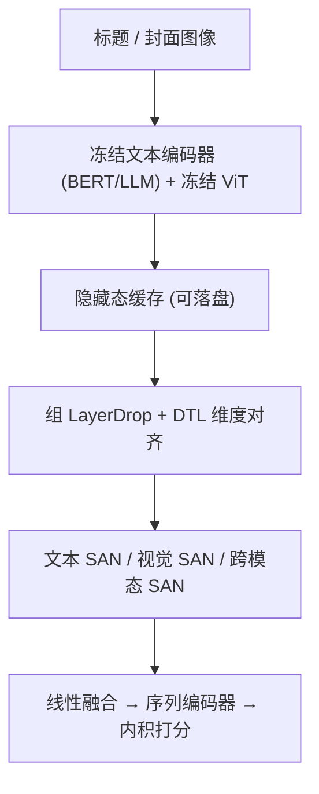
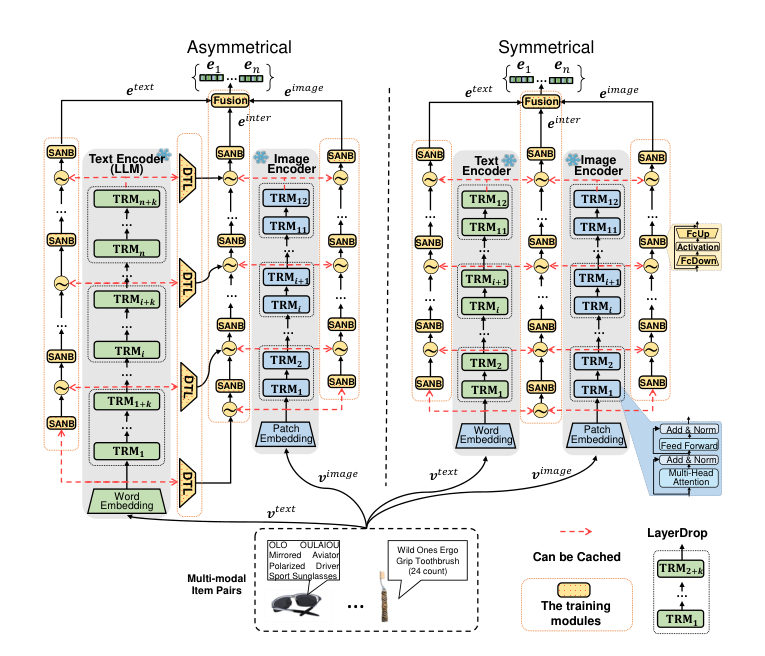

# Efficient and Effective Adaptation of Multimodal Foundation Models in Sequential Recommendation (多模态基础模型在序列推荐中的高效有效适配)

- **会议/期刊**: IEEE Transactions on Knowledge and Data Engineering (TKDE)
- **作者与机构**: Junchen Fu, Xuri Ge, Xin Xin, Alexandros Karatzoglou, Ioannis Arapakis, Kaiwen Zheng, Yongxin Ni, Joemon M. Jose（格拉斯哥大学、山东大学、Amazon、Telefonica Research、中科大）
- **推荐链路定位**: 召回（物品表征编码 + 序列编码器）
- **研究方向**: 多模态推荐 / 序列推荐
- **论文原文**: [https://arxiv.org/abs/2411.02992v2](https://arxiv.org/abs/2411.02992v2)
- **开源代码**: [https://github.com/GAIR-Lab/IISAN](https://github.com/GAIR-Lab/IISAN)

## TL;DR (1分钟核心速览)

多模态序列推荐（MoRec）若端到端全量微调 BERT/ViT 甚至 LLM 编码器，显存与训练时间开销巨大；而 Adapter/LoRA 等嵌入式 PEFT 只省可训练参数、不省激活与反向传播。本文提出 IISAN-Versa：把可训练侧适配网络（SAN）与冻结骨干**解耦**，用组 LayerDrop 把 70B LLM 的 80 层压到 6 层、用维度变换层对齐 LLM 与 ViT 的嵌入维度，从而首次统一适配**对称与非对称**多模态基础模型。在 Amazon 三数据集与 MicroLens 上采用 Leave-One-Out + Full-Ranking 协议，HR@10 相对 IISAN-VS 再提升 3.1%–6.3%，显存较 FFT 降约 15 倍、较 EPEFT 降约 12 倍。

## Background & Motivation (背景与核心矛盾)

- **主流范式**: MoRec 用预训练文本编码器（BERT/LLM）与视觉编码器（ViT）编码物品的标题与封面，再送入 SASRec 类序列编码器做下一物品预测；为追求效果普遍采用端到端全量微调。
- **前人局限**: ① FFT 计算不可承受；Adapter/LoRA/BitFit 等 EPEFT 把可训练模块嵌进骨干内部，反向传播仍需穿越整个大模型，显存与训练时间几乎不降；② 前作 IISAN 的解耦 PEFT 虽解决了效率，但**只能处理对称结构**（文本与图像编码器层数、维度一致），无法接入 Llama-3-70B 这类远大于 ViT 的文本编码器。
- **核心洞察 (Key Insight)**: 图 1 显示开源视觉 Transformer 普遍 < 1B 参数（ViT-22B 等闭源），而文本侧 LLM 已达 70B–405B，**非对称是常态而非例外**；同时 IISAN 的隐藏态可缓存特性意味着骨干前向只需算一次，真正的瓶颈在反向图。
- **本文切入点**: 把"解耦"从对称推广到非对称——用组 LayerDrop 将 LLM 的层数压缩到与 ViT 对齐，用 DTL 对齐维度，使 70B 文本编码器也能在单张 A6000 上参与适配。

## Method (核心方法设计)

### 1. 整体框架 (Overall Architecture)

物品的标题与封面分别送入冻结的文本编码器（BERT 或 LLM）与图像编码器（ViT），逐层抽取隐藏态 $\{h_i^t\},\{h_i^v\}$。三条解耦的可训练支路并行工作：文本模态内 SAN 输出$e^t$、视觉模态内 SAN 输出$e^v$、跨模态 SAN 输出$e^{inter}$，三者拼接后经线性融合层得到物品嵌入$e_{item}=FL([e^v:e^{inter}:e^t])$，送入 2 层 Transformer 序列编码器，与候选物品嵌入内积打分。训练时骨干隐藏态可预先缓存到磁盘，反向传播只穿越轻量 SAN，不触碰骨干。

<figure class="paper-figure" markdown="span">
  <figcaption>图 2：面向序列推荐的 IISAN-Versa 概览。IISAN-Versa 模型引入通用的模态内与模态间侧适配网络（SAN），用于在序列推荐中适配对称与非对称多模态基础模型。这些网络由多个 SAN 块（SANB）和可学习融合门组成，融合两种非对称结构。IISAN-Versa 采用维度变换层（DTL）对齐嵌入维度。值得注意的是，我们利用 LayerDrop 进一步消除冗余。该非对称框架采用偶数</figcaption>
</figure>

### 2. 关键设计拆解 (Key Designs)

1. **解耦侧适配网络 SAN（Intra / Inter）**：痛点是把 Adapter 嵌进骨干导致反向链穿越全部 Transformer 块。本文将 SANB 置于骨干之外，用可学习门融合上一 SANB 输出与当前层隐藏态：$h_i^{B_{intra}}=SANB_{intra}(\mu_i^t h_{i-1}^{B_{intra}}+(1-\mu_i^t)h_i^t)$，跨模态侧则融合视觉态与（对齐后的）文本态：$h_i^{B_{inter}}=SANB_{inter}(\beta_i h_i^v+(1-\beta_i)X_i+h_{i-1}^{B_{inter}})$。由于骨干输出是常量，反向图被截断在 SAN 内部，这是显存与时间双降的根本来源。

2. **组 LayerDrop + 维度变换层 DTL（非对称适配核心）**：LLM 有 $L_t$层而 ViT 仅$L_v$层，且隐藏维$d_{in}\gg d_{out}$。本文对文本侧按$\max_k (L_t-k\cdot L_v/2\ge 1)$均匀抽取$k$组层（如 80 层取$\{5,20,35,50,65,80\}$共 6 层），视觉侧沿用隔层丢弃；再用$z=Wx+b,\ W\in\mathbb{R}^{d_{out}\times d_{in}}$ 把 LLM 高维态压到 ViT 维度。直觉是：深层 LLM 的层间高度冗余，均匀抽样既保留全深度跨层交互，又把 SANB 数量压到与视觉侧对称，使跨模态融合在"同层数"语义下成立。

3. **训练目标、负采样与推理效率**：采用 in-batch 去偏交叉熵（按物品流行度 $p_i$做 log 校正），负样本即 batch 内其他用户交互物品，无需额外负采样：$\mathcal{L}_{CE}=-\sum_u\sum_i \log\frac{\exp(\hat{y}_{ui}-\log p_i)}{D_{ui}}$。推理阶段骨干前向可离线预计算并缓存，在线仅需跑 SAN + 序列编码器；缓存代价为磁盘（Scientific 全集 70B 模型全层 26 GB，LayerDrop 后仅 2.4 GB）。

## Experimental Setup & Evaluation Protocol (实验设置与评估协议)

- **数据集与预处理**:

| 数据集 | #Users | #Items | #Interactions | 稀疏度/密度 | 特征/场景说明 |
| :--- | :---: | :---: | :---: | :---: | :--- |
| Scientific | 12,076 | 20,314 | 81,711 | 99.97% 稀疏 | Amazon 标题+封面 |
| Instrument | 10,000 | 19,246 | 75,022 | 99.96% 稀疏 | Amazon 标题+封面 |
| Office | 10,000 | 22,785 | 71,276 | 99.97% 稀疏 | Amazon 标题+封面 |
| MicroLens | 100,000 | 19,738 | 719,405 | 99.96% 稀疏 | 标题+封面+视频（LLaVA 生成 caption） |
| NINERec-1M | 151,495 | 104,605 | 1,035,822 | 99.99% 稀疏 | 百万级交互采样 |

- **数据划分与防穿越 (Splitting Strategy)**: `Leave-One-Out`——最后一项测试、倒数第二项验证、其余训练。
- **排名评测协议 (Ranking Protocol)**: 无偏 `Full-Ranking`，预测物品对**全量物品集**排序，指标 HR@10 与 NDCG@10。
- **对比基线与超参设置**: 基线含 FFT、Adapter、LoRA、BitFit、IISAN-VS，以及 MicroLens 上的 DSSM/LightGCN/NFM/DeepFM、GRU4Rec/SASRec/NextItNet、MMGCN/GRCN、GRU4Rec-V 等；序列编码器固定 2 层 2 头、嵌入维 64，SANB 隐维在 $\{8,\dots,2048\}$搜索，学习率$10^{-5}$–$10^{-3}$，单卡 A6000，显著性用配对 t 检验$p<0.05$。

## Key Experimental Results (实验关键数据)

### 1. 主实验对比 (Main Results)

Amazon 三数据集（ViT-base 固定，IISAN-VS 用 BERT-base，IISAN-VA 用 BERT-large）：

| Method | Scientific H@10 | Scientific N@10 | Instrument H@10 | Instrument N@10 | Office H@10 | Office N@10 |
| :--- | :---: | :---: | :---: | :---: | :---: | :---: |
| FFT | 6.62 | 4.06 | 8.76 | 6.76 | 6.30 | 4.58 |
| Adapter | 6.61 | 3.91 | 8.82 | 6.83 | 6.65 | 4.85 |
| LoRA | 6.62 | 4.09 | 8.43 | 6.64 | 6.55 | 4.78 |
| BitFit | 6.37 | 3.76 | 8.65 | 6.71 | 6.78 | 4.87 |
| IISAN-VS | 6.83 | 4.14 | 9.06 | 7.01 | 6.80 | 4.92 |
| **IISAN-VA** | **7.29** | **4.41** | **9.52** | **7.17** | **7.02** | **5.11** |
| Improv.% (vs VS) | +6.31% | +6.12% | +4.83% | +2.23% | +3.13% | +3.72% |

MicroLens 公开基准（IISAN-VS 用 BERT-base，IISAN-VA 用 BERT-large）：

| Class | Model | HR@10 | NDCG@10 |
| :--- | :--- | :---: | :---: |
| IDRec (SR) | SASRec | 0.0909 | 0.0517 |
| VideoRec | GRU4Rec-V（前 SOTA） | 0.0954 | 0.0517 |
| VideoRec | SASRec-V | 0.0948 | 0.0515 |
| MM VideoRec | Full Finetuning | 0.0926 | 0.0493 |
| IISAN-Versa | IISAN-VS | 0.0960 | 0.0530 |
| IISAN-Versa | **IISAN-VA** | **0.0964** | **0.0533** |

### 2. 消融实验 (Ablation Study)

Scientific 数据集（IISAN-VS 用 BERT-base，IISAN-VA 用 BERT-large）：

| 配置 | VS H@10 | VS N@10 | VA H@10 | VA N@10 |
| :--- | :---: | :---: | :---: | :---: |
| w/o LayerDrop | 6.73 | 4.04 | 6.85 | 4.11 |
| w/o Modality Gate | 6.58 | 3.89 | 7.08 | 4.30 |
| Frozen Backbone（仅训序列编码器） | 6.00 | 3.53 | 5.81 | 3.37 |
| w/o Inter-modality | 6.38 | 3.89 | 6.96 | 4.21 |
| w/o Intra-modality | 6.41 | 3.83 | 7.12 | 4.43 |
| **Full IISAN-Versa** | **6.83** | **4.14** | **7.29** | **4.41** |

### 3. 关键实验发现 (Key Findings)

1. **非对称适配带来真实增益，且文本编码器存在缩放效应**：BERT-large 换入后 HR@10 从 6.83 升至 7.29；继续放大到 Llama3-70B-GPTQ 时 HR@10 达 8.14、NDCG@10 达 4.94，四组规模（PLM 0.0706 → Base LLM 0.0763 → MoE 0.0790 → 70B 0.0808）均值单调上升，说明 IISAN-Versa 能继承 LLM 的缩放红利。
2. **文本主导、视觉边际递减**：门控可视化显示文本门恒 > 0.5、视觉门仅 0.26–0.42，且 IISAN-VA 比 VS 更依赖文本；把 ViT-base 换成 ViT-large/huge 在强文本编码器下几乎无增益甚至下降，而弱文本（BERT-tiny）+ EVA-ViT 可从 0.0683 提到 0.0744——视觉扩容只在文本弱时划算。
3. **LayerDrop 是效率与效果的双赢而非妥协**：去掉 LayerDrop 后 VS 的 HR@10 反降 0.1%，VA 降幅更大（6.85 vs 7.29），说明深层冗余确实存在；6+6 组层配置在 12 种组合中均值最优（7.08/4.33），且把 70B 模型缓存从 26 GB 压到 2.4 GB、训练时间大幅下降。

## Highlights & Limitations (亮点、对比与审稿批判)

- **与代表作对比 (vs. Prior Work)**: 与 Adapter/LoRA/BitFit 等 EPEFT 的本质区别在于反向图是否穿越骨干——EPEFT 只减可训练参数，IISAN-Versa 直接截断反向链并缓存前向；与前作 IISAN（SIGIR'24）的区别在于从"仅对称"扩展到"对称+非对称"，用组 LayerDrop + DTL 两个轻量算子解锁 LLM 文本编码器；与 VIP5 相比，本文同时适配文本与视觉两侧而非只挂文本 Adapter。
- **可迁移亮点**: ① "组均匀抽样 + 维度变换"是把任意深度/宽度不匹配的双塔对齐到可融合状态的通用配方，可直接迁移到图文检索、VQA 等双塔任务；② 隐藏态落盘缓存 + 只缓存 LayerDrop 后有用层的做法，为工业界在有限 GPU 上接入 70B 级编码器提供了可落地路径。
- **审稿级局限批判**: ① 缓存策略以磁盘换显存，70B 全层需 26 GB/数据集，物品库扩张或跨域多场景时存储成本会线性膨胀，论文未给出增量更新方案；② 效率对比仅在 BERT-base+ViT-base 与单卡 A6000 上完成，缺少与 LoRA 在同等效果下的端到端时延/吞吐对比，也未报告线上 A/B；③ 视觉侧结论（强文本下视觉无用）依赖 Amazon/MicroLens 这类标题信息极强的电商数据，在视觉主导的短视频场景可能不成立。

## Rating (四维评分)

- **方法创新性 (Novelty)**: ⭐⭐⭐⭐ （解耦 PEFT 从对称推广到非对称是清晰增量，组 LayerDrop + DTL 简洁有效，但单点算子本身新意有限）
- **评估协议与实验扎实度 (Protocol & Experiments)**: ⭐⭐⭐⭐ （5 数据集 + Full-Ranking + 配对 t 检验 + 14 个文本编码器缩放实验 + 12 种层组合消融，覆盖充分；缺线上验证）
- **写作与数学规范度 (Clarity & Rigor)**: ⭐⭐⭐⭐ （前向/反向传播链式展开的效率分析严谨，符号统一；部分公式编号与变量命名有笔误）
- **工业落地与复现价值 (Industrial & Practical Value)**: ⭐⭐⭐⭐⭐ （代码开源，单卡可训 70B 编码器，显存降 12–15 倍、提速 16–20 倍，缓存换显存的权衡对工业部署极具参考价值）

