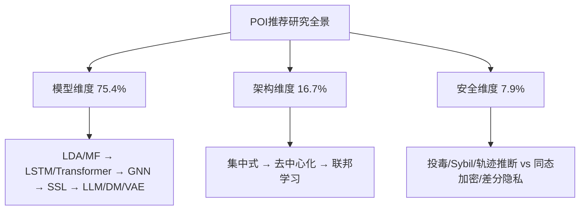
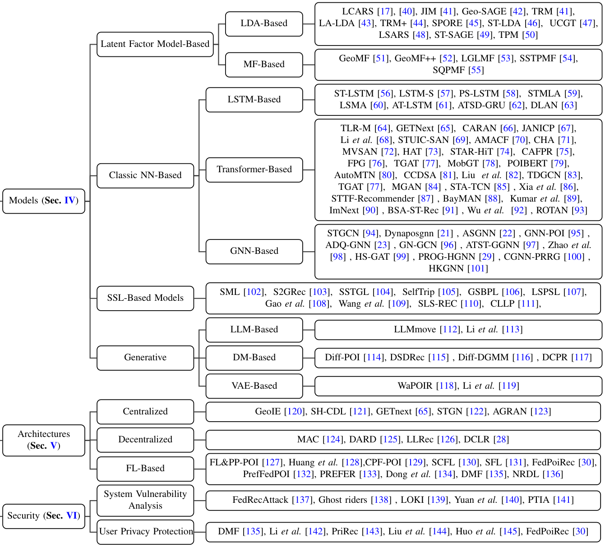

# A Survey on Point-of-Interest Recommendation: Models, Architectures, and Security (兴趣点推荐综述：模型、架构与安全)

- **会议/期刊**: IEEE TKDE 2025
- **作者与机构**: Qianru Zhang, Peng Yang, Junliang Yu, Haixin Wang, Xingwei He, Siu-Ming Yiu, Hongzhi Yin（香港大学、昆士兰大学、UCLA）
- **推荐链路定位**: 召回 / 精排 / 端到端生成式（覆盖全链路模型与部署架构）
- **研究方向**: 时空轨迹与 POI 本地生活推荐 / 去偏公平、可信隐私与工业架构
- **论文原文**: [论文原文链接](https://arxiv.org/abs/2410.02191v2)
- **开源代码**: 暂未开源

## TL;DR (1分钟核心速览)

现有 POI 推荐综述多停留在传统矩阵分解或早期深度学习阶段，缺乏对 LLM/扩散模型等前沿模型、去中心化/联邦部署架构以及投毒攻击与隐私防护的系统梳理。本文提出"模型—架构—安全"三维分类框架，系统梳理从 LDA/MF 到 Transformer/GNN/SSL/LLM/DM 的模型演进、从集中式到联邦学习的架构迁移，以及数据投毒与同态加密等安全议题，并给出未来研究方向。作为综述，其价值在于分类体系与横向对比表，而非单一基准上的数值提升。

## Background & Motivation (背景与核心矛盾)

- **主流范式**: 早期 POI 推荐以 LDA 主题模型与矩阵分解（GeoMF 系列）为主，随后 LSTM/Transformer 建模签到序列、GNN 建模用户-POI 图结构成为主流。
- **前人局限**: 现有综述（Zhao 2016、Werneck 2020、Islam 2022、Wang 2023）仅覆盖传统或早期深度方法，未涉及 GNN/LLM/DM 等新模型；且几乎不讨论去中心化部署与安全隐私，Yin 2024 的端侧综述又不涉及 POI 基础模型。
- **核心洞察 (Key Insight)**: 作者统计现有文献分布发现——模型类研究占 75.4%，架构类仅 16.7%，安全类仅 7.9%，安全与架构是明显的研究洼地。
- **本文切入点**: 以"模型演进 × 架构迁移 × 安全防护"三正交维度构建统一分类体系，填补前沿模型与部署安全交叉处的综述空白。

## Method (核心方法设计)

### 1. 整体框架 (Overall Architecture)

本文为综述，其"方法"即分类学框架。整体沿三条主线展开：模型维度按 LDA→MF→LSTM→Transformer→GNN→SSL→生成式（LLM/DM/VAE）的时间轴梳理技术演进；架构维度按集中式→去中心化→联邦学习刻画部署范式迁移；安全维度按系统脆弱性（投毒、Sybil、轨迹推断）与用户隐私保护（同态加密、差分隐私、联邦聚合）两条支线组织。三条主线在"模型-架构-安全"交叉表中相互映射，最终归纳出未来研究方向。

<figure class="paper-figure" markdown="span">
  <figcaption>图 1：现有 POI 推荐研究在模型、架构与安全方面的分类体系</figcaption>
</figure>

### 2. 关键设计拆解 (Key Designs)

1. **模型演进分类学（从隐因子到生成式）**：针对不同模型族给出统一形式化。经典神经网络以交叉熵为目标 $\theta^{*}=\arg\min_{\theta}-\sum_{i=1}^{U}\sum_{j=1}^{V}y_{ij}\log p_{ij}(\theta)$；SSL 采用对比损失拉近正对、推远负对；LLM 将推荐转为自回归文本生成$\mathcal{L}(\theta)=-\sum_{j}\sum_{i}\log p(r_i|r_1,...,r_{i-1},u_j,c,\theta)$；DM 以 KL 散度对齐生成分布与真实分布。该拆解的价值在于把异构模型统一到"预测目标函数"视角下横向比较。

2. **架构效率度量（集中式/去中心化/联邦）**：作者用三个"效率比"公式刻画架构权衡——集中式效率 $=\frac{\text{Scalability}+\text{Cost Efficiency}+\text{Accessibility}}{\text{Initial Hardware}+\text{Physical Constraints}}$；去中心化效率$=\frac{\text{Local Processing}+\text{Storage}}{\text{Bandwidth}+\text{Cloud Cost}}$；联邦效率$=\frac{\text{DPP}+\text{Computational Optimization}}{\text{Bandwidth}+\text{Model Aggregation}}$。联邦全局目标为$\Theta^{*}=\arg\min_{\Theta}\sum_{k=1}^{K}w_k\mathcal{L}_k(\Theta)$，在数据不出端的前提下聚合本地更新，兼顾隐私与协同学习。

3. **安全威胁与防护形式化**：投毒攻击建模为 $\tilde{D}=\arg\max_{D'}\mathcal{L}_{attack}(\Theta;D\cup D')$，即在原数据$D$上注入恶意样本$D'$以最大化攻击损失；同态加密利用$\text{Enc}(x)\oplus\text{Enc}(y)=\text{Enc}(x+y)$、$\text{Enc}(x)\otimes\text{Enc}(y)=\text{Enc}(x\cdot y)$ 的密文同态性，使服务器在不解密原始位置数据的情况下完成聚合计算，是 FedPOIRec 等框架的隐私基石。

## Experimental Setup & Evaluation Protocol (实验设置与评估协议)

作为综述，本文不设统一实验，而是汇总各代表工作在标准 POI 基准上的评测配置：

- **数据集与预处理**: 主流基准为 Foursquare（NYC/TKY/SIN 等城市切片）、Gowalla（CA/NYC）、Weeplaces、Brightkite、Yelp，部分工作用 Meituan、Ctrip 等工业数据。签到数据通常按用户序列组织，过滤低频用户/POI。

| 数据集 | 典型切片 | 主要用途 | 特征/场景说明 |
| :--- | :---: | :---: | :--- |
| Foursquare | NYC / TKY / SIN | 序列与图模型主基准 | 城市级签到，含时空戳 |
| Gowalla | CA / NYC | 跨城市泛化 | 全球签到，稀疏度高 |
| Weeplaces | NY / SF | 序列推荐 | 用户行程数据 |
| Brightkite | — | 早期 MF/GNN | 稀疏签到 |
| Yelp / Meituan | — | 工业场景 | 评论+POI 语义 |

- **数据划分与防穿越 (Splitting Strategy)**: 各工作不一，序列类多用 `Leave-One-Out`（留最后一次签到作测试）或按时间戳切分，图类常用比例划分；综述未强制统一，属其评估梳理的薄弱点。
- **排名评测协议 (Ranking Protocol)**: 主流采用 `Sampled Ranking`（每正样本配 100 或 500 负样本）计算 HR@K / NDCG@K / MRR，少数用 `Full-Ranking`；负采样多为均匀采样，部分工作用地理距离加权负采样。
- **对比基线与超参设置**: 基线按模型族分组（LDA/MF、LSTM、Transformer、GNN、SSL、生成式），嵌入维度常见 $d=64\sim128$，序列长度多为 50–100。

## Key Experimental Results (实验关键数据)

### 1. 主实验对比 (Main Results)

综述本身无统一主实验表，作者以 Table III 对四类模型族做定性横向对比（效果/效率/可扩展性/可解释性）：

| 模型族 | 有效性 | 推理效率 | 训练可扩展性 | 可解释性 |
| :--- | :---: | :---: | :---: | :---: |
| 隐因子模型 (LFM) | 中等 | 高 | 高 | 中等 |
| 经典神经网络 (NN) | 高 | 视架构而定 | 中等 | 低 |
| 自监督 (SSL) | 高 | 视方法而定 | 中等 | 中等 |
| 生成式 (Gen-Models) | 高 | 低 | 低 | 高 |

### 2. 消融实验 (Ablation Study)

综述无消融实验，代之以文献分布统计作为"结构性证据"：

| 维度 | 文献占比 | 代表工作数（约） | 说明 |
| :--- | :---: | :---: | :--- |
| 模型 (Models) | 75.4% | 60+ | 精度/个性化研究密集 |
| 架构 (Architecture) | 16.7% | 15+ | 集中式/去中心化/联邦 |
| 安全 (Security) | 7.9% | 10+ | 投毒与隐私保护 |

### 3. 关键实验发现 (Key Findings)

1. **模型研究严重过载而安全研究稀缺**：模型类占 75.4%、安全类仅 7.9%，说明社区仍以精度为导向，位置数据的高敏感性（轨迹可反推住址/作息）与安全投入严重不匹配。
2. **生成式模型"高效果低效率"的权衡明确**：Table III 显示 Gen-Models 在有效性与可解释性上均达"高"，但推理效率与可扩展性均为"低"，意味着 LLM/DM 类 POI 推荐在实时 LBS 场景落地需依赖蒸馏或端侧轻量化。
3. **架构演进由隐私与延迟双轮驱动**：从集中式到联邦学习，核心收益是数据不出端（DPP）与边缘加速（PREFER），但代价是通信开销与异构数据同步难题，FedPOIRec 用 CKKS 全同态加密在社交好友间交换参数即为此权衡的典型折中。

## Highlights & Limitations (亮点、对比与审稿批判)

- **与代表作对比 (vs. Prior Work)**: 相较 Zhao 2016（仅传统 MF/LDA）与 Wang 2023（仅深度学习模型），本文首次将 GNN/LLM/DM 前沿模型、联邦/去中心化架构与安全隐私纳入同一框架；相较 Yin 2024 端侧综述，本文补齐了 POI 基础模型与时空建模的专门讨论。
- **可迁移亮点**: (1) 三维正交分类法可迁移到其他敏感数据推荐（如健康、金融）的综述组织；(2) 三个"架构效率比"公式提供了部署选型的快速量化直觉。
- **审稿级局限批判**: (1) 作为综述缺乏统一复现实验，各工作数据集划分与采样协议不一致，横向数值比较可信度有限；(2) 安全部分对投毒防御的定量评估（如攻击成功率下降幅度）着墨较少，且未讨论 LLM 推荐特有的提示注入风险。

## Rating (四维评分)

- **方法创新性 (Novelty)**: ⭐⭐⭐ （分类框架与效率公式有组织创新，但综述本身不提出新算法）
- **评估协议与实验扎实度 (Protocol & Experiments)**: ⭐⭐⭐ （文献覆盖全面、对比表详实，但缺统一基准复现与定量安全评估）
- **写作与数学规范度 (Clarity & Rigor)**: ⭐⭐⭐⭐ （形式化统一、图表清晰，模型族对比表信息密度高）
- **工业落地与复现价值 (Industrial & Practical Value)**: ⭐⭐⭐⭐ （架构效率公式与联邦/加密方案对 LBS 工业部署有直接参考价值，但无开源代码）

