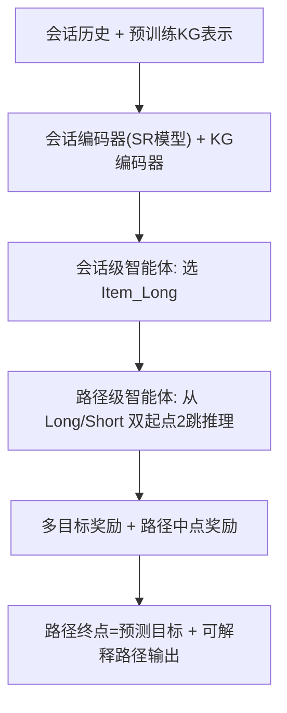

# Explainable Session-based Recommendation via Path Reasoning (基于路径推理的可解释会话推荐)

- **会议/期刊**: IEEE TKDE
- **作者与机构**: Yang Cao, Shuo Shang, Jun Wang, Wei Zhang（华东师范大学 / 电子科技大学）
- **推荐链路定位**: 重排（在已有 SR 模型输出之上做可解释路径推理与重打分）
- **研究方向**: 序列与会话推荐 / 图神经网络与知识图谱推荐
- **论文原文**: [论文原文链接](https://arxiv.org/abs/2403.00832v1)
- **开源代码**: 暂未开源

## TL;DR (1分钟核心速览)

现有 SR 模型精度高但不可解释，而传统路径推理只关注知识图谱探索、忽略会话序列模式。本文提出 PR4SR——首个用分层强化学习为 SR 提供可解释路径的通用框架：会话级智能体从会话中挑选"重要物品"作为推理起点，路径级智能体在知识图谱上做路径推理，并设计多目标奖励适配序列跳转行为、路径中点奖励提升探索效率，同时把图像特征注入知识图谱。在 4 个数据集上实例化 5 种 SR 模型，相对无解释框架平均提升 HR@20 达 13%–42%，相对唯一可解释基线 REKS 平均提升 6%–30%。

## Background & Motivation (背景与核心矛盾)

- **主流范式**: SR 侧以 GRU4Rec/NARM/SASRec/SR-GNN/GCSAN 等深度序列模型追求精度；可解释侧以 PGPR/ADAC/REKS 等强化学习路径推理在知识图谱上生成解释路径。
- **前人局限**: (1) 传统路径推理以用户实体或会话末位物品为起点，忽略会话中"跳转行为"（skip behavior）——与目标最相关的物品未必在序列末尾；(2) 奖励函数只奖励终点命中，不奖励"接近目标"的中间探索，且知识图谱缺少图像等属性，实体间连边稀疏、路径多样性差。
- **核心洞察 (Key Insight)**: 会话中不同物品对推理起点的价值不同（图 1(c) 中末位物品与目标在 2 跳内无路径，而首物品可经共享用户连通），且短路径更易被用户接受，因此"选对起点 + 奖励中间进展"是提升可解释性与精度的关键。
- **本文切入点**: 用分层 RL 把"选起点"与"走路径"解耦为两个 MDP，并重设计奖励与知识图谱构建。

## Method (核心方法设计)

### 1. 整体框架 (Overall Architecture)

PR4SR 先由会话编码器（直接复用被增强的 SR 模型）产出会话状态 $S_{se}$，会话级智能体据此从会话历史中选出重要物品$Item_{Long}$，同时保留末位物品$Item_{Short}$作为第二起点；路径级智能体以$S_{se}$、知识图谱实体表示与当前节点表示拼接为状态，分别从两个起点在知识图谱上做 2 跳推理，路径终点即预测目标（未来$T$ 步物品序列）。训练时三路损失联合优化，推理时用概率 beam search 解码路径并给出解释。

### 2. 关键设计拆解 (Key Designs)

1. **分层双智能体（Session-level + Path-level Agent）**：单智能体无法同时处理"会话内选物品"与"图谱内选(关系,实体)"两种异构动作空间。会话级动作概率 $P_{se}=\mathrm{softmax}((W_1A_{se})\otimes(W_2S_{se}))$，路径级$P^{L}=\mathrm{softmax}((W_3A^{L}_{t})\otimes(W_4S^{long}_{t}))$，且 Long/Short 两条路径共享参数$W_3,W_4$。直觉：把"起点选择"显式建模，避免 REKS 只押注末位物品导致的路径不可达。

2. **多目标奖励 + 路径中点奖励**：针对跳转行为，设连续 $T$个目标存入$T_{list}$，命中即按位置给分：
$$R_{Multi}=\begin{cases}T-Index(v_{end}), & v_{end}\in T_{list}\\ \log(S^{KG}_{end}\cdot S^{KG}_{tar_0}), & \text{otherwise}\end{cases}$$
针对"终点才对才给奖励"的稀疏问题，预存起点到各目标的中间节点字典，定义 $R_{PMid}=\max\left(0,\max_{i\in range(T)}[T-i\mid (r,e)\in dic^i_{path}]\right)$。直觉：让智能体在错误路径上也能因"更靠近目标"获得梯度，加速收敛并提升探索效率。

3. **图像特征增强的知识图谱构建**：用百度图像识别 API 抽取每张商品图 top-5 特征（置信度 >50%），以 `image sim` 关系连到物品实体；按商品域把 `also viewed/also bought` 拆为同域与 `diff` 两类关系；合并同时被 `also viewed` 与 `also bought` 连接的重复实体为 `viewed bought`（Beauty 上减少约 30 万条连边）。直觉：补全属性、强化实体关联，使 2 跳内可达路径更多、解释形式更多样。

4. **训练目标与推理**：总损失 $\mathcal{L}=\mathcal{L}_{Ce}+\alpha\mathcal{L}_{Path}+\beta\mathcal{L}_{Se}$，其中$\mathcal{L}_{Path},\mathcal{L}_{Se}$为带状态值基线的策略梯度损失，$\mathcal{L}_{Ce}$为会话编码器交叉熵；路径长度固定 2，动作空间上限 200，动作 dropout 0.7，$\gamma=0.99$，$T=5$，beam search 采样规模 100/1。

## Experimental Setup & Evaluation Protocol (实验设置与评估协议)

- **数据集与预处理**: 四个真实数据集，按"一天内交互为一个会话"切分，过滤交互数 <5 的物品与会话长度 <2 的会话。

| 数据集 | #Entities | #Relations | #Sessions | 平均会话长度 | 场景说明 |
| :--- | :---: | :---: | :---: | :---: | :--- |
| Beauty | 204,007 | 4,566,296 | 198,502 | 2.96 | Amazon 美妆 |
| Cellphones | 136,811 | 3,779,244 | 194,439 | 2.75 | Amazon 手机配件 |
| Baby | 97,851 | 3,099,721 | 160,792 | 2.014 | Amazon 母婴 |
| Douban-movie | 77,760 | 326,064 | 216,992 | 2.17 | 豆瓣电影 |

- **数据划分与防穿越 (Splitting Strategy)**: 会话级随机 `比例划分`（75% 训练 / 10% 验证 / 15% 测试），非全局时间戳切分，存在轻微信息泄漏风险。
- **排名评测协议 (Ranking Protocol)**: 采用 `Sampled Ranking`（候选池采样，非全库 Full-Ranking），指标为 HR@{5,10,20} 与 NDCG@{5,10,20}；解释质量用 50 人问卷（每数据集 30 例，PR4SR vs. REKS 二选一）。
- **对比基线与超参设置**: 5 个 SR 骨干（GRU4Rec、NARM、GCSAN、SR-GNN、SASRec）× {NONE, REKS, PR4SR} 三档；嵌入维度 400（$W_4\in\mathbb{R}^{800\times400}$），Adam 优化，Amazon 150 epoch / Douban 50 epoch，batch 256；$\alpha\in[0.005,0.05]$、$\beta\in[0.005,0.01]$ 按数据集网格搜索。

## Key Experimental Results (实验关键数据)

### 1. 主实验对比 (Main Results)

以最具代表性的 NARM 与 SASRec 骨干为例（NONE / REKS / PR4SR 三档，HR@10 与 NDCG@10）：

| 数据集 | 骨干 | NONE | REKS | PR4SR | vs. NONE | vs. REKS |
| :--- | :--- | :---: | :---: | :---: | :---: | :---: |
| Beauty | NARM | 11.88 | 14.82 | **17.01** | +43.2% | +14.8% |
| Beauty | SASRec | 14.11 | 15.34 | **17.26** | +22.3% | +12.5% |
| Cellphones | NARM | 10.98 | 10.94 | **14.16** | +29.0% | +29.4% |
| Cellphones | SASRec | 11.07 | 11.10 | **14.24** | +28.6% | +28.3% |
| Baby | NARM | 7.37 | 8.05 | **8.86** | +20.2% | +10.1% |
| Baby | SASRec | 7.22 | 8.09 | **8.91** | +23.4% | +10.1% |
| Douban | NARM | 6.78 | 7.25 | **8.28** | +22.1% | +14.2% |
| Douban | SASRec | 7.23 | 7.05 | **8.55** | +18.3% | +21.3% |

全指标平均：PR4SR 相对 NONE 提升 HR@20 约 13%–42%、NDCG@20 约 28%–37%；相对 REKS 提升 HR@20 约 6%–26%、NDCG@20 约 8%–26%。Cellphones 上 NDCG@5 相对 REKS 提升高达 30.14%。

### 2. 消融实验 (Ablation Study)

基于 NARM / SASRec，在 Beauty 与 Cellphones 上（HR@5 / NDCG@5 趋势）：

| 变体 | 移除内容 | 性能变化（相对完整 PR4SR） |
| :--- | :--- | :--- |
| PR4SR-Image | 去掉图像特征实体与 `image sim` 关系 | 精度略降，但解释路径多样性明显下降 |
| PR4SR-Merge_Edge | 不合并 `also viewed`/`also bought` 重复实体 | 精度下降，图谱冗余连边增多 |
| PR4SR-Session_Level_Agent | 仅用末位物品做起点 | **下降最大**，验证起点选择是关键 |
| PR4SR-Midpoint_Reward | 去掉路径中点奖励 | 精度下降，探索效率变低 |
| PR4SR-Multi_Target_Reward | 只保留单一目标点 | 精度下降，跳转行为未被奖励 |

### 3. 关键实验发现 (Key Findings)

1. **起点选择贡献最大**：去掉会话级智能体（退回 REKS 式末位起点）的性能跌幅超过去掉任一奖励项，说明"选对起点"是路径可达性的瓶颈；同时 PR4SR 在 Cellphones/Baby/Douban 上 k 越小提升越明显，契合用户更关注近邻推荐的实际购物习惯。
2. **多目标奖励的最优 $T>2$**：Beauty 上 NARM 在$T=5$达 HR@5=12.50（$T=1$仅 11.82），SASRec 在$T=3$ 达 12.84，定量证实跳转行为建模有效；且 PR4SR 随动作空间增大性能稳定上升，而 REKS 下降或停滞，说明其更能适应动态扩张的商品图谱。
3. **图像特征主要提升可解释性而非精度**：消融显示加入图像实体对 HR/NDCG 影响很小，但案例研究（图 10）中"pearl"特征使原本不可达的 item1→item5 出现两条 `image sim` 解释路径；50 人问卷中 PR4SR 在 Beauty/Cellphones/Baby 上分别以 56.2%/61.5%/57.8%（总体 60.0%）被选为更优解释。

## Highlights & Limitations (亮点、对比与审稿批判)

- **与代表作对比 (vs. Prior Work)**: 相比 PGPR（用户起点、无会话信息）与 REKS（末位物品起点、单目标奖励），PR4SR 首次把"起点选择"与"跳转行为奖励"纳入分层 RL；相比纯 SR 模型，它以插件形式同时输出预测与解释路径，且对注意力/RNN 骨干（NARM、SASRec）增益大于 GNN 骨干。
- **可迁移亮点**: (1) 路径中点奖励是一种通用的"过程奖励塑形"技巧，可迁移到任意稀疏终局奖励的图谱推理任务；(2) 按域拆分关系 + 合并重复实体的图谱清洗流程，可直接复用到电商知识图谱构建。
- **审稿级局限批判**: (1) 评估采用 Sampled Ranking 而非 Full-Ranking，且会话随机比例划分存在时间穿越，绝对数值可能偏乐观；(2) 路径长度固定为 2、每步动作空间上限 200，长程解释能力受限，且分层 RL + beam search 的在线推理开销与 5 个骨干的逐一适配成本未做延迟分析；(3) 解释质量仅靠 50 人小样本问卷，缺乏自动化的解释忠实度（faithfulness）指标。

## Rating (四维评分)

- **方法创新性 (Novelty)**: ⭐⭐⭐⭐ （首个分层 RL 路径推理框架，起点选择与跳转奖励设计有明确针对性，但 RL+KG 路径推理范式本身非全新）
- **评估协议与实验扎实度 (Protocol & Experiments)**: ⭐⭐⭐ （4 数据集 × 5 骨干 × 3 档对比较全面，但采样排序、随机划分与问卷规模削弱说服力）
- **写作与数学规范度 (Clarity & Rigor)**: ⭐⭐⭐⭐ （MDP 定义、奖励公式与算法伪代码完整清晰，符号表规范，个别公式排版有小瑕疵）
- **工业落地与复现价值 (Industrial & Practical Value)**: ⭐⭐⭐ （插件式增强易集成、图谱构建流程可复用，但未开源、RL 训练与 beam search 推理开销较大）

