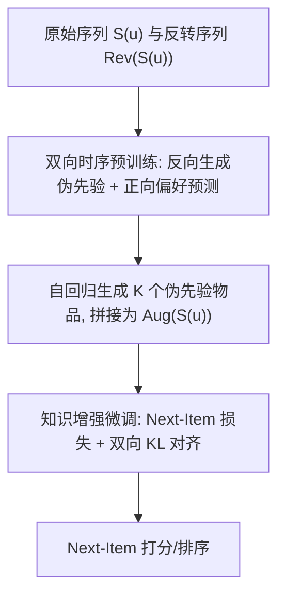
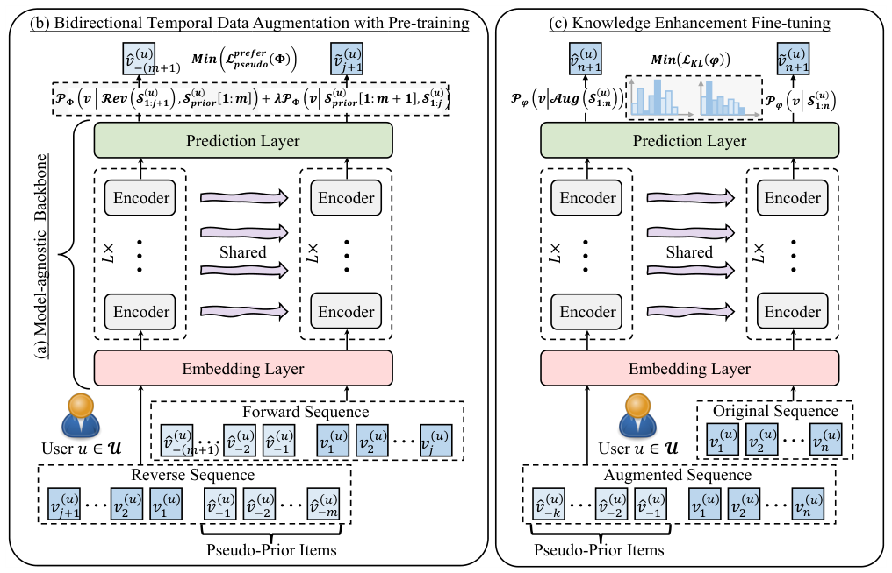

# Improving Sequential Recommendations via Bidirectional Temporal Data Augmentation with Pre-training (基于预训练的双向时序数据增强改进序列推荐)

- **会议/期刊**: IEEE TKDE 2025
- **作者与机构**: Juyong Jiang, Peiyan Zhang, Yingtao Luo, Chaozhuo Li, Kai Zhang 等（HKUST(GZ)、HKUST、CMU、MSRA、ECNU、UIC）
- **推荐链路定位**: 召回（序列 Next-Item 预测）
- **研究方向**: 序列与会话推荐 / 自监督对比学习与交互去噪
- **论文原文**: [https://arxiv.org/abs/2112.06460v6](https://arxiv.org/abs/2112.06460v6)
- **开源代码**: [https://github.com/juyongjiang/BARec](https://github.com/juyongjiang/BARec)

## TL;DR (1分钟核心速览)

序列推荐在短序列上信息稀缺，随机扰动式增强（mask/crop/replace）破坏时序依赖，而 ASReP 的反向生成伪先验物品在正向语境下存在时序错配。BARec 提出**双向时序增强预训练**：在反向生成伪先验物品的同时，用这些伪物品去正向预测用户尾部偏好，强制生成物与真实偏好一致；再用**双向 KL 知识增强微调**把增广序列与原序列映射到同一表征空间，避免熵塌缩。在 5 个基准（含 Tenrec 大规模）上，全库排序协议下 Beauty Recall@5 相对 ASReP 提升 16.62%，Phones NDCG@5 提升 50.29%。

## Background & Motivation (背景与核心矛盾)

- **主流范式**: Transformer 序列推荐（SASRec/BERT4Rec）配合数据增强缓解稀疏；增强路线分两支——随机扰动（mask/crop/add/replace、CL4SRec 对比学习）与生成式（ASReP 反向生成伪先验物品）。
- **前人局限**: ① 随机扰动直接破坏物品间时序依赖，短序列对微小改动极敏感，实验显示其相对 SASRec 普遍**负增益**；② ASReP 仅做反向（future-to-past）预训练，生成的伪先验物品在正向（past-to-future）语境下与真实偏好错配，长序列（$L\ge 20$）上甚至不如 SASRec（图 1 红框）。
- **核心洞察 (Key Insight)**: 作者用 Bayes 定理证明 $P(A\mid B)=P(B\mid A)\Leftrightarrow P(A)=P(B)$，即正向相关**不蕴含**反向一致，除非两段物品集等概率共现——这从理论上解释了 ASReP 的错配根源；同时指出增广序列的 Shannon 熵低于原序列，会削弱表征能力。
- **本文切入点**: 在反向生成时引入正向偏好约束（双向预训练），并用 KL 对齐解耦"增强带来的信息"与"模型表征学习"。

## Method (核心方法设计)

### 1. 整体框架 (Overall Architecture)

BARec 采用"模型无关骨干 + 预训练 + 微调"三段式。骨干为标准因果 Transformer（嵌入层 + $L$层 CMHSA/PFFN + 预测层）。阶段一：将用户序列反转得$\mathrm{Rev}(S^{(u)}_{1:n})$，自回归生成伪先验物品$S^{(u)}_{\text{prior}}$，同时用这些伪物品正向预测用户尾部偏好，双向联合预训练。阶段二：对长度$<M$的短序列，用预训练模型贪心生成$K$个伪先验物品拼接到序列头部得$\mathrm{Aug}(S^{(u)}_{1:n})$。阶段三：在增广序列上做 shift-one-step 微调，并加入原/增广序列预测分布的双向 KL 对齐项。

<figure class="paper-figure" markdown="span">
  <figcaption>图 2. 我们提出的 BARec 框架的架构包含三个核心组件：(a) 与模型无关的骨干网络，包含嵌入层、L× 编码器层和预测层；(b) 双向时间数据增强策略，结合预训练，旨在生成高保真的伪先验物品，保留用户偏好并增强物品间的语义关联；(c) 面向下游任务（即序列推荐）的知识增强微调阶段。</figcaption>
</figure>

### 2. 关键设计拆解 (Key Designs)

1. **双向时序预训练（Bidirectional Temporal Pre-training）**：针对 ASReP 反向生成与正向偏好错配，在反向掩码预测损失上叠加一项"用伪先验物品正向预测尾部偏好"的损失：
$$\mathcal{L}^{\text{prefer}}_{\text{pseudo}}=-\sum_{u}\sum_{t\in T^{(u)}_{\text{pseudo}}}\Big[\log P_\Phi\big(S^{(u)}_{-t}\mid \mathrm{Rev}(S^{(u)}),S^{(u)}_{\text{prior}[1:t-1]}\big)+\lambda\!\!\sum_{f\in F^{(u)}_{\text{prefer}}}\!\!\log P_\Phi\big(S^{(u)}_{f}\mid S^{(u)}_{\text{prior}[1:f]},S^{(u)}_{1:n-\lfloor n\gamma_{\text{prefer}}\rfloor}\big)\Big]$$
直觉：伪先验物品若真能"代表"用户偏好，就应能正向预测出真实尾部行为，这一约束把反向生成锚定到正向语义上，从而保证偏好保真。

2. **知识增强微调（Knowledge Enhancement Fine-tuning）**：增广序列熵更低（$H(P_\phi)_{\text{aug}}<H(P_\phi)_{\text{org}}$），易致表征迟钝/过拟合。作者用双向 KL 把增广序列与原序列的预测分布拉齐：
$$\mathcal{L}_{\text{KL}}(\phi)=\tfrac{1}{2}\big[D_{\text{KL}}(P_\phi(v\mid \mathrm{Aug})\|P_\phi(v\mid S))+D_{\text{KL}}(P_\phi(v\mid S)\|P_\phi(v\mid \mathrm{Aug}))\big]$$
双向（而非单向）KL 避免一方塌缩为另一方，使表征空间对两种序列"同等敏感"，维持跨序列长度的 Shannon 熵一致。

3. **训练目标、负采样与推理效率**：最终损失 $\mathcal{L}^{\text{final}}_{FT}=\mathcal{L}_{FT}+\alpha\cdot\mathcal{L}_{\text{KL}}$，其中$\mathcal{L}_{FT}$为带 gold-label 截断（仅保留最近$clip_k=\lfloor|\mathrm{Aug}|\eta_{\text{gold}}\rfloor$ 个标签）的 softmax 交叉熵 + 全库负样本项，**免显式负采样**（全库 softmax）。推理时仅需一次前向，伪物品生成只在训练前的离线阶段完成，在线开销与 SASRec 同阶。

## Experimental Setup & Evaluation Protocol (实验设置与评估协议)

- **数据集与预处理**: Amazon 三品类与 Yelp 均 `5-core` 过滤，Tenrec 取 QK-video 子集：

| 数据集 | #Users | #Items | #Interactions | 密度 | 场景说明 |
| :--- | :---: | :---: | :---: | :---: | :--- |
| Beauty | 22,363 | 12,101 | 198,502 | 0.07% | 美妆，短序列占 32% ($L\le3$) |
| Phones | 27,879 | 10,429 | 194,439 | 0.06% | 手机配件 |
| Yelp | 30,431 | 20,033 | 316,354 | 0.05% | 本地生活（2019 后交易） |
| Sports | 35,598 | 18,357 | 296,337 | 0.05% | 运动户外 |
| Tenrec | 983,642 | 410,112 | 36,947,008 | 0.01% | 大规模短视频 |

- **数据划分与防穿越 (Splitting Strategy)**: `Leave-One-Out`——末位测试、倒数第二位验证、其余训练。
- **排名评测协议 (Ranking Protocol)**: 主表（表 3、表 6）为无偏 `Full-Ranking`（全物品集排序）；其余表采用 `Sampled Ranking`（1 正 : 100 负）。指标 Recall/HR、NDCG、MRR，10 个随机种子取均值。
- **对比基线与超参设置**: SASRec、BERT4Rec、SRGNN、CL4SRec、ASReP 及各自 `w/o PT` 变体；$d_{\text{model}}\in\{32,64,128\}$，$L=2$，$h\in\{2,4,8\}$，$K\in[15,18]$，$M\in[16,20]$，显著性用 sign test$p<0.05$。

## Key Experimental Results (实验关键数据)

### 1. 主实验对比 (Main Results)

全库排序（表 3），Improv. 为 BARec 相对最强基线 ASReP：

| 数据集 | 指标 | SASRec | BERT4Rec | SRGNN | CL4SRec | ASReP | **BARec** | Improv. |
| :--- | :--- | :---: | :---: | :---: | :---: | :---: | :---: | :---: |
| Beauty | R@5 | 0.0288 | 0.0216 | 0.0328 | 0.0335 | 0.0343 | **0.0400** | +16.62% |
| Beauty | NDCG@5 | 0.0151 | 0.0139 | 0.0225 | 0.0200 | 0.0213 | **0.0256** | +13.78% |
| Phones | R@5 | 0.0367 | 0.0337 | 0.0432 | 0.0483 | 0.0527 | **0.0731** | +38.71% |
| Phones | NDCG@5 | 0.0199 | 0.0217 | 0.0285 | 0.0300 | 0.0348 | **0.0523** | +50.29% |
| Yelp | R@5 | 0.0342 | 0.0147 | 0.0257 | 0.0380 | 0.0249 | **0.0443** | +16.58% |
| Yelp | NDCG@5 | 0.0268 | 0.0093 | 0.0170 | 0.0291 | 0.0161 | **0.0367** | +26.12% |
| Sports | R@5 | 0.0149 | 0.0103 | 0.0149 | 0.0217 | 0.0188 | **0.0272** | +25.35% |
| Sports | NDCG@5 | 0.0077 | 0.0063 | 0.0095 | 0.0133 | 0.0115 | **0.0185** | +39.10% |

Tenrec 大规模（表 6，单 epoch）：BARec R@5=0.0287 / NDCG@20=0.0334，显著高于 ASReP（0.0216 / 0.0259）与 SASRec（0.0114 / 0.0133）。

### 2. 消融实验 (Ablation Study)

BI=双向预训练，AUG=伪先验增强，KL=知识增强，LC=gold 标签截断：

| 数据集 | 设置 | BI | AUG | KL | LC | R@5 | NDCG@5 | +∆ |
| :--- | :--- | :---: | :---: | :---: | :---: | :---: | :---: | :---: |
| Beauty | (A) | ✗ | ✗ | ✗ | ✗ | 0.3963 | 0.2949 | - |
| Beauty | (B) | ✗ | ✓ | ✗ | ✗ | 0.4684 | 0.3547 | +20.28% |
| Beauty | (D) | ✓ | ✓ | ✗ | ✓ | 0.4868 | 0.3671 | +24.48% |
| Beauty | (E) | ✓ | ✓ | ✓ | ✓ | **0.5217** | **0.3892** | +31.98% |
| Phones | (F) | ✗ | ✗ | ✗ | ✗ | 0.4646 | 0.3379 | - |
| Phones | (J) | ✓ | ✓ | ✓ | ✓ | **0.5804** | **0.4371** | +29.36% |

### 3. 关键实验发现 (Key Findings)

1. **增强是主增益源，双向预训练是"质"的修正**：AUG 单独带来 NDCG@5 平均 +22.19%，而 BI 在 AUG 之上再贡献 +7.54%；更关键的是 `BARec w/o PT` 在 Phones/Yelp 上已全面超过 ASReP，说明双向约束生成的伪物品**质量本身更高**，而非仅靠预训练参数。
2. **短序列收益远大于长序列**：$L\le3$时 BARec 相对 SASRec 的 Recall@5 平均 +40.46%、相对 ASReP +11.85%；而$20<L\le50$ 时相对 ASReP 仅 +10.59%，印证增强主要补偿短序列上下文缺失，长序列本身信息已足。
3. **KL 项虽小但不可省**：消融中 KL 单独贡献 NDCG@5 平均 +4.15%，且随机扰动类增强（mask/crop/add/replace）相对 SASRec 普遍负增益，而生成式 ASReP/BARec 分别 +14.46%/+27.76%——时序完整性是序列增强的硬约束。

## Highlights & Limitations (亮点、对比与审稿批判)

- **与代表作对比 (vs. Prior Work)**: 相比 SASRec（无增强）与 CL4SRec（对比式随机扰动），BARec 不改动原序列、只"补头"；相比 ASReP（单向反向生成），BARec 用正向偏好预测锚定生成物，并用 KL 解决 ASReP 未处理的熵塌缩问题——这是其长序列上不再劣化、短序列上大幅领先的根本原因。
- **可迁移亮点**: ① "生成物必须能反推真实行为"的双向一致性约束，可直接迁移到扩散/LLM 生成式推荐的伪样本筛选；② 双向 KL 对齐可作为任何"增广数据 + 原数据"混合训练的正则项，缓解分布偏移。
- **审稿级局限批判**: ① 伪物品生成需离线对每条短序列做 $K$步贪心自回归，$K\approx15$、$M\approx18$ 且对超参呈单峰敏感，大规模场景（Tenrec 仅训 1 epoch）调参成本高；② 主表 Full-Ranking 与其余表 1:100 采样协议混用，且 Tenrec 未与 leaderboard 最优对齐，跨表可比性略弱；③ 理论部分仅给出"正向不蕴含反向"的必要性论证，未量化双向约束的增益上界。

## Rating (四维评分)

- **方法创新性 (Novelty)**: ⭐⭐⭐⭐ （双向偏好锚定 + 双向 KL 熵保持，动机有 Bayes 推导支撑，但整体仍是 ASReP 的增量式改良）
- **评估协议与实验扎实度 (Protocol & Experiments)**: ⭐⭐⭐⭐ （5 数据集含 Tenrec 大规模、短/长序列分桶、10 种子与显著性检验齐全，扣分在采样/全库协议混用）
- **写作与数学规范度 (Clarity & Rigor)**: ⭐⭐⭐⭐ （符号表完整、公式规范，理论分析偏定性、缺复杂度量化）
- **工业落地与复现价值 (Industrial & Practical Value)**: ⭐⭐⭐⭐ （代码开源、骨干模型无关、在线开销与 SASRec 同阶，离线生成与超参调优是主要工程成本）

