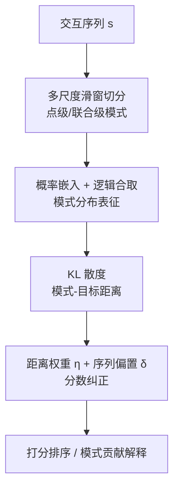
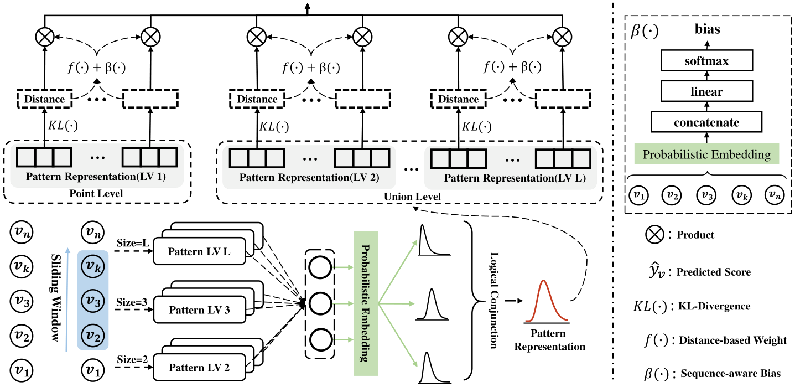

# Pattern-wise Transparent Sequential Recommendation (模式级透明序列推荐)

- **会议/期刊**: IEEE TKDE
- **作者与机构**: Kun Ma, Cong Xu, Zeyuan Chen, Wei Zhang（华东师范大学；蚂蚁集团）
- **推荐链路定位**: 精排（Next-Item 打分）
- **研究方向**: 序列与会话推荐 / 可解释推荐
- **论文原文**: [论文原文链接](https://arxiv.org/abs/2402.11480v5)
- **开源代码**: 暂未开源

## TL;DR (1分钟核心速览)

现有可解释序列推荐陷入两难：透明模型（NAIS/RUM）只能做点级归因且性能落后 SOTA 约 17.6%，而 SASRec 类黑盒注意力权重与真实决策不一致。PTSR 用多尺度滑窗把序列显式切成点级/联合级模式作为原子决策单元，以 Gamma/Beta 概率嵌入 + 逻辑合取算子建模模式，用 KL 散度度量模式-目标距离，并设计距离权重与序列偏置隐式学习关键模式。在 5 个数据集、Real-plus-N（1 正 + 100 负）采样排序协议下，平均较最强基线提升 5.23%，Beauty 上 HR@10 相对提升 10.49%。

## Background & Motivation (背景与核心矛盾)

- **主流范式**: 序列推荐以 SASRec/BERT4Rec 的自注意力堆叠为主流，靠注意力热力图充当"解释"；透明路线则以 NAIS/RUM 的目标注意力显式计算历史物品相关性。
- **前人局限**: 其一，透明模型仅建模低阶点级关系、无序列信息，性能显著劣化；其二，注意力权重被 Jain & Wallace 等工作质疑与输出分布不一致，深层非线性使决策不可分解；其三，池化/GRU 融合把模式压成向量空间固定点，丢失物品组合效应，图网络则使高阶模式成分与贡献模糊。
- **核心洞察 (Key Insight)**: 用户兴趣既由单个物品（点级）也由物品共现子序列（联合级）共同驱动，而真实场景**没有关键模式的 ground-truth**，因此必须让模式贡献在无监督信号下"隐式"浮现。
- **本文切入点**: 保持架构级透明（无深层非线性），转而用概率嵌入提升模式表征精度来补回性能，并用距离权重纠正朴素距离求和的失效。

## Method (核心方法设计)

### 1. 整体框架 (Overall Architecture)

输入为用户交互序列 $s=[v_1,\dots,v_n]$。首先用尺寸$l=1,\dots,L$的多尺度滑窗从左到右切出各级模式$p_k^{(l)}=[v_k,\dots,v_{k+l-1}]$；每个物品以概率分布参数（Gamma 的$(\alpha,\beta)$或 Beta 的双形状参数）表示，模式内物品经概率合取算子融合为模式分布；随后对每个候选物品计算模式分布与目标分布的 KL 散度，经距离权重$\eta$与序列偏置$\delta$加权聚合得到最终打分$\hat{y}_v$，按分数排序输出 Top-N，同时各模式权重即为可读解释。

<figure class="paper-figure" markdown="span">
  <figcaption>图 2. PTSR 的架构：该框架采用多尺度滑动窗口进行模式提取，利用概率嵌入与逻辑算子进行模式表示，并通过 KL 散度结合权重与偏置计算目标分数。</figcaption>
</figure>

### 2. 关键设计拆解 (Key Designs)

1. **概率合取的模式表征（替代池化/GRU）**：痛点是把模式压成加权平均向量只能刻画相似性、无法表达组合语义。本文将模式内各物品分布按 PDF 加权乘积做合取，标量形式为 $\prod_i f^{w_i}(\alpha_i,\beta_i)\propto f(\sum_i w_i\alpha_i,\sum_i w_i\beta_i)$，向量化后得$p_k=(\sum_i w_i\odot\alpha_{v_i},\ \sum_i w_i\odot\beta_{v_i})\in\mathbb{R}^{2d}_+$，权重$w_i$由对$\alpha_{v_i}\oplus\beta_{v_i}$ 的 MLP+softmax 自适应给出。直觉：合取后的分布刻画"多个分布彼此一致的程度"，天然表达物品共现的组合约束，且全程可分解、可追溯。

2. **距离权重 + 序列偏置的分数纠正（无标签下的关键模式学习）**：直接最小化距离和会失效——训练初期关键模式距离迅速下降后，模型转而压低噪声模式距离，导致各模式贡献趋同；且"距离求和"无法区分"某模式对 $v_1$距离 0.1、对$v_2$距离 0.8"与"另一模式对两者均约 4.5"这两种本质不同的支持结构。为此将负距离 softmax 化为权重$\eta_{p_k^{(l)}}^{v}=\frac{\exp(-\text{Dis}_{p_k^{(l)}}^{v})}{\sum_j\exp(-\text{Dis}_{p_j^{(l)}}^{v})}$，同级内竞争、跨级协作；再叠加序列偏置$\delta_k^{(l)}=[\text{Softmax}(\text{MLP}^{(l)}(e_1\oplus\cdots\oplus e_n))]_k$（$e_i=\alpha_i/(\alpha_i+\beta_i)$，将参数量减半），弥补滑窗对"整段序列反转"不敏感的盲区。最终打分为$\hat{y}_v=\sum_{l=1}^{L}\big[\sum_{k=1}^{n-l+1}(\eta_{p_k^{(l)}}^{v}+\lambda\delta_k^{(l)})\cdot(\gamma-\text{Dis}_{p_k^{(l)}}^{v})\big]$，$\gamma$ 为 margin 防止得分恒非正。

3. **训练目标与复杂度**：采用 BCE 损失 $\ell=-\log\sigma(\hat{y}_{v^+})-\log\sigma(-\hat{y}_{v^-})$，每个正样本均匀采样 1 个负样本（无难负采样、无额外特征）。复杂度约$O(nL^2d^2)$，因最优$L\in\{2,3\}$，与标准自注意力$O(nd^2+n^2d)$ 同量级。

## Experimental Setup & Evaluation Protocol (实验设置与评估协议)

- **数据集与预处理**: 均按 `5-core` 过滤用户与物品。

| 数据集 | #Users | #Items | #Interactions | 稀疏度 | 场景说明 |
| :--- | :---: | :---: | :---: | :---: | :--- |
| Beauty | 22,363 | 12,101 | 198,502 | 99.93% | Amazon 高稀疏美妆 |
| Toys | 19,412 | 11,924 | 167,597 | 99.99% | Amazon 玩具 |
| Tools | 16,638 | 10,217 | 134,476 | 99.92% | Amazon 工具 |
| Yelp | 30,431 | 20,033 | 316,354 | 99.95% | 商户点评 |
| Sports | 331,844 | 103,911 | 2,835,125 | 99.99% | Amazon 运动（大规模） |

- **数据划分与防穿越**: `Leave-One-Out`，倒数第二项作验证、最后一项作测试。
- **排名评测协议**: `Sampled Ranking`，采用 Real-plus-N 协议——每个测试样本随机抽 100 个未交互物品与真值组成 101 候选集排序，报告 NDCG@{5,10} 与 HR@{5,10}。**注意：非 Full-Ranking，绝对数值偏高，跨论文比较需谨慎。**
- **对比基线与超参**: 四组共 11 个基线（传统 Caser/GRU4Rec/MSGIFSR；透明 NAIS/RUM/PMAN；注意力 SASRec/BERT4Rec；新嵌入 STOSA/CBox4CR/SRPLR）。$\alpha$或$\beta$维度固定 64，学习率 5e-4，batch 512，最大序列长 20，$\gamma=2$，$L=3$（Yelp）或$2$（其余），5 次独立运行配对 t 检验（$p<0.01$）。

## Key Experimental Results (实验关键数据)

### 1. 主实验对比 (Main Results)

| 数据集 | 指标 | SASRec | BERT4Rec | CBox4CR | SRPLR | PTSR-G | Improv. |
| :--- | :---: | :---: | :---: | :---: | :---: | :---: | :---: |
| Beauty | HR@10 | 0.4832 | 0.4987 | 0.5044 | 0.5024 | **0.5573** | +10.49% |
| Beauty | N@10 | 0.3270 | 0.3361 | 0.3297 | 0.3517 | **0.3747** | +6.54% |
| Toys | HR@10 | 0.4925 | 0.4786 | 0.4848 | 0.5035 | **0.5347** | +6.20% |
| Toys | N@10 | 0.3208 | 0.3139 | 0.3116 | 0.3495 | **0.3614** | +3.40% |
| Tools | HR@10 | 0.3885 | 0.4067 | 0.3832 | 0.3813 | **0.4534** | +11.48% |
| Tools | N@10 | 0.2427 | 0.2523 | 0.2289 | 0.2408 | **0.2853** | +13.08% |
| Yelp | HR@10 | 0.7639 | 0.7599 | 0.8026 | 0.7797 | **0.8138** | +1.40% |
| Yelp | N@10 | 0.4875 | 0.5032 | 0.5156 | 0.5113 | **0.5487** | +6.42% |
| Sports | HR@10 | 0.6196 | 0.6115 | 0.6115 | 0.6166 | **0.6321** | +2.02% |
| Sports | N@10 | 0.4208 | 0.4305 | 0.4128 | 0.4201 | **0.4388** | +1.93% |

透明基线 NAIS/RUM/PMAN 整体落后 SOTA 序列模型约 17.6%，而 PTSR 在全部 5 个数据集、4 个指标上均显著最优（$p<0.01$）。

### 2. 消融实验 (Ablation Study)

| 变体 | Beauty N@10 | Toys N@10 | Tools N@10 | Yelp N@10 |
| :--- | :---: | :---: | :---: | :---: |
| Default (PTSR-G) | **0.3747** | **0.3614** | **0.2815** | **0.5498** |
| w/o W（去距离权重） | 0.3337 | 0.3306 | 0.2089 | 0.4725 |
| w/o B（去序列偏置） | 0.3593 | 0.3355 | 0.2754 | 0.5454 |
| w/o W+B | 0.2832 | 0.2548 | 0.2003 | 0.4646 |
| Replace KL（改余弦） | 0.2720 | 0.2208 | 0.2165 | 0.4029 |
| Replace ProbE（改普通嵌入） | 0.2533 | 0.2294 | 0.2077 | 0.3973 |

### 3. 关键实验发现 (Key Findings)

1. **距离权重是性能第一支柱**：去掉 W 后 Tools N@10 从 0.2815 暴跌至 0.2089（−25.8%），Yelp 从 0.5498 降至 0.4725；W+B 同时移除则整体下滑 15%–30%，说明"同级竞争性归一化"是让关键模式从噪声模式中脱颖而出的必要条件。
2. **概率嵌入 > KL 散度 > 权重/偏置的贡献排序**：Replace ProbE 在四个数据集上均比 Replace KL 更差（如 Beauty 0.2533 vs 0.2720），表明收益主要来自概率分布表征本身，KL 散度只是放大其优势；KL 的非对称性（"先买电脑再买桌"≠反之）契合推荐的方向性。
3. **多级模式互补但非越多越好**：单级中 level-1 最强（Beauty N@5 0.3268），组合 {1,2} 最优（0.3404），再加 level-3 反而降至 0.3367；仅 Yelp 因序列更长（均值 10.39）在 {1,2,3} 上最优。关键物品召回上，PTSR 在 Bought-together 关系 Recall@1 达 53.41/64.16/69.67（Beauty/Toys/Tools），远超 RUM 的 32.63/45.13/42.89。

## Highlights & Limitations (亮点、对比与审稿批判)

- **与代表作对比 (vs. Prior Work)**: 相比 NAIS/RUM 的目标注意力，PTSR 把解释单元从"单个物品"升级为"可分解的子序列模式"，且不牺牲性能；相比 SASRec/BERT4Rec，其决策路径无深层非线性，模式贡献即打分构成项，解释与决策天然一致；相比 STOSA/CBox4CR/SRPLR 等新嵌入模型，本文首次把概率逻辑算子用于**序列模式**而非静态图谱查询。
- **可迁移亮点**: ①"负距离 softmax 归一化 + margin 截断"可作为通用技巧，用于任何以距离为打分的可解释检索/匹配模块；②用 $\alpha/(\alpha+\beta)$ 压缩分布参数喂入 MLP，可减半参数并保留序信息，适合轻量位置编码替代方案。
- **审稿级局限批判**: ①评估采用 1:100 采样排序而非 Full-Ranking，绝对指标被系统性抬高，且未报告全库排序结果，与 SASRec 类文献的可比性受限；②合取算子仅覆盖**连续**子序列，无法建模序列中远距离物品构成的模式，且缺少否定算子，无法表达用户负反馈；③softmax 权重在长序列下区分度衰减，论文自承对长序列可能退化，而实验中最大序列长仅设为 20，未验证真实长序列场景。

## Rating (四维评分)

- **方法创新性 (Novelty)**: ⭐⭐⭐⭐ （首次将概率逻辑合取引入序列模式建模，实现架构级透明而非事后归因，思路清晰但组件均为已有算子的重组）
- **评估协议与实验扎实度 (Protocol & Experiments)**: ⭐⭐⭐ （5 数据集 + 11 基线 + 配对 t 检验 + 消融/层级/超参/稳定性分析齐全，但仅用 1:100 采样排序、缺 Full-Ranking 与线上验证）
- **写作与数学规范度 (Clarity & Rigor)**: ⭐⭐⭐⭐ （公式推导与复杂度分析完整，符号表规范；模式贡献与打分的关系阐释到位，个别记号如 $\eta$ 上下标略密）
- **工业落地与复现价值 (Industrial & Practical Value)**: ⭐⭐⭐ （复杂度与注意力同量级、无需额外特征，解释可直接面向用户；但未开源、滑窗模式数随 $L$ 增长，长序列工程化需额外裁剪）

