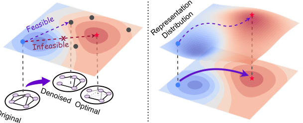
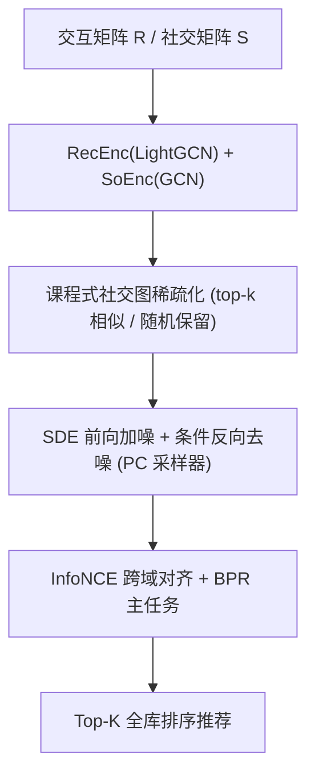

# Score-based Generative Diffusion Models for Social Recommendations (面向社交推荐的分数匹配生成式扩散模型)

- **会议/期刊**: IEEE Transactions on Knowledge and Data Engineering (TKDE)
- **作者与机构**: Chengyi Liu, Jiahao Zhang, Shijie Wang, Wenqi Fan, Qing Li（香港理工大学 COMP / MM）
- **推荐链路定位**: 召回（社交增强的用户表征学习）
- **研究方向**: 社交与群组推荐 / 自监督对比学习与交互去噪
- **论文原文**: [https://arxiv.org/abs/2412.15579v2](https://arxiv.org/abs/2412.15579v2)
- **开源代码**: [https://github.com/Coder-Yu/QRec](https://github.com/Coder-Yu/QRec)

## TL;DR (1分钟核心速览)

真实社交网络普遍存在低同质性（三个数据集 graph-wise homophily rate 均 < 0.01），原始社交边会向用户表征注入冗余噪声。本文放弃"改图"的数据中心范式，提出 SGSR：把 GCN 传播后的社交表征送入 SDE 扩散过程，以协同域表征为条件做 classifier-free 引导去噪，直接生成与协同信号一致的社交表征；再用课程式稀疏化训练解决"无监督真值"难题，并以 InfoNCE 对齐两个域。在 Ciao/Epinions/Dianping 上采用 8:1:1 划分与 Full-Ranking 全库排序，Recall@10 相对最强基线提升 2.87%/3.07%/1.85%。

## Background & Motivation (背景与核心矛盾)

- **主流范式**: 社交推荐依赖 social homophily 假设，用 GNN（DiffNet/MHCN）或 SSL（SEPT）把社交图与交互图联合传播；近年出现数据中心（data-centric）去噪，即按手工相似度删边/重连（SHaRe、GBSR、GDMSR）。
- **前人局限**: 其一，删边依赖 cosine 等**手工相似度度量**，泛化性差且只能做一跳局部修改，得到的表征只是"次优暗点"而非"最优红星"（图 2a）；其二，图编辑的表达能力受限于预定义候选集，多跳扩展还会引发局部/全局最优冲突，且消息传递本身仍带噪。
- **核心洞察 (Key Insight)**: 最优社交表征未必对应任何可枚举的图结构，但**其分布可以被建模**——若能学到社交表征的潜在分布，就能绕过所有图结构修订，直接采样出协同一致的表征。
- **本文切入点**: 用 SDE 形式的 score-based 生成模型（SGM）在连续时间上对社交隐表征做"预测-校正"式去噪，条件为用户的协同表征。

<figure class="paper-figure" markdown="span">
  <figcaption>图 2：不同社会去噪方法如何提升社会信号与协同信号一致性的示意图。红色表示高一致性，蓝色表示低一致性。现有以数据为中心的方法（子图 a）通过修改社会图结构间接增强协同一致性，但由于手工设计的相似度度量和表达能力限制，可能无法获得最优的社会表示。相比之下，所提出的生成式社会去噪范式（子图 b）捕捉社会图的潜在分布，直接生成</figcaption>
</figure>

## Method (核心方法设计)

### 1. 整体框架 (Overall Architecture)

输入为交互矩阵 $R$与社交矩阵$S$。先用 LightGCN 编码协同域得到用户/物品表征$E_R^{(L)}$，用 GCN 编码社交域得到$E_S^{(L)}$；随后以$(e_R^{(L)})_u$为条件，对$(e_S^{(L)})_u$执行前向 VP/VE-SDE 加噪与反向 SDE 去噪，得到去噪社交表征$\hat{E}_S^{(L)}$；训练阶段由课程机制动态稀疏化社交图以构造"易到难"的分布序列，最终以 BPR 主任务 + InfoNCE 跨域对齐联合优化。

### 2. 关键设计拆解 (Key Designs)

1. **协同条件化的 Classifier-free 去噪（Collaboratively Controlled Denoising）**：常规条件扩散需按 Bayes 规则训练分类器估计 $\nabla_x\log p_t(c|x_t)$，但推荐场景用户数上万、等价于上万类，逐噪声尺度训练分类器不可行。作者将协同表征$c=(e_R^{(L)})_u$ 视为**解耦伪标签**，借助 Tweedie 公式把条件分数匹配化简为可闭式求导的去噪匹配目标：
$$\min_\theta\ \mathbb{E}_t\Big[\lambda(t)\mathbb{E}_{x_0}\mathbb{E}_{x_t|x_0,c}\big\|s_\theta(x_t,t,c)-\nabla_{x_t}\log p_{0t}(x_t|x_0)\big\|^2\Big]$$
其中 $p_{0t}$ 对 VP/VE-SDE 均有高斯闭式解。直觉上，这把"生成什么"的控制权交给了用户真实行为，而非人工设定的图结构。

2. **课程驱动训练（Curriculum-Driven Training）**：社交去噪没有 ground-truth 最优表征，无法像图像复原那样算重建损失。作者设计两阶段稀疏化：第一阶段保留协同相似度 top 的 $\rho$比例社交边（用户级、易学），第二阶段随机保留$\hat{\rho}$ 比例（全网级、更难），使 SGM 在递增稀疏度的分布序列上学习，从而"覆盖"潜在最优表征所在区域，最终由推荐信号隐式挑选。

3. **训练目标、负采样与推理效率**：总损失 $\mathcal{L}=\mathcal{L}_{Diff}+\lambda_1\mathcal{L}_{BPR}+\lambda_2\mathcal{L}_{cl}$，其中$\mathcal{L}_{cl}$为 InfoNCE，用 MLP 投影后最大化$\hat{e}_u$与$p_u$ 的余弦一致性以消除 Wiener 过程与曝光偏差引入的残余噪声。负采样为每正例配 1 个均匀负例。推理用 Predictor-Corrector（Euler–Maruyama + Langevin MCMC）求解反向 SDE；由于扩散作用在用户隐表征而非图结构上，计算开销**不随图规模增长**，这是相对图扩散方法的可扩展性优势。

## Experimental Setup & Evaluation Protocol (实验设置与评估协议)

- **数据集与预处理**: 仅保留评分 > 3 的交互转为隐式反馈，过滤交互数 < 3 的用户与物品（3-core 式过滤）：

| 数据集 | #Users | #Items | #Interactions | 交互密度 | 社交边数 / 同质性 |
| :--- | :---: | :---: | :---: | :---: | :--- |
| Ciao | 7,317 | 104,975 | 283,319 | 0.0368% | 111,781 / 0.0071 |
| Epinions | 18,088 | 261,649 | 764,352 | 0.0161% | 355,813 / 0.0015 |
| Dianping | 147,918 | 11,123 | 2,149,675 | 0.1306% | 629,618 / 0.0028 |

- **数据划分与防穿越 (Splitting Strategy)**: 训练/验证/测试按 **8:1:1 比例划分**（非 Leave-One-Out，非时间戳切分）。
- **排名评测协议 (Ranking Protocol)**: 无偏 **Full-Ranking 全库未交互物品排序**，指标 Recall@{5,10} 与 NDCG@{5,10}；Epinions 额外报告 @{3,20,40}。所有实验重复 5 次取均值。
- **对比基线与超参设置**: 覆盖三类基线——原生社交推荐（SocialMF、NGCF、LightGCN、DiffNet、SEPT、MHCN）、扩散推荐（DiffRec、DreamRec、DreamRec+、BSPM、GiffCF）、社交图去噪（DESIGN、DSL、GBSR、SHaRe、EIISRS、RecDiff、GDSSL）。嵌入维度 $d\in\{32,64,128,256\}$，3 层 GNN，Adam lr=0.001，batch 1024/2048，扩散步$T\in\{3,5,10,30,50,100\}$，$\rho,\hat{\rho}\in\{0.7,\dots,0.9\}$，$\tau\in\{0.05,0.1,0.5\}$。

## Key Experimental Results (实验关键数据)

### 1. 主实验对比 (Main Results)

| 方法 (Ciao / Epinions / Dianping) | Ciao R@10 | Ciao N@10 | Epinions R@10 | Epinions N@10 | Dianping R@10 | Dianping N@10 |
| :--- | :---: | :---: | :---: | :---: | :---: | :---: |
| LightGCN | 0.0579 | 0.0392 | 0.0428 | 0.0295 | 0.0526 | 0.0361 |
| SEPT | 0.0599 | 0.0403 | 0.0445 | 0.0291 | 0.0671 | 0.0451 |
| MHCN | 0.0627 | 0.0412 | 0.0456 | 0.0303 | 0.0699 | 0.0463 |
| DESIGN | 0.0623 | 0.0411 | 0.0451 | 0.0301 | 0.0701 | 0.0458 |
| GBSR | 0.0585 | 0.0405 | 0.0443 | 0.0288 | 0.0699 | 0.0464 |
| SHaRe | 0.0617 | 0.0407 | 0.0454 | 0.0304 | 0.0687 | 0.0453 |
| RecDiff | 0.0604 | 0.0404 | 0.0445 | 0.0293 | 0.0689 | 0.0463 |
| GDSSL | 0.0627 | 0.0408 | 0.0431 | 0.0277 | 0.0676 | 0.0456 |
| **SGSR (Ours)** | **0.0645** | **0.0425** | **0.0470** | **0.0315** | **0.0714** | **0.0482** |
| **Improv.%** | +2.87% | +2.66% | +3.07% | +3.62% | +1.85% | +3.88% |

在 Epinions 的 @{3,20,40} 扩展评测中，SGSR 的 R@3 达 0.0205（较 RecDiff 的 0.0187 提升 9.63%），N@40 达 0.0450（+4.17%），说明收益在头部与长尾截断位置均成立。

### 2. 消融实验 (Ablation Study)

| 变体 / 替代方案 | Ciao R@10 | Ciao N@10 | Epinions R@10 | Epinions N@10 |
| :--- | :---: | :---: | :---: | :---: |
| **SGSR (VP-SDE)** | **0.0645** | **0.0425** | **0.0470** | **0.0315** |
| w/o sgm（传统数据增广替代扩散） | 显著下降 | 显著下降 | 显著下降 | 显著下降 |
| w/o cur（去掉课程训练） | 下降 | 下降 | 下降 | 下降 |
| w/o ssl（MLP 融合替代 InfoNCE） | 最大降幅 | 最大降幅 | 最大降幅 | 最大降幅 |
| SGM (VE-SDE) | 0.0630 | 0.0419 | 0.0453 | 0.0295 |
| SGM (VP-SDE w/o predictor) | 0.0614 | 0.0416 | 0.0420 | 0.0303 |
| DDPM | 0.0615 | 0.0415 | 0.0417 | 0.0290 |
| NCSN | 0.0611 | 0.0412 | 0.0408 | 0.0287 |
| VAE | 0.0607 | 0.0411 | 0.0401 | 0.0282 |

### 3. 关键实验发现 (Key Findings)

1. **扩散去噪本身是主增益来源，但"连续 SDE + PC 采样器"才是关键**：VP-SDE 比离散 DDPM 高 0.0030（Ciao R@10，0.0645 vs 0.0615），去掉 predictor 后即退化到 DDPM 水平，证明收益来自连续时间求解而非"用了扩散"这一标签。
2. **课程训练与跨域对齐缺一不可，且 SSL 贡献最大**：去掉 SSL 的降幅超过去掉 SGM，说明扩散生成的表征若不经 InfoNCE 注入协同域，其价值无法兑现；而去掉课程训练（直接用原始社交图）同样掉点，反证原始社交图确实含噪。
3. **去噪后的表征仍保留真实社交结构**：在 Ciao 上以 top-K 余弦相似预测一阶社交边，SGSR 的 R@20=0.1996 / HR@20=0.8234，优于 GDSSL（0.1866 / 0.7996）与 LightGCN（0.0213 / 0.2667），说明"过滤噪声"并未摧毁社交信号本身。此外最优扩散步仅 $T=5$，步数增大反而因过度扰动掉点，VP-SDE 在 5–50 步区间稳定优于 VE-SDE。

## Highlights & Limitations (亮点、对比与审稿批判)

- **与代表作对比 (vs. Prior Work)**: SHaRe/GBSR 在**图结构空间**做离散删边，受限于手工相似度与一跳候选；RecDiff/GDSSL 虽用扩散，但 RecDiff 仅在隐空间做 DPM 精修、GDSSL 直接对邻接矩阵做离散扩散，均未把"协同信号作为生成条件"显式注入；SGSR 的差异在于**在表征空间做连续 SDE 生成并以协同表征为 classifier-free 条件**，从而绕开图编辑的组合爆炸。
- **可迁移亮点**: (1) 把"无真值的去噪任务"转化为"课程式分布序列学习 + 下游任务隐式选优"，可迁移到任何缺乏监督信号的图净化场景；(2) 用解耦伪标签替代显式分类器实现条件扩散，避免了万级类别的分类器训练开销。
- **审稿级局限批判**: (1) 推理需逐步求解反向 SDE，训练耗时 7.6s/18.3s/57.1s 与 DESIGN、GBSR 相当甚至略高，显存 3,299/15,643 MiB 亦非优势，在线部署需一致性模型蒸馏；(2) 8:1:1 随机划分对社交推荐偏乐观，缺少时间切分与冷启动用户分桶实验，且课程保留率 $\rho,\hat{\rho}$ 需逐数据集网格搜索，超参敏感度较高。

## Rating (四维评分)

- **方法创新性 (Novelty)**: ⭐⭐⭐⭐ （首次将 SDE 分数匹配生成范式用于社交去噪，classifier-free 条件化推导有理论支撑，但"扩散去噪"本身在 RecDiff/GDSSL 中已有雏形）
- **评估协议与实验扎实度 (Protocol & Experiments)**: ⭐⭐⭐⭐ （三数据集 + Full-Ranking + 5 次重复 + 18 个基线覆盖全面，消融含生成模型与编码器替换，但缺时间切分与冷启动分桶）
- **写作与数学规范度 (Clarity & Rigor)**: ⭐⭐⭐⭐ （SDE 前向/反向、Tweedie 化简与复杂度分析推导完整，符号体系清晰；部分实验图仅给曲线未给数值表）
- **工业落地与复现价值 (Industrial & Practical Value)**: ⭐⭐⭐ （代码基于 QRec 生态易复现，扩散作用于用户隐表征使开销不随图规模增长，但多步采样延迟与显存开销限制线上直接部署）

